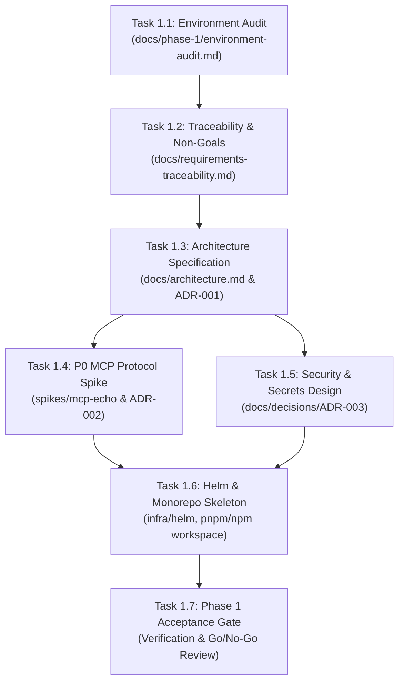

# Urumi AI FDE Internship — Canonical 8-Phase Master Roadmap & Phase 1 Execution Plan (Status Update: 19 Oct 2026)
## Technical Architecture, Phase 1 Work Order & Self-Verification Checklist
### 🛡️ 100% Free-Tier & Open-Source Stack (Zero Paid Subscriptions Required)

> **Status update — 19 October 2026:** This document remains the canonical eight-phase roadmap. The original target dates are preserved as historical targets; actual status and revised forecasts are recorded in Section 2–3. Phase 4 G9 is `READY FOR TECHNICAL HEAD ACCEPTANCE`, not formally accepted until the Technical Head records that decision. Phase 5 planning is submitted for review; **implementation HOLD remains active**. This planning update is a local review copy and has not been committed to the repository.

---

## 1. Goal Description & Zero-Cost Guarantee

This project builds a production-grade **Team Model Context Protocol (MCP) Gateway on Kubernetes** with a live **WooCommerce Store** as its foundational data source. 

> [!IMPORTANT]
> **Zero-Cost Commitment**:
> Every single tool, framework, and model used in this implementation is **100% free and open source**:
> - **External MCP Client**: Official open-source **MCP Inspector** (`@modelcontextprotocol/inspector`), which runs locally via `npx` with zero subscription or API key needed.
> - **Chat Agent LLM**: **Google Gemini API (Free Tier)** or local **Ollama** (100% free, runs locally on your machine).
> - **Kubernetes & Cloud Native Layer**: `k3d` (K3s in Docker), `kubectl`, `helm`, `traefik`/`ingress-nginx` (100% free open-source).
> - **Store & Database Layer**: WordPress, WooCommerce plugin, MariaDB (100% free open-source).
> - **Gateway & Dashboard**: Node.js/TypeScript, React/Vite (100% free open-source).
>
> You do **NOT** need a Claude subscription, ChatGPT Plus, or any paid cloud account.

---

## 2. Canonical 8-Phase Master Project Roadmap (Original Targets: Oct 9–26)

> **Roadmap governance:** This is the canonical master roadmap. Original target dates are retained as historical targets, not rewritten as actual completion dates. Current status reflects the best available repository/documentary evidence as of 19 October 2026. Phase 4 Gate G9 is reported complete by the implementation worker but remains **READY FOR TECHNICAL HEAD ACCEPTANCE** until a formal acceptance decision is recorded. Phase 5–8 remain incomplete.

| Phase | Original target dates (historical) | Objective / milestone outcome | Current status (19 Oct 2026) | Evidence recorded | Remaining work / dependencies |
| :--- | :--- | :--- | :--- | :--- | :--- |
| **Phase 1** | **Oct 9–10** | Foundation & technical validation: environment audit, requirements, ADRs, MCP echo spike, Helm/monorepo skeleton. | **Reported completed; prior phase documentation exists.** No new local environment verification was performed for this update. | `docs/phase-1/phase-1-completion-report.md`, `docs/architecture.md`, `docs/requirements-traceability.md`, ADRs; README reports Node 24.20.0, MCP SDK 1.32.1 and 4/4 echo-spike checks. | Preserve verified toolchain and architecture; re-run tests only under a bounded, approved verification work order. |
| **Phase 2** | **Oct 11–12** | Deploy WordPress/WooCommerce + MariaDB to local Kubernetes with PVCs, seed data and COD checkout. | **Completed/reported operational baseline.** This planning task did not query the live cluster or database. | Phase 2 runbooks/completion material; G9 report's protected-store and PVC comparison says products 10/11/12, Order #14 and three PVCs remained unchanged. | Keep the baseline intact; use disposable fixtures for any later tests. Do not mutate products 10/11/12 or Order #14. |
| **Phase 3** | **Oct 13–14** | Custom in-cluster WooCommerce MCP server exposing the required five tools. | **Reported complete and previously closed in project context.** G9 regression matrix reports the workload/tests still pass. | `docs/phase-3/phase-3-execution-log.md`, Phase 3 completion report/material, `apps/woocommerce-mcp/`; G9 reports 81 unit tests for this revision, which must be reconciled with older evidence counts. | Reconfirm current image/source and exact test baseline during Phase 5 G0; retain internal-only Service and WooCommerce REST credential isolation. |
| **Phase 4** | **Oct 15–17** | Team gateway: MCP aggregation/routing, dynamic upstream management, API-key verification, audit writes, SQLite persistence, security and deployment. | **Implementation worker recommends acceptance; formal Technical Head acceptance not evidenced.** Do not mark formally accepted yet. | `docs/phase-4/phase-4-execution-log.md`, `docs/phase-4/g9-e2e-acceptance-runbook.md`, attached Gate G9 report. G9 reports 10 tools, 350 unit + 10 protocol tests, Helm revision 9, `PRAGMA integrity_check=ok`, and stable protected baseline. | Technical Head must decide G9 acceptance and resolve ADR-012 status. P5 G0 must reconcile commit/image/chart/live cluster and route mismatch (`PUT .../credential` report vs `PATCH` source). Benchmark has a 1% failure at concurrency 10 and high p95 under concurrent load; don't overclaim. |
| **Phase 5** | **Oct 18–20** | Team platform/dashboard: browser identity, Admin/Member roles, upstream management, member management/API keys and audit table. | **Planning only; no implementation authorized. High schedule risk.** | Current source has reusable gateway/AdminService/upstream lifecycle, API-key primitives, audit writer/query repository, SQLite/PVC and security controls. Inspected frontend paths `apps/dashboard/package.json`, `src/main.tsx`, `vite.config.ts` returned 404. Planning documents are under `docs/phase-5/` in the review package, not yet committed to this repository. | Approve product brief, gap analysis and roadmap; release implementation hold separately; complete G0/G1 before coding. Add safe browser identity/session, browser route façade, React/Vite SPA, member/key lifecycle HTTP endpoints and audit retrieval/UI without duplicating existing backend capabilities. Target Phase 5 evidence by Oct 24 under revised schedule. |
| **Phase 6** | **Oct 21–22** | In-dashboard chat agent and external MCP client/User B; cross-server tool flow. | **Not started / pending.** | Original roadmap and `docs/requirements-traceability.md` define CHT-02/03/04 and EXT-01/02/03 as Phase 6 requirements; G9 proves gateway tools/protocol only, not a completed chat agent or final external-client demo. | Depends on Phase 5 accepted login/identity and stable gateway key workflow. Demonstrate one LLM tool loop as User A, a separate external MCP client authenticated as User B, and one cross-server workflow. Avoid any claim that the Phase 4 `/mcp` probe completes Phase 6. |
| **Phase 7** | **Oct 23–24** | Reliability and deployment hardening: failure tests, NetworkPolicies, non-root containers, production values/profile. | **Not started as a distinct phase; some relevant Phase 4 hardening is reported.** | G9 reports NetworkPolicy/RBAC isolation probes, non-root gateway, storage permissions, load benchmark, and local Helm validation. These are Phase 4 evidence and do not replace Phase 7 acceptance. | Run scoped reliability/hardening regression, validate `values-prod.yaml` and production-like manifests; review TLS/digest pinning/backup recovery gaps. VPS rollout is not automatically mandatory unless required by the original brief or explicitly approved. |
| **Phase 8** | **Oct 25–26** | Final DoD acceptance, demo recording, README/threat model, evidence and submission. | **Not started / pending.** Deadline is fixed. | The original assignment roadmap identifies final acceptance/demo/submission as separate deliverables. This planning task has not completed a final DoD run, video, or submission package. | Complete full end-to-end DoD only after P5–P7, collect evidence and known gaps, record formal decisions, prepare demo and submit by **26 Oct 2026, 11:59 PM IST**. |

### Status vocabulary used in this roadmap

- **Source-inspected:** implementation/code/document exists in the repository snapshot examined for planning. This does not prove a running deployment is current.
- **Worker-reported:** a completion report or execution log records a result, but this planning task did not rerun the test or independently query the live cluster.
- **Independently verified:** current exact command/runtime evidence was collected during a verification task. None of the Phase 4 live-cluster claims were independently rerun during this planning-only update.
- **Formally accepted:** an explicit Technical Head decision exists. Do not infer acceptance from `PASS`, `READY FOR TECHNICAL HEAD ACCEPTANCE`, or a worker report alone.

## 3. Current Project Status and Revised Delivery Forecast (19 Oct 2026)

The original Phase 5 window (18–20 October) is already compressed and the browser dashboard is not present in the inspected source tree. Seven calendar days remain until the submission deadline. The revised plan therefore prioritizes mandatory end-to-end journeys over optional polish and makes Phase 5 formal approval, G0 baseline capture, and G1 architecture decisions critical-path blockers.

| Date (IST) | Proposed focus | Gate / result | Stop condition |
| :--- | :--- | :--- | :--- |
| **Mon 19 Oct** | Technical Head review of G9 disposition and Phase 5 planning package; approve/reject browser identity, listener and key-ownership decisions. | Planning decision only. | No implementation until planning is approved and hold is explicitly released. |
| **Tue 20 Oct** | Read-only live/source reconciliation, record API contract and schema/session design. | P5-G0 and P5-G1. | Stop if source/image/Helm do not reconcile or private Admin perimeter cannot be preserved. |
| **Wed 21 Oct** | React/Vite workspace, browser listener/session shell, protected routes; start upstream read UI. | P5-G2, only if authorized. | `/mcp` compatibility, browser-session separation and external `/admin/v1/*` 404 must be preserved. |
| **Thu 22 Oct** | Upstream lifecycle UI and catalog/tool/status display; start member/key routes. | P5-G3. | No credential can be returned to browser; Admin mutation must be checked server-side. |
| **Fri 23 Oct** | Member invite/enrollment and API-key issue/list/revoke with ownership checks. | P5-G4. | Key exposure or cross-user access failure blocks progression. |
| **Sat 24 Oct** | Audit query/table, full P5 regression and Technical Head acceptance recommendation. | P5-G5/G6/G7 target. | Report failed/skipped tests honestly; don't call P5 accepted without sign-off. |
| **Sun 25 Oct** | Phase 6 chat-agent/external MCP client demonstrations; targeted Phase 7 hardening. | P6/P7, as feasible after P5. | If P5 slips, Technical Head must re-prioritize mandatory DoD; do not waive security silently. |
| **Mon 26 Oct** | Final regression, README/demo/evidence package and submission before 11:59 PM IST. | P8. | Reserve time for capture and packaging; freeze optional work. |

**Feasibility:** High risk. The timeline has little contingency for authentication, migrations, or ingress defects, and requires same-day decisions. If Phase 5 is not stable by 24 October, prioritize mandatory team/key/audit journeys and the assignment's Phase 6 demo; defer optional styling, expanded audit filters, and bonus capabilities. An explicit Technical Head re-prioritization is required if a mandatory journey will be missed.

**Planning artifacts for Phase 5 review:**
- [`docs/phase-5/phase-5-product-brief.md`](../../docs/phase-5/phase-5-product-brief.md)
- [`docs/phase-5/phase-5-gap-analysis.md`](../../docs/phase-5/phase-5-gap-analysis.md)
- [`docs/phase-5/phase-5-master-roadmap.md`](../../docs/phase-5/phase-5-master-roadmap.md)
- [`docs/phase-5/phase-5-risk-and-decision-register.md`](../../docs/phase-5/phase-5-risk-and-decision-register.md)
- [`docs/phase-5/phase-5-schedule-and-handoff.md`](../../docs/phase-5/phase-5-schedule-and-handoff.md)

---

## 4. Phase 1 Work Order (Detailed Task Breakdown)

### Task 1.1 / Task A — Environment Audit
- **Goal**: Establish concrete facts about the local machine without assumptions or destructive actions.
- **Observed Initial Facts**:
  - OS: Ubuntu 24.04 LTS (x86_64, 4 vCPUs, 7.6GB RAM, ~1.2GB available, 22GB disk free on `/`).
  - Docker: Docker 29.8.1 is active and accessible without sudo.
  - Node.js: v18.19.1; npm: 9.2.0.
  - Host Port 80: Occupied by host `nginx/1.24.0 (Ubuntu)`.
  - Host Port 8080 & 8443: Available.
  - Missing CLIs: `kubectl`, `helm`, `k3d` (will install to `~/.local/bin/`).
  - External Client: **MCP Inspector** (free, no subscription).
  - Git: Workspace `/home/rathore/Documents/Urumi Assignment` is not yet a git repository.
- **Output Artifact**: `docs/phase-1/environment-audit.md`

### Task 1.2 / Task B — Requirements Traceability & Non-Goals
- **Goal**: Map all 9 mandatory requirements directly to owning components and explicit verification tests.
- **Non-Goals Frozen for MVP**:
  - No multi-store dynamic provisioning (Bonus) until core passes.
  - No OAuth replacement for API keys (API keys are mandatory for DoD).
  - No complex vector search for tools (namespacing handles 3 servers cleanly).
  - No multi-replica cluster scaling until core is solid.
- **Output Artifact**: `docs/requirements-traceability.md`

### Task 1.3 / Task B & E — Architecture Specification (ADR-001)
- **Decisions Recorded**:
  - **D1 (Monorepo)**: npm workspaces with TypeScript for `apps/dashboard`, `apps/gateway`, `apps/mcp-woocommerce`, `apps/mcp-crm`, `apps/mcp-tasks`, and `packages/shared`.
  - **D2 (Persistence)**: MariaDB for WooCommerce (stateful PVC); SQLite / PostgreSQL for Gateway metadata & audit logs (with persistent volume).
  - **D3 (Service Boundaries)**: Gateway is single point of ingress for MCP traffic; upstreams are internal ClusterIP only.
  - **D4 (Kubernetes Engine)**: `k3d` (K3s in Docker) with ingress mapped to ports 8080/8443.
  - **D5 (Local Ingress & Domains)**: `127.0.0.1.nip.io` or `/etc/hosts` mappings (`shop.urumi.test`, `dashboard.urumi.test`, `mcp.urumi.test`).
- **Output Artifacts**: `docs/architecture.md`, `docs/decisions/ADR-001-stack-and-deployment.md`

### Task 1.4 / Task C — MCP Protocol Compatibility Proof (P0 Spike)
- **Goal**: Prove MCP Streamable HTTP (SSE) tool discovery and invocation with static API key headers using **100% free tools**.
- **Stack**:
  - Pin `@modelcontextprotocol/sdk` (latest stable v1.32.1).
  - Disposable test server in `spikes/mcp-echo/` exposing `echo_message({ message: string })`.
  - Client testing via **MCP Inspector** and automated node test client.
- **Verification Criteria**:
  1. Server launches on HTTP port with SSE endpoint.
  2. Protocol handshake succeeds.
  3. Client discovers `echo_message`.
  4. Client executes `echo_message` and asserts matching output.
  5. Static authentication header (`Authorization: Bearer <test-key>`) is validated on connection.
- **Output Artifact**: `docs/decisions/ADR-002-mcp-compatibility.md` + reproducible spike code.

### Task 1.5 / Task D — Security & Credential Storage Design (ADR-003)
- **Design Specifications**:
  - **Gateway User API Keys**: Generated cryptographically (`urumi_sec_...`), shown once to user, stored hashed (SHA-256 / bcrypt) in Gateway DB. Immediate revocation via status flag.
  - **Static Platform Credentials**: Database passwords, WooCommerce master consumer secret, JWT secrets provided via Kubernetes Secrets.
  - **Admin-Registered Dynamic Upstream Credentials**: Stored securely as Kubernetes Secrets in a dedicated namespace (`urumi-gateway-secrets`), managed via Gateway's dedicated `ServiceAccount` and namespaced RBAC.
  - **Credential Leakage Prevention**: Upstream credentials injected in Gateway memory only; stripped from all API responses, tool outputs, and audit logs.
- **Output Artifact**: `docs/decisions/ADR-003-secrets-and-access.md`

### Task 1.6 / Task E & F — Monorepo & Helm Skeleton
- **Monorepo Scaffolding**:
  - `git init`, `.gitignore`, root `package.json` with workspaces, TypeScript config.
  - Directory layout: `apps/dashboard`, `apps/gateway`, `apps/mcp-woocommerce`, `apps/mcp-crm`, `apps/mcp-tasks`, `packages/shared`, `infra/helm`.
- **Helm Scaffold**:
  - `infra/helm/urumi-platform/` with `Chart.yaml`, `values.yaml`, `values-local.yaml`, `values-prod.yaml`.
  - Validate with `helm lint` and `helm template`.
- **Output Artifacts**: `infra/helm/`, `README.md` (bootstrap instructions).

---

## 5. User Review Required & Critical Decisions

> [!IMPORTANT]
> **Host Port 80 Conflict**:
> The host machine is already running `nginx/1.24.0` on port 80.
> **Decision**: Map local k3d cluster ingress to port **8080** (HTTP) and **8443** (HTTPS) so we never touch or disrupt your host nginx.

> [!IMPORTANT]
> **Zero-Cost External Client (No Claude Subscription Needed)**:
> Urumi explicitly specifies:
> *"Connect Claude Code, Cursor or **MCP Inspector** to the gateway using only the gateway URL and user B's API key."*
> We will use **MCP Inspector**, the official free open-source GUI client designed by the MCP maintainers. It runs locally with a single command (`npx @modelcontextprotocol/inspector`) and requires zero API keys or subscriptions.

> [!IMPORTANT]
> **Zero-Cost Chat LLM**:
> Urumi's brief explicitly states:
> *"The model, provider and design are your choice. A free tier or a local model is fine. We grade that the tool loop works, not the quality of the model's answers."*
> We will use **Google Gemini Free Tier** (or local **Ollama** if preferred), which costs $0.00.

---

## 6. Interactive Self-Verification Checklist (For Aditya)

You can copy this checklist or use it directly to independently verify and tick off every milestone before authorizing Phase 2.

### 📋 Phase 1 Verification Checklist

#### Gate 1: Environment Audit
- [ ] `docs/phase-1/environment-audit.md` exists and contains actual CLI outputs.
- [ ] Verified host RAM (7.6GB total, ~1.2GB available) and disk (22GB available).
- [ ] Confirmed host port 80 is occupied by nginx, and port 8080 is selected for cluster ingress.
- [ ] Verified `kubectl`, `helm`, and `k3d` are installed in `~/.local/bin` and print their versions.

#### Gate 2: Scope & Traceability
- [ ] `docs/requirements-traceability.md` maps all 9 mandatory requirements to owning components.
- [ ] Non-goals for Round 1 (no multi-store bonus, no OAuth, no search clustering) are clearly frozen.

#### Gate 3: Architecture & Decision Records
- [ ] `docs/architecture.md` documents 4-tier model (Store, WooCommerce MCP, Gateway, Chat Agent).
- [ ] `docs/decisions/ADR-001-stack-and-deployment.md` approves TypeScript monorepo & k3d.
- [ ] Upstream MCP servers defined (WooCommerce MCP + CRM MCP + Tasks/Notes MCP).

#### Gate 4: MCP Protocol Compatibility Spike (P0) — 100% Free
- [ ] Spike server in `spikes/mcp-echo/` starts with `@modelcontextprotocol/sdk`.
- [ ] Streamable HTTP / SSE endpoint accepts incoming client connection.
- [ ] Client successfully discovers `echo_message` tool via protocol.
- [ ] Client executes `echo_message` and receives exact echoed response.
- [ ] Static header authorization (`Authorization: Bearer <key>`) verified.
- [ ] External client verification using **MCP Inspector** (`npx @modelcontextprotocol/inspector`) without any paid subscription.
- [ ] `docs/decisions/ADR-002-mcp-compatibility.md` records exact SDK versions and protocol evidence.

#### Gate 5: Security & Credentials Design
- [ ] `docs/decisions/ADR-003-secrets-and-access.md` defines user API key hashing & revocation flow.
- [ ] Upstream credential isolation documented: stored in K8s Secrets, never sent to browser or client.
- [ ] Dedicated ServiceAccount and namespaced RBAC model defined for Gateway secrets access.

#### Gate 6: Repository & Helm Baseline
- [ ] Git repository initialized with clean `.gitignore` (no credentials, no node_modules).
- [ ] Monorepo `package.json` with workspaces configured.
- [ ] Helm chart in `infra/helm/urumi-platform/` passes `helm lint`.
- [ ] `helm template urumi infra/helm/urumi-platform -f infra/helm/urumi-platform/values-local.yaml` renders successfully without errors.
- [ ] `README.md` documents exact commands to reproduce Phase 1.
