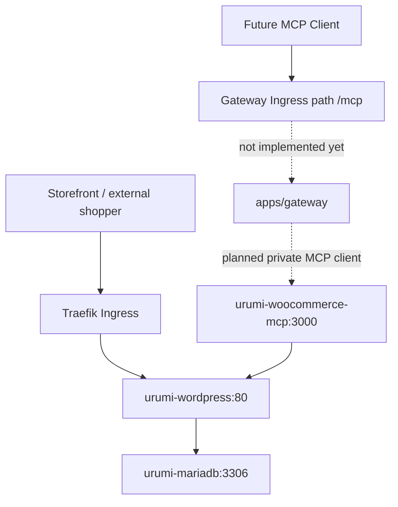
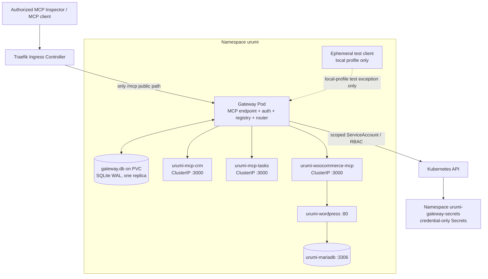

# Urumi — Phase 4 Master Technical Roadmap and Execution Checklist

**Project:** Urumi — Kubernetes-Based MCP Gateway for WooCommerce  
**Phase:** 4 — Team MCP Gateway Core: Aggregation, Routing, Security and Reliability  
**Document status:** **DRAFT — Submitted for Technical Head Review; Implementation HOLD Remains in Effect**  
**Prepared by:** Product Manager AI  
**Prepared on:** 15 October 2026  
**Repository reviewed:** `AdityaDRathore/MCP-Gateway-Kubernetes-Wcom` (default branch content inspected; actual current HEAD must be captured during G0)  
**Target repository path after approval:** `docs/phase-4/phase-4-master-technical-roadmap-and-checklist.md`  
**Execution target:** Local `k3d-urumi` cluster, namespace `urumi`, unified Helm chart `infra/helm/urumi-platform`  
**Approval authority:** Technical Head / Technical Lead  

> **Governance notice — this document is planning only.** It does not authorize Phase 4 implementation. No implementation, source/configuration edit, commit, push, deployment, resource deletion, Secret rotation, or mutation of the live store is authorized by this roadmap. The Technical Head must approve the roadmap and the specified decision records before the coding agent begins implementation.

---

## 0. Executive Summary

Phase 4 builds the central Team MCP Gateway that makes tools from three separate MCP services available through one authenticated downstream MCP endpoint. It must route calls deterministically, isolate upstream failures, support dynamic upstream enable/disable and configuration, protect upstream credentials, persist gateway metadata and audit events, and run through the existing unified Helm chart.

The accepted Phase 3 foundation is:

1. `apps/woocommerce-mcp` — TypeScript/Node.js 24.20.0 service using `@modelcontextprotocol/sdk@1.32.1`, Express, Zod, and Streamable HTTP. It exposes exactly `list_products`, `create_product`, `list_orders`, `get_order`, and `update_order_status`.
2. `urumi-woocommerce-mcp` — internal `ClusterIP` Service on port 3000, with no public Ingress, NodePort, or hostPort.
3. WooCommerce REST access — the MCP service calls WordPress through the internal Service, but signs OAuth 1.0a requests using the canonical public WordPress URL because that is how the current installation verifies the signature. This is the existing accepted Phase 3 behavior; do not replace it with Basic Auth over plaintext HTTP.
4. Store baseline — products 10, 11, and 12; Order #14 (processing, INR 299.00, COD). These records are protected regression fixtures and must not be modified/deleted by Phase 4 tests.
5. Existing deployment assets — unified chart `infra/helm/urumi-platform`, local and production-like values, Node.js/npm workspace, MCP Deployment/Service/NetworkPolicy, and the Phase 3 runbooks and security register.

The repository completion reports record 120 Phase 3 tests passing and in-cluster integration working. Those results are accepted as reported for planning; this document does not claim to independently rerun them.

### Recommended revised gate sequence

The Phase 4 readiness review proposed G0–G7. This roadmap retains the G0–G7 intent but subdivides the work where a separate database/security boundary or technical proof requires a stop-and-review point:

| Gate | Name | Exit product |
|---|---|---|
| G0 | Repository, cluster and baseline preflight | Verified current state, protected-data fingerprint, resource and security inventory |
| G1 | Architecture and contract freeze | Approved ADRs, API/tool contracts, threat boundaries and acceptance matrix |
| G2 | Deterministic CRM and Tasks MCP upstreams | Two separately deployed mock MCP services with stable contract tests |
| G3 | Gateway skeleton and MCP protocol proof | Gateway HTTP/MCP entry point, health endpoints, strict config, protocol tests |
| G4 | SQLite persistence, API keys and audit foundation | Transactional schema/migrations, verified auth, durable audit, bootstrap procedure |
| G5 | Upstream client manager and tool aggregation | Three upstreams connect independently; namespaced dynamic tool catalog |
| G6 | Routing, timeouts and failure isolation | Deterministic tool routing, bounded calls, cancellation/recovery and circuit state |
| G7 | Dynamic upstream control plane and Secret lifecycle | Authenticated management API, atomic config behavior, Kubernetes Secret integration |
| G8 | Docker, Helm, Kubernetes and NetworkPolicy deployment | Non-root gateway + mock pods integrated into unified chart, private upstreams, tested policies |
| G9 | End-to-end acceptance, regression, runbooks and Phase 4 close | Evidence-backed GTW-01–GTW-11 pass matrix and approved handoff to Phase 5 |

**Do not treat completion of one gate as permission to execute the next.** Every gate ends with an explicit review request. If a test fails or a major assumption changes, stop and return the evidence instead of bypassing the gate.

---

## 1. Objectives, Scope, Non-Goals and Boundaries

### 1.1 Product outcome

An authorized MCP client connects to one downstream Streamable HTTP endpoint and discovers tools provided by three distinct upstream MCP servers. Tool names are stable and unambiguous, and each call reaches the intended upstream. A failed or slow upstream is isolated; healthy upstreams remain usable. Admin-only control APIs can add/update/enable/disable/remove upstreams without restarting the gateway. User API keys identify callers; secrets used to access upstreams never flow back to clients. Upstream definitions and audit events survive a gateway pod replacement through SQLite on a PVC.

### 1.2 Mandatory Phase 4 scope

- Single downstream MCP endpoint at `/mcp` using the repository-pinned MCP SDK generation and Streamable HTTP.
- At least three distinct upstream MCP services: existing WooCommerce MCP, deterministic mock CRM MCP, and deterministic mock Tasks MCP.
- Namespacing: `{server_slug}__{upstream_tool_name}`, examples `woocommerce__list_products`, `crm__search_contacts`, `tasks__create_task`.
- Dynamic discovery and deterministic merge of upstream tools.
- Correct call routing by server slug and original upstream tool name.
- Independent upstream health states and non-fatal startup when one upstream is unavailable.
- Per-upstream timeout configuration with a **10,000 ms default**, consistent with the readiness blueprint and Phase 3 tool timeout baseline.
- Failure isolation, bounded concurrency, stale-catalog protection, reconnect/recovery behavior, and a circuit breaker if approved by G1.
- User API-key authentication on the downstream MCP endpoint, with admin/member roles sufficient for control-plane authorization. Phase 5 may add the dashboard UI; Phase 4 must provide an authenticated backend contract and bootstrap route/CLI.
- Durable upstream metadata and audit trail in SQLite using WAL mode at `/data/gateway.db` on a dedicated PVC; a one-replica deployment unless an approved architecture change replaces SQLite.
- Dynamic upstream management through a control-plane API, not through ordinary downstream MCP tools.
- Kubernetes Secret management for dynamically registered upstream credentials according to ADR-003, with narrowly scoped RBAC and no plaintext credentials in gateway database records.
- Docker, Helm, health probes, resource requests/limits, securityContext, graceful shutdown, and NetworkPolicies.
- Acceptance evidence, updated traceability, architecture records, execution log, runbooks, threat model updates, and known-risk carryover.

### 1.3 Explicitly out of scope

Unless separately approved after all mandatory acceptance tests pass:

- React dashboard, chat UI, or LLM tool-calling loop (Phase 5/6 scope).
- Real CRM, task tracker, SaaS account, or other external integration. CRM/Tasks are deterministic internal mocks only.
- Multi-store provisioning, dynamic Kubernetes workload creation for tenants, or per-tenant clusters.
- Production VPS rollout, registry publication and immutable remote digest closure (SEC-REG-01 target Phase 7).
- Mandatory in-cluster mTLS/TLS rollout for shared or multi-tenant production (SEC-REG-02 remains qualified/open).
- Closure of WooCommerce credential endpoint-scoping risk (SEC-REG-03 remains tracked for later hardening).
- Multi-replica gateway, distributed SQLite, external database migration, leader election, or consensus.
- Large tool-catalog search/embedding, OAuth login, complex fine-grained per-tool permissions, Prometheus/Grafana, or benchmark claims beyond the scoped acceptance load.
- New public endpoints for CRM, Tasks, or WooCommerce MCP.

### 1.4 Definitions

- **Downstream:** the MCP client calling the gateway.
- **Upstream:** an MCP service called by the gateway.
- **Catalog snapshot:** deterministic list of currently enabled and callable upstream tools, with a version/revision and refresh timestamp.
- **Control plane:** authenticated management API for upstreams and API-key records. It is not itself a public MCP tool catalog.
- **Data plane:** authenticated `/mcp` endpoint and tool routing path.
- **Healthy/Connected:** a recent successful initialization/discovery or health check indicates the service is reachable and usable. It does not mean every possible tool operation will succeed.
- **Unreachable:** transport, timeout, DNS, or repeated server-level errors prevent successful use. A credential/configuration failure should be distinguishable from a network outage in diagnostics.
- **Disabled:** explicitly administratively disabled; no tools advertised and no calls accepted regardless of last health state.
- **Baseline-protected records:** seeded products 10/11/12 and Order #14; no Phase 4 test may mutate or delete them.

---

## 2. Source of Truth and Evidence Rules

### 2.1 Source hierarchy

1. Urumi assignment brief and its mandatory Definition of Done.
2. Accepted project ADRs and contracts, including `docs/phase-3/five-tool-contract.md` and `docs/phase-3/security-and-deployment-readiness-register.md`.
3. Current source, Helm templates, lockfiles and live environment discovered during G0.
4. Phase 3 execution and verification logs as historical evidence.
5. This roadmap's proposed decisions, which remain proposals until the Technical Head approves them.

If the live repository contradicts a report, stop and report the mismatch. Never repair the report by pretending a missing source file exists. Never infer current cluster state from a historical log.

### 2.2 Reviewed repository paths

The latest repository content inspected for this roadmap includes:

- `package.json`, `package-lock.json`, `.nvmrc`, `tsconfig.base.json`
- `packages/shared/package.json`, `packages/shared/src/index.ts`
- `apps/woocommerce-mcp/package.json`
- `apps/woocommerce-mcp/src/index.ts`
- `apps/woocommerce-mcp/src/server.ts`
- `apps/woocommerce-mcp/src/config.ts`
- `apps/woocommerce-mcp/src/tools/` and `apps/woocommerce-mcp/src/woocommerce/` (verify all exact file names during G0)
- `apps/woocommerce-mcp/Dockerfile`
- `spikes/mcp-echo/` (Phase 1 compatibility spike)
- `infra/helm/urumi-platform/Chart.yaml`
- `infra/helm/urumi-platform/values.yaml`
- `infra/helm/urumi-platform/values-local.yaml`
- `infra/helm/urumi-platform/values-prod.yaml`
- `infra/helm/urumi-platform/templates/mcp-deployment.yaml`
- `infra/helm/urumi-platform/templates/mcp-service.yaml`
- `infra/helm/urumi-platform/templates/networkpolicy.yaml`
- the existing WordPress/MariaDB PVC, Service, StatefulSet/Deployment, Ingress templates
- `docs/architecture.md`, `docs/requirements-traceability.md`, `docs/decisions/ADR-001-stack-and-deployment.md`, `ADR-002-mcp-compatibility.md`, `ADR-003-secrets-and-access.md`, `ADR-007-in-cluster-rest-api-authentication.md`, `ADR-009-kubernetes-network-isolation-and-conditional-policies.md`
- `docs/phase-3/phase-4-readiness-review.md`
- `docs/phase-3/five-tool-contract.md`
- `docs/phase-3/operational-runbook.md`
- `docs/phase-3/verification-runbook.md`
- `docs/phase-3/phase-3-execution-log.md`
- `docs/phase-3/security-and-deployment-readiness-register.md`
- `docs/phase-2/store-deployment.md`, `docs/phase-2/phase-2-execution-log.md`, `docs/phase-2/image-lock.md`

The paths above are an inspection list, not authorization to rewrite those files. Verify all filenames and content against the actual checkout. Previous reports and ADRs may mention historical paths or outdated labels.

### 2.3 Claims and evidence policy

Every completion claim must be linked to one or more of:

- an actual test file and reproducible command;
- captured command output with secret/PII redaction;
- a rendered manifest or live Kubernetes object inspection;
- a repeatable manual test with exact steps and expected result;
- a code-level review tied to an exact path and commit.

Do not count tests by reading a report alone. The 120 Phase 3 tests are a regression baseline, not a substitute for Phase 4 tests. Distinguish `PASS`, `FAIL`, `BLOCKED`, `NOT RUN`, and `NOT APPLICABLE`; do not use `PASS` for a test that was only planned.

---

## 3. Current Architecture Baseline and Proposed Target

### 3.1 Existing accepted topology



Phase 3 has the WooCommerce MCP private Service and policy that permits source pods with label `app.kubernetes.io/component: gateway`, plus a local-only test-client exception. Phase 4 must use the same component label for the gateway or amend the relevant policy deliberately and test it. Existing WordPress and MariaDB policy must continue to allow only intended sources. Do not loosen policies to `namespaceSelector: {}` plus all ports simply to make a test pass.

### 3.2 Proposed Phase 4 target topology



**Topology requirements:** CRM, Tasks, and WooCommerce MCP are `ClusterIP` only. The public ingress must route only the gateway's downstream MCP path in Phase 4. The admin/control API should be unreachable through public ingress unless the Technical Head explicitly approves a future route and access model. Tests may reach the private endpoint through a local-only NetworkPolicy exception or a controlled `kubectl port-forward`; production-like values must omit the test-client exception.

### 3.3 Namespace and Service names

Current Phase 2/3 references use namespace `urumi`, context `k3d-urumi`, service `urumi-woocommerce-mcp:3000`, WordPress `urumi-wordpress:80`, and MariaDB `urumi-mariadb:3306`. These names must be verified during G0.

Proposed mock names are `urumi-mcp-crm:3000` and `urumi-mcp-tasks:3000`. Proposed gateway Service name is `urumi-gateway`, port 3000. These names are proposals; confirm Helm naming conventions, selector labels and release semantics before implementation.

### 3.4 Canonical URL nuance for WooCommerce

The gateway should call the WooCommerce MCP Service, **not** the WordPress REST API directly. The WooCommerce MCP service owns the WooCommerce consumer credentials and existing OAuth 1.0a signing logic. Gateway-to-WooCommerce-MCP traffic does not need those REST credentials unless the Phase 3 contract changes under a separately reviewed ADR. Do not mount `urumi-woocommerce-api` into the gateway just because it is a WooCommerce-related service.

The existing Phase 3 WooCommerce client signs REST requests against `WOOCOMMERCE_SITE_URL` (currently `http://shop.127.0.0.1.nip.io:8080`) while targeting the internal `WOOCOMMERCE_BASE_URL`. That accepted behavior must not be inadvertently rewritten during Phase 4.

---

## 4. Decisions Requiring Technical Head Approval

These are explicit review items, not already accepted requirements. Product Management recommends the defaults below to keep the assignment achievable and auditable.

| Decision ID | Open question | Recommended proposal | Why it requires approval |
|---|---|---|---|
| P4-DEC-01 | MCP SDK/protocol version | Reuse `@modelcontextprotocol/sdk@1.32.1`, Node.js 24.20.0, Streamable HTTP; test protocol negotiation against the actual Phase 3 service and official Inspector. Do not migrate to SDK v2 during this phase. | Avoids simultaneous protocol migration and gateway build. Preserve observed wire revision, not an assumed one. |
| P4-DEC-02 | Downstream transport lifecycle | Stateless Streamable HTTP (`sessionIdGenerator: undefined`) per incoming POST using a fresh server/transport as in Phase 3; no session affinity or push-based list-change notification. Clients re-fetch `tools/list`. | Phase 3 uses stateless mode; dynamic catalog notifications may not be available without a separate stateful design. |
| P4-DEC-03 | Upstream client lifetime | One independently managed MCP client/transport per configured upstream, with single-flight connect/reconnect and tested concurrent calls. If SDK 1.32.1 cannot safely cancel/time out one call on a reused transport, use the least complex tested isolation strategy and record it. | Client transport reuse, timeout cancellation and concurrent invocation must be empirically verified. |
| P4-DEC-04 | SQLite driver | Select after a short Node 24 + Linux image compatibility spike. Prefer a maintained SQLite driver whose Node 24, chosen libc/base image and backup API behavior can be tested. Avoid selecting a native module without testing the final image. | The gateway requires WAL and backup/restore; native driver packaging is a real build risk. |
| P4-DEC-05 | API key verifier | Recommend 32 cryptographically random bytes; one-time plaintext delivery; HMAC-SHA-256 verifier using a separately stored server-side pepper, verifier version, key ID/prefix and constant-time comparison. Because a uniformly random 256-bit token already resists brute force, plain SHA-256 is not equivalent to password hashing; HMAC adds defense for a database-only leak but introduces pepper rotation management. | ADR-003 currently records SHA-256 with a system-wide salt. Choose and document migration/rotation semantics before schema freeze. |
| P4-DEC-06 | Initial admin bootstrap | Use an explicit one-shot CLI command executed against the gateway's SQLite file to create the first admin and issue an API key once. It must not write plaintext key to app logs/database. Phase 5 dashboard will consume the same management API. | No dashboard exists in this phase. A secure initial bootstrap mechanism is necessary to manage upstreams without hardcoded credentials. |
| P4-DEC-07 | Audit failure policy | Durable `tool_call_started` audit row before upstream execution; update to terminal status after. If the start audit write fails, fail closed and do not invoke the upstream. If final update fails, leave detectable `started/pending` state and emit a redacted critical diagnostic. No DB transaction should remain open across network I/O. | Makes auditing meaningful without holding SQLite write locks while awaiting upstreams. |
| P4-DEC-08 | Circuit breaker thresholds | Proposed defaults: open after 3 consecutive transport/timeout/5xx failures; open 15 seconds; half-open permits one probe; reset on success. Invalid tool arguments and normal upstream 4xx business errors do not increment transport-failure count. Make values configurable and test state transitions. | These are proposed operational values, not current requirements. Review after test data/latency observed. |
| P4-DEC-09 | Concurrency/resource caps | Proposed starting values: 4 simultaneous calls per upstream, 20 gateway-wide active tool calls, 64 KiB max incoming tool arguments, 1 MiB max tool result payload. Start from the current planned 96Mi request / 256Mi limit, then measure RSS; mocks start at 25m/48Mi request and 150m/128Mi limit as in the platform baseline. | Values are hypotheses; acceptance measurements must be recorded and changes justified. |
| P4-DEC-10 | Catalog freshness | Poll each enabled upstream on a 5-second health interval and refresh catalog no more often than every 15–30 seconds, plus refresh immediately after add/enable/config changes. Do not synchronously wait for all upstreams on each `tools/list`. Exact values should be validated with response latency and memory tests. | Must balance prompt detection of disable/unavailability with request latency. |
| P4-DEC-11 | Audit retention | Proposed configurable `AUDIT_RETENTION_DAYS=30` for local MVP; never delete during the retention window; cleanup is periodic and bounded. Confirm whether this is acceptable for the assignment demo. | Requirement requests audit persistence but has no stated retention period. PVC is only 500Mi baseline and will eventually fill. |
| P4-DEC-12 | Upstream URL safety | Phase 4 admits internal service DNS names within `urumi.svc.cluster.local` by default; external endpoints require a separately approved host allowlist and HTTPS. Reject loopback, link-local, metadata IPs, embedded credentials, fragments and query credentials. | Dynamic URL registration creates an SSRF boundary; supporting arbitrary external hosts broadens scope materially. |
| P4-DEC-13 | Gateway ingress path | Public Ingress exposes `/mcp` only. Control plane remains ClusterIP/internal, accessed from dashboard in Phase 5 or via local `kubectl port-forward`/authorized test client during Phase 4. | Prevents administrative endpoints becoming public merely because gateway MCP is exposed. |
| P4-DEC-14 | Deployment rollout strategy | One gateway replica. Use `Recreate` or `maxSurge: 0` with no concurrent second gateway process against the same SQLite PVC; choose and test one. A normal rolling surge is not approved for this data model. | Avoids simultaneous gateway writers against a single-file database on local-path PVC. |
| P4-DEC-15 | Phase 4 acceptance performance | Provisional target: under 10 concurrent test clients and 100 fast mock calls, no failures/timeouts on healthy upstreams and p95 < 1 second for no-delay mock calls, measured in the recorded local environment; all injected slow calls terminate within configured timeout plus 1 second of test tolerance. | A target, not a production SLA; record actual environment and result, do not claim guarantees from assumptions. |

**Approval rule:** G1 cannot close until the Technical Head has accepted, rejected, or modified each row above. A rejected proposal must have an alternate recorded design before implementation proceeds.

---

## 5. Data, Trust and Network Boundaries

### 5.1 Trust boundaries

1. **Downstream client → Gateway data plane:** client presents its individual gateway API key. The gateway authenticates the key and resolves a user/role. The key is not forwarded to upstreams.
2. **Admin client/dashboard → Gateway control plane:** admin role required for user-key administration and upstream mutation. Control plane is internal-only in Phase 4. Member role must not add/remove/enable/disable upstreams or read global audit logs.
3. **Gateway → MCP upstream:** gateway sends the upstream's own configured credentials if the server requires them. Phase 3 WooCommerce MCP is currently reached internally without a gateway-level WooCommerce REST credential; its own WordPress credential remains inside that service.
4. **WooCommerce MCP → WordPress:** its existing OAuth 1.0a HMAC-SHA-256 signer and secret handling remain unchanged.
5. **Gateway → Kubernetes API → `urumi-gateway-secrets`:** dedicated ServiceAccount and namespaced RBAC only. The metadata database stores a Secret reference, not its value.
6. **MCP output → downstream:** tool results are untrusted. Secrets, authentication headers and known secret literal values must be redacted; results are size-bounded. Tool descriptions and outputs must be treated as untrusted content, not policy/instructions.
7. **Gateway → SQLite/PVC:** process UID can read/write only the gateway data path. Database contains user/key verifier records, upstream metadata, schema migrations and audit events, not plaintext upstream credentials or raw API keys.

### 5.2 Network policy target

- Gateway ingress: only Traefik controller for `/mcp` in the local/production chart path; local test-client ingress only where explicitly enabled in the local profile. Verify Traefik's actual namespace and pod labels before setting selectors.
- Gateway egress: DNS, the three upstream Services on TCP 3000, and the Kubernetes API only as required for Secret lifecycle. Do not allow broad unrestricted egress simply to make dynamic Secret creation work.
- WooCommerce MCP ingress: preserve existing `app.kubernetes.io/component: gateway` selector plus local-only `test-client` exception. Gateway pods must carry this exact label.
- CRM/Tasks MCP ingress: gateway label and local-only test-client exception. No Ingress, NodePort or hostPort.
- WordPress ingress: preserve Traefik and WooCommerce MCP/test source boundaries; do not permit gateway to WordPress REST directly by default.
- MariaDB ingress: remain WordPress-only, TCP 3306. Gateway and mock pods must not gain MariaDB access.
- Production-like profile: `networkPolicy.allowTestClient: false`; verify rendered manifests omit test-client ingress permissions for every internal MCP service.

NetworkPolicy behavior depends on the active CNI. The project reports enforcement by the local K3s/kube-router setup; G0 and G8 must verify it with real allowed/blocked connection tests, not only by rendering YAML.

### 5.3 Secret namespace and RBAC contract

Recommended contract from ADR-003:

- Gateway ServiceAccount in namespace `urumi`, for example `urumi-gateway-sa`.
- A dedicated namespace `urumi-gateway-secrets` used only for dynamic upstream credential Secrets.
- A namespaced `Role`/`RoleBinding` in `urumi-gateway-secrets` that binds to the gateway ServiceAccount in `urumi`.
- No cluster-admin, no Secret `list` or `watch` permission. Request only the verbs actually proven necessary by the implementation. `create` cannot be limited to resource names by standard RBAC, so isolate this namespace exclusively for gateway-managed credentials and generate server-chosen Secret names. Verify exact RBAC semantics against the cluster version.
- Secrets named by generated IDs, not a user-supplied raw URL or arbitrary resource name. Values are write-only in the control API. The gateway must not return values from Kubernetes reads.
- The gateway may use Secret `get` by exact name. It must not list all Secrets. A new credential's Secret must be created before committing metadata that references it, with compensation if the metadata transaction fails. Removal must disable/drain calls first, then delete metadata and Secret with a recoverable/orphan cleanup record if one side fails.
- Do not confuse base64 serialization with encryption at rest. SEC-REG-02 and Kubernetes Secret encryption-at-rest caveats remain open for the later deployment hardening review.

---

## 6. Repository Preflight Work Order — G0

**No code edits until G0's preflight report has been reviewed.** The coding agent must run these checks from the existing checkout without deleting files or resources.

### 6.1 Git and repository

```bash
git rev-parse --show-toplevel
git status --short --branch
git branch --show-current
git rev-parse HEAD
git log -8 --oneline --decorate
git diff --stat
git diff --cached --stat
git ls-files apps infra/helm/urumi-platform docs/phase-3 docs/decisions
```

Capture output to `docs/phase-4/phase-4-preflight-report.md` after approval to add that file. Record whether the working tree is clean. If not clean, do not stash, reset, checkout or overwrite; list the changes and ask for an explicit decision. Do not assume Phase 3's recorded commit is the current HEAD.

### 6.2 Runtime and workspace

```bash
node -v
npm -v
cat .nvmrc
npm pkg get workspaces
npm ls @modelcontextprotocol/sdk --all
npm run build
```

Adapt test command syntax to the actual root `package.json` scripts and run each existing suite by its declared script. The required workspace checks are:

```bash
npm ci
npm run build
npm run test --workspaces --if-present
```

Run `npm ci` only after confirming the working tree/lockfile status and using the committed lockfile. Do not regenerate the lockfile silently. Record exact package versions and any test failures.

### 6.3 Kubernetes context and cluster health

```bash
kubectl config current-context
kubectl --context k3d-urumi version
kubectl --context k3d-urumi get nodes -o wide
kubectl --context k3d-urumi get ns
kubectl --context k3d-urumi -n urumi get deploy,statefulset,pod,svc,ingress,networkpolicy,pvc
kubectl --context k3d-urumi -n urumi get events --sort-by=.lastTimestamp
kubectl --context k3d-urumi get storageclass,ingressclass
```

Verify active K3s version, node readiness, local-path StorageClass, Traefik IngressClass, CNI policy enforcement, and host port mappings. Do not switch context automatically. If context differs, stop and obtain authorization before touching any cluster.

### 6.4 Secret metadata without Secret values

```bash
kubectl --context k3d-urumi -n urumi get secret urumi-woocommerce-api -o json | jq '{name:.metadata.name, keys:(.data|keys)}'
kubectl --context k3d-urumi -n urumi get secret urumi-store-secrets -o json | jq '{name:.metadata.name, keys:(.data|keys)}'
kubectl --context k3d-urumi get secret -n urumi-gateway-secrets --ignore-not-found
```

Never `base64 -d` actual secret values for the report. The command above reports Secret metadata/key names only; the agent must confirm that no secret values appear in shell history or logs. Verify whether `urumi-gateway-secrets` already exists before creating anything.

### 6.5 Baseline store snapshot

Before any Phase 4 deployment or integration test, capture a redacted baseline with read-only requests/commands:

- Product IDs, SKUs, prices, status for IDs 10/11/12.
- Order #14 status, currency, total, payment method and line-item product ID.
- PVC names/UIDs, pod names/UIDs and Helm release revision.
- WooCommerce MCP tool list and readiness status.

Do not capture customer PII, billing/shipping fields, API credentials, tokens, password hashes or full order JSON. Do not modify order #14. Save a compact, redacted machine-readable snapshot in test artifacts or the execution log. This snapshot supports after-test equivalence checks.

### 6.6 Security and resource baseline

```bash
kubectl --context k3d-urumi -n urumi get networkpolicy -o yaml
kubectl --context k3d-urumi -n urumi get pods --show-labels
kubectl --context k3d-urumi -n kube-system get pods --show-labels
docker info
free -h
df -h
helm version --short
k3d version
```

If Metrics Server is installed:

```bash
kubectl --context k3d-urumi -n urumi top pods
kubectl --context k3d-urumi top nodes
```

If it is not installed, record this instead of assuming metrics exist. No metrics add-on installation without authorization. Identify any current resource pressure before setting requests/limits.

### 6.7 G0 acceptance and stop conditions

G0 passes only when:

- The actual HEAD/branch/working-tree state and path inventory are recorded.
- Cluster context, Kubernetes version, node readiness, storage, ingress and CNI are verified.
- Existing Phase 2/3 pods, PVCs and NetworkPolicies are identified.
- The baseline records are fingerprinted without PII or secrets.
- Available resource headroom is measured.
- No protected data changed during preflight.

**Stop and ask the Technical Head** if the cluster or store is unhealthy; if the branch has unexplained modifications; if the baseline is not stable; if a Secret is missing/corrupt; if NetworkPolicy enforcement cannot be demonstrated; or if the resource budget cannot support the proposed components. Do not repair Phase 2 incidentally under a Phase 4 work order.

---

## 7. Gate G1 — Design Freeze and Contract Approval

**Objective:** Resolve architecture choices before any persistent schema or service contract is implemented.

### Entry criteria

- G0 report reviewed and accepted.
- Phase 3 five-tool contract and NetworkPolicy/Secret ADRs read.
- No unexplained worktree modifications.

### Files to inspect

`docs/phase-3/phase-4-readiness-review.md`, `docs/phase-3/five-tool-contract.md`, `docs/phase-3/security-and-deployment-readiness-register.md`, `docs/architecture.md`, `docs/requirements-traceability.md`, all files under `docs/decisions/`, root workspace manifests, Phase 3 `config.ts`, `server.ts`, upstream client and test patterns, and all current Helm values/templates.

### Decisions to record (do not overwrite existing ADR IDs)

Before creating an ADR, enumerate `docs/decisions/` and use the next unused number. Candidate subjects:

- Gateway server/protocol and downstream stateless lifecycle.
- SQLite schema, migration, WAL, one-replica rollout and backup/restore.
- API-key verifier/hash format, rotation, revocation and bootstrap.
- Upstream registry, URL allowlist, Secret namespace/RBAC and configuration transaction compensation.
- Circuit breaker and timeout/cancellation semantics.
- Mock server contracts and fixtures.
- NetworkPolicy and public/internal ingress boundaries.

### Freeze contracts

1. Tool naming convention: `{server_slug}__{tool_name}`; slugs are generated/validated and unique. Examples use `woocommerce`, `crm`, `tasks`.
2. The upstream local tool name is never rewritten other than the one deterministic prefix; routing splits the first `__` delimiter only after validating the registered server slug, and checks the entire original tool name against the current catalog.
3. A disabled upstream exposes zero tools and rejects direct gateway `tools/call` even if a client submits a stale tool name.
4. An unreachable upstream is marked `Unreachable`; it must not make healthy upstreams unavailable. The catalog policy and stale schema handling are explicit and tested.
5. Tools/list response order is deterministic: sort by server slug then original tool name, or another approved stable order. Do not depend on response order from asynchronous upstream calls.
6. The gateway never forwards the downstream bearer token upstream.
7. The gateway and MCP mocks do not call WordPress directly. Gateway → WooCommerce MCP → WordPress → MariaDB remains the path.
8. No blind retry for any tool that can mutate state. One timeout after a POST/PUT is ambiguous; return a bounded error and make the operator inspect state rather than repeating the write.
9. The gateway's downstream MCP transport version/negotiation must be tested with the pinned SDK and a real client. Do not change the SDK to v2 as part of Phase 4.
10. Public Ingress exposes `/mcp` only; control-plane routes are not routed publicly.
11. SQLite runs with WAL on the existing configured gateway PVC path; only one gateway replica and no concurrent rolling surge.
12. API keys are 256-bit cryptographically random, shown once, verifier only in DB, revocation checked from persisted state each request (or otherwise proven immediate), comparisons constant-time.
13. Upstream credential values live in Kubernetes Secrets and are write-only through admin API. The DB stores only references.
14. Audit rows contain actor ID/key record ID, upstream ID/slug, exposed tool and original tool, start time, duration, result/error code, correlation ID and catalog revision as appropriate; never raw keys/secrets or full raw tool args/results.
15. WooCommerce Order #14 and seeded products are read-only fixtures for Phase 4 tests.

### Required G1 evidence

- ADR list with status `Proposed`/`Accepted` clearly indicated.
- Open-decision table answered by the Technical Head.
- Updated architecture diagram and trust-boundary explanation.
- Proposed table schemas and JSON/TypeScript contracts.
- Protocol spike plan demonstrating SDK support for upstream client reuse, timeout and cancellation.

### G1 exit / stop

**G1 must stop for Technical Head review.** No G2 code is authorized until the decision table is approved and the exact mock tool contracts are frozen. If an SDK behavior is uncertain, prove it in a disposable isolated spike rather than building assumptions into the main service.

---

## 8. Gate G2 — Deterministic CRM and Tasks MCP Mock Services

**Objective:** Create two separately deployable, internal-only MCP services to prove multi-upstream aggregation and cross-server routing without adding external vendor dependencies.

### Proposed paths

- `apps/mcp-crm/package.json`
- `apps/mcp-crm/tsconfig.json`
- `apps/mcp-crm/src/index.ts`
- `apps/mcp-crm/src/config.ts`
- `apps/mcp-crm/src/server.ts`
- `apps/mcp-crm/src/tools/*.ts`
- `apps/mcp-crm/src/health.ts` (or align with approved project layout)
- `apps/mcp-crm/test/unit/*.test.ts`
- `apps/mcp-crm/test/protocol/*.test.ts`
- `apps/mcp-tasks/package.json`
- `apps/mcp-tasks/tsconfig.json`
- `apps/mcp-tasks/src/index.ts`
- `apps/mcp-tasks/src/config.ts`
- `apps/mcp-tasks/src/server.ts`
- `apps/mcp-tasks/src/tools/*.ts`
- `apps/mcp-tasks/src/health.ts`
- `apps/mcp-tasks/test/unit/*.test.ts`
- `apps/mcp-tasks/test/protocol/*.test.ts`
- root `package-lock.json` and workspace scripts, updated deliberately

These are expected paths, not permission to overwrite existing directories. Check for existing work first.

### CRM mock contract — proposed

Use fixed synthetic records only; do not introduce real contact PII. Minimum acceptance tools:

1. `search_contacts`: input `{ query?: string, limit?: integer }`; `limit` bounded, default 10, maximum 20. Returns stable records containing `contact_id`, `display_name`, `company`, and a non-sensitive status/segment field. Query is case-insensitive substring search over the approved fixture fields.
2. `get_contact`: input `{ contact_id: string }`; returns one stable contact projection, or a structured not-found tool error. No email, phone, home address, private notes or real-world personal data.
3. Optional `get_status`/`list_contacts` only if they add test value and are approved at G1. Keep the catalog deliberately small.

Fixtures must be deterministic across fresh server instances. Example IDs can be `crm-contact-001` etc.; confirm final IDs in G1. Fixture values must be clearly synthetic and stable. Search results should be sorted deterministically. Unsupported input is rejected before business logic executes.

### Tasks mock contract — proposed

Minimum acceptance tools:

1. `create_task`: `{ title: string (1–120 chars), description?: string (0–1000 chars), related_contact_id?: string, priority?: 'low'|'normal'|'high', idempotency_key?: string }`. Returns task ID, normalized fields, status and creation timestamp. Use an in-memory store for the mock if approved; no real task system or external persistence is required. Define what resets on pod replacement.
2. `list_tasks`: `{ status?: 'open'|'in_progress'|'completed', limit?: integer }`; returns bounded results in stable order.
3. `update_task_status`: `{ task_id: string, status: 'open'|'in_progress'|'completed' }`; returns prior/current status and whether changed.
4. Optional `get_status` can be used to test naming collisions, but do not add unnecessary tools.

If idempotency is accepted, the mock must deduplicate same idempotency keys and return the original task record; different keys create distinct tasks. If not implemented, explicitly document that a client retry after a timeout could create duplicate mock tasks. Deterministic tests should instantiate a fresh app/in-memory repository rather than rely on previous suite state.

### Deterministic failure injection

Use test-only configuration, never a publicly callable hidden MCP tool:

- `MOCK_DELAY_MS` — add delay to calls, bounded and validated on startup.
- `MOCK_FAIL_MODE` — one of `none`, `http-500`, `tool-error`, `timeout` (exact semantics fixed at G1).
- `MOCK_FAIL_AFTER_N` or a test-injected fake repository for deterministic transient failure counts.

Failure injection must default to disabled. Production-like values render no unsafe permissive test setting. If a control endpoint is used to toggle failures, it must be absent in production builds or protected and internal-only. Prefer dependency injection in automated tests and environment-controlled failures only for in-cluster acceptance.

### Protocol and application behavior

- Match the project's existing `@modelcontextprotocol/sdk@1.32.1`, TypeScript strict mode, Node 24 runtime and Streamable HTTP pattern.
- Each mock is its own process and `ClusterIP` service, so terminating one pod does not terminate the gateway or the other mock.
- `/health` reports process/app health without exposing fixtures or configuration secrets.
- Only `POST /mcp` is accepted according to the stateless transport arrangement used by this repository; unsupported methods must return the SDK/HTTP behavior documented by the implementation.
- Direct pod access is allowed only from gateway and the local test-client exception. It is never routed through public Ingress.
- The CRM and Tasks tools must have no duplicate local names unless deliberate collision tests are approved; at least one collision test should use two upstreams with the same local tool name to prove namespacing.

### Tests

Unit tests cover schema bounds, search sorting, stable fixtures, missing IDs, not-found, task update no-op, idempotency if selected, delay/failure modes and error redaction.

Protocol tests use the official TypeScript MCP client to initialize, list tools and call every mock tool. Verify tool names and input schemas exactly match the approved contract.

Integration tests from an authorized in-cluster test pod verify service DNS, the returned fixture values and that one mock can be stopped without affecting the other. Do not yet route through gateway; that belongs to G5/G6.

### Commands (adapt to actual script names after implementation)

```bash
npm ci
npm run build
npm run test --workspace=apps/mcp-crm
npm run test --workspace=apps/mcp-tasks
npm run test --workspaces --if-present
```

The agent must add real scripts to package manifests, then run them. No `echo "tests passed"` placeholder scripts. Capture final tool lists from MCP clients, not just unit test names.

### G2 acceptance

- Two separately built processes expose the approved deterministic tools.
- Unit and protocol tests pass; no uncontrolled network calls.
- Fixtures are synthetic, stable and PII-minimized.
- Failure modes are off by default, bounded, reproducible and tested.
- Each mock has no public ingress and has the intended health/configuration behavior.
- Root workspace clean install/build remains reproducible.

### G2 stop / recovery

Stop on SDK/build mismatch, dependency duplication, unbounded failure-injection behavior, or test flakiness caused by shared in-memory state. Do not proceed by turning off tests or loosening schemas. Keep mock data disposable; there is no need to mutate WooCommerce for G2.

---

## 9. Gate G3 — Gateway Skeleton and Downstream MCP Protocol

**Objective:** Create `apps/gateway` as a distinct service with configuration validation, health endpoints, graceful shutdown and a working Streamable HTTP MCP endpoint before aggregation logic is added.

### Proposed paths

- `apps/gateway/package.json`
- `apps/gateway/tsconfig.json`
- `apps/gateway/Dockerfile` (may be drafted later in G8; do not claim image-ready here)
- `apps/gateway/src/index.ts`
- `apps/gateway/src/config.ts`
- `apps/gateway/src/server.ts`
- `apps/gateway/src/http/health.ts`
- `apps/gateway/src/logging/logger.ts`
- `apps/gateway/src/mcp/create-server.ts`
- `apps/gateway/test/unit/`
- `apps/gateway/test/protocol/`
- root `package-lock.json` and scripts

Use existing Phase 3 patterns where compatible; do not blindly copy sensitive WooCommerce-specific config or REST signer code into the gateway.

### Configuration contract (minimum)

Validate environment variables at startup and fail fast when required configuration is absent or malformed. Initial names proposed for review:

- `NODE_ENV`, `PORT` (3000), `HOST` (`0.0.0.0` in pod), `LOG_LEVEL`.
- `GATEWAY_DB_PATH` (`/data/gateway.db`).
- `UPSTREAM_DEFAULT_TIMEOUT_MS` (10000).
- `UPSTREAM_HEALTH_INTERVAL_MS` / `UPSTREAM_CATALOG_REFRESH_MS` (values finalized at G1).
- `API_KEY_PEPPER_SECRET_REF` only if the chosen key-verifier design uses a separately managed pepper; do not place the pepper in plain ConfigMap.
- Kubernetes API in-cluster configuration from the official client path; do not hardcode cluster API endpoint/token.

Do not make upstream URL, API-key verifier or credentials optional with insecure fallback values. The service must fail closed if essential auth/persistence config is missing. The liveness endpoint should still support Kubernetes probing when upstreams are unavailable.

### Endpoints and lifecycle

- `GET /health/live`: confirms process/event loop is responding; no dependency fan-out.
- `GET /health/ready`: verifies config, migrations and SQLite can be accessed, and the MCP handler is initialized. It must not be `503` solely because one upstream is unavailable; partial upstream availability belongs in upstream health metadata.
- `GET /health` may remain a compatibility alias if that matches Helm probes, but its semantics must be clear.
- `POST /mcp`: downstream Streamable HTTP endpoint; authorization middleware runs before MCP transport handling.
- `GET /mcp`, `DELETE /mcp`, and unsupported routes follow the chosen stateless SDK contract; document actual behavior from tests.
- `/admin/v1/*`: control-plane API routes to be implemented in G7; they must not be exposed by public Ingress and must require admin auth.

Create an injectable `McpServer`/registry/transport composition so protocol tests can run without Kubernetes or WooCommerce. No gateway tool should be added solely for debugging.

### Authentication placeholder rule

The final endpoint must not ship unauthenticated. If G3 comes before the DB-backed authenticator, G3's test app may inject a fake authenticator only in test files. The real app entry point must fail closed until G4 supplies the persistent API-key verifier. No environment variable such as `ALLOW_NO_AUTH=true` may activate an unauthenticated deployment path in production.

### Protocol behavior

- Reuse the pinned SDK generation and use a fresh `McpServer`/`StreamableHTTPServerTransport` per incoming request if stateless mode remains approved.
- Ensure request body/parser setup uses the SDK's required Express integration and size limits; don't double-consume the request stream.
- Close server/transport resources on `res.close`/request completion, and handle rejected connections safely.
- Preserve MCP result semantics: application/tool failures should normally return a CallToolResult with `isError: true`; JSON-RPC/protocol failures remain protocol errors. Verify exact behavior using SDK 1.32.1 and tests rather than improvising response envelopes.
- Do not send API keys, Authorization headers, tool argument bodies, or unredacted upstream errors to logs.

### G3 tests

- Process starts with valid config; startup fails on missing/invalid required config.
- `/health/live` works even while no upstream is configured.
- Protocol handshake succeeds using official SDK client.
- Invalid/missing API keys are rejected before MCP handler dispatch once G4 is wired; until then, test the middleware interface with a fake authenticator only.
- Malformed JSON/invalid JSON-RPC and unsupported methods return documented errors.
- Request/response cleanup and SIGTERM behavior are tested; no listeners/handles leak across repeated requests.

### G3 acceptance

Build/typecheck/unit/protocol tests pass, app has strict configuration and no unauthenticated production default, health semantics are defined, and the transport behavior is documented. G3 does not claim aggregation or dynamic management is implemented.

---

## 10. Gate G4 — SQLite Persistence, API-Key Lifecycle and Audit Foundation

**Objective:** Implement the durable authority for gateway users, key verifiers, upstream metadata and audit events before routing is allowed to rely on it.

### 10.1 Database path, permissions and journal mode

- Database file path: `/data/gateway.db`; its parent directory must be mounted to the dedicated 500Mi (initial baseline) gateway PVC.
- Parent directory and database must be writable/readable only by the gateway UID (baseline UID/GID 10001). Ensure SQLite can create `gateway.db`, `gateway.db-wal`, and `gateway.db-shm` as required.
- Enforce `PRAGMA journal_mode=WAL`, `PRAGMA foreign_keys=ON`, a bounded `busy_timeout`, and the approved `synchronous` setting from G1. Verify returned PRAGMA values on startup. Do not assume WAL mode succeeded simply because setting it did not throw.
- Open one shared SQLite connection per gateway process unless the chosen driver architecture proves a safe alternative. Ensure all DB operations are short; never hold a write transaction open while waiting for a network request.
- Exactly one gateway replica in Phase 4. No concurrent rollout surge. SQLite WAL is not a multi-node database; do not claim it supports gateway horizontal scaling.

### 10.2 Migration contract

Use a versioned migration table, e.g. `schema_migrations(version PRIMARY KEY, applied_at)`. Each migration is idempotently applied in a transaction where SQLite allows. Unknown/newer schema versions must fail startup with a clear safe diagnostic rather than silently downgrading or deleting the DB. Tests create a new DB, apply all migrations twice, and open the DB after a process replacement.

### 10.3 Recommended logical schema (proposed; freeze at G1)

**`users`**
- `id` text/UUID primary key.
- `name`, normalized unique `email` (only if email is actually required; otherwise omit rather than collecting unnecessary data).
- `role` constrained to `admin` or `member`.
- `status`/`disabled_at` as appropriate.
- `created_at`, `updated_at` UTC timestamps.

**`api_keys`**
- `id` text/UUID primary key.
- `user_id` FK to `users`.
- `key_prefix` unique/indexed partial prefix used for lookup; never store the raw key.
- `verifier_hash` BLOB/text for the approved SHA-256 or HMAC-SHA-256 result.
- `verifier_version` and optionally `pepper_version` when using HMAC.
- `created_at`, optional `expires_at`, `revoked_at`, `last_used_at`.
- Indexes on unique prefix, `user_id`, and active/revoked lookup as needed.

**`upstreams`**
- `id` (stable UUID), `slug` unique, `display_name`, `url`, `transport`, `enabled`, `timeout_ms`, `auth_mode`, `secret_namespace`, `secret_name`, `secret_key` (references only; no credential value), `created_by`, `created_at`, `updated_at`, `config_revision`.
- runtime health data should either be stored separately or explicitly identified as a cached last-known state, not authoritative config. Health updates must not overwrite admin intent (`enabled`).

**`audit_events`**
- `id`, `correlation_id`, `actor_user_id` nullable for system/startup events, `api_key_id` nullable, `event_type`, `upstream_id` nullable, `upstream_slug`/tool names, `started_at`, `finished_at`, `duration_ms`, `outcome`, `safe_error_code`, `catalog_revision`, `created_at`.
- Do not store raw API keys, credential values, Authorization header, full raw arguments, full raw results, order customer PII, or arbitrary upstream error body.
- Consider a separate `upstream_health_events` table only if that improves useful diagnosis; don't duplicate every 5-second poll into the permanent audit log.

**`schema_migrations`**
- version, applied_at, checksum/description if supported by the selected migration approach.

**Optional config events/operation state**
- Only add tables required for clear recovery of cross-system Secret transactions, not as speculative enterprise architecture.

### 10.4 API-key verifier recommendation

API keys are bearer secrets, not user passwords. Generate the token with `crypto.randomBytes(32)`, encode as a documented `urumi_key_...` format, show plaintext once through an explicit secure issuance response/CLI, and persist only a verifier. SHA-256 is adequate against guessing when the token truly contains 256 uniformly random bits, but HMAC-SHA-256 with a separate pepper adds defense when only the DB is leaked. If HMAC is selected:

- Store the pepper in a Kubernetes Secret, not ConfigMap/SQLite/Git.
- Persist the verifier algorithm/version; define how old key versions remain valid through rotation.
- On lookup, use the non-secret prefix to narrow candidates and `crypto.timingSafeEqual` for same-length digests.
- Enforce unique prefixes and regenerate if a collision occurs.
- Never cache valid/revoked authorization indefinitely. Revocation must be reflected on the next request.
- Do not apply slow password-hashing (bcrypt/Argon2) to uniformly random 256-bit tokens as a substitute for entropy; document why the selected verifier is fit for bearer tokens.

### 10.5 Bootstrap and role contract

Because dashboard/user administration is Phase 5, Phase 4 needs a controlled bootstrap operation. Preferred: `node dist/cli.js users:create --role admin` or an equivalent explicit script running inside the gateway pod against its mounted SQLite database. It must:

- create an admin/user record transactionally;
- generate the key cryptographically;
- persist verifier only;
- display plaintext key once to the operator's terminal, not to application logs;
- never print it in diagnostics or save it in a repository file;
- reject accidental duplicate bootstrap unless an explicit admin key rotation workflow is used;
- have a testable, documented secure recovery procedure.

Member and admin API keys authenticate to `/mcp`. Both roles may use tools by default; only admins can manage upstreams/users or view global audit history. Per-tool role restrictions are deferred unless explicitly required by another accepted requirement.

### 10.6 Audit write rules

1. Authenticate caller and resolve user/key.
2. Validate namespaced tool against enabled current catalog.
3. Insert `tool_call_started` row and commit before upstream invocation. If this write fails, do not call upstream.
4. Perform bounded tool request outside a DB transaction.
5. Update the audit row with success, safe error class/code, duration, upstream identity and completion time.
6. If terminal update fails, the existing started row is detectable; emit safe structured `audit_finalize_failed`, increment an observable counter, and report an operationally visible degraded condition. Do not fabricate a terminal success row.

Audit admin changes, key creation/revocation and upstream state transitions too. Avoid creating an event every health poll; persist meaningful health transitions, not noisy identical polls. Keep raw input/output out of the audit store unless a specific minimal field is reviewed and approved.

### 10.7 SQLite resilience tests

- New database boot, schema migrations, indexes/FKs.
- Re-run migration command and verify no duplicate schema changes.
- Simulated interrupted migration rolls back safely.
- Concurrent short reads and writes do not corrupt data; expected SQLite busy condition is bounded and mapped.
- WAL mode is active; DB path actually resides on mounted PVC.
- `users`, `api_keys`, upstream metadata and audit history persist after gateway pod replacement.
- Revoking a key immediately rejects its next MCP request (HTTP 401 before MCP handling).
- DB unavailable, permissions wrong, disk-full test DB and corrupt test DB fail closed with actionable redacted diagnostic; **never auto-delete/reinitialize the live DB**.
- `audit_events` cannot store a full raw token or prohibited PII by code path/tests.

### 10.8 Backup/restore

A basic tested backup/restore path is required, but does not imply off-host disaster recovery. Use SQLite Online Backup API or `VACUUM INTO` through the selected driver/tool; do not copy only `gateway.db` while WAL writes are active and assume it is consistent. Back up to a temporary path, validate with `PRAGMA integrity_check`, restore into a separate test database, then verify users/upstreams/audit events. Do not overwrite the live DB during an acceptance test. The SQLite online backup documentation explains why a coordinated backup/snapshot is preferable to blind file copying: https://www.sqlite.org/backup.html.

### G4 acceptance

Database and key verifiers are durable, migrations/reopen work, audit write failure behavior is tested, key revoke is immediate, no plaintext secrets appear in DB/logs, and restore into a test DB is successful. No gateway multi-replica rollout is authorized.

---

## 11. Gate G5 — Upstream Client Manager, Catalog Discovery and Aggregation

**Objective:** Connect to three separate MCP servers, discover their tools independently, and expose a deterministic merged catalog.

### 11.1 Proposed source modules

- `apps/gateway/src/upstreams/types.ts`
- `apps/gateway/src/upstreams/registry.ts`
- `apps/gateway/src/upstreams/client-manager.ts`
- `apps/gateway/src/upstreams/catalog.ts`
- `apps/gateway/src/upstreams/health.ts`
- `apps/gateway/src/mcp/tool-name.ts`
- `apps/gateway/src/mcp/create-server.ts`
- `apps/gateway/src/mcp/register-dynamic-tools.ts` (or an approved low-level request handler if SDK dynamic registration semantics require it)
- Unit/integration tests under `apps/gateway/test/`

### 11.2 Upstream record contract

At minimum:

```typescript
interface UpstreamConfig {
  id: string;               // server-generated stable ID
  slug: string;             // unique, lowercase, validated
  displayName: string;
  url: string;              // validated canonical /mcp endpoint
  enabled: boolean;         // admin intent, persisted
  timeoutMs: number;        // bounded positive integer; default 10000
  authMode: 'none' | 'bearer' | 'header';
  secretRef?: { namespace: string; name: string; key: string };
  configRevision: number;
}
```

Separate this durable config from volatile health/catalog snapshot state. Health cannot silently flip `enabled=false`, and a health poll cannot overwrite the admin's stored configuration. Avoid storing raw secret values or bearer-header strings in `UpstreamConfig`.

### 11.3 Tool namespacing

- Server slug rules proposed: `^[a-z][a-z0-9-]{0,31}$` and uniqueness enforced in the DB.
- Local tool name and fully prefixed name must pass the tool-name rules used by pinned SDK/spec; length must be within the applicable MCP limit (current official references describe 1–128 chars, but test against the exact pinned SDK and selected protocol revision).
- Public name: `${slug}__${upstreamTool.name}`.
- The prefix uses the persisted slug, not `displayName` or an upstream-supplied name.
- Reject names with no prefix, empty slug, multiple ambiguous separators, unregistered slug, or tool absent from the current approved catalog.
- If a tool name from an upstream cannot be represented safely, omit it from public catalog and record a redacted catalog error; do not silently map it to a different name.
- A duplicated basename on separate upstreams is expected and is resolved by prefix. A duplicated public name within the same slug is a catalog integrity error and must be rejected/reported deterministically.

### 11.4 Discovery and catalog refresh

- Each configured enabled upstream connects independently. One unavailable upstream must not fail gateway startup or block the other two.
- Call `tools/list` under a bounded deadline. Validate response shape/size. Preserve input schemas and descriptions needed by clients while adding an explicit upstream context label to the description. Treat the description as untrusted content; do not claim textual sanitization reliably neutralizes prompt injection.
- Never allow remote JSON Schema `$ref` or schema expansion to trigger arbitrary network fetches. Accept only bounded schema structures supported by the approved validator.
- Catalog snapshot fields: revision, generated time, upstream config revision, healthy/enabled status, sorted tools and safe errors. Use atomic swap: readers should see the old complete snapshot or new complete snapshot, never a partially merged list.
- When a service is explicitly disabled, remove its tools from the downstream catalog immediately and reject calls even with stale tool names.
- When an upstream becomes unreachable, mark it Unreachable and do not make `tools/list` fail globally. The approved G1 policy should decide whether its tools are omitted (recommended) while preserving last-known definitions privately for recovery, or flagged. In either case the router must not call a service marked unusable without a fresh approved state transition.
- Refresh on service startup, reconnect, explicit upstream config mutation and a background interval. `tools/list` must read the in-memory current snapshot, not synchronously wait for three service calls on every request.
- Since the approved transport is stateless, do not rely on unsolicited `notifications/tools/list_changed` to update clients. Client refresh should use a new `tools/list` request. Tool list output order must be deterministic.

### 11.5 Upstream client lifecycle

- One manager record per configured upstream.
- Connect/initialize with official SDK `Client` and `StreamableHTTPClientTransport`.
- Bound initial connect and listTools; update only that upstream's health state on failure.
- Reconnect is single-flight per upstream: concurrent failed calls do not create an unbounded storm of new clients.
- On reconnect, close old client/transport and release timers/listeners. The manager must not create overlapping polling timers on repeated health transitions.
- Never retry an ambiguous write. Read-only discovery/health operations may retry only under a documented, bounded backoff policy and must not cause a thundering herd.
- Test whether the selected SDK transport supports per-request timeout/cancellation safely when reused; document how `AbortSignal`, MCP cancellation notifications and transport cleanup behave. If one call's timeout requires closing a shared connection and harms other calls, change the concurrency/transport design rather than pretending cancellation is isolated.

### 11.6 G5 tests

- One, two, and three upstreams loaded; exactly expected combined tool count.
- Same local tool name in CRM and Tasks produces two different prefixed names and routes correctly.
- Tool catalog response order is stable across repeated calls regardless of upstream response order.
- Unavailable CRM at startup does not prevent WooCommerce/Tasks catalog and calls.
- Disabled upstream tools disappear before the management operation returns or at the defined synchronous boundary.
- Upstream tool schema invalid/too large/unsupported cannot crash the gateway or invoke network refs.
- Reconnect does not leak sockets, clients, listeners or intervals.
- Cross-upstream calls remain independent under concurrent request load.

### G5 exit

A real MCP client connects to the gateway and lists tools from all three Services. Read-only calls to each upstream route correctly. Collision, disabled, unhealthy and stale catalog tests pass. No gateway control plane or full circuit breaker completion is claimed yet.

---

## 12. Gate G6 — Deterministic Routing, Timeouts and Failure Isolation

**Objective:** Prove that tool calls are routed to the correct server and errors from one upstream do not propagate into global gateway failure.

### 12.1 Routing algorithm contract

For every downstream `tools/call`:

1. Authenticate the caller and resolve role.
2. Validate downstream tool name against namespaced-name syntax.
3. Split into the stable upstream slug and original local tool name.
4. Read a current catalog snapshot and require the upstream to exist, be enabled, be in an accepted callable health state, and contain that original tool name.
5. Validate input against the cached tool input schema (or SDK-equivalent strict schema validation), with limits on payload size/depth as approved. No remote schema reference resolution.
6. Create and commit the audit-start record.
7. Acquire bounded global and per-upstream concurrency permits. If at limit, return a bounded overload error and release no unbounded pending queue.
8. Invoke exactly one upstream `tools/call` under its timeout and propagate cancellation where SDK safely supports it.
9. Sanitize/redact tool result and error, enforce response-size cap, finalize audit, release concurrency permits.
10. Never fall back to another upstream just because the intended upstream failed. Never silently rewrite an unknown tool to a similar name.

### 12.2 Timeout semantics

- Default per-upstream call timeout: 10,000 ms.
- Per-upstream override must be persisted and bounded to an approved minimum/maximum (proposed 500 ms to 30,000 ms; Head to approve).
- There must also be an overall request deadline/cap so chained internal steps do not create an unbounded call.
- Timeout errors are a safe MCP tool error (`isError: true`) for a well-formed tool call; malformed JSON-RPC remains a protocol error.
- No automatic retry for `create_product`, `update_order_status`, `create_task`, or any future write. A timed-out operation may have committed upstream even if the gateway never received the response. Provide safe diagnostic/correlation ID and tell caller to verify state before retrying.
- Cancellation must stop local waiting and attempt to cancel/abort upstream transport when supported. A cancellation acknowledgement does not guarantee the upstream side effect has not completed; document this limitation.
- Ensure timeouts free permits, audit finalization attempts and resources even on disconnect.

### 12.3 Error classes and mapping

| Failure condition | Expected public behavior | Circuit/health effect |
|---|---|---|
| Malformed JSON-RPC/protocol method | SDK JSON-RPC/protocol error; no tool execution | No upstream health change |
| Invalid arguments/schema violation | `CallToolResult.isError=true` with bounded validation message where compatible with SDK; no upstream call | No circuit failure |
| Unknown namespaced server/tool | Safe tool error or protocol error exactly as approved in G1 and verified against SDK; never guess/fallback | No health change |
| Disabled server | Safe `isError=true`; no upstream network call | Remains Disabled |
| Unreachable/DNS/connect failure | Safe `isError=true`; include correlation ID, not raw stack | Unreachable; circuit may open |
| Timeout | `isError=true`, `UpstreamTimeoutError` equivalent; bounded to timeout plus cleanup allowance | Count as transport failure under threshold |
| Upstream HTTP/MCP server error | Safe generic class/status; no raw body/stack | Count on server 5xx/transport; apply approved classification to 4xx |
| Upstream authentication/permission failure | Safe auth/permission class without credential details | Mark configuration/auth degraded distinctly; avoid noisy retry loop |
| DB/audit unavailable before call | Reject before invoking upstream | Gateway degraded; fail closed for audited calls |
| DB/audit failure after upstream side effect | Return safe degraded error/result policy approved in G1; leave started record detectable | Operator alert/diagnostic; no blind replay |
| Secret API access failure | Admin mutation fails and compensates; no config committed as active without Secret reference validation | Upstream unchanged or marked administratively blocked |

### 12.4 Circuit-breaker design (proposed)

Implement per-upstream state machine if accepted at G1:

- `CLOSED`: calls allowed; rolling failure counter observes transport, timeout and upstream 5xx failures.
- `OPEN`: calls short-circuit with a safe unavailable error; no calls are sent until the open timer expires.
- `HALF_OPEN`: only one probe call allowed; other calls remain short-circuited while probe is in flight.
- Probe success → `CLOSED`, counters reset. Probe failure → `OPEN`, duration restarts.
- Proposed initial values: 3 consecutive infrastructure failures; 15-second open interval; one half-open probe. These must be config-driven/tested and reviewed after measurement.
- Normal validation errors, business not-found/conflict and caller mistakes must not trip the circuit. Classify authentication failures separately to avoid hammering a misconfigured upstream.
- One upstream's open circuit must not block queue slots or health for any other upstream.

### 12.5 Concurrency and back-pressure

- Use per-upstream semaphore/limiter and gateway-wide cap; do not build an unbounded promise queue.
- Reject or return a bounded busy error when capacity is exhausted.
- Bound payload size before JSON parsing where supported; bound schemas/catalog and results.
- Ensure open-circuit calls fail quickly and do not consume upstream concurrency permit for the full timeout.
- Load tests report active requests, accepted/rejected count, latency p50/p95/p99, memory, error distribution and host/cluster versions.

### 12.6 G6 failure-injection tests

- Delay CRM > timeout; a CRM call fails within configured timeout plus test tolerance; WooCommerce and Tasks succeed concurrently.
- Kill CRM pod during active calls; gateway remains process-ready and continues serving two healthy upstreams; CRM recovers after pod return without restart of gateway.
- Open CRM circuit; verify calls short-circuit; after cooldown, one probe occurs; healthy response closes circuit.
- Send a malformed slug, unknown server, unknown tool, disabled tool and stale catalog tool. No unintended upstream receives traffic.
- Concurrently call slow CRM and fast Tasks; slow path cannot starve Tasks.
- Test client disconnect/cancellation; no hanging queue permit, leaked upstream connection, or audit-start row left forever without explicit timeout classification.
- Timeout a `create_product` call in a controlled test, then independently query by unique disposable SKU to determine whether the write committed; do not retry automatically. Remove disposable product with an approved cleanup procedure and verify the protected baseline unchanged.
- Force an upstream 401/403 and verify safe mapping and that raw credential/header never appears in client output/logs.

### G6 exit

All route/error/circuit/timeout tests pass. Each upstream failure is bounded and independent. No write is automatically replayed. State transitions and user-facing messages are documented. A local performance report records measured results without claiming production SLA.

---

## 13. Gate G7 — Dynamic Upstream Control Plane and Kubernetes Secret Lifecycle

**Objective:** Implement authenticated management operations to add/update/enable/disable/remove upstreams without a gateway process restart, while keeping control-plane operations separate from MCP tool calls.

### 13.1 Required initial bootstrap of the three default upstreams

A first deployment must not require a dashboard or undocumented manual database edits to discover its mandatory upstreams. Provide an explicit, idempotent CLI operation such as `node dist/cli.js upstreams:seed-defaults` that inserts the three trusted initial records (`woocommerce`, `crm`, `tasks`) only when their known stable IDs/slugs are absent. The initial URLs should be the verified internal ClusterIP Services, for example `http://urumi-woocommerce-mcp.urumi.svc.cluster.local:3000/mcp`, `http://urumi-mcp-crm.urumi.svc.cluster.local:3000/mcp`, and `http://urumi-mcp-tasks.urumi.svc.cluster.local:3000/mcp`, after G0 confirms namespace and service DNS conventions. It must not overwrite an existing admin-updated URL, enabled flag, timeout or credential reference during subsequent pod restarts. If an existing slug conflicts with a different ID or URL, stop and report rather than silently resetting data. A runbook must explain first install, repeat execution, and recovery after a deleted row. The initial upstream set has no gateway-level WooCommerce REST credentials; the WooCommerce MCP Service owns those credentials.

This bootstrap operation is separate from the initial admin-key creation and is safe to rerun without resetting admin changes. Test this property against a disposable gateway DB before the live cluster.

### 13.2 Candidate HTTP contract

All paths below are proposals; freeze exact response codes and schemas at G1/G7.

- `GET /admin/v1/upstreams` — return safe metadata only (id, slug, display name, URL, enabled, health, timeout, timestamps, config revision, secret ref presence). No Secret values.
- `POST /admin/v1/upstreams` — validate request, generate server-side ID/slug as defined, validate URL and optional credential input, create Secret first if needed, run MCP reachability/discovery validation under timeout, persist config, atomically publish catalog. Do not report success before all required steps succeed.
- `PATCH /admin/v1/upstreams/:id` — change allowed fields. Rotate secret only through a write-only credential operation. Validate updated config before switching live revision.
- `POST /admin/v1/upstreams/:id/enable` and `/disable` — idempotent state transitions. Disable removes tools and rejects new calls immediately; in-flight behavior defined below.
- `DELETE /admin/v1/upstreams/:id` — disable first, stop new invocations, wait a bounded drain period, close the client, delete metadata and Secret with compensation/orphan handling. Reject deleting the last required test upstream if policy says baseline upstreams are immutable; otherwise record a way to recreate defaults.
- `GET /admin/v1/health/upstreams` — per-upstream health/state/timing metadata without secrets.
- `POST /admin/v1/api-keys` / `POST /admin/v1/api-keys/:id/revoke` / rotation route — admin-only key lifecycle for Phase 4 bootstrap and tests; dashboard consumes this contract in Phase 5.
- `GET /admin/v1/audit-events` — admin-only, paginated, redacted audit view; member cannot query global history.

The upstream CRUD endpoints must not be registered in `tools/list`; no downstream MCP call can manipulate gateway configuration.

### 13.3 Authentication/authorization contract

- Every `/mcp` POST requires `Authorization: Bearer <gateway_api_key>`; missing, malformed, revoked, disabled-user or invalid key gets HTTP 401 before MCP dispatch, without telling the caller which check failed.
- `/admin/v1/*` requires an authenticated key and `role=admin`; member receives HTTP 403. Authentication failure does not reveal role/existence.
- Key rotation creates a new independently revocable key; revoke applies to the next request. If “rotate” is atomic, document whether old and new overlap and for how long. Prefer create-new then verify then revoke-old to avoid lockout, but admin must make the final revoke explicit.
- Both admin and member may invoke the Phase 4 MCP tools unless the original assignment or an approved policy demands stricter tool-level authorization. Management endpoints remain admin-only.
- Never accept user-supplied role in ordinary key creation without admin permission and server-side validation.
- Avoid API key caching across requests; test revocation immediately on the next request.

### 13.4 URL validation and SSRF protections

- Accept internal Service FQDNs from approved upstream namespace(s) and approved port/path defaults for Phase 4.
- Reject URL credentials (`user:pass@`), fragment, query string with secrets, malformed hostname, unsupported scheme, loopback, link-local, multicast, cloud metadata addresses, and other denied destinations.
- Do not follow redirects for credential-bearing requests unless every redirect target is revalidated; simplest safe default is `maxRedirects=0`/reject redirect.
- Resolve and validate destination host where applicable; prevent DNS rebinding/redirect bypass for external destinations. Phase 4 default should disallow arbitrary external hosts rather than claiming generic SSRF protection.
- Enforce URL and slug uniqueness. Do not let `displayName` drive DNS names, Kubernetes Secret names, path segments or authorization.
- Set a maximum URL length and allowed endpoint suffix (`/mcp` expected; normalize carefully without accidental double-path or query handling).
- Do not permit the gateway to target its own public route, Kubernetes API, WordPress/MariaDB, loopback, or metadata service as a generic upstream.

### 13.5 Secret CRUD consistency model

Kubernetes Secret API and SQLite cannot participate in one ACID transaction. Implement and test a compensating workflow:

**Create/add with credential**
1. Authenticate admin.
2. Validate full config and secret payload size/headers.
3. Generate immutable Secret name from a random ID; never trust a supplied name.
4. Create Secret in `urumi-gateway-secrets` with restrictive metadata/labels; verify creation by `get` the exact name (never list).
5. Perform bounded upstream initialization/discovery if “must be reachable to add” is accepted. If it is unavailable, permit a valid but Unreachable config only if approved. Keep this behavior consistent.
6. Insert the upstream row in SQLite transactionally with exact Secret reference.
7. Publish new config/catalog revision atomically.
8. If DB commit or publish fails, delete the just-created Secret and record/emit any cleanup failure. Do not return plaintext credentials in the normal metadata response.

**Rotate credential**
1. Create a new versioned Secret first.
2. Validate connectivity/auth using candidate Secret without switching live traffic where practical.
3. Transactionally point metadata to the new reference and increment config revision.
4. Atomically replace client config, close old client, remove old Secret after successful transition.
5. If post-commit cleanup fails, record a redacted orphan Secret cleanup item; do not revert to an invalid old Secret silently.

**Disable/remove**
1. Mark disabled or deleting in the config snapshot so no new call can start.
2. Drain in-flight work for a bounded interval; in-flight writes must not be replayed.
3. Close transport and stop poll timers.
4. Delete/mark DB row and Secret according to the approved recovery strategy.
5. Any partially completed operation must be safely retryable and visible to the admin/operator.

### 13.6 In-flight request semantics

- Disable: immediate rejection for new calls; existing in-flight calls may finish within their timeout/drain window unless policy says cancellation is required. Document the chosen behavior and test it.
- Remove: no new calls, bounded drain, close client, persist removal, delete credential Secret. If the process crashes mid-transition, startup reconciliation must detect incomplete/deleting state and complete/alert safely.
- Update URL/secret: create new upstream client and discovery snapshot before switching current config when possible. Publish a new config revision atomically so a call cannot mix old slug/URL with new secret reference.
- Do not reuse a stale catalog entry after an update unless its schema and destination revision match the current upstream config revision.

### 13.7 Kubernetes RBAC and egress

- Use dedicated ServiceAccount for gateway; do not mount a default token unless needed.
- Role/RoleBinding must grant only required verbs in dedicated credential namespace, preferably no list/watch and no broad access to the `urumi` namespace's WordPress/MariaDB Secrets.
- Be careful: RBAC cannot restrict `create` by `resourceNames`; namespace isolation is critical. Dedicated namespace should contain only this gateway's dynamic upstream credentials.
- Disable automount of service account token for mock/WooCommerce MCP pods; gateway may need the token for K8s Secret operations. Set `automountServiceAccountToken: false` on all other app pods where not needed.
- Restrict egress to DNS, approved upstream services and Kubernetes API. Prove policy works with the actual cluster networking implementation. If API egress is hard to express because Service NAT/node routing impacts policy, document measured behavior and choose a tested least-privilege design rather than opening all egress.

### G7 tests

- Admin can add CRM test endpoint and see catalog refresh without gateway restart.
- Member cannot add, modify, enable, disable or remove upstream; gets 403 and leaves DB/Secret untouched.
- Add invalid URL, duplicate slug, redirect target, metadata IP, malformed port, invalid Secret reference, and credential header injection; all rejected.
- Secret value is absent from SQLite, admin GET response, audit logs, app logs, MCP outputs and errors. Only expected Secret keys appear in K8s API metadata checks; do not decode them for evidence.
- Simulate K8s API create/update/delete failure, SQLite insert/update failure and failed catalog refresh. Verify compensation/recovery and no phantom enabled upstream.
- Rotate Secret and confirm new credential takes effect; old reference is deleted only after transition is verified.
- Disable server and confirm tool is absent from next `tools/list` and stale `tools/call` is rejected.
- Remove upstream with an in-flight read/write; verify bounded drain, no duplicate write, no leaked client/timer/secret.
- Restart gateway after add/update/disable/revoke and confirm DB state/secret references/catalog rebuild consistently.

### G7 exit

Control API is admin-authenticated, never public through Ingress, configuration changes are durable and atomic to request readers, Secret values never leak, and cross-system failure/compensation tests pass. If K8s RBAC is broader than accepted, stop for security approval.

---

## 14. Gate G8 — Docker, Helm, Kubernetes, Storage and Network Integration

**Objective:** Package the gateway and two mocks into the current unified chart without destabilizing the accepted WordPress/MariaDB/WooCommerce MCP workloads.

### 14.1 Expected Helm additions/modifications

Inspect every existing chart file before changing. Candidate new files may include:

- `infra/helm/urumi-platform/templates/gateway-deployment.yaml`
- `infra/helm/urumi-platform/templates/gateway-service.yaml`
- `infra/helm/urumi-platform/templates/gateway-pvc.yaml`
- `infra/helm/urumi-platform/templates/gateway-ingress.yaml` or carefully extend an existing Ingress template to path-route `/mcp` only
- `infra/helm/urumi-platform/templates/gateway-serviceaccount.yaml`
- `infra/helm/urumi-platform/templates/gateway-rbac.yaml`
- `infra/helm/urumi-platform/templates/gateway-networkpolicy.yaml`
- `infra/helm/urumi-platform/templates/crm-deployment.yaml`
- `infra/helm/urumi-platform/templates/crm-service.yaml`
- `infra/helm/urumi-platform/templates/crm-networkpolicy.yaml`
- `infra/helm/urumi-platform/templates/tasks-deployment.yaml`
- `infra/helm/urumi-platform/templates/tasks-service.yaml`
- `infra/helm/urumi-platform/templates/tasks-networkpolicy.yaml`
- `infra/helm/urumi-platform/templates/gateway-secrets-namespace.yaml` only if namespace ownership via Helm is approved; otherwise provision separately through runbook
- `infra/helm/urumi-platform/templates/_helpers.tpl` (reuse existing helpers; avoid duplicate helper definitions)
- `infra/helm/urumi-platform/values.yaml`
- `infra/helm/urumi-platform/values-local.yaml`
- `infra/helm/urumi-platform/values-prod.yaml`

Existing `templates/networkpolicy.yaml` currently includes WooCommerce MCP, WordPress and MariaDB policy. Prefer focused additions or safe template decomposition, not an all-at-once rewrite. Preserve all existing selectors and conditional `allowTestClient` behavior. Ensure gateway component label exactly matches the rule permitting ingress to WooCommerce MCP.

### 14.2 Values schema proposed

Use values in a consistent naming convention. Avoid defining the same image/port/resource under conflicting `.Values.gateway` and `.Values.upstreams.gateway` trees. Candidate layout:

```yaml
gateway:
  enabled: true
  image: "urumi-gateway:1.0.0"
  digest: ""
  imagePullPolicy: "IfNotPresent"
  service:
    port: 3000
  replicas: 1
  domain: "dashboard.127.0.0.1.nip.io"
  mcpPath: "/mcp"
  persistence:
    enabled: true
    size: "500Mi"
    storageClass: "local-path"
    mountPath: "/data"
  resources:
    requests: { cpu: "50m", memory: "96Mi" }
    limits: { cpu: "300m", memory: "256Mi" }

upstreams:
  woocommerce:
    enabled: true
    service:
      name: "urumi-woocommerce-mcp"
      port: 3000
  crm:
    enabled: true
    image: "urumi-mcp-crm:1.0.0"
    digest: ""
    imagePullPolicy: "IfNotPresent"
    service: { port: 3000 }
  tasks:
    enabled: true
    image: "urumi-mcp-tasks:1.0.0"
    digest: ""
    imagePullPolicy: "IfNotPresent"
    service: { port: 3000 }

networkPolicy:
  enabled: true
  allowTestClient: true # local only; prod values false
```

This is illustrative; reconcile against the current chart values before implementation. Do not paste this fragment over the entire existing values file: preserve store and WooCommerce MCP settings. Existing Phase 3 values use `upstreams.woocommerce` for the MCP service; avoid introducing a second source of truth for it.

### 14.3 Docker requirements

- Follow the accepted Phase 3 multi-stage container pattern but evaluate driver/package requirements (especially SQLite native modules) before choosing Alpine vs Debian slim. Use the same Node 24 version family; pin base image digest only after retrieving and verifying a real digest for the selected final image.
- Build dependencies in build stage only; final runtime includes compiled `dist`, production dependencies and required licenses/package manifests.
- `USER 10001:10001`, `allowPrivilegeEscalation: false`, drop Linux capabilities, `seccompProfile: RuntimeDefault`, no privileged mode.
- Handle read-only root filesystem if all runtime-write locations are moved to `/tmp` and `/data`; do not claim it is compatible without testing the final image. SQLite WAL requires writable `/data`.
- Expose only container port 3000; no hostPort, no NodePort.
- Graceful SIGTERM: stop admitting new requests, bounded drain of in-flight tool calls, close all upstream clients/transports, stop polling/reconnect timers, checkpoint/close SQLite safely, close listener, exit before `terminationGracePeriodSeconds`. Ensure the process does not exit before database/audit finalization or hang indefinitely.
- Do not add secret values as Docker build args, image ENV defaults, labels, or layers. Use Kubernetes Secret references at runtime.
- Do not claim remote registry immutability: SEC-REG-01 remains blocked until Phase 7.

### 14.4 Gateway persistence rollout

- PVC is separate from WordPress/MariaDB PVCs; default 500Mi as recorded in the Phase 1 ADR/values baseline, adjustable only with evidence.
- Mount `/data`; DB path `/data/gateway.db`.
- One replica. Rollout must not start two writer pods with the same database. Prefer `strategy: Recreate` or a validated no-surge one-at-a-time strategy. A regular rolling update with `maxSurge: 1` is rejected for the gateway unless the DB design changes.
- For local-path, state is durable across pod replacement on this node but not host disk destruction or node migration. Document this limitation; external backups are a later hardening task.
- Do not include a Helm PVC delete policy or cleanup script that removes the gateway/store PVCs. `helm uninstall` must not be casually used as rollback.

### 14.5 Probes and readiness

- `/health/live`: liveness only; should not fail simply because an upstream is down.
- `/health/ready`: database open, migration complete, configuration valid and request handler initialized. Do not require all upstreams connected.
- Separate internal/admin health report lists `Connected`, `Unreachable`, `Disabled`, and auth/config errors with timestamps and safe error codes.
- Probe periods/timeouts/failure thresholds should be selected for app startup time; test by actual pod startup/restart. Do not make liveness depend on WordPress/MCP reachability, as this causes restart cascades during upstream outages.
- Resource requests/limits: start from approved proposal and measure with `kubectl top`; if Metrics Server is unavailable, record this and use RSS/container metrics observed by available tools. Avoid overcommitting limited host RAM.

### 14.6 NetworkPolicy tests

- Local: explicitly allowed `test-client` can reach gateway/each mock for testing; arbitrary unauthorized pod cannot. Gateway can reach three upstream services, DNS and K8s API as needed. Gateway cannot reach MariaDB/WordPress directly. Mocks cannot access WordPress/MariaDB. WooCommerce MCP continues to reach WordPress on TCP 80 only.
- Production profile: `allowTestClient=false`; render-and-inspect that test-client rules are absent for all MCP services.
- Public Ingress reaches gateway `/mcp`; direct access to `urumi-woocommerce-mcp`, CRM, Tasks, `/admin/v1/*`, database or other internal ports fails.
- Verify each allowed/blocked path from labeled pods with exact source labels and record observed results. YAML lint/template success is not proof of packet filtering.

### 14.7 Helm commands

After implementing templates and values:

```bash
helm lint infra/helm/urumi-platform
helm template urumi-store infra/helm/urumi-platform \
  -n urumi -f infra/helm/urumi-platform/values-local.yaml \
  > /tmp/urumi-local-rendered.yaml
helm template urumi-store infra/helm/urumi-platform \
  -n urumi -f infra/helm/urumi-platform/values-prod.yaml \
  > /tmp/urumi-prod-rendered.yaml
```

Add schema validation or assertions to inspect: images/digest fields, replica count 1, PVC mount, `securityContext`, probes, resources, internal Services only, Ingress only for gateway path, test-client policy disabled in production, RBAC scope, and no secret values. Use `kubectl apply --dry-run=server` where the API schema supports it. Do not deploy to production values or any VPS as part of Phase 4 without separate approval.

### G8 acceptance

Helm lints and renders both profiles; all workloads deploy and become ready in local k3d; database survives gateway pod replacement; only gateway public MCP route is reachable; NetworkPolicies are proven; no store pods/PVCs have been deleted or unexpectedly replaced; production manifests remain correctly qualified (local image digest may be empty only in local profile; SEC-REG-01 remains a blocker for production).

---

## 15. Gate G9 — End-to-End Acceptance, Regression and Documentation

**Objective:** Run the full mandatory verification against a live local cluster, preserve baseline data, produce reproducible evidence, and request Phase 4 formal closure.

### 15.1 Execution prerequisites

- All earlier gates individually signed off.
- A fresh baseline snapshot from G0 exists.
- Store and WooCommerce MCP pods/PVCs ready.
- Secrets and local profile known-good.
- No dirty/uncommitted modifications unrelated to current work.
- Test fixtures are unique and disposable; cleanup method reviewed.

### 15.2 Required end-to-end scenarios

**E2E-01 — Three-server aggregation**

1. Connect an official MCP client to gateway URL `/mcp` using an admin/member API key.
2. Verify protocol initialization succeeds with the selected SDK/client versions.
3. `tools/list` includes tools from all three server slugs, with exact namespaced names. The original five WooCommerce tools exist under `woocommerce__...`; CRM and Tasks tools match the approved G2 contract.
4. Confirm stable sorted order across repeated calls.

Expected: all three upstreams represented; zero public endpoint for upstream servers.

**E2E-02 — WooCommerce live read**

1. Invoke `woocommerce__list_products` and assert seeded SKUs `URUMI-MUG-001`, `URUMI-MOUSE-001`, `URUMI-NOTE-001` and prices.
2. Invoke `woocommerce__list_orders` and confirm Order #14 exists as processing / INR 299.00.
3. Invoke `woocommerce__get_order` for 14 and assert prohibited customer PII is absent.

Expected: calls pass through gateway to the Phase 3 MCP Service (not directly to WordPress); no change to protected records.

**E2E-03 — WooCommerce safe disposable write**

1. Generate a unique test SKU such as `URUMI-P4-TEST-<UTC timestamp>-<random suffix>`.
2. Invoke `woocommerce__create_product` with valid test data.
3. Read it back through `woocommerce__list_products` and confirm real ID/SKU/price.
4. Cleanup only the disposable product using the approved direct cleanup method (WP-CLI or a separately authenticated operation), because the five-tool MCP contract intentionally has no delete tool.
5. Re-query by exact SKU and prove it is absent.

Do not attempt to delete products 10/11/12 or use Order #14 for a status-update test.

**E2E-04 — Update-order-status test**

1. Create a disposable order through a documented fixture procedure with a unique external reference. Do not use Order #14.
2. Invoke `woocommerce__update_order_status` from a safe starting status to an allowed different status.
3. Verify previous/new state and no-op semantics.
4. Verify invalid/disallowed statuses are rejected without upstream mutation.
5. Remove/restore the disposable order using the approved cleanup process and confirm Order #14 remains unchanged.

If creating a safe disposable order/cleanup cannot be made deterministic, block this test and seek approval for an isolated test store; do not mutate the protected baseline to satisfy it.

**E2E-05 — CRM + Tasks routing / cross-server workflow**

1. Call `crm__search_contacts` for a seeded synthetic record.
2. Use returned `contact_id` in `tasks__create_task` (or approved equivalent).
3. `tasks__list_tasks` confirms task exists and points to correct synthetic contact ID.
4. Verify audit records show two independent upstream calls and the correct user.

Expected: one downstream MCP URL supports multiple upstream servers and data shapes.

**E2E-06 — Authentication and revocation**

1. Missing key and invalid key → HTTP 401, before MCP request dispatch.
2. Valid member key can call tools; member cannot manage upstreams or access global audit data.
3. Admin key can perform approved control actions.
4. Revoke test user's key, then issue the next MCP request using the revoked key → HTTP 401.
5. Confirm DB stores only verifier, not plaintext token; logs contain no key.

**E2E-07 — Dynamic upstream lifecycle**

1. Add a new valid internal test upstream or recreate an approved mock config via control API.
2. Confirm catalog updates without restarting gateway or changing its pod UID.
3. Disable it; its tools disappear from subsequent list and calls using stale names fail without network call.
4. Re-enable; after successful connection/catalog refresh, tools return.
5. Update one config/Secret and verify atomic revision behavior.
6. Remove the disposable upstream and verify config/Secret cleanup. Default required baseline upstreams must be recreated/left intact afterward.

**E2E-08 — Failure isolation and recovery**

1. Make CRM slow beyond timeout or terminate its pod.
2. Call CRM tool → bounded error and health says `Unreachable`/open circuit.
3. Call WooCommerce read and Tasks tool in parallel → both succeed within their normal response budget.
4. Restore CRM; verify reconnect and half-open/healthy transition according to accepted policy without gateway restart.
5. Verify one CRM outage does not fail gateway readiness or the entire `tools/list` request.

**E2E-09 — Secret isolation / output redaction**

1. Use a mock upstream fixture that returns text containing a synthetic credential-like string and object keys such as `authorization`, `token`, `password`, `consumer_secret`.
2. Verify approved redaction removes literal configured secret values and sensitive keys before downstream exposure; verify log and audit paths do not store raw secrets.
3. Ensure gateway admin GET returns only Secret reference/presence metadata, never Secret data.
4. Do not put real credentials in a test fixture or commit test tokens that resemble production tokens.

**E2E-10 — Persistence and gateway restart**

1. Add an upstream, create/revoke a test key, and generate several audit events.
2. Capture gateway DB path/PVC identity (not DB raw contents if it contains metadata) and current rows using redacted query.
3. `kubectl rollout restart deployment/<actual-gateway-deployment>` and wait for readiness.
4. Verify upstream definitions/enabled state, key revocation, schema migration level, and audit rows persist; catalog is rebuilt from current config.
5. Verify the gateway has exactly one replica and never had two concurrently serving with the same SQLite DB.

**E2E-11 — Helm/NetworkPolicy separation**

- Local profile renders/deploys the explicit test-client exception.
- Production-like profile render omits it; no `Ingress` targets a CRM/Tasks/WooCommerce MCP Service.
- Only expected Traefik-to-gateway route is public; `/admin/v1/*` is not routed by public Ingress.
- MariaDB remains internal; gateway and mocks cannot connect to WordPress/MariaDB directly.

**E2E-12 — Audit correctness and failure handling**

- Every authorized call has actor, upstream, exposed/original tool, start/end, duration, outcome, correlation ID and safe error class.
- Failed input validation and authentication attempts follow approved audit policy; no secret or PII values.
- Simulate audit database write failure in tests; no upstream call should happen if start-event persistence fails.
- Simulate finalization failure in a test DB and verify pending rows are detectable and alert is redacted.
- Admin control changes and key revoke are audited.

### 15.3 Performance and resource acceptance

Use deterministic mocks, not WooCommerce or an LLM, to measure gateway overhead.

Proposed G1 target (subject to approval):

- 10 concurrent client sessions / requests, 100 fast mock calls.
- Zero internal errors/timeouts with all mocks healthy.
- p95 < 1,000 ms for no-delay mock calls in the recorded local environment.
- Configured delayed calls fail within timeout + 1 second test tolerance.
- No OOMKilled/restarts, no unbounded pending request growth, no leaked handles or continuously rising RSS after warm-up.
- Report CPU/RSS, host memory, cluster version, client SDK version, test counts, p50/p95/p99, failures and test duration.

If the machine is materially constrained or the target fails, diagnose it and request an approved target change; do not claim the target passed because the suite eventually completed. Do not promote these local numbers to a production SLA.

### 15.4 Final store baseline reconciliation

Re-query products 10/11/12 and Order #14 using the read-only API/tool path and compare to the G0 snapshot. Verify:

- expected IDs, SKUs, prices, published state unchanged;
- Order #14 still processing, INR 299.00, COD, same product 10 line item;
- no disposable product/order remains;
- original WordPress/MariaDB PVC UIDs unchanged;
- gateway changes did not alter the store bootstrap script, local REST helper guard, or WooCommerce key Secret.

If any difference is observed, stop Phase 4 closure, report impact and preserve evidence. Do not auto-correct a possibly legitimate unrelated store change without approval.

### 15.5 Final documentation files

After authorization and implementation, update/create only the needed files:

- `docs/phase-4/phase-4-master-technical-roadmap-and-checklist.md` — this approved roadmap, with changes approved by the Technical Head only.
- `docs/phase-4/phase-4-execution-log.md` — chronological gates, commands, timestamps, commit IDs and outcomes.
- `docs/phase-4/phase-4-verification-runbook.md` — reproducible setup and acceptance procedures.
- `docs/phase-4/phase-4-operational-runbook.md` — health, troubleshooting, key rotation, upstream restore, backup/restore, rollback.
- `docs/phase-4/phase-4-threat-model.md` — threat boundaries, SSRF, prompt injection, credential handling, compromised member/admin, DB compromise, node/root compromise.
- `docs/requirements-traceability.md` — statuses for GTW-01 through GTW-11 and supporting infrastructure requirements.
- `docs/architecture.md` — current approved diagram/data flows and limitations.
- `README.md` — local deployment/test commands, external MCP connection setup, known limitations.
- relevant new ADRs, using next unused ID and preserving current history.
- update `docs/phase-3/security-and-deployment-readiness-register.md` only to carry status/ownership forward; do not mark SEC-REG-01/02/03 closed without their defined closure criteria.

### G9 exit / formal closure

Phase 4 is accepted only when all required tests below pass, all deviations are reviewed, evidence is in Git, and the Technical Head records formal closure. A red test, unresolved security issue in mandatory local scope, missing audit rows, exposed internal service, leaked credential, mutated protected baseline, or unbounded failing upstream blocks acceptance.

---

## 16. GTW-01 Through GTW-11 Requirement-to-Test Traceability

The statuses below begin as `PLANNED`; the roadmap does not mark implementation complete.

| Requirement | Component | Primary test IDs | Detailed pass criteria | Gate |
|---|---|---|---|---|
| **GTW-01 — One downstream endpoint aggregates tools** | Gateway MCP server/catalog | P4-PROTO-01, E2E-01 | One authenticated `/mcp` endpoint returns one deterministic catalog containing tools from every enabled/reachable registered upstream; protocol handshake works with official client. | G3, G5, G9 |
| **GTW-02 — Three distinct upstreams** | WooCommerce MCP, CRM MCP, Tasks MCP, registry | P4-INT-01, E2E-01, E2E-05 | Separate Kubernetes services are independently addressable; catalog contains WooCommerce/CRM/Tasks tools; stopping one service leaves two functioning. | G2, G5, G8, G9 |
| **GTW-03 — Correct routing** | Namespaced router/upstream manager | P4-ROUTE-01, E2E-02, E2E-05 | Each namespaced call reaches only the upstream/local tool identified by the current catalog; results match source; no fallback or prefix confusion. | G5, G6, G9 |
| **GTW-04 — `{server}__{tool}` naming** | Tool name parser/catalog | P4-CAT-01, E2E-01 | Every advertised tool has approved prefix; same basename on two upstreams remains distinct; duplicates/malformed/stale names fail closed. | G1, G5, G6 |
| **GTW-05 — Failure isolation** | Health, manager, circuit breaker, router | P4-FAIL-01, P4-FAIL-02, E2E-08 | Killing/pausing one upstream never crashes gateway or blocks healthy upstreams; recovery requires no gateway restart; health state transitions are recorded. | G5, G6, G9 |
| **GTW-06 — Per-upstream timeout (10s default)** | Config, router, upstream client | P4-TIME-01, P4-TIME-02, E2E-08 | Default timeout 10,000 ms; overrides validated/bounded; slow upstream yields mapped error within tolerance; concurrency permits/transport resources are released; write is not retried. | G1, G6, G9 |
| **GTW-07 — Dynamic add/remove/enable/disable** | Admin control API, registry, catalog | P4-ADMIN-01, P4-ADMIN-02, E2E-07 | Admin can change config without process restart; member is denied; catalog revision switches atomically; disabled/stale tool call rejected; removal cleans client and Secret. | G4, G7, G9 |
| **GTW-08 — Upstream health metadata** | Health monitor, metadata API | P4-HEALTH-01, E2E-08 | Each upstream is Connected/Unreachable/Disabled or a documented finer status; diagnostics are bounded/redacted; one upstream health error does not mark gateway process unready. | G5, G6, G7, G9 |
| **GTW-09 — Upstream credential isolation** | Secret provider, output/error/log redaction | P4-SEC-01, E2E-09 | Downstream supplies only gateway key; gateway strips it before upstream request; upstream credentials never appear in DB/API/log/audit/tool results; response redaction tested with synthetic secret. | G4, G7, G9 |
| **GTW-10 — Dynamic credentials in Kubernetes Secrets** | K8s client, ServiceAccount, Role/RoleBinding, secret namespace | P4-SEC-02, P4-RBAC-01, E2E-07, E2E-09 | Admin creates/rotates/deletes credential references safely; DB stores only references; RBAC does not access unrelated namespace secrets; failure compensation works. | G1, G7, G8, G9 |
| **GTW-11 — SQLite WAL on PVC** | DB provider/migrations, Helm PVC, lifecycle | P4-DB-01, P4-DB-02, E2E-10 | WAL confirmed active; DB path is PVC-mounted; migrations, users/keys/upstreams/audit persist through pod replacement; one replica/no-surge; backup restores into a separate test DB. | G4, G8, G9 |

### Additional cross-cutting tests

| Test ID | Area | Expected result | Gate |
|---|---|---|---|
| P4-PREFLIGHT-01 | Cluster/working tree/baseline | Actual state recorded, no unexpected resource or data changes | G0 |
| P4-CONFIG-01 | Startup configuration | Missing/invalid required configuration fails closed with redacted diagnostic | G3 |
| P4-MOCK-01 | CRM contract | Fixed synthetic search/get results; validation/error behavior deterministic | G2 |
| P4-MOCK-02 | Tasks contract | Create/list/status behavior deterministic; reset/cleanup documented | G2 |
| P4-PROTO-01 | Streamable HTTP | Handshake/list/call with pinned SDK works, no unsupported protocol assumptions | G3 |
| P4-KEY-01 | API keys | random key; verifier-only storage; missing/invalid/revoked 401; member/admin separation | G4, G7 |
| P4-DB-01 | Schema/migration | Fresh DB and repeat migration pass; FKs/indexes correct; corrupted DB fails safe | G4 |
| P4-DB-02 | Backup/restore | online backup integrity check and restore into test DB succeed | G4, G9 |
| P4-CAT-01 | Catalog | namespaces, collisions, size/schema constraints, stable ordering | G5 |
| P4-ROUTE-01 | Tool route | source upstream receives expected call; wrong service receives none | G5/G6 |
| P4-TIME-01 | Timeout | one delayed server times out with expected error; others work | G6 |
| P4-TIME-02 | Cancellation/cleanup | cancellation/disconnect releases bounded resources; no automatic write replay | G6 |
| P4-FAIL-01 | Crash isolation | one upstream pod down; two others pass calls | G6 |
| P4-FAIL-02 | Circuit breaker | thresholds/open/cooldown/half-open/close transitions verified | G6 |
| P4-ADMIN-01 | Admin authorization | admin action succeeds; member gets 403; anonymous gets 401 | G7 |
| P4-ADMIN-02 | Catalog state update | enable/disable/update/remove takes effect without gateway restart | G7 |
| P4-SEC-01 | Leakage/redaction | synthetic secret in tool text/objects/errors does not leak downstream or logs | G7 |
| P4-SEC-02 | Secret transaction | failures produce no phantom active config or orphan without alert/cleanup record | G7 |
| P4-RBAC-01 | K8s RBAC | gateway can perform intended exact-name secret operations and cannot list/access unrelated secrets | G8 |
| P4-NET-01 | NetworkPolicy | expected allowed source succeeds; unauthorized source fails; no direct DB/API bypass | G8 |
| P4-HELM-01 | Helm values | lint/render local+prod; policies and replicas/volumes verified | G8 |
| P4-REG-01 | Phase 3 regression | existing 120 Phase 3 tests rerun; all report statuses; baseline remains unchanged | G9 |
| P4-BASELINE-01 | Store invariance | products 10/11/12 and order #14 unchanged; no test artifacts remain | G0/G9 |
| P4-PERF-01 | Scoped load | 10 clients/100 fast calls, p95 measurement, no unbounded memory/queues | G6/G9 |

---

## 17. Security Review and Production-Readiness Carryover

Phase 4 must improve the local platform's gateway security without erasing accepted production qualifications from the Phase 3 register.

### SEC-REG-01 — Registry publication and immutable digest pinning

**Status remains: Production deployment BLOCKED.** Local k3d may continue using an imported image tag with an empty digest. Phase 4 must not misrepresent that as a publishable production artifact. Closure still requires authenticated OCI registry publication, actual distribution manifest digest capture, pinned `values-prod.yaml`, and a clean external-node pull. Target Phase 7 per current register.

### SEC-REG-02 — In-cluster transport encryption

**Status remains: accepted for local demo, qualified for production.** NetworkPolicy and OAuth HMAC authentication are not transport encryption. Dedicated single-node deployment may be qualified under the existing register, but shared/multi-tenant deployments still need TLS/mTLS decision/closure. Don't add a mesh to Phase 4 without approval and measurement.

### SEC-REG-03 — WooCommerce API key least privilege

**Status remains: application-layer mitigated; hardening open.** The WooCommerce key has read/write permissions; MCP exposes only five approved operations but direct key compromise permits a broader API surface. Do not give the gateway direct WordPress credentials. Do not mark SEC-REG-03 closed because gateway routing works. The dedicated WordPress endpoint-scoping filter and negative direct REST tests remain in the later hardening plan.

### New Phase 4 risk register (initial)

| ID | Severity | Likelihood | Risk | Mitigation | Closure/acceptance authority |
|---|---|---|---|---|---|
| P4-R01 | High | Medium | Dynamic URLs enable SSRF into internal services or metadata endpoints | Default internal-service allowlist; reject redirects/credentials/loopback/link-local/metadata; validate every update; negative tests | Technical Head/Security review at G1 and G7 |
| P4-R02 | High | Medium | Tool description/output prompt injection misleads downstream LLM | Treat all upstream content as untrusted; length/schema limits; do not grant policy authority to tool descriptions; only approved admins register upstreams; note limitations in threat model | Technical Head at G1/G9 |
| P4-R03 | High | Medium | Credential leak through logs, errors, database, downstream content | Secret references only, output/error redaction, no raw argument/output audit, synthetic leak tests | Technical Head at G7/G9 |
| P4-R04 | High | Medium | SQLite DB/WAL corruption or loss due concurrent pods, disk-full, abrupt shutdown | Single replica/no surge; WAL mode verification; backup API, integrity checks, graceful close; alert on space/DB failures | Technical Head at G4/G8 |
| P4-R05 | High | Medium | Side effect completed upstream but gateway timeout makes caller retry and duplicates write | No blind retry; correlation ID; ambiguous-write error; post-timeout inspect by SKU/task idempotency key | Technical Head at G6 |
| P4-R06 | Medium | Medium | One dead upstream starves gateway/global catalog | Independent clients, bounded per-upstream concurrency, cached atomic catalog, circuit breaker | Technical Head at G5/G6 |
| P4-R07 | High | Low/Medium | Broad Kubernetes API permissions disclose unrelated Secrets | Dedicated credential namespace; minimum verbs; no list/watch; exact name refs; RBAC negative tests; API egress policy | Technical Head/security at G7/G8 |
| P4-R08 | Medium | Medium | Audit failure allows untraceable mutation | Fail closed before invocation if start row can't be committed; pending/incomplete terminal updates are detectable | Technical Head at G4/G9 |
| P4-R09 | High | Medium | Store baseline damaged by test mutation/cleanup bug | Never update/delete seeded records; unique SKUs; separate disposable order; snapshot compare before/after | Product/Technical Head at G0/G9 |
| P4-R10 | Medium | Medium | Local host memory pressure causes OOM and false failures | Re-measure baseline, staged deployment, budgets, metrics, bounded concurrency; no local LLM | Technical Head at G0/G8 |
| P4-R11 | Medium | Medium | Kubernetes policy templates render but CNI does not enforce them | Real allowed/blocked traffic tests on k3d CNI, verify labels/namespace selectors | Technical Head at G8 |
| P4-R12 | High | Medium | SQLite replica surge opens same DB concurrently or PVC attaches unexpectedly | One replica, no surge, tested pod replacement, backup before schema change | Technical Head at G4/G8 |
| P4-R13 | Medium | Medium | SDK version differences break stateless lifecycle/cancellation | Protocol spike, pin SDK, test reused clients/timeouts; no v2 upgrade in same phase | Technical Head at G1/G3/G6 |
| P4-R14 | Medium | Medium | Audit DB growth fills 500Mi PVC | Approved retention, indexes, bounded event volume, disk full unit/integration tests, alerting/runbook | Technical Head at G1/G4 |

A risk may be `accepted` only by the named authority, not by the coding agent. Closure requires test evidence and an update to the register.

---

## 18. Coding-Agent Governance, Git Controls and Rollback

### 18.1 Allowed actions by phase of authorization

**Before Technical Head approves this roadmap:**

- Allowed: inspect current files, run read-only repository analysis in a separate environment, draft the roadmap and propose decisions.
- Not allowed: edit source or deployment config, create phase 4 implementation files, install/change cluster resources, build/deploy phase 4 images, create/rotate/delete secrets, mutate store data, commit, push or open PR with unapproved code.

**After roadmap approval, within an authorized gate only:**

- Edit only listed paths within the gate; first inspect them and the working tree.
- No branch force-push, `git reset --hard`, cleanup of untracked files, cluster deletion, namespace deletion, PVC deletion, release uninstall, or `kubectl delete` of unknown resources.
- No commits/pushes unless the Technical Head's instruction explicitly authorizes them; proposed default is local commits on a dedicated branch after gate review.
- No production values deployment, registry credential use, external VPS access or real third-party credentials without a separate explicit approval.
- All one-off test data must have a known unique identifier and cleanup plan before creation.
- Any requested change outside a gate needs a change request with purpose, risk, files affected, test impact and rollback.

### 18.2 Suggested commit boundaries after authorization

1. `docs(phase4): freeze gateway contracts and ADRs` — only after G1 approval.
2. `feat(mcp): add deterministic CRM and task mock services` — after G2 local tests.
3. `feat(gateway): add authenticated MCP endpoint and persistence` — only after G3/G4 review.
4. `feat(gateway): aggregate and route upstream tools` — after G5 tests.
5. `feat(gateway): isolate failures and support dynamic upstreams` — after G6/G7 review.
6. `feat(helm): deploy gateway and mocks with network isolation` — after G8 acceptance.
7. `test(phase4): add full acceptance and update runbooks` — before G9 close.

Do not combine all gates into one large unreviewable commit. The Technical Head can change the commit policy before implementation.

### 18.3 Rollback and recovery rules

- Before Helm upgrade, save `helm history`, current rendered manifests and current release values **without secret values**. Never publish secret-bearing `helm get values --all` output.
- Do not run `helm uninstall` as a normal rollback; it may remove managed resources and can endanger data depending on chart/PVC ownership.
- Roll back a failed app release to the last verified chart revision only after checking whether a DB migration is backward-compatible. Do not downgrade schema just by restarting an older image.
- Back up SQLite before a schema change using the approved online backup procedure; verify backup integrity and restore into a test DB. Never delete `gateway.db`, `-wal`, or `-shm` files manually while the process may be using them.
- Never delete or recreate `urumi-wordpress-pvc` or `urumi-mariadb-pvc`. Their names and data are outside Phase 4 scope.
- If an upstream credential is created but metadata commit fails, run the approved orphan-secret cleanup/report process; do not use broad `kubectl delete secret --all` or list-and-delete scripts.
- If a baseline record unexpectedly changes, stop and capture evidence before any correction.

### 18.4 Required gate handoff format from every coding AI

For every gate, the agent must return:

1. Gate ID and declared status: PASS / FAIL / BLOCKED / NOT RUN.
2. Commit SHA(s)/branch (only if commits are authorized) and `git status --short`.
3. Exact files changed, with one-line rationale for each.
4. Commands actually executed and summarized raw outputs/exit codes.
5. Test count by suite, including skipped/failed tests.
6. Deployment manifests/render diffs and live pod/service/policy evidence where applicable.
7. Risks/open questions and deviations from approved ADRs.
8. Baseline preservation result.
9. Suggested rollback/recovery if this gate fails.
10. Explicit request: “Technical Head review requested; next gate not started.”

An AI-generated completion report is not evidence by itself; reviewers need artifacts/commands that can be rerun.

---

## 19. Phase 4 Timeline and Staffing Assumptions

The assignment submission deadline is 26 October 2026, 11:59 PM IST. As of the roadmap date (15 October), 11 calendar days remain. Phase 4 must not absorb all remaining time; Phases 5/6 plus final demo need time after the gateway core.

Proposed target only, subject to G0/G1 findings:

| Target window | Gate | Critical outcome |
|---|---|---|
| 15 Oct | G0 | Preflight and baseline; stop if cluster/repo baseline uncertain |
| 15 Oct | G1 | Architecture decision review and contracts frozen |
| 16 Oct | G2 | CRM/Tasks mock MCP services and tests |
| 16–17 Oct | G3–G4 | Gateway transport, SQLite, keys and audit core |
| 17–18 Oct | G5–G6 | Aggregation, routing, timeout/recovery tests |
| 18–19 Oct | G7 | Dynamic management/Secrets lifecycle and authorization |
| 19–20 Oct | G8 | Helm/network integration and deployed acceptance |
| 20 Oct | G9 | E2E evidence, docs, Phase 4 close request |

This is an aggressive planning target, not a guarantee. If a critical security boundary or persistence decision takes longer, slip the optional work rather than bypass review. The product manager recommends finishing a narrow but correct mandatory gateway core before starting dashboard polish. Avoid extra features until GTW-01 through GTW-11 are demonstrably satisfied.

### Scope reduction order if schedule slips

Do not cut: auth on `/mcp`, upstream isolation, correct routing, schema validation, 10-second default timeout, failure isolation, Secret boundary, SQLite persistence/audit, three upstreams, baseline protection, NetworkPolicy verification.

May defer with written Technical Head approval: advanced metrics export, more mock tools, generic external upstream support, detailed circuit-breaker tuning beyond tested minimal state machine, rich admin UI (already Phase 5), detailed load tests beyond the scoped baseline, custom dashboards, and optional mTLS implementation (still tracked for pre-production).

---

## 20. Final Phase 4 Definition of Done

Phase 4 may be declared accepted only when every applicable item is backed by verifiable evidence and formally reviewed.

### Product behavior

- [ ] One authenticated Streamable HTTP `/mcp` endpoint works with the pinned SDK/client.
- [ ] Tools from WooCommerce, CRM and Tasks are all discoverable under deterministic `{server}__{tool}` names.
- [ ] All advertised tools route correctly; duplicate basenames remain distinct.
- [ ] Disabled/unknown/stale tools are never invoked.
- [ ] Failure of one upstream leaves other two usable and does not fail gateway readiness or process health.
- [ ] Per-upstream timeout defaults to 10 seconds, is configurable within accepted bounds, and does not trigger automatic write retries.
- [ ] Dynamic add/remove/enable/disable/update occurs without gateway process restart and uses a consistent catalog/config revision.
- [ ] Upstream health states are visible through the internal management/diagnostics API.

### Security and audit

- [ ] Missing/invalid/revoked downstream key gets HTTP 401 before MCP dispatch.
- [ ] Admin/member authorization protects management and global audit APIs.
- [ ] New keys are cryptographically random, plaintext shown once, verifier only persisted, constant-time comparison used, rotation/revocation documented.
- [ ] Downstream gateway keys are never forwarded to upstreams.
- [ ] Upstream Secret values remain only in Kubernetes Secret objects and are absent from DB, API responses, logs, audit and tool outputs.
- [ ] Gateway Secret RBAC is namespaced and tested; no access/listing of unrelated Secrets.
- [ ] SSRF mitigations and malicious upstream tests are implemented and the residual prompt-injection limitation documented honestly.
- [ ] Every required tool call and admin change is audited, with safe error fields and no raw credentials/customer PII.

### Persistence and operations

- [ ] SQLite WAL is verified active on `/data/gateway.db` mounted from its own PVC.
- [ ] Gateway deployment is a single replica with no rollout surge against the same DB.
- [ ] DB migrations, integrity checks, backup and test restore work; disk-full/corrupt DB behavior fails safe.
- [ ] User/key/upstream/audit state persists through gateway pod replacement.
- [ ] Service clients, timers, sockets, semaphore permits and HTTP listener shut down/reconnect cleanly.
- [ ] Resources, probes, UID/GID, capabilities, seccomp, image path and PVC permissions are verified in live pod manifests.
- [ ] Helm local and production-like profiles render; the local test-client exception is absent from production rendering.
- [ ] Direct access to all three internal MCP services is blocked except approved gateway and local test path; MariaDB remains isolated.

### Regression and governance

- [ ] All new unit/protocol/integration/failure tests pass and are reproducible from a clean clone.
- [ ] Existing Phase 3 unit/protocol/integration suites are rerun and results recorded.
- [ ] Protected products 10/11/12 and Order #14 match the preflight snapshot exactly on fields covered by baseline contract.
- [ ] No temporary upstream, product, order, pod, Secret or fault-injection state remains without explicit documentation.
- [ ] Requirements traceability GTW-01 through GTW-11 links to actual tests/evidence and carries correct status.
- [ ] Architecture, ADRs, execution log, verification runbook, operational runbook, threat model and README are current.
- [ ] SEC-REG-01/02/03 remain correctly open/qualified; no false production-readiness claim.
- [ ] Technical Head has reviewed gate reports and signed formal Phase 4 acceptance.

### Hard blockers

Any of the following prevents closure:

1. Gateway accepts unauthenticated MCP requests.
2. Member can perform admin operations or access global audit entries.
3. An upstream secret or gateway API key leaks in logs, DB, error or tool results.
4. One upstream outage makes all healthy upstreams unusable.
5. A disabled/stale tool can still execute.
6. Write retry after timeout can duplicate a mutation without explicit idempotency proof.
7. Gateway metadata/audit state is lost after a normal pod replacement.
8. More than one gateway replica can access the single SQLite DB during rollout.
9. Direct public exposure of an upstream MCP service or MariaDB appears.
10. Protected Phase 2 store records are mutated/deleted by tests.
11. The coding agent claims a test passed without evidence or commits/pushes/deploys outside authorization.

---

## 21. Technical Head Review Request and Handoff

### Recommendation

Approve the phased approach with the gate sequence G0–G9 and review gates intact. The architecture is feasible for a local single-node k3d take-home environment if scope is restricted to three internal MCP services, one authenticated gateway endpoint, SQLite single replica, deterministic mocks, basic internal control APIs and measurable failure isolation.

### Decisions requested before implementation

1. Approve or amend every P4-DEC-01 through P4-DEC-15 in Section 4.
2. Approve the proposed CRM/Tasks mock tool contracts and fixture policy in Section 8.
3. Approve the control-plane route contract and keep those routes out of public Ingress.
4. Approve the Secret namespace/RBAC model and explicitly accept its known RBAC trade-offs.
5. Approve the API-key verifier strategy and the one-time admin bootstrap operation.
6. Approve circuit-breaker starting values, audit retention and performance target or provide alternatives.
7. Confirm that the Phase 4 target remains the local k3d cluster only; no production VPS deployment in this phase.
8. Approve the governance rule that each gate stops for explicit review before moving to the next.

### Explicit authorization boundary

**Current status: NOT AUTHORIZED TO IMPLEMENT.** The coding agent must not create gateway/mock source, alter the unified Helm chart, deploy Phase 4 workloads, or mutate the live store while this document is under review. Once the Technical Head approves this roadmap, the first authorized activities are G0 read-only preflight and G1 contract/ADR preparation only. The agent must stop at G1 and obtain explicit decision approval before beginning implementation Gate G2. Later gates remain subject to their own review/authorization. A roadmap approval is not a blanket authorization for commits, pushes, production deployment or destructive actions.

### Requested response from Technical Head

- [ ] `APPROVED` — authorize G0 read-only preflight and G1 decision preparation only; implementation remains on hold until G1 decisions are accepted.
- [ ] `APPROVED WITH CHANGES` — list the P4-DEC IDs and required modifications.
- [ ] `RETURN FOR REVISION` — identify missing requirements or security concerns.
- [ ] `REJECTED` — provide reason and an alternate scope/architecture direction.

**End of Phase 4 Master Technical Roadmap — planning document only.**

---

## Appendix A — External Technical References

The implementation AI must re-check the official documentation current at execution time. Links below support the recommendations but do not override the approved repository contract or gate-specific tests.

1. MCP TypeScript SDK v1 documentation (the v1 line is the maintenance line and implements protocol revisions through 2025-11-25): https://ts.sdk.modelcontextprotocol.io/
2. MCP TypeScript SDK protocol version differences (legacy 2025-era vs modern 2026-era transport behavior): https://ts.sdk.modelcontextprotocol.io/v2/protocol-versions
3. Official MCP tool/error conventions should be checked for the negotiated protocol revision: https://modelcontextprotocol.io/specification/2025-11-25/server/tools
4. WooCommerce REST API authentication over HTTP uses one-legged OAuth 1.0a rather than Basic credentials over plaintext HTTP: https://woocommerce.github.io/woocommerce-rest-api-docs/
5. Kubernetes NetworkPolicy API reference and source/destination selector semantics: https://kubernetes.io/docs/reference/kubernetes-api/networking/network-policy-v1/ and https://kubernetes.io/docs/concepts/services-networking/network-policies/
6. Kubernetes Secret good practices and the distinction between base64 encoding and encryption at rest: https://kubernetes.io/docs/concepts/security/secrets-good-practices/
7. SQLite Online Backup API and consistency considerations: https://www.sqlite.org/backup.html
8. SQLite Write-Ahead Logging behavior/limitations should be reviewed against the selected storage/driver setup: https://www.sqlite.org/wal.html
9. Node.js supported release lines and exact runtime status: https://nodejs.org/en/about/previous-releases

