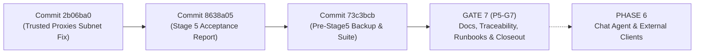
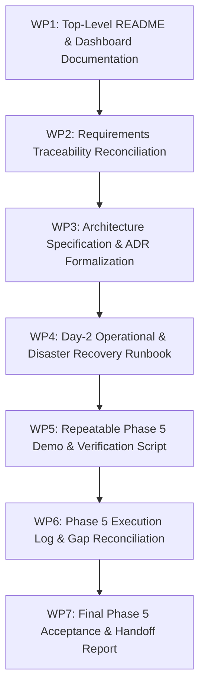

# Gate 7 Technical Plan & Execution Checklist
## Phase 5 Gate P5-G7: Documentation, Traceability, Runbooks & Final Acceptance Handoff

**Project:** Urumi MCP Gateway on Kubernetes with WooCommerce Platform  
**Repository:** `AdityaDRathore/MCP-Gateway-Kubernetes-Wcom`  
**Current Baseline:** Phase 5 Gate P5-G6 Stage 5 **ACCEPTED** (`73c3bcb`, image `urumi-gateway:1.0.0`, Helm Rev 10)  
**Target Milestone:** Gate P5-G7 Documentation, Traceability, and Formal Phase 5 Closure  
**Unblocks:** Phase 6 (In-Dashboard Chat Agent & External MCP Client Integration)  
**Author:** Senior Technical Lead & Implementation Worker  
**Status:** PROPOSED — PENDING TECHNICAL HEAD APPROVAL  

---

## 1. Gate 7 Scope Determination & Relationship to Baseline

### 1.1 Objective & Context Reconciliation
Following the successful execution and formal acceptance of **Gate P5-G6 Stage 5** (recorded in [`Resource/implementation/phase_5_g6_stage_5_final_acceptance_report.md`](./phase_5_g6_stage_5_final_acceptance_report.md)), the project stands at a critical governance juncture.

A rigorous audit of the master roadmap ([`Resource/implementation/phase_1_master_roadmap_and_checklist.md`](./phase_1_master_roadmap_and_checklist.md)), the Phase 5 Master Technical Roadmap ([`Context/phase5-planning-package/docs/phase-5/phase-5-master-roadmap.md`](../../Context/phase5-planning-package/docs/phase-5/phase-5-master-roadmap.md)), and the Phase 5 Implementation Plan ([`Resource/implementation/phase_5_implementation_plan..md`](./phase_5_implementation_plan..md)) confirms:
1. **The Phase Governance Model**: Each major phase in the Urumi assignment progresses through discrete numbered gates (e.g., Phase 4 progressed through G1–G9; Phase 5 progresses through P5-G0 through P5-G7).
2. **The Immediate Sequential Gate**: Having verified and deployed all functional capabilities across P5-G2 (Dashboard Foundation & Session), P5-G3 (Upstream & Tool Management), P5-G4 (Invitations & API Keys), P5-G5 (Audit Log API), and P5-G6 (Integration, Hardening & Stage 5 Cluster Runtime Acceptance), the mandatory next step is **Phase 5 Gate P5-G7: Documentation, Traceability, Operator Runbooks, and Final Phase 5 Acceptance Handoff**.
3. **Boundary with Phase 6 and Phase 7**:
   - **Gate P5-G7** is the terminal gate of Phase 5. It establishes a reproducible, source-documented, evidence-backed baseline.
   - **Phase 6** (Chat Agent & External Clients) is the subsequent major phase where the in-dashboard chat agent loop (Gemini Free Tier / Ollama) and external MCP client (MCP Inspector / User B) are built and demonstrated.
   - **Phase 7** (Reliability & Hardening) is the penultimate phase scheduled after Phase 6, focusing on pod failure injection, VPS `values-prod.yaml` parity, and chaos recovery.
   - Skipping P5-G7 or advancing prematurely to Phase 7 without completing Phase 5 closure and Phase 6 would directly violate the project roadmap and leave unverified, stale documentation across the codebase.

> [!IMPORTANT]
> **Scope Determination:**  
> **Gate 7** is formally identified and defined as **Gate P5-G7 (Documentation, Requirements Traceability, System Architecture Formalization, Operator Runbooks, Demo Script & Phase 5 Acceptance Report)**. Completing Gate P5-G7 fulfills all Phase 5 exit criteria and provides the verified technical foundation required to begin **Phase 6**.

---

### 1.2 Baseline Verification (Accepted Source & Deployment State)

The baseline for Gate 7 is frozen at Git commit `73c3bcb` and Helm Revision 10 in `k3d-urumi`:



#### Verified Baseline Facts
- **Active Git Commit:** `73c3bcb` (clean working tree on `main`).
- **Cluster & Release:** `k3d-urumi`, namespace `urumi`, release `urumi-store` at **Helm Revision 10**.
- **Runtime Workloads:** All 6 pods 1/1 Running (`urumi-gateway`, `urumi-mariadb-0`, `urumi-wordpress`, `urumi-woocommerce-mcp`, `urumi-mcp-crm`, `urumi-mcp-tasks`).
- **Gateway Deployed Image:** `urumi-gateway:1.0.0` (`sha256:4cc76d09366b0d458ce59da1799dcfacfb063d2ba0409b21ee97b1111c05ef2b`).
- **Runtime Acceptance:** 28 of 28 tests passing (`TEST-8.1.1` to `TEST-8.8.2`) under non-destructive runner `scratch/test-stage5-acceptance.ts`.
- **Automated Monorepo Suite:** All unit, protocol, and integration tests across `apps/gateway`, `apps/dashboard`, `apps/woocommerce-mcp`, `apps/mcp-crm`, `apps/mcp-tasks`, and `packages/shared` pass cleanly under Node 24 LTS (`v24.20.0`).
- **Persistence & Protected Data:** SQLite WAL integrity verified (`PRAGMA integrity_check` -> `ok`, 0 foreign key violations); WooCommerce Product IDs 10, 11, 12 and Order #14 verified 100% intact.
- **Disaster Recovery Package:** Point-in-time database snapshot preserved at `backups/pre-stage5/gateway-pre-stage5.db` with manifest `backups/pre-stage5/gateway-pre-stage5.manifest.json` (SHA-256: `a9307df1231b0cf0446823214e52420c32c081ce7d7525aaa7e5df435377ff6f`).

---

## 2. Gate 7 Objectives, Deliverables & Boundaries

### 2.1 Core Objectives
1. **Synchronize Repository Documentation:** Bring top-level `README.md`, `docs/architecture.md`, `docs/requirements-traceability.md`, and dashboard documentation into 100% alignment with the actual implemented and verified Phase 5 code.
2. **Formalize Architecture Decisions:** Advance `ADR-012` from `Proposed` to `Accepted`, and codify Phase 5's dual-listener and session security architecture in `ADR-019` and `ADR-020`.
3. **Produce Operator & Developer Runbooks:** Provide explicit, tested instructions for initial admin enrollment, member invitation lifecycle, upstream credential management, and disaster recovery procedures.
4. **Deliver a Repeatable Demo Script:** Provide an executable, step-by-step validation guide for the Phase 5 dashboard flows (login, upstream catalog, member invitations, API key self-service, instant revocation, and audit logs) with zero mutation to protected store records.
5. **Reconcile Discrepancies & Gap Log:** Formally disposition all items from `phase-5-gap-analysis.md` (GAP-C01 through GAP-C10) based on source and runtime evidence.
6. **Submit Phase 5 Completion Report:** Deliver a formal, evidence-backed acceptance report recommending Technical Head closure of Phase 5 and authorizing the start of Phase 6.

### 2.2 Strict Gate Boundaries

| In Scope for Gate 7 | Strictly Excluded from Gate 7 |
|---|---|
| Updating `README.md` with Phase 5 architecture, local URLs, and auth | Modifying live Kubernetes cluster resources or running `helm upgrade` |
| Updating `docs/requirements-traceability.md` (Categories D, E, F, G) | Modifying live database `/data/gateway.db` or running restore scripts |
| Updating `docs/architecture.md` (dual-listener, 7-table SQLite schema) | Modifying WooCommerce storefront records (Products 10, 11, 12, Order #14) |
| Authoring `apps/dashboard/README.md` (developer guide, build/test) | Implementing Phase 6 LLM chat agent or chat tool loop (`CHT-02`–`04`) |
| Authoring `docs/phase-5/operational-runbook.md` (Day-2 operator guide) | Implementing Phase 6 external MCP Inspector client User B demo (`EXT-01`–`03`) |
| Authoring `docs/phase-5/p5-demo-script.md` (repeatable manual test flow) | Refactoring production gateway or dashboard application source code |
| Authoring `docs/phase-5/phase-5-execution-log.md` (historical trace) | Attempting bonus features (multi-store provisioning, OAuth replacement) |
| Authoring `docs/decisions/ADR-019` & `ADR-020`, accepting `ADR-012` | Deleting Git tags, branches, or rewriting commit history |
| Authoring `docs/phase-5/phase-5-completion-report.md` | Committing plaintext secrets, passwords, or raw invitation tokens |

---

## 3. Detailed Work Packages & Execution Checklist

Gate 7 is structured into **seven sequential, non-destructive Work Packages (WP1 – WP7)**:



---

### Work Package 1: Top-Level README & Dashboard Documentation
- **Target Files:**
  - `[MODIFY]` `README.md`
  - `[NEW]` `apps/dashboard/README.md`
- **Tasks:**
  1. Advance `README.md` status badge and section from "Phase 4 Complete" to "Phase 5 Complete: Team Platform, Browser Dashboard & Dual-Listener Architecture".
  2. Document the dual-listener entrypoints:
     - Dashboard SPA & Browser API: `http://dashboard.127.0.0.1.nip.io:8080/` (mapped to gateway Port 3001).
     - Downstream MCP Streamable HTTP: `http://dashboard.127.0.0.1.nip.io:8080/mcp` (mapped to gateway Port 3000).
     - WooCommerce Storefront: `http://shop.127.0.0.1.nip.io:8080/`.
  3. Document the Initial Admin Bootstrap CLI command:
     ```bash
     npm --prefix apps/gateway run cli:bootstrap-admin -- --username admin --role admin
     ```
  4. Document the Browser Authentication model (Scrypt KDF, opaque session cookies, `HttpOnly`, `SameSite=Lax`, dual CSRF tokens via `X-Urumi-CSRF` and strict Origin checking).
  5. Document the Member Invitation & Onboarding flow (Admin generates single-use token; member redeems and sets password).
  6. Document the API Key lifecycle (displayed exactly once, SHA-256 hashed, instant revocation against `/mcp`).
  7. Retain the external MCP client connection guide for Phase 6 readiness.
  8. Create `apps/dashboard/README.md` describing the React 19 / Vite 6 / Vanilla CSS architecture, component structure, state management, build process, and testing instructions.
- **Verification:** Markdown lint check; link integrity verification; clean formatting.

---

### Work Package 2: Requirements Traceability Reconciliation
- **Target File:**
  - `[MODIFY]` `docs/requirements-traceability.md`
- **Tasks:**
  1. **Category D (Team MCP Gateway Core):** Update `GTW-01` through `GTW-11` from "Planned" to **"Verified"**, citing empirical evidence from Phase 4 and Phase 5 Stage 5 runtime tests (`TEST-8.3.1`, `TEST-8.4.1`, `TEST-8.5.1`, `TEST-8.7.1`, `TEST-8.8.1`, `TEST-8.8.2`).
  2. **Category E (Team Access Control & API Key Lifecycle):** Update `SEC-01` through `SEC-06` from "Planned" / "Protocol Spike" to **"Verified"**, citing Stage 5 runtime tests (`TEST-8.1.4`, `TEST-8.2.1`–`8.2.8`, `TEST-8.3.1`–`8.3.4`).
  3. **Category F (Audit Logging & Attribution):** Update `AUD-01` through `AUD-04` from "Planned" to **"Verified"**, citing Stage 5 runtime tests (`TEST-8.6.1`, `TEST-8.6.2`) and WAL query benchmarks.
  4. **Category G (In-Dashboard Chat Agent):** Update `CHT-01` (Dashboard Foundation) to **"Verified"** (`TEST-8.1.1`). Maintain `CHT-02`, `CHT-03`, `CHT-04` as **"Planned for Phase 6"**.
  5. **Category H (External MCP Client Support):** Reconcile `EXT-01` (Protocol Verified in Spike, App Planned in Phase 6), `EXT-02` (Planned in Phase 6), and `EXT-03` (Planned in Phase 6).
  6. Ensure unambiguous distinction between `source-confirmed`, `empirically-verified`, and `planned`.
- **Verification:** Review traceability matrix against the 28 tests in the Stage 5 report.

---

### Work Package 3: Architecture Specification & ADR Formalization
- **Target Files:**
  - `[MODIFY]` `docs/architecture.md`
  - `[MODIFY]` `docs/decisions/ADR-012-gateway-persistence-node-sqlite-and-wal.md`
  - `[NEW]` `docs/decisions/ADR-019-browser-identity-session-and-csrf.md`
  - `[NEW]` `docs/decisions/ADR-020-dual-listener-and-ingress-perimeter.md`
- **Tasks:**
  1. Update `docs/architecture.md`:
     - Embed the updated 4-layer Mermaid architecture diagram showing Port 3000 (MCP) and Port 3001 (Browser SPA) split.
     - Document Traefik Ingress routing: path `/mcp` -> Port 3000; path `/` -> Port 3001.
     - Document the full 7-table SQLite schema (`users`, `user_credentials`, `sessions`, `invitations`, `api_keys`, `upstreams`, `audit_logs`).
     - Detail the network security boundaries (NetworkPolicy denying direct WordPress:80 and MariaDB:3306 egress).
  2. Formalize `ADR-012`: Update status from `Proposed — Pending Technical Head Approval` to `Accepted & Empirically Verified in Phase 5 Stage 5`. Record migration 003, WAL checkpoints, and `VACUUM INTO` backup validation.
  3. Author `ADR-019`: Document the Browser Identity, Scrypt Password KDF, Opaque Session Token lifecycle, and dual-layer CSRF protection (X-Urumi-CSRF header + strict Origin match).
  4. Author `ADR-020`: Document the Dual-Listener and Ingress perimeter architecture, proving that the private `/admin/v1/*` API cannot be reached via the public Ingress.
- **Verification:** Markdown formatting; cross-reference checks with ADR index.

---

### Work Package 4: Day-2 Operational & Disaster Recovery Runbook
- **Target File:**
  - `[NEW]` `docs/phase-5/operational-runbook.md`
- **Tasks:**
  1. Provide step-by-step operator commands for:
     - Admin bootstrap and credential initialization.
     - Creating and managing member invitations.
     - Registering, updating, disabling, and deleting upstream MCP servers.
     - Querying and filtering audit logs via API and UI.
  2. Document the complete Disaster Recovery procedure:
     - Taking an online, non-locking backup using SQLite `VACUUM INTO`.
     - Validating backup file checksums against companion manifest.
     - Quiescing the gateway (`replicas: 0`) to release SQLite file locks.
     - Restoring `/data/gateway.db` from backup.
     - Verifying pod startup, schema migration, and `PRAGMA integrity_check`.
  3. Include security guidelines: zero secret exposure, handling lost admin credentials, and emergency API-key revocation.
- **Verification:** Dry-run procedure validation; ensure all commands use exact repository paths.

---

### Work Package 5: Repeatable Phase 5 Demo & Verification Script
- **Target File:**
  - `[NEW]` `docs/phase-5/p5-demo-script.md`
- **Tasks:**
  1. Structure a reproducible, end-to-end walkthrough for an evaluator or developer:
     - **Step 1:** Access the dashboard at `http://dashboard.127.0.0.1.nip.io:8080/`.
     - **Step 2:** Log in as Administrator. Verify upstream list (WooCommerce, CRM, Tasks) and tool catalog (10 tools).
     - **Step 3:** Generate a Member invitation token.
     - **Step 4:** Open incognito window, redeem invitation, set password for User B (`test-member`).
     - **Step 5:** As User B, navigate to API Keys. Generate a new API key; observe one-time display warning.
     - **Step 6:** As User B, verify administrative tabs (`Members`, `Audit`) are hidden or return HTTP 403.
     - **Step 7:** Connect MCP client to `/mcp` using User B's key; verify handshake and tool list.
     - **Step 8:** As Admin, revoke User B's API key.
     - **Step 9:** Execute immediate tool call with revoked key; observe instant HTTP 401 Unauthorized.
     - **Step 10:** Verify audit log records all operations with correct attribution and zero secret leakage.
     - **Step 11:** Verify protected store records (Products 10, 11, 12, Order #14) remain 100% intact.
  2. Ensure synthetic names/credentials are used; no persistent clutter or store modifications.
- **Verification:** Cross-check steps against assignment Definition of Done requirements.

---

### Work Package 6: Phase 5 Execution Log & Gap Reconciliation
- **Target Files:**
  - `[NEW]` `docs/phase-5/phase-5-execution-log.md`
  - `[NEW]` `docs/phase-5/gap-reconciliation-report.md`
- **Tasks:**
  1. Compile the comprehensive chronological log of Phase 5 execution from P5-G0 through P5-G6 Stage 5, capturing:
     - Commit SHAs, dates, gate titles, and exit dispositions.
     - Test metrics, commands, and artifact locations.
  2. Formally reconcile gaps `GAP-C01` through `GAP-C10` from `phase-5-gap-analysis.md`:
     - `GAP-C01` (Dashboard workspace absent) -> **RESOLVED** (`apps/dashboard` added and verified).
     - `GAP-C02` (Browser session/auth absent) -> **RESOLVED** (Scrypt KDF, opaque sessions, CSRF implemented).
     - `GAP-C03` (Member/key HTTP endpoints missing) -> **RESOLVED** (`/api/v1/browser/*` implemented).
     - `GAP-C04` (Audit read API missing) -> **RESOLVED** (`/api/v1/browser/audit` implemented with pagination).
     - `GAP-C05` (Architecture text describes SPA served by gateway) -> **RESOLVED** (Multi-stage build & dual-listener Ingress).
     - `GAP-C06` (G9 PUT .../credential route mismatch) -> **RESOLVED** (Reconciled to `PATCH /upstreams/:id`).
     - `GAP-C07` (ADR-012 pending approval) -> **RESOLVED** (Formalized and accepted in Gate 7).
     - `GAP-C08` (Trusted proxy subnet missing) -> **RESOLVED** (Bridge subnet `172.19.0.0/16` added in commit `2b06ba0`).
     - `GAP-C09` (Audit index on user_id) -> **RESOLVED** (Composite indices added in migration 003).
     - `GAP-C10` (Invitation session atomicity) -> **RESOLVED** (Atomic transaction implemented in `redeemInvitation`).
- **Verification:** Ensure 100% gap closure with explicit source line and commit references.

---

### Work Package 7: Final Phase 5 Acceptance & Handoff Report
- **Target Files:**
  - `[NEW]` `docs/phase-5/phase-5-completion-report.md`
  - `[NEW]` `Resource/implementation/phase_5_g7_final_completion_report.md`
- **Tasks:**
  1. Compile the authoritative completion report synthesizing all Phase 5 achievements.
  2. Summarize the deployment baseline (Commit `73c3bcb`, image `urumi-gateway:1.0.0`, Helm Rev 10).
  3. Include the complete test score matrix (471+ automated tests, 28/28 live runtime acceptance tests).
  4. Provide the formal disposition: **PHASE 5 COMPLETE & ACCEPTED**.
  5. Issue the Phase 6 Readiness Statement outlining requirements and scope for **Phase 6: In-Dashboard Chat Agent & External Clients**.
- **Verification:** Independent verification against assignment evaluation criteria.

---

## 4. Test Strategy & Acceptance Criteria

### 4.1 Gate P5-G7 Acceptance Criteria (Definition of Done)
1. **AC-1 (Documentation Consistency):** `README.md`, `docs/architecture.md`, and `docs/requirements-traceability.md` contain zero references to Phase 5 as "in progress" or "planned", and accurately reflect the dual-listener, 7-table SQLite schema, and live Ingress routing.
2. **AC-2 (Zero Broken Links & Valid Markdown):** All markdown links, file references, and Mermaid diagrams render cleanly without syntax errors or invalid paths.
3. **AC-3 (ADR Completeness):** `ADR-012` is marked `Accepted`; `ADR-019` (Session/CSRF) and `ADR-020` (Dual Listener/Ingress) are fully documented.
4. **AC-4 (Runbook Operability):** The operational runbook contains exact, copy-pasteable commands for all day-2 tasks, verified against the current repository structure.
5. **AC-5 (Gap Closure):** All 10 gap items (`GAP-C01`–`GAP-C10`) are evidenced as resolved.
6. **AC-6 (Test Suite Green):** 100% of monorepo automated tests continue to pass under Node 24 LTS:
   ```bash
   export PATH="/home/rathore/.nvm/versions/node/v24.20.0/bin:$PATH"
   npm test --workspaces --if-present
   npm run --workspaces --if-present build
   helm lint infra/helm/urumi-platform
   ```
7. **AC-7 (Zero Code/Cluster Mutation):** No application code logic, database rows, or live Kubernetes workloads are altered during Gate 7 execution.
8. **AC-8 (Zero Plaintext Secrets):** Documentation and runbooks contain zero committed plaintext passwords, tokens, or API keys.

---

## 5. Risk Register & Mitigation Strategy

| Risk ID | Description | Severity | Likelihood | Mitigation Strategy |
|---|---|:---:|:---:|---|
| **R-G7-01** | **Documentation Drift vs Runtime**<br>Docs describe ideal architecture rather than what was deployed in Helm Revision 10. | High | Low | Ground every document change strictly in inspected source files and the 28 empirical runtime test results from the Stage 5 report. |
| **R-G7-02** | **Accidental Cluster Mutation**<br>Running live commands that mutate pod, database, or secret state. | Critical | Low | Strictly enforce read-only policy for Gate 7. Zero `kubectl apply`, `helm upgrade`, or DB restore commands. |
| **R-G7-03** | **Secret Disclosure in Runbooks/Logs**<br>Accidental inclusion of real API keys or session cookies in examples. | High | Low | Use synthetic, RFC-compliant documentation tokens (`urumi_live_example...`, `test_user`, `admin_temp_token`). |
| **R-G7-04** | **Scope Creep into Phase 6**<br>Attempting to scaffold the LLM chat agent or connect MCP Inspector during Gate 7. | Medium | Medium | Strict gate boundary: Phase 6 code or client demos remain locked until Phase 5 is formally closed. |

---

## 6. Authorization & Stop Conditions

> [!CAUTION]
> **Implementation Hold Active:**  
> This Technical Plan is a planning deliverable. No files will be modified, created, or committed until the Technical Head reviews and explicitly approves this plan.

### Explicit Stop Conditions
Execution must immediately halt if:
1. Any discrepancy is discovered between the inspected source code and the reported Stage 5 baseline.
2. Any test in the monorepo fails or produces non-zero exit codes.
3. The Technical Head requests adjustments to the scope, deliverables, or ordering of Work Packages.

---

## 7. Next Step

Upon receiving written approval from the Technical Head:
1. Initialize Work Package 1 (`README.md` and `apps/dashboard/README.md`).
2. Progress sequentially through WP2–WP7.
3. Deliver the final Gate P5-G7 Completion Report and handoff package for Phase 6 authorization.
