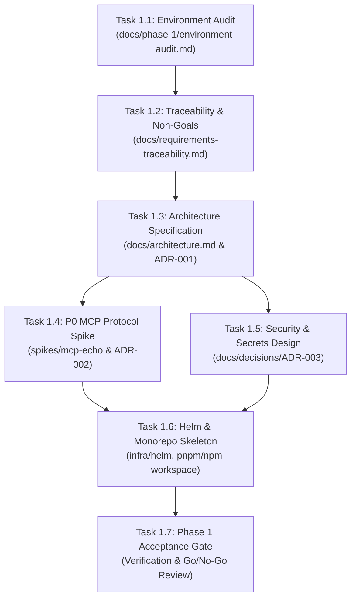

# Urumi AI FDE Internship — Master Roadmap & Phase 1 Execution Plan
## Technical Architecture, Phase 1 Work Order & Self-Verification Checklist
### 🛡️ 100% Free-Tier & Open-Source Stack (Zero Paid Subscriptions Required)

---

## 1. Goal Description & Zero-Cost Guarantee

This project builds a production-grade **Team Model Context Protocol (MCP) Gateway on Kubernetes** with a live **WooCommerce Store** as its foundational data source. 

> [!IMPORTANT]
> **Zero-Cost Commitment**:
> Every single tool, framework, and model used in this implementation is **100% free and open source**:
> - **External MCP Client**: Official open-source **MCP Inspector** (`@modelcontextprotocol/inspector`), which runs locally via `npx` with zero subscription or API key needed.
> - **Chat Agent LLM**: **Google Gemini API (Free Tier)** or local **Ollama** (100% free, runs locally on your machine).
> - **Kubernetes & Cloud Native Layer**: `k3d` (K3s in Docker), `kubectl`, `helm`, `traefik`/`ingress-nginx` (100% free open-source).
> - **Store & Database Layer**: WordPress, WooCommerce plugin, MariaDB (100% free open-source).
> - **Gateway & Dashboard**: Node.js/TypeScript, React/Vite (100% free open-source).
>
> You do **NOT** need a Claude subscription, ChatGPT Plus, or any paid cloud account.

---

## 2. 8-Phase Master Project Roadmap (Oct 9 – Oct 26)

| Phase | Target Dates | Milestone Outcome | Core Deliverables (100% Free Stack) |
| :--- | :--- | :--- | :--- |
| **Phase 1** | **Oct 9–10** | **Foundation & Technical Validation** | Environment audit, requirements matrix, ADRs, working MCP echo spike, Helm skeleton. |
| **Phase 2** | **Oct 11–12** | **Store Deployment** | WordPress + WooCommerce + MariaDB running on local K8s with PVCs, seed data, and Cash on Delivery. |
| **Phase 3** | **Oct 13–14** | **Custom WooCommerce MCP** | In-cluster TypeScript MCP server exposing 5 required tools against WooCommerce REST API. |
| **Phase 4** | **Oct 15–17** | **Gateway Core Engine** | Dual MCP server/client proxy, dynamic upstreams, namespacing (`server__tool`), failure isolation, timeouts. |
| **Phase 5** | **Oct 18–20** | **Team Platform & Dashboard** | Admin & Member roles, hashed API keys, React UI (servers, keys, audit log table). |
| **Phase 6** | **Oct 21–22** | **Chat Agent & External Clients** | In-dashboard chat agent tool loop using **Gemini Free Tier / Ollama**, **MCP Inspector** for User B, multi-server calls. |
| **Phase 7** | **Oct 23–24** | **Reliability & Hardening** | Pod kill tests, NetworkPolicies, non-root containers, `values-prod.yaml` for VPS (k3s). |
| **Phase 8** | **Oct 25–26** | **Acceptance, Demo & Submission** | Definition of Done test run, video walkthrough recording, `README.md`, threat model, submission form. |

---

## 3. Phase 1 Work Order (Detailed Task Breakdown)

### Task 1.1 / Task A — Environment Audit
- **Goal**: Establish concrete facts about the local machine without assumptions or destructive actions.
- **Observed Initial Facts**:
  - OS: Ubuntu 24.04 LTS (x86_64, 4 vCPUs, 7.6GB RAM, ~1.2GB available, 22GB disk free on `/`).
  - Docker: Docker 29.8.1 is active and accessible without sudo.
  - Node.js: v18.19.1; npm: 9.2.0.
  - Host Port 80: Occupied by host `nginx/1.24.0 (Ubuntu)`.
  - Host Port 8080 & 8443: Available.
  - Missing CLIs: `kubectl`, `helm`, `k3d` (will install to `~/.local/bin/`).
  - External Client: **MCP Inspector** (free, no subscription).
  - Git: Workspace `/home/rathore/Documents/Urumi Assignment` is not yet a git repository.
- **Output Artifact**: `docs/phase-1/environment-audit.md`

### Task 1.2 / Task B — Requirements Traceability & Non-Goals
- **Goal**: Map all 9 mandatory requirements directly to owning components and explicit verification tests.
- **Non-Goals Frozen for MVP**:
  - No multi-store dynamic provisioning (Bonus) until core passes.
  - No OAuth replacement for API keys (API keys are mandatory for DoD).
  - No complex vector search for tools (namespacing handles 3 servers cleanly).
  - No multi-replica cluster scaling until core is solid.
- **Output Artifact**: `docs/requirements-traceability.md`

### Task 1.3 / Task B & E — Architecture Specification (ADR-001)
- **Decisions Recorded**:
  - **D1 (Monorepo)**: npm workspaces with TypeScript for `apps/dashboard`, `apps/gateway`, `apps/mcp-woocommerce`, `apps/mcp-crm`, `apps/mcp-tasks`, and `packages/shared`.
  - **D2 (Persistence)**: MariaDB for WooCommerce (stateful PVC); SQLite / PostgreSQL for Gateway metadata & audit logs (with persistent volume).
  - **D3 (Service Boundaries)**: Gateway is single point of ingress for MCP traffic; upstreams are internal ClusterIP only.
  - **D4 (Kubernetes Engine)**: `k3d` (K3s in Docker) with ingress mapped to ports 8080/8443.
  - **D5 (Local Ingress & Domains)**: `127.0.0.1.nip.io` or `/etc/hosts` mappings (`shop.urumi.test`, `dashboard.urumi.test`, `mcp.urumi.test`).
- **Output Artifacts**: `docs/architecture.md`, `docs/decisions/ADR-001-stack-and-deployment.md`

### Task 1.4 / Task C — MCP Protocol Compatibility Proof (P0 Spike)
- **Goal**: Prove MCP Streamable HTTP (SSE) tool discovery and invocation with static API key headers using **100% free tools**.
- **Stack**:
  - Pin `@modelcontextprotocol/sdk` (latest stable v1.32.1).
  - Disposable test server in `spikes/mcp-echo/` exposing `echo_message({ message: string })`.
  - Client testing via **MCP Inspector** and automated node test client.
- **Verification Criteria**:
  1. Server launches on HTTP port with SSE endpoint.
  2. Protocol handshake succeeds.
  3. Client discovers `echo_message`.
  4. Client executes `echo_message` and asserts matching output.
  5. Static authentication header (`Authorization: Bearer <test-key>`) is validated on connection.
- **Output Artifact**: `docs/decisions/ADR-002-mcp-compatibility.md` + reproducible spike code.

### Task 1.5 / Task D — Security & Credential Storage Design (ADR-003)
- **Design Specifications**:
  - **Gateway User API Keys**: Generated cryptographically (`urumi_sec_...`), shown once to user, stored hashed (SHA-256 / bcrypt) in Gateway DB. Immediate revocation via status flag.
  - **Static Platform Credentials**: Database passwords, WooCommerce master consumer secret, JWT secrets provided via Kubernetes Secrets.
  - **Admin-Registered Dynamic Upstream Credentials**: Stored securely as Kubernetes Secrets in a dedicated namespace (`urumi-gateway-secrets`), managed via Gateway's dedicated `ServiceAccount` and namespaced RBAC.
  - **Credential Leakage Prevention**: Upstream credentials injected in Gateway memory only; stripped from all API responses, tool outputs, and audit logs.
- **Output Artifact**: `docs/decisions/ADR-003-secrets-and-access.md`

### Task 1.6 / Task E & F — Monorepo & Helm Skeleton
- **Monorepo Scaffolding**:
  - `git init`, `.gitignore`, root `package.json` with workspaces, TypeScript config.
  - Directory layout: `apps/dashboard`, `apps/gateway`, `apps/mcp-woocommerce`, `apps/mcp-crm`, `apps/mcp-tasks`, `packages/shared`, `infra/helm`.
- **Helm Scaffold**:
  - `infra/helm/urumi-platform/` with `Chart.yaml`, `values.yaml`, `values-local.yaml`, `values-prod.yaml`.
  - Validate with `helm lint` and `helm template`.
- **Output Artifacts**: `infra/helm/`, `README.md` (bootstrap instructions).

---

## 4. User Review Required & Critical Decisions

> [!IMPORTANT]
> **Host Port 80 Conflict**:
> The host machine is already running `nginx/1.24.0` on port 80.
> **Decision**: Map local k3d cluster ingress to port **8080** (HTTP) and **8443** (HTTPS) so we never touch or disrupt your host nginx.

> [!IMPORTANT]
> **Zero-Cost External Client (No Claude Subscription Needed)**:
> Urumi explicitly specifies:
> *"Connect Claude Code, Cursor or **MCP Inspector** to the gateway using only the gateway URL and user B's API key."*
> We will use **MCP Inspector**, the official free open-source GUI client designed by the MCP maintainers. It runs locally with a single command (`npx @modelcontextprotocol/inspector`) and requires zero API keys or subscriptions.

> [!IMPORTANT]
> **Zero-Cost Chat LLM**:
> Urumi's brief explicitly states:
> *"The model, provider and design are your choice. A free tier or a local model is fine. We grade that the tool loop works, not the quality of the model's answers."*
> We will use **Google Gemini Free Tier** (or local **Ollama** if preferred), which costs $0.00.

---

## 5. Interactive Self-Verification Checklist (For Aditya)

You can copy this checklist or use it directly to independently verify and tick off every milestone before authorizing Phase 2.

### 📋 Phase 1 Verification Checklist

#### Gate 1: Environment Audit
- [ ] `docs/phase-1/environment-audit.md` exists and contains actual CLI outputs.
- [ ] Verified host RAM (7.6GB total, ~1.2GB available) and disk (22GB available).
- [ ] Confirmed host port 80 is occupied by nginx, and port 8080 is selected for cluster ingress.
- [ ] Verified `kubectl`, `helm`, and `k3d` are installed in `~/.local/bin` and print their versions.

#### Gate 2: Scope & Traceability
- [ ] `docs/requirements-traceability.md` maps all 9 mandatory requirements to owning components.
- [ ] Non-goals for Round 1 (no multi-store bonus, no OAuth, no search clustering) are clearly frozen.

#### Gate 3: Architecture & Decision Records
- [ ] `docs/architecture.md` documents 4-tier model (Store, WooCommerce MCP, Gateway, Chat Agent).
- [ ] `docs/decisions/ADR-001-stack-and-deployment.md` approves TypeScript monorepo & k3d.
- [ ] Upstream MCP servers defined (WooCommerce MCP + CRM MCP + Tasks/Notes MCP).

#### Gate 4: MCP Protocol Compatibility Spike (P0) — 100% Free
- [ ] Spike server in `spikes/mcp-echo/` starts with `@modelcontextprotocol/sdk`.
- [ ] Streamable HTTP / SSE endpoint accepts incoming client connection.
- [ ] Client successfully discovers `echo_message` tool via protocol.
- [ ] Client executes `echo_message` and receives exact echoed response.
- [ ] Static header authorization (`Authorization: Bearer <key>`) verified.
- [ ] External client verification using **MCP Inspector** (`npx @modelcontextprotocol/inspector`) without any paid subscription.
- [ ] `docs/decisions/ADR-002-mcp-compatibility.md` records exact SDK versions and protocol evidence.

#### Gate 5: Security & Credentials Design
- [ ] `docs/decisions/ADR-003-secrets-and-access.md` defines user API key hashing & revocation flow.
- [ ] Upstream credential isolation documented: stored in K8s Secrets, never sent to browser or client.
- [ ] Dedicated ServiceAccount and namespaced RBAC model defined for Gateway secrets access.

#### Gate 6: Repository & Helm Baseline
- [ ] Git repository initialized with clean `.gitignore` (no credentials, no node_modules).
- [ ] Monorepo `package.json` with workspaces configured.
- [ ] Helm chart in `infra/helm/urumi-platform/` passes `helm lint`.
- [ ] `helm template urumi infra/helm/urumi-platform -f infra/helm/urumi-platform/values-local.yaml` renders successfully without errors.
- [ ] `README.md` documents exact commands to reproduce Phase 1.
