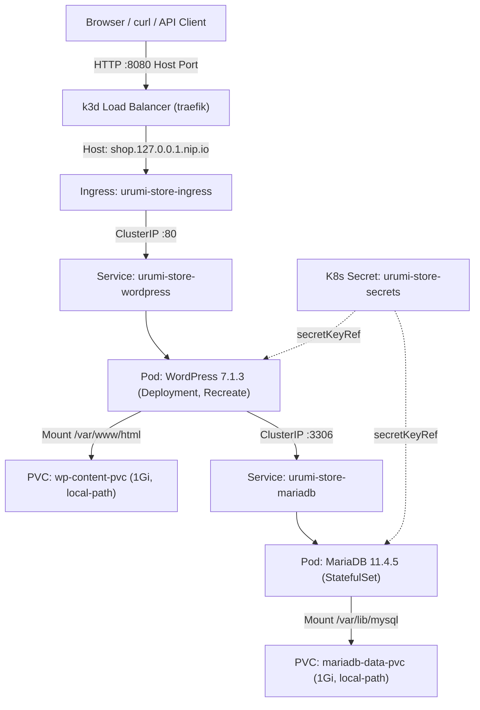

# Implementation Plan: Phase 2 — Stateful WooCommerce Store Deployment

**Document Type:** Technical Implementation Plan / Execution Strategy  
**Phase:** Phase 2 (Stateful WooCommerce Store Deployment)  
**Target Release:** `AdityaDRathore/MCP-Gateway-Kubernetes-Wcom` (`main`)  
**Target Environment:** Local k3d Kubernetes cluster on Ubuntu 24.04 LTS (x86_64)  
**Execution Context:** `k3d-urumi` on host ports `8080` (HTTP) and `8443` (HTTPS)  

---

## 1. Goal Description

Deploy a production-grade, stateful WordPress + WooCommerce store to a local Kubernetes cluster using the existing Helm chart (`infra/helm/urumi-platform`). 

The store must:
1. Run WordPress and MariaDB inside Kubernetes with persistent volumes (`local-path`), health probes (`startupProbe`, `readinessProbe`, `livenessProbe`), CPU/memory requests and limits, and zero plaintext secrets.
2. Be accessible via Traefik Ingress at `http://shop.127.0.0.1.nip.io:8080/`.
3. Keep the database strictly internal (ClusterIP only, no external Ingress or host ports).
4. Persist database data and WordPress webroot content across pod restarts and controlled workload replacements.
5. Provide a working Cash on Delivery (COD) checkout experience with at least three seeded products.
6. Expose working, authenticated WooCommerce REST API (`wc/v3`) endpoints with dedicated credentials stored in Kubernetes Secrets for downstream Phase 3 MCP integration.



---

## 2. User Review Required

> [!IMPORTANT]
> **Kubernetes Client/Server Version Skew Resolution:**  
> The host has `kubectl v1.37.1` installed. The default k3d K3s version (`v1.31.5-k3s1`) violates the Kubernetes $\pm 1$ minor-version skew policy. We verified that **`rancher/k3s:v1.37.1-k3s1`** is published on Docker Hub for `linux/amd64` and will be used to create the `urumi` cluster, ensuring **zero minor-version skew**.

> [!IMPORTANT]
> **Host Socket Invariants:**  
> - Host port `80` is actively occupied by native `nginx/1.24.0`.  
> - Host port `3001` is actively occupied by `Wekan`.  
> - We will strictly map the k3d cluster load balancer to host ports `8080` (HTTP) and `8443` (HTTPS). Neither port 80 nor port 3001 will be touched or rebound.

> [!WARNING]
> **Container Image Pinning & Compatibility:**  
> - Current chart values specify `wordpress:6.7-php8.2-apache` and floating `mariadb:11.4`.  
> - WooCommerce 11.2+ requires WordPress 7.0+.  
> - We verified that `wordpress:7.1.3-php8.3-apache` and `mariadb:11.4.5` are published for `linux/amd64`. We will pin these exact tags across the chart values.

> [!CAUTION]
> **Git Ownership & History:**  
> In accordance with project rules, the AI will not commit, push, reset, or modify Git repository branches. All files will be created and modified cleanly in the working tree for the repository owner to review and commit.

---

## 3. Open Questions

There are no blocking ambiguities; the roadmap work order (`phase_2_stateful_woocommerce_store_roadmap.md`) provides complete specifications. The plan below details each technical milestone and verification step.

---

## 4. Proposed Changes

### Component 1: Host Environment & Cluster Preflight (Task 2.0 & Task 2.1)

#### [MODIFY] [`.gitignore`](file:///home/rathore/Documents/Urumi%20Assignment/.gitignore)
- Ensure `.secrets/` directory and any local secret files are strictly gitignored to prevent accidental commits.

```diff
--- a/.gitignore
+++ b/.gitignore
@@ -10,3 +10,4 @@
 dist/
 build/
+.secrets/
```

#### [NEW] Cluster Creation & Validation
- Create local k3d cluster `urumi` pinned to `rancher/k3s:v1.37.1-k3s1`:
  ```bash
  k3d cluster create urumi \
    --image rancher/k3s:v1.37.1-k3s1 \
    --port "8080:80@loadbalancer" \
    --port "8443:443@loadbalancer" \
    --timeout 180s
  ```
- Validate nodes (`Ready`), StorageClass (`local-path`), and IngressClass (`traefik`) using context `k3d-urumi`.

---

### Component 2: Secret & Values Contract (Task 2.2 & Task 2.3)

#### [NEW] Local Secret Generation (`.secrets/phase2-store.env`)
- Generate strong, random passwords for MariaDB root and application user (`wordpress_user`).
- File permissions set to `0600`.
- Applied imperatively to Kubernetes namespace `urumi`:
  ```bash
  kubectl --context k3d-urumi create namespace urumi --dry-run=client -o yaml | kubectl --context k3d-urumi apply -f -
  kubectl --context k3d-urumi -n urumi create secret generic urumi-store-secrets \
    --from-env-file=.secrets/phase2-store.env \
    --dry-run=client -o yaml | kubectl --context k3d-urumi apply -f -
  ```

#### [MODIFY] [`infra/helm/urumi-platform/values.yaml`](file:///home/rathore/Documents/Urumi%20Assignment/infra/helm/urumi-platform/values.yaml)
- Update image pins to `wordpress:7.1.3-php8.3-apache` and `mariadb:11.4.5`.
- Add probe and secret configuration blocks for MariaDB and WordPress.
- Add explicit database name and user configurations: `wordpress` DB, `wordpress_user` user, DB host `urumi-store-mariadb`.

#### [MODIFY] [`infra/helm/urumi-platform/values-local.yaml`](file:///home/rathore/Documents/Urumi%20Assignment/infra/helm/urumi-platform/values-local.yaml)
- Align resource requests and limits with observed host capacity (requests: WP 100m/192Mi, MariaDB 100m/128Mi; limits: WP 500m/384Mi, MariaDB 500m/384Mi).
- Set storageClass to verified `local-path`.

#### [MODIFY] [`infra/helm/urumi-platform/values-prod.yaml`](file:///home/rathore/Documents/Urumi%20Assignment/infra/helm/urumi-platform/values-prod.yaml)
- Maintain renderability with production hostnames and TLS configurations.

---

### Component 3: Helm Chart Workload Templates (Task 2.4)

#### [NEW] [`infra/helm/urumi-platform/templates/mariadb-service.yaml`](file:///home/rathore/Documents/Urumi%20Assignment/infra/helm/urumi-platform/templates/mariadb-service.yaml)
- ClusterIP service for MariaDB exposing port `3306` inside the cluster only.

#### [NEW] [`infra/helm/urumi-platform/templates/mariadb-statefulset.yaml`](file:///home/rathore/Documents/Urumi%20Assignment/infra/helm/urumi-platform/templates/mariadb-statefulset.yaml)
- Single-replica `StatefulSet` for MariaDB.
- Volume mount at `/var/lib/mysql` using `volumeClaimTemplates` or PVC reference.
- Health probes: `startupProbe` (failureThreshold 30, periodSeconds 5), `readinessProbe`, and `livenessProbe` using MariaDB `healthcheck.sh --connect --innodb_initialized`.
- Environment variables: `MARIADB_DATABASE`, `MARIADB_USER`, and passwords sourced via `secretKeyRef` pointing to `urumi-store-secrets`.

#### [NEW] [`infra/helm/urumi-platform/templates/wordpress-pvc.yaml`](file:///home/rathore/Documents/Urumi%20Assignment/infra/helm/urumi-platform/templates/wordpress-pvc.yaml)
- PersistentVolumeClaim for WordPress `/var/www/html` with access mode `ReadWriteOnce` and StorageClass `local-path`.

#### [NEW] [`infra/helm/urumi-platform/templates/wordpress-service.yaml`](file:///home/rathore/Documents/Urumi%20Assignment/infra/helm/urumi-platform/templates/wordpress-service.yaml)
- ClusterIP service for WordPress exposing port `80` inside the cluster.

#### [NEW] [`infra/helm/urumi-platform/templates/wordpress-deployment.yaml`](file:///home/rathore/Documents/Urumi%20Assignment/infra/helm/urumi-platform/templates/wordpress-deployment.yaml)
- Single-replica `Deployment` with rollout strategy `Recreate`.
- Volume mount at `/var/www/html`.
- Probes: `startupProbe` (HTTP GET `/wp-login.php`, port 80, initialDelaySeconds 10, failureThreshold 30), `readinessProbe` (HTTP GET `/wp-login.php`), `livenessProbe` (TCP socket 80).
- Environment variables: `WORDPRESS_DB_HOST`, `WORDPRESS_DB_NAME`, `WORDPRESS_DB_USER`, and password sourced via `secretKeyRef`.

#### [NEW] [`infra/helm/urumi-platform/templates/ingress.yaml`](file:///home/rathore/Documents/Urumi%20Assignment/infra/helm/urumi-platform/templates/ingress.yaml)
- Ingress resource with `ingressClassName: traefik`.
- Routing rule: host `shop.127.0.0.1.nip.io` pointing to `wordpress` service on port 80.
- Database service is never exposed in Ingress.

---

### Component 4: Store Deployment, Bootstrap, and Verification (Task 2.5 & Task 2.6)

1. **Deploy Helm Release:**
   ```bash
   helm --kube-context k3d-urumi upgrade --install urumi-store \
     infra/helm/urumi-platform \
     --namespace urumi \
     --create-namespace \
     -f infra/helm/urumi-platform/values-local.yaml
   ```
2. **Progressive Verification:**
   - Verify PVCs: `mariadb-data` and `wordpress-data` in `Bound` state.
   - Verify pods: MariaDB and WordPress reach `1/1 Running` and `Ready`.
   - Verify HTTP response: `curl -sI -H "Host: shop.127.0.0.1.nip.io" http://127.0.0.1:8080/`.
3. **Automated/Assisted WordPress & WooCommerce Bootstrap:**
   - Complete WordPress initial setup (Site title, demo admin user, strong password).
   - Configure Pretty Permalinks (`/%postname%/`).
   - Install and activate WooCommerce plugin (record exact plugin version).
   - Configure store settings: Currency = INR (`₹`), test shipping method (Free/Flat Rate), enable Cash on Delivery (COD).
   - Seed 3 published products:
     - `Urumi Test Mug` (SKU `URUMI-MUG-001`, regular price ₹299, category `Accessories`)
     - `Wireless Mouse Demo` (SKU `URUMI-MOUSE-001`, regular price ₹799, category `Electronics`)
     - `Notebook Demo` (SKU `URUMI-NOTE-001`, regular price ₹149, category `Stationery`)
4. **End-to-End COD Checkout:**
   - Perform checkout via storefront API / web session using fictional customer data.
   - Verify order generation and confirm order status in WooCommerce Admin (`Processing` / `Pending payment`).

---

### Component 5: WooCommerce REST API Prep for Phase 3 (Task 2.7)

1. Create a dedicated WordPress user `urumi-mcp-integration` with the `shop_manager` role.
2. Generate WooCommerce REST API consumer key and consumer secret with Read/Write permissions.
3. Store the integration credentials in a Kubernetes Secret `urumi-woocommerce-api` in namespace `urumi`.
4. Validate authenticated endpoints over `wc/v3`:
   - `GET /wp-json/wc/v3/products` (returns 3 seeded products).
   - `GET /wp-json/wc/v3/orders` (returns the COD test order).
   - Validate create/delete of a temporary test product to prove write capability.

---

### Component 6: Controlled Persistence & Failure Testing (Task 2.8)

1. **Capture Pre-Restart Baseline:**
   - Pod names, PVC claim names, Product IDs, and Order ID.
2. **WordPress Pod Replacement:**
   - Execute `kubectl --context k3d-urumi -n urumi rollout restart deployment/<wp-deploy>`.
   - Wait for rollout status to complete.
   - Re-check storefront and REST API; verify all 3 products and order remain intact.
3. **MariaDB Pod Replacement:**
   - Execute `kubectl --context k3d-urumi -n urumi rollout restart statefulset/<mariadb-sts>`.
   - Wait for database recovery and readiness probe pass.
   - Re-check storefront and REST API; verify all 3 products and order remain intact.
4. **Failure Boundary Documentation:**
   - Clarify in the runbook that this verifies resilience across Kubernetes pod replacement/eviction with local-path PVCs, not cross-host disaster recovery.

---

### Component 7: Documentation & Traceability (Task 2.9)

#### [NEW] [`docs/phase-2/phase-2-execution-log.md`](file:///home/rathore/Documents/Urumi%20Assignment/docs/phase-2/phase-2-execution-log.md)
- Chronological command execution log with timestamps, tool versions, and test outputs.

#### [NEW] [`docs/phase-2/image-lock.md`](file:///home/rathore/Documents/Urumi%20Assignment/docs/phase-2/image-lock.md)
- Complete digest and version lock record for `wordpress:7.1.3-php8.3-apache`, `mariadb:11.4.5`, and WooCommerce plugin.

#### [NEW] [`docs/phase-2/store-deployment.md`](file:///home/rathore/Documents/Urumi%20Assignment/docs/phase-2/store-deployment.md)
- Full step-by-step reproduction runbook, disaster boundaries, and debugging guide.

#### [MODIFY] [`docs/requirements-traceability.md`](file:///home/rathore/Documents/Urumi%20Assignment/docs/requirements-traceability.md)
- Update statuses for `STR-01` through `STR-05`, `INF-01`, `INF-04`, `INF-05`, `INF-06`, and `API-PREP-01` with observed evidence.

#### [MODIFY] [`README.md`](file:///home/rathore/Documents/Urumi%20Assignment/README.md)
- Add Phase 2 quickstart commands for local store deployment and verification.

---

## 5. Verification Plan

### Automated & CLI Test Sequence

| Test ID | Command | Target / Verification |
|---|---|---|
| **P2-ENV-01** | `npm ci && npm run build` | Verified clean workspace compilation (Completed in preflight) |
| **P2-K8S-01** | `kubectl --context k3d-urumi version` | Client v1.37.1 and server v1.37.1 match exactly (0 skew) |
| **P2-K8S-02** | `kubectl --context k3d-urumi get sc,ingressclass,nodes` | `local-path` and `traefik` present, node `Ready` |
| **P2-HELM-01** | `helm lint infra/helm/urumi-platform` | 0 failures, valid chart syntax |
| **P2-HELM-02** | `helm template test-local infra/helm/urumi-platform -f infra/helm/urumi-platform/values-local.yaml` | Valid manifests; no secrets rendered |
| **P2-HELM-03** | `helm template test-prod infra/helm/urumi-platform -f infra/helm/urumi-platform/values-prod.yaml` | Valid manifests; single replica retained |
| **P2-SEC-01** | `git grep -iE 'password|secret' infra/helm/` | Zero hardcoded plaintext credentials; all use `secretKeyRef` |
| **P2-STORE-01**| `kubectl --context k3d-urumi -n urumi get pods,pvc,svc,ingress` | Both workloads Ready, PVCs Bound, MariaDB ClusterIP only |
| **P2-STORE-02**| `curl -sS -I http://shop.127.0.0.1.nip.io:8080/` | HTTP 200 or 302 from WordPress through Ingress |
| **P2-CHECKOUT**| Storefront checkout request | Order ID generated and verified in admin |
| **P2-API-01**  | Authenticated `GET /wp-json/wc/v3/products` | Returns 3 seeded products with correct prices/SKUs |
| **P2-API-02**  | Authenticated `GET /wp-json/wc/v3/orders` | Returns COD order with matching total and line items |
| **P2-PERSIST-01**| `kubectl rollout restart deployment/urumi-store-wordpress` | Rollout completes; products and order survive |
| **P2-PERSIST-02**| `kubectl rollout restart statefulset/urumi-store-mariadb` | Rollout completes; products and order survive |

### Manual Verification
- Open `http://shop.127.0.0.1.nip.io:8080/` in a local browser to browse products, view cart, and inspect the store layout.
- Log into `http://shop.127.0.0.1.nip.io:8080/wp-admin` to inspect WooCommerce settings, product catalog, and order history.
