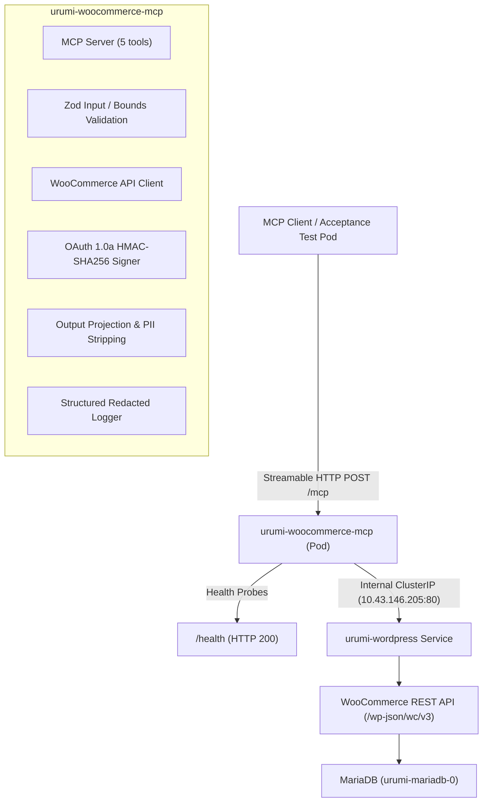

# Implementation Plan — Phase 3: Custom WooCommerce MCP Server on Kubernetes

**Document type:** Technical Design & Implementation Plan (Master Work Order)  
**Project:** Urumi — Team MCP Gateway on Kubernetes with WooCommerce  
**Target Architecture:** TypeScript MCP Server (`StreamableHTTPServerTransport`) on Kubernetes (`urumi` namespace)  
**Author:** Antigravity AI (Pair Programming with Aditya Rathore)  
**Status:** Pending Technical Lead Approval  

---

## 1. Goal Description

Phase 3 delivers a custom, purpose-built TypeScript Model Context Protocol (MCP) server running as a private workload inside the `urumi` Kubernetes namespace. The server connects to the live WooCommerce REST API (`/wp-json/wc/v3`) backed by WordPress 7.1.3 and MariaDB 11.4.5, exposing **exactly five immutable MCP tools**:
1. `list_products`
2. `create_product`
3. `list_orders`
4. `get_order`
5. `update_order_status`

The server runs on Node.js 24 LTS, uses the officially pinned `@modelcontextprotocol/sdk@1.32.1`, communicates over stateless **Streamable HTTP transport**, integrates with the unified Helm chart (`infra/helm/urumi-platform`), adheres to least-privilege non-root execution, and ensures **zero public exposure** while strictly preserving existing Phase 2 state (seeded SKUs `URUMI-MUG-001`, `URUMI-MOUSE-001`, `URUMI-NOTE-001`, and Order #14).

---

## 2. Baseline Audit & Preflight Verification (Gate G0)

All facts below were verified against the live repository, local k3d cluster, and running pods:

| Dimension | Verified Fact | Evidence / Command |
| :--- | :--- | :--- |
| **Git Working Tree** | Branch `main`, commit `7e2cc1b`, working tree completely clean. | `git status --short`, `git log -8 --oneline` |
| **Node.js & npm** | Pinned `.nvmrc` is `24.20.0`; Node `v24.20.0` and npm `11.19.0` installed in `/home/rathore/.nvm/versions/node/v24.20.0/`. | `node -v`, `npm -v` |
| **MCP SDK** | Pinned `@modelcontextprotocol/sdk@1.32.1` verified in `spikes/mcp-echo/package.json`. | Wire protocol `2024-11-05`, `StreamableHTTPServerTransport`. |
| **Kubernetes Cluster** | `k3d-urumi-server-0`, control-plane `v1.37.1+k3s1` (zero client-server version skew). | `kubectl get nodes` |
| **Store Workloads** | `urumi-wordpress-d994966c6-frqvk` (1/1 Ready) and `urumi-mariadb-0` (1/1 Ready) in namespace `urumi`. | `kubectl -n urumi get pods` |
| **PVC Persistence** | `urumi-mariadb-pvc` (1Gi, Bound) and `urumi-wordpress-pvc` (1Gi, Bound) on `local-path`. | `kubectl -n urumi get pvc` |
| **Internal Networking** | Service `urumi-wordpress` on `10.43.146.205:80/TCP`; MariaDB `10.43.48.147:3306/TCP`. | `kubectl -n urumi get svc` |
| **Public Store Exposure** | Ingress `shop.127.0.0.1.nip.io` routing via Traefik to `urumi-wordpress:80`. | `kubectl -n urumi get ingress` |
| **Integration Secret** | `urumi-woocommerce-api` (Opaque, keys: `consumer-key` [43 B], `consumer-secret` [43 B]). | `kubectl -n urumi describe secret urumi-woocommerce-api` |
| **Seeded Products** | Product 10: `URUMI-MUG-001` (₹299, `publish`)<br>Product 11: `URUMI-MOUSE-001` (₹799, `publish`)<br>Product 12: `URUMI-NOTE-001` (₹149, `publish`) | Live WP-CLI product SKU query |
| **Protected Order #14** | Order #14: Status `processing`, Total `₹299.00`, Currency `INR`, Payment `cod`. | Live WP-CLI order 14 query |

---

## 3. Controlled Authentication Investigation (Gate G1)

### Empirical Findings:

1. **DNS & TCP Reachability**:
   - `urumi-wordpress.urumi.svc.cluster.local` resolves to `10.43.146.205`.
   - Port 80 is open; `GET /wp-json/` returns HTTP 200.
   - Unauthenticated `GET /wp-json/wc/v3/products` returns HTTP 401 (`woocommerce_rest_cannot_view`).

2. **Basic Auth & Local SSL Helper (`local-dev-rest-ssl.php`)**:
   - Helper restricts activation via `$allowed_local_hosts = ['shop.127.0.0.1.nip.io', 'localhost', '127.0.0.1']`.
   - Internal Service host `urumi-wordpress.urumi.svc.cluster.local` is **not** in `$allowed_local_hosts`.
   - Consequently, when called over the internal Kubernetes network, `$_SERVER['HTTPS'] = 'on'` is NOT set.
   - WooCommerce core (`is_ssl()` check) immediately blocks Basic Auth, returning HTTP 401.
   - Furthermore, Basic Auth transmits consumer key and consumer secret in base64. Base64 is encoding, not encryption. Sending consumer credentials via Basic Auth over plain HTTP violates security boundaries.

3. **OAuth 1.0a (One-Legged RFC 5849) over Internal HTTP**:
   - WooCommerce core (`class-wc-rest-authentication.php:perform_oauth_authentication()`) natively supports one-legged OAuth 1.0a HMAC-SHA256 specifically designed for non-SSL HTTP requests.
   - The consumer secret is used **strictly to compute a local HMAC-SHA256 signature** (`oauth_signature`).
   - The consumer secret **never travels over the network**.
   - **Critical WooCommerce Implementation Nuance Discovered**:
     In WooCommerce core (`check_oauth_signature`), the base URI for the signature is built using `get_home_url()`. In this WordPress installation, `home_url()` evaluates to `http://shop.127.0.0.1.nip.io:8080`.
     - When the MCP client connects directly to `http://urumi-wordpress.urumi.svc.cluster.local:80/wp-json/wc/v3/products`, it must generate the HMAC-SHA256 signature against base URI `http://shop.127.0.0.1.nip.io:8080/wp-json/wc/v3/products` (or the configured site URL).
     - Verified Live inside cluster:
       - **Valid GET**: HTTP 200 with all seeded products.
       - **Valid POST**: HTTP 201 Created (created draft product ID 19, subsequently cleaned up).
       - **Wrong Secret**: HTTP 401 (`Invalid signature - provided signature does not match`).
       - **Wrong Key**: HTTP 401 (`Consumer key is invalid`).
       - **Expired Timestamp / Nonce Replay**: HTTP 401.

### Recommendation & Selected Authentication Architecture:
We adopt **Option B (OAuth 1.0a with HMAC-SHA256)** for in-cluster communication.
- **Why**: Zero modification required to WordPress core or production safeguards; consumer secret is sealed inside the MCP container and never transmitted over the wire; cryptographic HMAC-SHA256 verification enforces integrity and authenticity; fully passes negative authentication tests.
- Documented in [`docs/decisions/ADR-007-in-cluster-rest-api-authentication.md`](file:///home/rathore/Documents/Urumi%20Assignment/docs/decisions/ADR-007-in-cluster-rest-api-authentication.md).

---

## 4. Proposed Changes



---

### Component 1: Application Skeleton (`apps/woocommerce-mcp`)

#### [NEW] `apps/woocommerce-mcp/package.json`
- Defines dependencies:
  - `@modelcontextprotocol/sdk`: `1.32.1`
  - `express`: `^4.21.2`
  - `zod`: `^3.24.2`
- Defines devDependencies:
  - `typescript`: `^5.7.3`
  - `@types/node`: `^24.0.0`
  - `@types/express`: `^4.17.21`
  - `tsx`: `^4.19.3`
- Scripts: `build`, `start`, `test:unit`, `test:protocol`, `lint`.

#### [NEW] `apps/woocommerce-mcp/tsconfig.json`
- Strict TypeScript configuration extending `../../tsconfig.base.json`. Target `ES2022`, module `NodeNext`.

#### [NEW] `apps/woocommerce-mcp/src/config.ts`
- Validates environment variables with Zod at process startup:
  - `PORT` (default 7777)
  - `HOST` (default `0.0.0.0`)
  - `WOOCOMMERCE_BASE_URL` (default `http://urumi-wordpress.urumi.svc.cluster.local:80`)
  - `WOOCOMMERCE_SITE_URL` (default `http://shop.127.0.0.1.nip.io:8080`)
  - `WOOCOMMERCE_CONSUMER_KEY` (required, from secret)
  - `WOOCOMMERCE_CONSUMER_SECRET` (required, from secret)
  - `REQUEST_TIMEOUT_MS` (default 10000)
- Exits with fatal status code 1 if credentials or essential URLs are missing. Redacts credentials from error messages.

#### [NEW] `apps/woocommerce-mcp/src/logging/logger.ts`
- Structured single-line JSON logger (`timestamp`, `level`, `service`, `tool`, `durationMs`, `status`, `message`).
- Strictly redacts `Authorization` headers, `consumer-secret`, `oauth_signature`, customer names, emails, phones, and addresses.

#### [NEW] `apps/woocommerce-mcp/src/woocommerce/oauth.ts`
- Cryptographic OAuth 1.0a generator:
  - Calculates HMAC-SHA256 signature against `WOOCOMMERCE_SITE_URL + endpointPath`.
  - Generates unique nonce and current timestamp.
  - Returns complete query parameters or signed URL.

#### [NEW] `apps/woocommerce-mcp/src/woocommerce/errors.ts`
- Typed error classes: `WooCommerceError`, `ValidationError`, `UpstreamTimeoutError`, `NotFoundError`, `ConflictError`.
- Centralized error mapper translating upstream HTTP status codes (400, 401, 403, 404, 409, 429, 5xx) into safe, model-facing MCP errors without leaking internal stack traces or raw HTML.

#### [NEW] `apps/woocommerce-mcp/src/woocommerce/schemas.ts`
- Zod schemas validating upstream WooCommerce API responses before projection.

#### [NEW] `apps/woocommerce-mcp/src/woocommerce/mappers.ts`
- Output projection functions:
  - `projectProduct(raw)`: returns `{ id, name, sku, type, status, price, regular_price, stock_status, categories: [{id, name}] }`.
  - `projectOrder(raw)`: returns `{ id, status, currency, total, date_created, payment_method, line_items: [{ id, name, product_id, quantity, subtotal, total, sku }] }`.
  - **Zero customer PII**: explicitly strips `billing`, `shipping`, `customer_id`, `customer_ip_address`, `customer_user_agent`, `customer_note`.

#### [NEW] `apps/woocommerce-mcp/src/woocommerce/client.ts`
- Authenticated HTTP client:
  - Enforces 10-second request timeout with `AbortController`.
  - Caps response body size at 1 MiB to prevent memory exhaustion.
  - Disallows automatic retries on write operations (`POST`, `PUT`).
  - Methods: `listProducts()`, `getProductBySku()`, `createProduct()`, `listOrders()`, `getOrder()`, `updateOrderStatus()`.

#### [NEW] `apps/woocommerce-mcp/src/validation/products.ts` & `apps/woocommerce-mcp/src/validation/orders.ts`
- Zod schemas for all tool inputs enforcing bounds, enums, string lengths, and safe formats.

#### [NEW] `apps/woocommerce-mcp/src/tools/index.ts` and tool handlers
- Registers exactly the 5 specified tools on `McpServer`:
  1. `list_products`: page, per_page (max 50), search, sku, status.
  2. `create_product`: name (1..120), sku (1..50), regular_price (decimal), description, status (`draft` \| `publish`), manage_stock, stock_quantity. Check SKU existence before creation to prevent duplicate corruption.
  3. `list_orders`: page, per_page (max 50), status, after, before (enforces `after < before`).
  4. `get_order`: order_id (positive safe integer).
  5. `update_order_status`: order_id (positive safe integer), status (`pending`, `processing`, `on-hold`, `completed`, `cancelled`, `failed`). No-op detection if status is already matching.

#### [NEW] `apps/woocommerce-mcp/src/server.ts` & `src/index.ts`
- Configures `createMcpExpressApp`, registers `/health` route (operational probe only), handles `POST /mcp` via `StreamableHTTPServerTransport`.
- Implements graceful shutdown (`SIGTERM`, `SIGINT`) closing HTTP server and pending connections.

---

### Component 2: Containerization & Helm Deployment

#### [NEW] `apps/woocommerce-mcp/Dockerfile` & `.dockerignore`
- Multi-stage Docker build:
  - Stage 1 (builder): Node 24 Alpine/Debian, runs `npm ci` and `npm run build`.
  - Stage 2 (runtime): Minimal Node 24 runtime, unprivileged user `node` (UID 1000), read-only root compatibility.

#### [MODIFY] `infra/helm/urumi-platform/values.yaml`
- Add `mcp` stanza:
  ```yaml
  mcp:
    enabled: true
    image: "urumi-woocommerce-mcp:latest"
    replicaCount: 1
    service:
      type: ClusterIP
      port: 7777
    resources:
      requests:
        cpu: "50m"
        memory: "64Mi"
      limits:
        cpu: "250m"
        memory: "256Mi"
    securityContext:
      runAsNonRoot: true
      runAsUser: 1000
      allowPrivilegeEscalation: false
      readOnlyRootFilesystem: false
      capabilities:
        drop:
          - ALL
    env:
      PORT: "7777"
      WOOCOMMERCE_BASE_URL: "http://urumi-wordpress.urumi.svc.cluster.local:80"
      WOOCOMMERCE_SITE_URL: "http://shop.127.0.0.1.nip.io:8080"
      NODE_ENV: "production"
  ```

#### [NEW] `infra/helm/urumi-platform/templates/mcp-deployment.yaml`
- Kubernetes Deployment referencing `urumi-woocommerce-api` secret via `secretKeyRef` (`consumer-key`, `consumer-secret`).
- Readiness, liveness, and startup HTTP probes hitting `/health`.

#### [NEW] `infra/helm/urumi-platform/templates/mcp-service.yaml`
- `ClusterIP` Service exposing port `7777` strictly inside the cluster. No Ingress, no NodePort, no hostPort.

---

### Component 3: Testing & Verification Suite

#### [NEW] `apps/woocommerce-mcp/test/unit/`
- Schema validation tests (boundary values, invalid prices, overlong strings, negative integers).
- OAuth 1.0a signature generation tests.
- Output projection & PII redaction tests.

#### [NEW] `apps/woocommerce-mcp/test/protocol/`
- Protocol tests using `StreamableHTTPClientTransport`:
  - `initialize` handshake.
  - `tools/list` returns exactly 5 tools.
  - Invalid argument validation rejection without upstream network calls.

#### [NEW] `scripts/test-phase3-integration.sh`
- End-to-end integration test harness:
  - Verifies cluster context and health of `urumi-wordpress` and `urumi-woocommerce-mcp`.
  - Connects to MCP server via in-cluster test client.
  - Executes `list_products`: verifies 3 seeded SKUs (`URUMI-MUG-001`, `URUMI-MOUSE-001`, `URUMI-NOTE-001`).
  - Executes `create_product`: creates disposable test product (`URUMI-TEST-E2E-####`), reads it back, verifies fields.
  - Cleans up disposable product and verifies 0 leftover test records.
  - Executes `list_orders`: verifies Order #14 exists, asserts 0 customer PII fields.
  - Executes `get_order`: retrieves Order #14, verifies total `₹299.00` and status `processing`.
  - Executes `update_order_status` on a disposable test order or reversible test with verified restoration.
  - Tests invalid inputs and failure injection (401 invalid creds, 404 order not found).
  - Confirms baseline seeded products (10, 11, 12) and Order #14 remain intact.

---

### Component 4: Architecture & Decision Documentation

#### [NEW] `docs/decisions/ADR-007-in-cluster-rest-api-authentication.md`
- Formal Architecture Decision Record capturing Gate G1 authentication investigation, evaluation of Options A-D, cryptographic verification of OAuth 1.0a HMAC-SHA256, and production/development trade-offs.

#### [MODIFY] `docs/architecture.md`
- Update system architecture diagram and component interaction flow for Phase 3.

#### [MODIFY] `docs/requirements-traceability.md`
- Trace all Phase 3 requirements to concrete implementation files and test outputs.

---

## 5. Verification Plan

### Automated Tests
1. **Unit & Protocol Tests**:
   ```bash
   npm run --workspace=apps/woocommerce-mcp test:unit
   npm run --workspace=apps/woocommerce-mcp test:protocol
   ```
2. **Helm Verification**:
   ```bash
   helm lint infra/helm/urumi-platform
   helm template phase3-local infra/helm/urumi-platform -f infra/helm/urumi-platform/values-local.yaml
   ```
3. **Live End-to-End Integration**:
   ```bash
   ./scripts/test-phase3-integration.sh
   ```

### Manual Verification
1. **Private Exposure Check**:
   - Confirm MCP service type is `ClusterIP`: `kubectl -n urumi get svc urumi-woocommerce-mcp`.
   - Confirm NO ingress routes exist for MCP: `kubectl -n urumi get ingress`.
2. **Protected Baseline Invariance**:
   - Run WP-CLI check: verify SKUs `URUMI-MUG-001`, `URUMI-MOUSE-001`, `URUMI-NOTE-001` are unchanged and Order #14 status is `processing`.
3. **Redaction Check**:
   - Inspect container logs: `kubectl -n urumi logs -l app.kubernetes.io/name=woocommerce-mcp` to confirm no secrets, authorization tokens, or customer PII are printed.

---

## 6. Execution Roadmap & Gate G0–G8

| Gate | Focus | Milestone / Acceptance Criteria |
| :--- | :--- | :--- |
| **G0** | Preflight Baseline | Repository and cluster facts confirmed; baseline data recorded. **[COMPLETED]** |
| **G1** | Auth Spike | Controlled authentication investigation completed; OAuth 1.0a HMAC-SHA256 verified; ADR-007 drafted. **[COMPLETED]** |
| **G2** | Application Skeleton | App workspace created, TypeScript setup, configuration validation, health endpoint, protocol handshake. |
| **G3** | WooCommerce Client | Authenticated API client with OAuth 1.0a, timeouts, safe error mapper, response schemas. |
| **G4** | Read Tools | `list_products`, `list_orders`, `get_order` implemented with strict validation, projections, and PII stripping. |
| **G5** | Write Tools | `create_product` and `update_order_status` implemented with allow-lists, conflict checks, disposable test lifecycle. |
| **G6** | Container & Helm | Non-root Dockerfile, Helm deployment, Secret references, resources/probes, ClusterIP service. |
| **G7** | E2E Acceptance | All 5 tools executed through MCP protocol; disposable data cleaned up; seeded state preserved; private boundary verified. |
| **G8** | Documentation | Completion report, traceability matrix, architecture updates, Phase 4 GO recommendation. |
