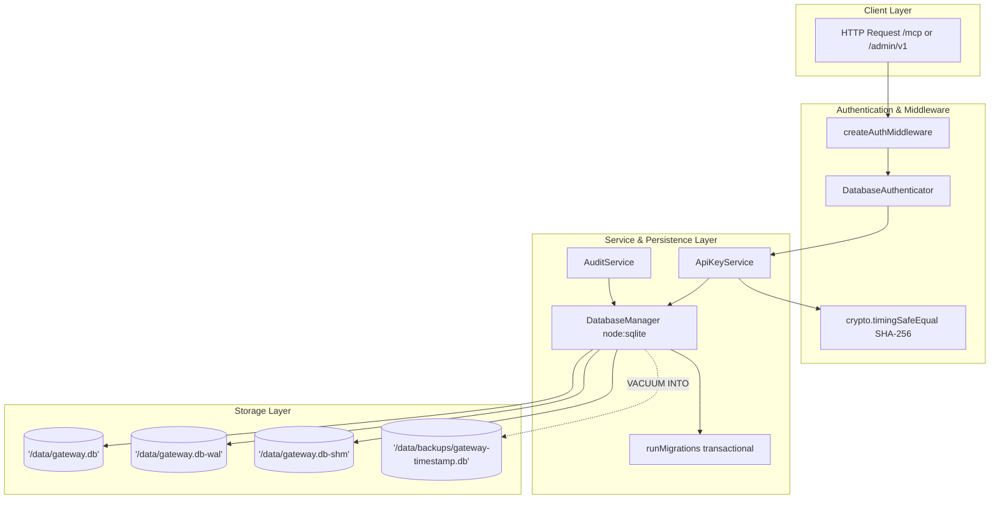

# Implementation Plan — Gate G4: SQLite Persistence, API-Key Lifecycle, Bootstrap, Audit, and Recovery

Gate G4 implements the durable persistence and security foundation for the Urumi Team MCP Gateway (`apps/gateway`) using Node.js 24 LTS core `node:sqlite` in Write-Ahead Logging (WAL) mode at `/data/gateway.db`.

This plan details the architecture, typed persistence layer, migration framework, credential lifecycle primitives, audit engine, idempotent bootstrap CLI, disaster recovery runbook, and verification suites.

---

## User Review Required

> [!IMPORTANT]
> **Runtime Environment Alignment**: The gateway requires Node.js 24 LTS (`node:sqlite`). Verified locally on Node `v24.20.0` (managed via nvm at `~/.nvm/versions/node/v24.20.0/bin/node` and specified in `.nvmrc`). All build, test, and CLI commands must be executed under Node >= 24.0.0.

> [!IMPORTANT]
> **Production Authenticator Transition**: In Gate G3, `FailClosedAuthenticator` rejected all requests unconditionally. In Gate G4, we introduce `DatabaseAuthenticator` which validates presented Bearer tokens against the SQLite database using constant-time comparison. In production `src/index.ts`, when the database is initialized, `DatabaseAuthenticator` is connected. If database initialization fails, the gateway halts startup immediately (fail-closed).

> [!WARNING]
> **Strict Gate Boundary Exclusions**: Per the Work Order, Gate G4 strictly excludes upstream aggregation (`apps/gateway/src/upstream/`, Gate G5), upstream routing and resilience (Gate G6), dynamic admin REST endpoints (Gate G7), and Kubernetes/Helm/PVC provisioning (Gate G8). No live WooCommerce store records (protected products 10, 11, 12, Order #14) or cluster resources will be touched.

---

## G4 Technical Architecture & Component Design



---

## Proposed Changes

### Component 1: Database Foundation & Migrations (`apps/gateway/src/db/`)

#### [NEW] `apps/gateway/src/db/connection.ts`
- Manages the `DatabaseSync` connection lifecycle with strict PRAGMAs:
  ```sql
  PRAGMA journal_mode = WAL;
  PRAGMA foreign_keys = ON;
  PRAGMA busy_timeout = 5000;
  PRAGMA synchronous = NORMAL;
  ```
- Startup integrity verification: executes `PRAGMA integrity_check;`. If the database is corrupt, throws `DatabaseCorruptionError` and aborts startup immediately without deleting or resetting existing files.
- Fail-closed error handling for missing/unwritable paths (`DatabaseInitializationError`).
- Exports `DatabaseManager` providing typed query preparation, transaction helpers, and graceful connection closure (`close()`).

#### [NEW] `apps/gateway/src/db/migrations.ts`
- Transactional versioned migration framework using `schema_migrations` (`version INTEGER PRIMARY KEY, name TEXT NOT NULL, applied_at INTEGER NOT NULL`).
- **Fail-Closed Version Check**: Detects if database schema version > application code version (`IncompatibleSchemaError`). Startup halts to prevent data corruption.
- **Transactional Atomicity**: Executes each pending migration within `BEGIN IMMEDIATE TRANSACTION; ... COMMIT;`. On any failure, executes `ROLLBACK;` and raises `MigrationError`, leaving zero partially applied schema state.

#### [NEW] `apps/gateway/src/db/schema.ts`
- Canonical Migration 001 Schema defining:
  - `schema_migrations`
  - `users` (`id`, `username UNIQUE`, `role CHECK('admin', 'member')`, `created_at`)
  - `api_keys` (`id`, `user_id REFERENCES users`, `key_hash UNIQUE`, `key_prefix`, `name`, `expires_at`, `revoked_at`, `created_at`, `last_used_at`)
  - `upstreams` (`id`, `slug UNIQUE`, `display_name`, `endpoint_url`, `timeout_ms CHECK(500..30000)`, `is_enabled`, `status`, `secret_ref_name`, `secret_ref_key`, `cleanup_error`, `created_at`, `updated_at`)
  - `audit_logs` (`id`, `user_id REFERENCES users`, `upstream_slug`, `tool_name`, `arguments_hash`, `status CHECK('pending', 'success', 'failed', 'timeout', 'client_disconnected', 'unconfirmed_outcome')`, `duration_ms`, `error_code`, `error_message`, `created_at`)
  - Indexes: `idx_audit_status_created`, `idx_audit_created`, `idx_api_keys_hash`, `idx_api_keys_user`, `idx_upstreams_slug`.

#### [NEW] `apps/gateway/src/db/backup.ts`
- Implements `backupDatabase(db, backupDir, retainCount = 7)` using SQLite native `VACUUM INTO '<destination_path>'`.
- Immediately verifies snapshot integrity via `PRAGMA integrity_check;`.
- Sets strict POSIX permissions `0600` (`-rw-------`).
- Automated retention pruning keeping the latest snapshots and removing older files.

---

### Component 2: API-Key Lifecycle & Authentication (`apps/gateway/src/auth/` & `src/db/`)

#### [NEW] `apps/gateway/src/db/api-key-repo.ts`
- Typed persistence methods:
  - `insertUser(user)`
  - `findUserById(id)`, `findUserByUsername(username)`
  - `hasAdminUser(): boolean`
  - `insertApiKey(keyRecord)`
  - `findApiKeyByHash(keyHash)`
  - `revokeApiKey(id, revokedAt): boolean`
  - `updateApiKeyLastUsed(id, lastUsedAt)`
  - `listApiKeysByUser(userId)`

#### [NEW] `apps/gateway/src/auth/api-key-service.ts`
- **Entropy & Format**: Generates 32 cryptographically secure random bytes via `crypto.randomBytes(32)`.
  - Format: `urumi_live_<64_hex_chars>` (75 characters total).
  - Prefix: `rawKey.substring(0, 16)` (e.g. `urumi_live_7f8a...`).
- **One-Way Verifier**: Computes SHA-256 digest (`crypto.createHash('sha256').update(rawKey).digest('hex')`). Only the verifier and prefix are saved to SQLite; the raw key is returned **exactly once** upon creation.
- **Constant-Time Verification**: Compares inbound candidate token hash to stored hash using `crypto.timingSafeEqual` over raw buffer digests to prevent timing side channels.
- **Lifecycle Invariants**:
  - Rejects revoked keys (`revoked_at IS NOT NULL`).
  - Rejects expired keys (`expires_at <= unixepoch()`).
  - Updates `last_used_at` timestamp.
  - Zero raw keys or authorization headers written to logs or database.

#### [NEW] `apps/gateway/src/auth/database-authenticator.ts`
- Implements `Authenticator` interface from G3 (`authenticate(bearerToken: string): Promise<AuthenticatedUser | null>`).
- Delegates directly to `ApiKeyService.verifyKey(bearerToken)`.
- Replaces `FailClosedAuthenticator` in production server initialization when SQLite is active.

---

### Component 3: Idempotent Administrator Bootstrap CLI (`apps/gateway/src/cli/`)

#### [NEW] `apps/gateway/src/cli/bootstrap.ts`
- Standalone CLI command: `node dist/cli/bootstrap.js [options]` (and `npm --workspace=gateway run bootstrap`).
- Options: `--username <admin>` (default: `admin`), `--name <name>` (default: `System Administrator`).
- **Idempotency Guard**:
  - Checks if an administrator account already exists (`SELECT id FROM users WHERE role = 'admin' LIMIT 1;`).
  - If admin exists: Outputs `"Administrator account already provisioned. Bootstrap safely aborted."` and exits cleanly with **code 0**.
  - If no admin exists:
    1. Generates initial 32-byte API key (`urumi_live_...`).
    2. Writes admin user (`role = 'admin'`) and hashed key within a single SQLite transaction.
    3. Prints plaintext key to stdout **exactly once** with prominent warning:
       `"CRITICAL: Store this key securely now. It cannot be recovered."`
- **Zero Secret Spillage**: Never logs plaintext credentials to file logs or CI artifacts.

#### [MODIFY] `apps/gateway/package.json`
- Adds `"bootstrap": "tsx src/cli/bootstrap.ts"` to `scripts`.

---

### Component 4: Durable Two-Phase Audit Persistence (`apps/gateway/src/audit/` & `src/db/`)

#### [NEW] `apps/gateway/src/db/audit-repo.ts`
- Typed persistence methods:
  - `insertAuditStart(record)`
  - `updateAuditFinalize(id, update)`
  - `reconcileDanglingRecords(cutoffTimestamp)`
  - `pruneOldRecords(retentionDays, batchLimit)`
  - `findAuditById(id)`
  - `listAudits(options)`

#### [NEW] `apps/gateway/src/audit/audit-service.ts`
- Implements the strict 6-state lifecycle from ADR-014:
  - `pending` -> `success` | `failed` | `timeout` | `client_disconnected` | `unconfirmed_outcome`
- **Arguments Hash**: Computes SHA-256 fingerprint of JSON arguments (`arguments_hash`). Zero customer PII or sensitive authorization credentials persisted.
- **Phase 1 (Start Write)**:
  - Commits `pending` record to SQLite before invoking upstream.
  - If write fails (e.g. database locked or unwritable): throws `AuditStartError` and **aborts immediately** with HTTP 500. Upstream is never called (Fail Closed).
- **Phase 2 (Finalization Write)**:
  - Updates record with final status, duration, error code/message.
  - **Truthful Reporting Invariant**: If upstream mutation succeeds but Phase 2 write fails (e.g. disk full), does **not** report a failure to caller; sets `X-Urumi-Audit-Status: finalization-degraded` and leaves record in `pending` for reconciliation.
- **Background Reconciliation**:
  - `reconcileDanglingAuditRecords(olderThanSeconds)`: Finds records in `pending` older than cutoff and marks them as `unconfirmed_outcome` with error `FINALIZATION_TIMEOUT`.
- **Bounded Retention Pruning**:
  - `pruneAuditLogs(retentionDays, batchLimit)`: Deletes records older than retention threshold in bounded batches of 500 rows.

---

### Component 5: Server & Lifecycle Integration (`apps/gateway/src/`)

#### [MODIFY] `apps/gateway/src/lifecycle.ts`
- Adds database cleanup hook (`dbManager.close()`) to `LifecycleManager.stop()` ensuring SQLite WAL checkpoint and file handles are cleanly closed during graceful shutdown.

#### [MODIFY] `apps/gateway/src/index.ts`
- Initializes `DatabaseManager` using `config.DB_PATH`.
- Runs transactional migrations on startup.
- Connects `DatabaseAuthenticator` and binds DB health check into readiness probe `readinessCheck: () => dbManager.isHealthy()`.

---

### Component 6: Disaster Recovery Runbook

#### [NEW] `docs/phase-4/g4-recovery-runbook.md`
- Complete operational guide detailing:
  - WAL companion files (`.db-wal`, `.db-shm`) and backup consistency requirements.
  - Non-locking online backup procedure via `VACUUM INTO`.
  - Integrity verification procedure (`PRAGMA integrity_check;`).
  - Cold recovery and disaster restore steps (scaling replica to 0, replacing database and clearing stale WAL/SHM, file ownership/permissions UID 10001 / 0600, scaling to 1, readiness verification).
  - Disk-full (`SQLITE_FULL`) emergency mitigation and recovery procedures.

---

## Verification Plan

### Automated Test Suites (`apps/gateway/test/`)

All tests will use temporary disposable directories (`os.tmpdir()`) and disposable SQLite databases. Zero tests will target `/data/gateway.db` or live store databases.

```bash
# Gateway unit and persistence tests
export PATH="$HOME/.nvm/versions/node/v24.20.0/bin:$PATH"
npm --workspace=gateway run test:unit

# Gateway protocol and lifecycle tests
npm --workspace=gateway run test:protocol

# Monorepo build and regression suites
npm run build
npm test
```

#### Detailed Test Coverage Matrix:
1. **`test/unit/db-connection.test.ts`**:
   - Fresh initialization creates database with WAL mode, foreign keys enabled, synchronous normal, and busy timeout 5000ms.
   - Idempotent repeated initialization on existing database.
   - Detects corrupted database via `PRAGMA integrity_check` and throws `DatabaseCorruptionError` without wiping or resetting file.
   - Unwritable path fails closed (`DatabaseInitializationError`).
   - Clean connection close and reopen preserves data.
2. **`test/unit/db-migrations.test.ts`**:
   - Applies migrations cleanly and records entries in `schema_migrations`.
   - Idempotent: running migrations when already up to date is a no-op.
   - Rollback atomicity: failing migration rolls back `BEGIN IMMEDIATE TRANSACTION;` without partial schema application.
   - Future schema version detection: halts with `IncompatibleSchemaError` if database version > code version.
3. **`test/unit/api-key-lifecycle.test.ts`**:
   - Generates key matching `urumi_live_[0-9a-f]{64}`.
   - Raw key returned only once; only SHA-256 verifier stored in SQLite.
   - Valid Bearer token authentication via `DatabaseAuthenticator`.
   - Constant-time verification (`timingSafeEqual`) rejects tampered, malformed, or invalid tokens.
   - Revocation: `revokeApiKey()` takes effect immediately on next lookup.
   - Expiry: expired tokens fail authentication with null user.
   - Redaction: captures logs during key generation and authentication, verifying zero raw keys or Bearer headers are logged.
4. **`test/unit/bootstrap.test.ts`**:
   - First run provisions admin user and prints initial key once.
   - Subsequent runs detect existing administrator and safely exit with code 0 without creating duplicates or rotating keys.
   - Partial run recovery.
5. **`test/unit/audit-persistence.test.ts`**:
   - Full 2-phase lifecycle (`pending` -> `success` / `failed` / `timeout` / `client_disconnected`).
   - Invalid status rejected by SQLite `CHECK` constraint.
   - Arguments hashing: verifies SHA-256 digest is stored; no raw payload or PII persisted.
   - Phase 1 failure blocks execution (Fail Closed).
   - Phase 2 failure handling and dangling record reconciliation (`reconcileDanglingAuditRecords` -> `unconfirmed_outcome`).
   - Bounded retention pruning (`pruneAuditLogs`).
6. **`test/unit/recovery.test.ts`**:
   - Online backup via `VACUUM INTO` captures consistent snapshot.
   - Integrity check on backup snapshot passes `ok`.
   - Corrupted backup snapshot rejected.
   - Full restore simulation: active database cleared of WAL/SHM, restored from backup snapshot, reopened, and verified intact.

---

## Deliverables & Acceptance Criteria

1. Database schema and migration files in `apps/gateway/src/db/`.
2. Typed persistence layer and repository classes.
3. API-key lifecycle and constant-time `DatabaseAuthenticator`.
4. Two-phase audit service with 6-state lifecycle and reconciliation.
5. Idempotent CLI bootstrap command in `apps/gateway/src/cli/bootstrap.ts`.
6. Disaster recovery and backup runbook in `docs/phase-4/g4-recovery-runbook.md`.
7. Updated Phase 4 Execution Log in `docs/phase-4/phase-4-execution-log.md`.
8. Complete test evidence across all workspaces (`npm test` 100% pass).
9. Confirmation of strict gate boundaries (G5, G6, Kubernetes, WooCommerce store untouched).
