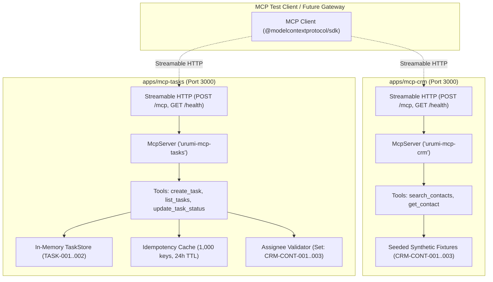

# Implementation Plan — Gate G2: CRM and Tasks Mock Services Implementation

## Goal Description
Implement the two internal, deterministic mock MCP services authorized for **Phase 4 Gate G2**:
1. **`apps/mcp-crm`**: A deterministic CRM mock service running over Streamable HTTP (`POST /mcp`, `GET /health`), providing synthetic non-PII contact fixtures (`CRM-CONT-001..003` with strictly `@example.mock` emails) and two tools (`search_contacts`, `get_contact`).
2. **`apps/mcp-tasks`**: A deterministic Tasks/Notes mock service running over Streamable HTTP (`POST /mcp`, `GET /health`), providing an in-memory task store with state-reset semantics on pod restart, seeded baseline tasks (`TASK-001`, `TASK-002`), 1,000-key / 24-hour idempotency caching, assignee relationship validation against the approved CRM contact set, and three tools (`create_task`, `list_tasks`, `update_task_status`).
3. **Automated Test Suites & Workspace Build**:
   - Comprehensive unit test suites validating bounds, sorting, non-PII compliance, assignee validation, and idempotency.
   - Official MCP SDK protocol client integration tests connecting to both servers over Streamable HTTP and executing all tools.
   - Clean workspace build verification (`npm run build`).

All implementations adhere strictly to [`ADR-018`](file:///home/rathore/Documents/Urumi%20Assignment/docs/decisions/ADR-018-upstream-mock-contracts-crm-and-tasks.md), [`ADR-002`](file:///home/rathore/Documents/Urumi%20Assignment/docs/decisions/ADR-002-mcp-compatibility.md), [`ADR-008`](file:///home/rathore/Documents/Urumi%20Assignment/docs/decisions/ADR-008-five-tool-contract-and-pii-redaction.md), [`Register`](file:///home/rathore/Documents/Urumi%20Assignment/docs/phase-4/phase-4-g1-architecture-decision-register.md), and carry forward all G1.1 findings.

---

## User Review Required

> [!IMPORTANT]
> **Strict Gate Boundary Enforcement**:
> In accordance with the Gate G2 work order, no code for `apps/gateway` will be created (reserved for Gate G3+), no Kubernetes cluster resources will be deployed or modified, and no live WooCommerce store records will be accessed or mutated.

> [!NOTE]
> **Runtime Environment & PATH**:
> Tests and build commands will be executed using Node 24 (`v24.20.0` at `/home/rathore/.nvm/versions/node/v24.20.0/bin/node` with npm `11.19.0`), matching the project's pinned Node 24 LTS runtime requirement.

---

## Open Questions
None. All schema definitions, tool inputs, seeded fixtures, and idempotency specifications have been approved in Gate G1 and G1.1.

---

## Architecture & Service Contracts



---

## Proposed Changes

### Component 1: `apps/mcp-crm` (CRM Mock Service)

#### [NEW] `apps/mcp-crm/package.json`
- Defines package name `mcp-crm`, `type: "module"`, pinned `@modelcontextprotocol/sdk@1.32.1`, `express@^4.21.2`, `zod@^3.24.2`.
- Scripts: `build`, `start`, `dev`, `test:unit`, `test:protocol`, `test`, `typecheck`.

#### [NEW] `apps/mcp-crm/tsconfig.json`
- Extends `../../tsconfig.base.json`, `outDir: "./dist"`, `rootDir: "./src"`.

#### [NEW] `apps/mcp-crm/src/config.ts`
- Zod schema for environment variables:
  - `PORT`: default `3000` (min 1024, max 65535).
  - `HOST`: default `'0.0.0.0'`.
  - `NODE_ENV`: `'development' | 'production' | 'test'`.
  - `LOG_LEVEL`: `'debug' | 'info' | 'warn' | 'error'`.
  - `MOCK_DELAY_MS`: test-injected latency (default `0`).
  - `MOCK_FAIL_MODE`: `'none' | 'http-500' | 'tool-error'` (default `'none'`).

#### [NEW] `apps/mcp-crm/src/logging/logger.ts`
- Structured JSON logger ensuring zero PII and sensitive data leakage, matching `apps/woocommerce-mcp` logging pattern.

#### [NEW] `apps/mcp-crm/src/data/fixtures.ts`
- Strictly non-PII seeded contact fixtures conforming to `CrmContactSchema`:
  - `CRM-CONT-001`: Alice Smith (Acme Retail Ltd, `alice.smith@example.mock`, `+91-98765-43210`, active)
  - `CRM-CONT-002`: Bob Jones (Globex Supply Chain, `bob.jones@example.mock`, `+91-98765-43211`, active)
  - `CRM-CONT-003`: Charlie Brown (Urumi Demo Merchant, `charlie.brown@example.mock`, `+91-98765-43212`, lead)

#### [NEW] `apps/mcp-crm/src/tools/schemas.ts`
- Strict Zod schemas:
  - `CrmContactSchema`: Full contact shape with regex `^CRM-CONT-[0-9]{3}$` and `@example.mock` constraint.
  - `SearchContactsInputShape`:
    - `query`: `z.string().trim().min(1).max(50).optional()`
    - `limit`: `z.number().int().min(1).max(20).default(10)`
  - `GetContactInputShape`:
    - `contact_id`: `z.string().regex(/^CRM-CONT-[0-9]{3}$/, 'Invalid Contact ID format')`

#### [NEW] `apps/mcp-crm/src/tools/index.ts`
- Registers tools with `server.registerTool(...)`:
  - `search_contacts`: Case-insensitive substring search over `name`, `company`, `title`, `notes`, `email`, `id`. Deterministically sorted by `id` ascending, bounded by `limit`.
  - `get_contact`: Look up by exact `id`. Returns contact or `{ isError: true, content: [{ type: 'text', text: 'Contact not found: ...' }] }`.

#### [NEW] `apps/mcp-crm/src/http/health.ts`
- Health probe returning HTTP 200 `{ status: 'ok', service: 'urumi-mcp-crm', timestamp: ... }`.

#### [NEW] `apps/mcp-crm/src/server.ts`
- `createCrmMcpServer()` creating `McpServer({ name: 'urumi-mcp-crm', version: '1.0.0' })`.
- `createExpressApp(config)` wiring `createMcpExpressApp`, `GET /health`, and stateless `POST /mcp` with `StreamableHTTPServerTransport`.

#### [NEW] `apps/mcp-crm/src/index.ts`
- Entry point with graceful shutdown handling on `SIGINT` / `SIGTERM`.

#### [NEW] `apps/mcp-crm/test/unit/fixtures.test.ts`
- Validates synthetic fixtures schema compliance, `@example.mock` domains, and absence of real customer PII.

#### [NEW] `apps/mcp-crm/test/unit/tools.test.ts`
- Unit tests for `search_contacts` (empty query, query matching, non-matching, sorting, limits, schema violations) and `get_contact` (found, not found, regex violations).

#### [NEW] `apps/mcp-crm/test/protocol/crm-protocol.test.ts`
- Protocol test starting server on ephemeral port, connecting with official MCP SDK `Client` + `StreamableHTTPClientTransport`, validating handshake `2024-11-05`, tool discovery, and wire execution.

---

### Component 2: `apps/mcp-tasks` (Tasks Mock Service)

#### [NEW] `apps/mcp-tasks/package.json`
- Defines package name `mcp-tasks`, `type: "module"`, pinned `@modelcontextprotocol/sdk@1.32.1`, `express@^4.21.2`, `zod@^3.24.2`.
- Scripts: `build`, `start`, `dev`, `test:unit`, `test:protocol`, `test`, `typecheck`.

#### [NEW] `apps/mcp-tasks/tsconfig.json`
- Extends `../../tsconfig.base.json`, `outDir: "./dist"`, `rootDir: "./src"`.

#### [NEW] `apps/mcp-tasks/src/config.ts`
- Environment config schema:
  - `PORT`: default `3000`.
  - `HOST`: default `'0.0.0.0'`.
  - `NODE_ENV`: `'development' | 'production' | 'test'`.
  - `LOG_LEVEL`: `'debug' | 'info' | 'warn' | 'error'`.
  - `MOCK_DELAY_MS`: test-injected latency (default `0`).
  - `MOCK_FAIL_MODE`: `'none' | 'http-500' | 'tool-error'` (default `'none'`).

#### [NEW] `apps/mcp-tasks/src/logging/logger.ts`
- Structured JSON logger ensuring zero PII and sensitive data leakage.

#### [NEW] `apps/mcp-tasks/src/store/task-store.ts`
- `TaskStore` class managing volatile in-memory state:
  - Seeded baseline: `TASK-001` and `TASK-002`.
  - `reset()` method to return state to initial baseline (guaranteeing pod-restart determinism).
  - Auto-incrementing IDs (`TASK-003`, `TASK-004`, ...).
  - Idempotency cache: `Map<string, { taskId: string, createdAt: number }>` bounded at 1,000 entries with 24-hour TTL (`24 * 60 * 60 * 1000` ms).
  - Assignee validation against `VALID_CRM_ASSIGNEES = new Set(['CRM-CONT-001', 'CRM-CONT-002', 'CRM-CONT-003'])`.

#### [NEW] `apps/mcp-tasks/src/tools/schemas.ts`
- Strict Zod schemas:
  - `VALID_CRM_ASSIGNEES`: Set of `'CRM-CONT-001'`, `'CRM-CONT-002'`, `'CRM-CONT-003'`.
  - `TaskRecordSchema`: Full task shape with regex `^TASK-[0-9]{3,}$`.
  - `CreateTaskInputShape`:
    - `title`: `z.string().min(1).max(120)`
    - `description`: `z.string().max(500).optional()`
    - `priority`: `z.enum(['low', 'medium', 'high', 'urgent']).default('medium')`
    - `assignee_contact_id`: `z.string().optional()`
    - `idempotency_key`: `z.string().max(64).optional()`
  - `ListTasksInputShape`:
    - `status`: `z.enum(['todo', 'in_progress', 'done', 'cancelled']).optional()`
    - `priority`: `z.enum(['low', 'medium', 'high', 'urgent']).optional()`
    - `limit`: `z.number().int().min(1).max(50).default(20)`
  - `UpdateTaskStatusInputShape`:
    - `task_id`: `z.string().regex(/^TASK-[0-9]{3,}$/)`
    - `status`: `z.enum(['todo', 'in_progress', 'done', 'cancelled'])`

#### [NEW] `apps/mcp-tasks/src/tools/index.ts`
- Registers tools with `server.registerTool(...)`:
  - `create_task`: Validates `assignee_contact_id` against `VALID_CRM_ASSIGNEES` (rejects unknown with `isError: true`). Checks `idempotency_key` cache. Creates new task if key is new. Returns task.
  - `list_tasks`: Filters by `status` and `priority`, deterministically sorted by `id` ascending, bounded by `limit`.
  - `update_task_status`: Updates status. If task not found, returns `{ isError: true, content: 'Task not found' }`. If status already matches, returns `{ updated: false }`. Otherwise updates status, refreshes `updated_at`, returns `{ updated: true }`.

#### [NEW] `apps/mcp-tasks/src/http/health.ts`
- Health probe returning HTTP 200 `{ status: 'ok', service: 'urumi-mcp-tasks', timestamp: ... }`.

#### [NEW] `apps/mcp-tasks/src/server.ts`
- `createTasksMcpServer(store?)` creating `McpServer({ name: 'urumi-mcp-tasks', version: '1.0.0' })`.
- `createExpressApp(config, store?)` wiring `createMcpExpressApp`, `GET /health`, and stateless `POST /mcp` with `StreamableHTTPServerTransport`.

#### [NEW] `apps/mcp-tasks/src/index.ts`
- Entry point with graceful shutdown handling on `SIGINT` / `SIGTERM`.

#### [NEW] `apps/mcp-tasks/test/unit/store.test.ts`
- Unit tests for `TaskStore`: initialization, reset, ID generation, filtering, sorting, status updates, idempotency cache hit/miss/expiry, and 1,000-key capacity limit.

#### [NEW] `apps/mcp-tasks/test/unit/tools.test.ts`
- Unit tests for `create_task` (valid creation, invalid assignee rejection, idempotency deduplication), `list_tasks` (filtering, limits), `update_task_status` (success, no-op, not found).

#### [NEW] `apps/mcp-tasks/test/protocol/tasks-protocol.test.ts`
- Protocol test starting server on ephemeral port, connecting with official MCP SDK `Client` + `StreamableHTTPClientTransport`, validating handshake `2024-11-05`, tool discovery, and wire execution.

---

### Component 3: Workspace Manifest & Execution Log

#### [MODIFY] `package-lock.json`
- Synchronize workspaces via `npm install` using Node 24 (`v24.20.0`).

#### [MODIFY] `docs/phase-4/phase-4-execution-log.md`
- Record execution results, tool discovery output, and test pass logs for Gate G2.

---

## Verification Plan

### Automated Tests
1. **CRM Unit Tests**:
   ```bash
   env PATH="/home/rathore/.nvm/versions/node/v24.20.0/bin:$PATH" npm run test:unit --workspace=apps/mcp-crm
   ```
2. **CRM Protocol Tests**:
   ```bash
   env PATH="/home/rathore/.nvm/versions/node/v24.20.0/bin:$PATH" npm run test:protocol --workspace=apps/mcp-crm
   ```
3. **Tasks Unit Tests**:
   ```bash
   env PATH="/home/rathore/.nvm/versions/node/v24.20.0/bin:$PATH" npm run test:unit --workspace=apps/mcp-tasks
   ```
4. **Tasks Protocol Tests**:
   ```bash
   env PATH="/home/rathore/.nvm/versions/node/v24.20.0/bin:$PATH" npm run test:protocol --workspace=apps/mcp-tasks
   ```
5. **Full Monorepo Build Verification**:
   ```bash
   env PATH="/home/rathore/.nvm/versions/node/v24.20.0/bin:$PATH" npm run build
   ```
6. **Full Monorepo Test Run**:
   ```bash
   env PATH="/home/rathore/.nvm/versions/node/v24.20.0/bin:$PATH" npm run test --workspaces --if-present
   ```

### Manual Verification
- Verify that `apps/mcp-crm` and `apps/mcp-tasks` can be started independently and respond to `GET /health` with HTTP 200.
- Verify that MCP protocol handshake (`2024-11-05`) succeeds over Streamable HTTP.
- Inspect JSON tool schemas advertised during protocol discovery to confirm parameter bounds.
- Confirm zero PII leakage and strict `@example.mock` compliance.
