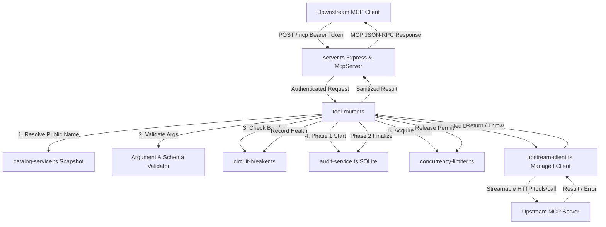

# Gate G6 Implementation Plan: Dynamic Tool Router, Bounded Execution, and Failure Isolation

## Goal Description

Implement the Team MCP Gateway's dynamic tool execution router (`apps/gateway`) to enable authenticated downstream MCP `tools/call` requests to be validated, mapped through the G5 catalog snapshot to registered upstreams, executed through managed MCP clients, and returned as truthful MCP results.

The implementation preserves all Gate G3-G5 boundaries:
- Dynamic catalog as the single source of truth for public-to-original tool translation.
- Bounded execution with a 10-second default upstream timeout, respecting upstream configuration and request deadlines.
- Exact request cancellation propagation via the pinned `@modelcontextprotocol/sdk@1.32.1` `RequestOptions.signal` contract.
- Per-upstream circuit breaker failure isolation (`closed`, `open`, `half_open`).
- Bounded process-local per-upstream concurrency control.
- Full integration with the two-phase audit lifecycle (`pending` -> `success` / `failed` / `timeout` / `client_disconnected` / `unconfirmed_outcome`).
- Truthful MCP protocol handling preserving JSON-RPC vs tool-level error distinctions.

## User Review Required

> [!IMPORTANT]
> **Process-Local Concurrency & Circuit Breakers**: Concurrency control and circuit breakers are process-local in Gate G6 (as specified in ADR-011 and Section 6 of the Work Order). No distributed locking or cross-pod synchronization is implemented.

> [!IMPORTANT]
> **Ambiguous Mutation Outcomes (`unconfirmed_outcome`)**: If a mutating tool call (`create_product`, `update_order_status`, `create_task`, `update_task_status`) experiences a timeout or client disconnect after dispatch to the upstream, the outcome is recorded as `unconfirmed_outcome` in the audit log. The gateway **never** automatically retries mutating calls.

> [!NOTE]
> **Audit Finalization Degradation Contract**: If upstream execution succeeds but local SQLite storage fails during Phase 2 finalization, the gateway returns the pristine upstream tool result with `_meta.urumi_audit_status = 'degraded'` and HTTP header `X-Urumi-Audit-Status: degraded`, preventing false client retries.

## Open Questions

None. All technical requirements, timeout bounds (500ms..30000ms), concurrency defaults (4 per upstream, 20 global), circuit breaker parameters (3 failures, 15s reset, 1 probe), and audit transitions are fully defined by ADR-011..ADR-018 and the Gate G6 Work Order.

---

## Proposed Changes



---

### Component: Upstream & Circuit Breakers (`apps/gateway/src/upstream/`)

#### [NEW] `apps/gateway/src/upstream/circuit-breaker.ts`
Implement per-upstream circuit breaker state machine:
- **States**: `closed` (normal), `open` (short-circuit fast fail), `half_open` (probe test).
- **Default Parameters**:
  - `failureThreshold`: 3 consecutive infrastructure failures.
  - `resetTimeoutMs`: 15,000 ms cooldown before half-open probe.
  - `halfOpenMaxProbes`: 1 probe.
- **Failure Classification**:
  - Counts towards breaker: `UpstreamTimeoutError`, `UpstreamConnectionError`, `UpstreamProtocolError` (5xx transport failures).
  - Excluded from breaker: upstream tool-level errors (`CallToolResult.isError = true`), client cancellations (`AbortError`), argument validation errors.
- **Methods**:
  - `canExecute(): boolean`
  - `recordSuccess(): void`
  - `recordFailure(err: unknown): void`
  - `getState(): CircuitBreakerState`
  - `getMetrics(): CircuitBreakerMetrics`

#### [NEW] `apps/gateway/src/upstream/concurrency-limiter.ts`
Implement bounded concurrency limiter:
- **Limits**:
  - Global permit limit (default 20 from `config.GLOBAL_CONCURRENCY_LIMIT`).
  - Per-upstream permit limit (default 4 from `config.PER_UPSTREAM_CONCURRENCY_LIMIT`).
  - Bounded waiting queue per upstream (max 10 items, bounded wait timeout).
- **Invariants**:
  - Fast-fail rejection when queue is exhausted.
  - Timeout while queued immediately removes the request and aborts.
  - Permits released exactly once in a terminal `finally` block.
  - Independent per upstream: overload on CRM cannot starve Tasks or WooCommerce.
  - Clean shutdown drain support.

#### [NEW] `apps/gateway/src/upstream/argument-validator.ts`
Implement strict JSON Schema argument validator for tool input schemas:
- Validates that arguments object matches `inputSchema.type === 'object'`.
- Validates all `required` properties exist and are not undefined.
- Validates property types against `inputSchema.properties` (`string`, `number`, `integer`, `boolean`, `array`, `object`).
- Rejects unknown properties when `additionalProperties: false`.
- Enforces depth and size limits to prevent prototype pollution or JSON bombs.
- Pure validation: never mutates, coerces, or injects arguments.

#### [MODIFY] `apps/gateway/src/upstream/upstream-client.ts`
Extend `ManagedUpstreamClient`:
- Add `callTool(originalName: string, args: Record<string, unknown> | undefined, options?: { signal?: AbortSignal }): Promise<CallToolResult>`
- Ensure underlying `Client` and `StreamableHTTPClientTransport` connection is established via single-flight connection manager.
- Dispatch via `this.client.request({ method: 'tools/call', params: { name: originalName, arguments: args } }, CallToolResultSchema, { signal })`.
- Classify and sanitize errors (timeout, connection, protocol).
- Expose `getTimeoutMs(): number`.

#### [NEW] `apps/gateway/src/upstream/tool-router.ts`
Implement the central dynamic tool execution router:
- Resolves public tool name through `catalogService.getSnapshot().toolsByPublicName`.
- Rejects unknown names with `McpError(ErrorCode.InvalidParams, 'Tool "..." not found')`.
- Rejects tools marked `reachable === false` with truthful MCP tool error.
- Rechecks upstream enabled status and connectivity before dispatch.
- Evaluates per-upstream circuit breaker; fails fast if open.
- Validates caller arguments via `argument-validator.ts`.
- Classifies mutating vs read-only operations:
  - Mutating: `create_product`, `update_order_status`, `create_task`, `update_task_status`, and `create_*`, `update_*`, `delete_*`, `patch_*`.
- Phase 1 Audit: persists `pending` record before dispatch. If write fails, aborts immediately without dispatch (fail closed).
- Acquires concurrency permits (global + upstream).
- Bounded execution deadline: `min(upstreamTimeoutMs, remainingRequestDeadline)`.
- Propagates cancellation via scoped `AbortController` linked to client disconnect and deadline timer.
- Executes tool via `ManagedUpstreamClient.callTool(...)`.
- Enforces response size cap (`MAX_RESULT_SIZE_BYTES`, default 1 MiB).
- Phase 2 Audit:
  - Confirmed success: `success`.
  - Upstream tool error: `failed` with code `TOOL_ERROR`.
  - Timeout: if mutating, `unconfirmed_outcome`; if read-only, `timeout`.
  - Client disconnect: if mutating, `unconfirmed_outcome`; if read-only, `client_disconnected`.
  - Circuit breaker open / overload: `failed`.
  - Degraded audit write: sets `_meta.urumi_audit_status = 'degraded'` and triggers response header callback.
- Releases concurrency permits.
- Returns clean, sanitized `CallToolResult`.

---

### Component: Downstream Server & Lifecycle (`apps/gateway/src/`)

#### [MODIFY] `apps/gateway/src/server.ts`
- Connect `ToolRouter` to `createGatewayMcpServer` and `createExpressApp`.
- In `createGatewayMcpServer`:
  - When `router` is provided, `CallToolRequestSchema` handler delegates to `router.dispatch(...)`.
  - Receives authenticated user context (`req.user`), client abort signal (triggered on `req.on('close')`), and degraded audit callback (`res.setHeader('X-Urumi-Audit-Status', 'degraded')`).
- Preserve G5 truthful behavior as fallback if router is not supplied.

#### [MODIFY] `apps/gateway/src/index.ts`
- Instantiate `AuditRepository` and `AuditService` from SQLite database.
- Instantiate `ToolRouter` with `catalogService`, `upstreamManager`, `auditService`, and `config`.
- Pass router to `createExpressApp`.
- Register router shutdown hook with `LifecycleManager`.

#### [MODIFY] `apps/gateway/src/lifecycle.ts`
- Ensure registered cleanup hooks drain router in-flight requests and reject new dispatches during shutdown.

---

### Component: Documentation & Execution Log

#### [MODIFY] `docs/phase-4/phase-4-execution-log.md`
- Record Gate G6 transition, implementation SHA, architectural details, and verification results.

---

## Verification Plan

### Automated Tests

#### 1. Unit Tests (`apps/gateway/test/unit/`)
- `circuit-breaker.test.ts`:
  - Verify transitions: `closed` -> `open` after 3 consecutive failures.
  - Verify fast-fail behavior in `open` state.
  - Verify cooldown expiry -> `half_open` state and single probe execution.
  - Verify probe success closes breaker; probe failure reopens breaker.
  - Verify business tool errors (`isError: true`) do NOT count as failures.
  - Verify client aborts do NOT count as failures.
  - Verify failure isolation between independent upstreams.
- `concurrency-limiter.test.ts`:
  - Verify capacity limit enforcement (max 4 per upstream, max 20 global).
  - Verify bounded queueing and wait timeout.
  - Verify fast rejection when queue is saturated.
  - Verify permit release exactly once on success, error, and abort.
  - Verify slow upstream does not starve independent upstream.
- `argument-validator.test.ts`:
  - Verify required fields validation.
  - Verify type checking (string, number, boolean, array, object).
  - Verify rejection of non-object root arguments.
  - Verify deep schema checking and unknown property rejection when disallowed.
- `tool-router.test.ts`:
  - Dynamic public tool name resolution through catalog.
  - Rejection of unknown tools before dispatch.
  - Rejection of disabled / unreachable tools.
  - Phase 1 audit failure prevents dispatch (fail closed).
  - Upstream tool error preservation.
  - Timeout and disconnect mutation classification (`unconfirmed_outcome`).
  - Degraded audit response metadata.
  - Response size limit enforcement.

#### 2. Protocol Tests (`apps/gateway/test/protocol/`)
- `tool-routing.test.ts`:
  - End-to-end Streamable HTTP tests using official `@modelcontextprotocol/sdk`.
  - Dynamic dispatch of `crm__search_contacts` to mock CRM.
  - Dynamic dispatch of `tasks__create_task` to mock Tasks.
  - Dynamic dispatch of `woocommerce__create_product` to mock WooCommerce.
  - Upstream tool-level error returned with `isError: true`.
  - Unknown public tool returns JSON-RPC `-32602` InvalidParams.
  - Upstream timeout returns bounded tool error.
  - Client cancellation propagation with exact request-ID correlation.
  - Circuit breaker open state fails fast over wire.
  - Audit database records reflect accurate final statuses.
  - Regression check: existing G3, G4, and G5 protocol tests continue to pass with 100% success.

#### 3. Command Execution
```bash
npm --workspace=gateway run test:unit
npm --workspace=gateway run test:protocol
npm test
npm run build
npm run lint
```

### Manual Verification
1. Inspect SQLite audit log rows after executing mock tool calls to confirm no customer PII or raw secrets are stored.
2. Confirm all protected baseline store records (Products 10, 11, 12; Order #14) remain untouched.
3. Verify zero Kubernetes cluster resources were modified.
