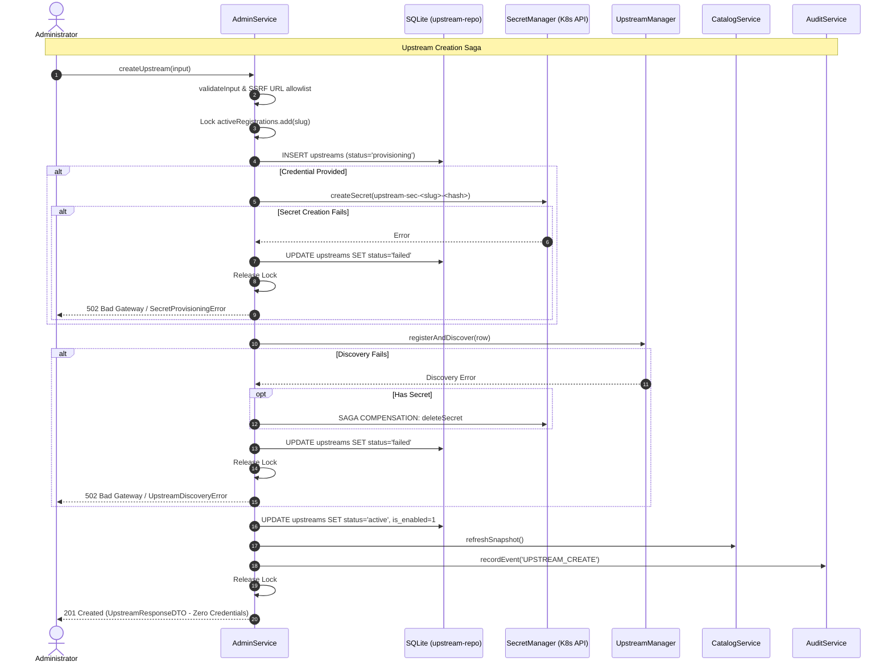

# Gate G7 Implementation Plan — Dynamic Admin API & Kubernetes Secret Lifecycle

## Goal Description
Implement the gateway's authenticated administrative API (`/admin/v1/upstreams`) and Kubernetes Secret lifecycle manager for dynamic upstream MCP server management.

The gateway must allow administrators to safely create, inspect, update, disable, re-enable, and delete upstream configurations and their associated Kubernetes-backed credentials. Configuration is persisted in SQLite WAL (`upstreams` table), credentials are stored exclusively in Kubernetes Secrets in namespace `urumi-gateway-secrets`, and the runtime `UpstreamManager`, `CatalogService`, and `ToolRouter` are updated dynamically without process restarts or disruptions to healthy upstreams.

Distributed state consistency across SQLite, Kubernetes etcd, and in-memory caches is maintained through a Saga compensation pattern with explicit lifecycle states (`provisioning`, `active`, `disabled`, `deleting`, `cleanup_required`, `failed`), in-process locks, bounded startup reconciliation, and crash-resilient orphan cleanup with a 5-minute grace period per ADR-017.

---

## User Review Required

> [!IMPORTANT]
> **No External Kubernetes Dependencies Required for Core Unit Tests**  
> Unit and protocol test suites will use a high-fidelity, in-memory `MockKubernetesSecretClient` with simulated network errors, latency, and resource version optimistic concurrency. No live cluster, `kubectl`, or external daemon is required to run the test suite. In production, a lightweight `DirectKubernetesSecretClient` communicates directly with the in-cluster Kubernetes API via Node.js HTTPS and ServiceAccount tokens.

> [!IMPORTANT]
> **G8 Boundary Preservation**  
> G7 implements the application-level Kubernetes client and admin API. It defines the exact RBAC permissions required for G8 (`urumi-gateway-secrets` namespace, Role `urumi-gateway-secret-manager` with verbs `get`, `list`, `create`, `update`, `delete` on `secrets`). **Zero Helm charts, ClusterRoles, or Kubernetes deployments are modified or applied in G7.**

> [!WARNING]
> **Credential Sanitization & Redaction Invariant**  
> Upstream credentials (tokens, API keys, passwords) are never stored in SQLite, never returned in admin REST API responses, never logged to stdout/stderr or log files, and never included in audit payloads or error messages.

---

## Open Questions

None. All technical choices and failure policies are strictly grounded in accepted ADRs:
- **ADR-017**: SSRF URL validation, Kubernetes Secret RBAC, Saga compensation workflow, and orphan secret sweep rules.
- **ADR-003**: Secret isolation, no token passthrough, SHA-256 verifier storage.
- **ADR-012**: SQLite single-writer WAL mode.
- **ADR-014**: Two-phase audit logging and failure policy.
- **ADR-016**: Decoupled lifecycle status vs transient health state.

---

## Proposed Changes

```
apps/gateway/
├── src/
│   ├── k8s/
│   │   ├── [NEW] secret-client.ts       # IKubernetesSecretClient interface, Mock and Direct clients
│   │   └── [NEW] secret-manager.ts      # Secret naming, labeling, credential encoding, orphan reconciliation
│   ├── admin/
│   │   ├── [NEW] admin-types.ts         # Zod schemas, DTOs, administrative input/output types
│   │   └── [NEW] admin-service.ts       # Saga compensation, in-process locking, lifecycle orchestration
│   ├── http/
│   │   └── [MODIFY] admin.ts            # Replace 501 stub with full versioned REST API (/admin/v1/upstreams)
│   ├── upstream/
│   │   └── [MODIFY] upstream-manager.ts # Dynamic client registration, update, disable, remove, catalog refresh
│   ├── db/
│   │   └── [MODIFY] upstream-repo.ts    # Add deleteUpstream, stale provisioning queries, cleanup_required queries
│   ├── config.ts                        # [MODIFY] Add KUBERNETES_SECRETS_NAMESPACE, KUBERNETES_API_URL
│   ├── server.ts                        # [MODIFY] Wire AdminService to createExpressApp
│   └── index.ts                         # [MODIFY] Wire SecretManager, AdminService, and startup reconciliation
└── test/
    ├── helpers/
    │   └── [NEW] mock-secret-client.ts  # Test helper for simulating K8s Secret operations and error modes
    ├── unit/
    │   ├── [NEW] secret-manager.test.ts # Secret naming, labeling, redaction, K8s error handling
    │   ├── [NEW] admin-service.test.ts  # Saga lifecycle, compensation, rollback, concurrency locks
    │   ├── [NEW] admin-api.test.ts      # Auth (401/403), validation (400), CRUD endpoints, no secret leak
    │   └── [NEW] reconciliation.test.ts # Crash recovery, orphan sweep (grace period), missing secrets
    └── protocol/
        └── [NEW] admin-protocol.test.ts # Live HTTP protocol tests for administrative CRUD & dynamic catalog update
```

---

### Component 1: Kubernetes Secret Client & Lifecycle Manager (`src/k8s/`)

#### [NEW] `apps/gateway/src/k8s/secret-client.ts`
Defines the `IKubernetesSecretClient` interface, data structures, and both `MockKubernetesSecretClient` (for testing) and `DirectKubernetesSecretClient` (for in-cluster execution via standard Node.js HTTPS).

```typescript
export interface K8sSecretMetadata {
  name: string;
  namespace: string;
  labels: Record<string, string>;
  dataKeys: string[];
  creationTimestamp?: number; // epoch ms
  resourceVersion?: string;
}

export interface K8sSecretPayload {
  name: string;
  namespace: string;
  labels?: Record<string, string>;
  stringData?: Record<string, string>; // unencoded string map
  data?: Record<string, string>;       // base64 encoded map
  resourceVersion?: string;
}

export interface IKubernetesSecretClient {
  createSecret(namespace: string, payload: K8sSecretPayload): Promise<void>;
  getSecret(namespace: string, name: string): Promise<K8sSecretMetadata | null>;
  getSecretData(namespace: string, name: string): Promise<Record<string, string> | null>;
  updateSecret(namespace: string, payload: K8sSecretPayload): Promise<void>;
  deleteSecret(namespace: string, name: string): Promise<boolean>;
  listSecrets(namespace: string, labelSelector?: string): Promise<K8sSecretMetadata[]>;
}
```

Key behaviors:
- Handles standard Kubernetes API error codes (404 Not Found, 409 Conflict, 403 Forbidden, 500 Server Error).
- Sanitizes all exceptions to prevent sensitive token disclosure in stack traces or error messages.
- `MockKubernetesSecretClient` provides deterministic fault injection (`failNextWith(err)`, simulated network down, delay simulation).

#### [NEW] `apps/gateway/src/k8s/secret-manager.ts`
Encapsulates Urumi Secret naming, labeling conventions, and safe orphan sweeping rules per ADR-017 Section 2.4 & 2.5.

- **Naming Convention**: `upstream-sec-${slug}-${hash}` where hash is 8 hex chars derived from upstream UUID (`crypto.createHash('sha256').update(upstreamId).digest('hex').slice(0, 8)`).
- **Labels**:
  - `app.kubernetes.io/managed-by: urumi-gateway`
  - `app.kubernetes.io/name: urumi-platform`
  - `urumi.io/upstream-slug: ${slug}`
- **Credential Storage**: Single key `token` or specific keys in `stringData`.
- **Ownership Verification**: Before deleting any Secret, asserts that `labels['app.kubernetes.io/managed-by'] === 'urumi-gateway'` and `labels['urumi.io/upstream-slug'] === slug`.
- **Orphan Reconciliation Algorithm (`reconcileOrphans`)**:
  - Lists secrets in `urumi-gateway-secrets` matching `app.kubernetes.io/managed-by=urumi-gateway`.
  - Queries SQLite for all referenced `secret_ref_name` values.
  - Skips secrets whose slug is currently in `activeRegistrations` lock.
  - Case 1: Referenced by row with `active` or `disabled` -> Retain.
  - Case 2: Referenced by row with `provisioning`:
    - Age < 120s: In-flight registration -> Retain.
    - Age >= 120s: Crashed registration -> Delete Secret, mark row `failed`.
  - Case 3: Completely unreferenced in SQLite:
    - Age < 300s (5-minute grace period): In-flight I/O -> Retain.
    - Age >= 300s: Definite orphan -> Delete Secret, record structured audit event.

---

### Component 2: Administrative Service & Lifecycle Coordinator (`src/admin/`)

#### [NEW] `apps/gateway/src/admin/admin-types.ts`
Zod validation schemas and DTOs:

```typescript
export const CreateUpstreamSchema = z.object({
  slug: z.string().regex(/^[a-z0-9-]{2,32}$/, 'Slug must be 2-32 lowercase alphanumeric characters or hyphens'),
  displayName: z.string().min(1).max(100),
  endpointUrl: z.string().url(),
  timeoutMs: z.number().int().min(500).max(30000).default(10000),
  credential: z.string().min(1).max(4096).optional(),
}).strict();

export const UpdateUpstreamSchema = z.object({
  displayName: z.string().min(1).max(100).optional(),
  endpointUrl: z.string().url().optional(),
  timeoutMs: z.number().int().min(500).max(30000).optional(),
  credential: z.string().min(1).max(4096).optional(),
}).strict();

export interface UpstreamResponseDTO {
  id: string;
  slug: string;
  displayName: string;
  endpointUrl: string;
  timeoutMs: number;
  isEnabled: boolean;
  status: 'provisioning' | 'active' | 'disabled' | 'deleting' | 'cleanup_required' | 'failed';
  secretRefName: string | null;
  cleanupError: string | null;
  createdAt: number;
  updatedAt: number;
  health: {
    healthState: 'connecting' | 'available' | 'unavailable' | 'disabled';
    toolCount: number;
    lastCheckedAt: number;
    lastError?: string;
  };
}
```

#### [NEW] `apps/gateway/src/admin/admin-service.ts`
Orchestrates the Saga lifecycle and maintains consistency between SQLite, Kubernetes Secrets, and the in-memory `UpstreamManager`:



Key Lifecycle Sequences:
1. **Create Upstream**:
   - Validates input: slug regex, display name, SSRF canonical URL parser (`validateAndNormalizeUpstreamUrl`).
   - Acquires in-process registration lock (`activeRegistrations.add(slug)`). If locked, returns 409 Conflict.
   - Checks if slug already exists in SQLite. If yes, returns 409 Conflict.
   - Inserts row with `status = 'provisioning'`.
   - If credential provided: creates K8s Secret. On failure -> updates row to `status = 'failed'`, audits, returns error.
   - Registers client in `UpstreamManager` and runs `discoverTools()`. On failure -> deletes Secret (compensation), updates row to `status = 'failed'`, audits, returns error.
   - Updates row to `status = 'active'`, `is_enabled = 1`.
   - Updates `CatalogService` snapshot.
   - Emits audit event `UPSTREAM_CREATE`.
   - Releases in-process lock.
   - Returns 201 Created with sanitized DTO.

2. **Update Upstream / Credential Rotation**:
   - Validates updates. Acquires in-process lock for slug.
   - If endpoint URL changed, validates via SSRF allowlist.
   - If credential provided (rotation):
     - Updates existing K8s Secret or creates new Secret with optimistic concurrency.
   - Updates SQLite row and timestamp.
   - Refreshes client in `UpstreamManager` and triggers discovery.
   - Updates `CatalogService` snapshot.
   - Emits audit event `UPSTREAM_UPDATE`.
   - Releases lock. Returns 200 OK.

3. **Disable Upstream**:
   - Updates SQLite: `is_enabled = 0`, `status = 'disabled'`.
   - Informs `UpstreamManager`: client set to disabled.
   - Refreshes `CatalogService` snapshot (tools excluded immediately).
   - In-flight tool calls in router drain normally; new calls rejected.
   - Emits audit event `UPSTREAM_DISABLE`.
   - Returns 200 OK.

4. **Re-Enable Upstream**:
   - Verifies upstream connectivity & tool discovery.
   - Updates SQLite: `is_enabled = 1`, `status = 'active'`.
   - Informs `UpstreamManager`: client set to enabled.
   - Refreshes `CatalogService` snapshot (tools re-published).
   - Emits audit event `UPSTREAM_ENABLE`.
   - Returns 200 OK.

5. **Delete Upstream**:
   - Acquires in-process lock.
   - Updates SQLite row to `status = 'deleting'`.
   - Removes client from `UpstreamManager` and refreshes `CatalogService` snapshot.
   - If `secret_ref_name` exists: issues `deleteSecret` to K8s.
     - If Secret deletion fails:
       - Row updated to `status = 'cleanup_required'`, `cleanup_error = sanitizedError`.
       - Emits audit event `UPSTREAM_DELETE_FAILED`.
       - Returns 502 with truthful message: upstream removed from runtime, but Secret cleanup failed and requires operator retry.
   - If Secret deletion succeeds (or no secret was required):
     - Deletes row from SQLite `upstreams` table.
     - Emits audit event `UPSTREAM_DELETE`.
     - Returns 200 OK with status message.
   - Releases lock.

6. **Retry Cleanup (`retryCleanup`)**:
   - For rows in `cleanup_required`: re-attempts Secret deletion.
   - If successful, deletes row from SQLite and emits audit record.

7. **Startup Reconciliation (`runStartupReconciliation`)**:
   - Sweeps stale `provisioning` rows (>120s old) -> deletes Secret, marks `failed`.
   - Sweeps `deleting` / `cleanup_required` rows -> re-attempts Secret deletion and row cleanup.
   - Sweeps orphaned Secrets (>300s old, unreferenced) -> deletes Secret, audits.
   - Checks active rows with missing Secrets -> marks `failed`, logs warning.

---

### Component 3: Administrative REST Router (`src/http/admin.ts`)

#### [MODIFY] `apps/gateway/src/http/admin.ts`
Replaces the Gate G3 HTTP 501 stub with the authenticated, authorized `/admin/v1` routes:

- `router.use(createAuthMiddleware(authenticator))`
- Role guard middleware:
  ```typescript
  function requireAdminRole(req: AuthenticatedRequest, res: Response, next: NextFunction): void {
    if (req.user?.role !== 'admin') {
      res.status(403).json({ error: 'Forbidden: Administrative privileges required' });
      return;
    }
    next();
  }
  ```
- Endpoints:
  - `POST /admin/v1/upstreams` -> `adminService.createUpstream()` (201 Created)
  - `GET /admin/v1/upstreams` -> `adminService.listUpstreams()` (200 OK)
  - `GET /admin/v1/upstreams/:id` -> `adminService.getUpstream()` (200 OK)
  - `PATCH /admin/v1/upstreams/:id` -> `adminService.updateUpstream()` (200 OK)
  - `POST /admin/v1/upstreams/:id/disable` -> `adminService.disableUpstream()` (200 OK)
  - `POST /admin/v1/upstreams/:id/enable` -> `adminService.enableUpstream()` (200 OK)
  - `DELETE /admin/v1/upstreams/:id` -> `adminService.deleteUpstream()` (200 OK)
  - `POST /admin/v1/upstreams/:id/retry-cleanup` -> `adminService.retryCleanup()` (200 OK)
- Error handling: Maps domain errors to HTTP status codes (400, 401, 403, 404, 409, 413, 502).
- Zero secret disclosure in all responses.

---

### Component 4: Upstream Manager & Repository Enhancements

#### [MODIFY] `apps/gateway/src/upstream/upstream-manager.ts`
Adds dynamic lifecycle methods:
- `registerAndDiscover(row: UpstreamRow): Promise<DiscoveredToolsResult>`
- `updateClient(row: UpstreamRow): Promise<void>`
- `setClientEnabled(slug: string, isEnabled: boolean): Promise<void>`
- `removeClient(slug: string): Promise<void>`
- Refreshes catalog snapshot after mutations and guarantees that healthy upstreams continue operating uninterrupted.

#### [MODIFY] `apps/gateway/src/db/upstream-repo.ts`
Adds helper queries:
- `deleteUpstream(id: string): boolean`
- `getStaleProvisioningUpstreams(cutoffSeconds: number): UpstreamRow[]`
- `getCleanupRequiredUpstreams(): UpstreamRow[]`
- `getActiveUpstreamsWithSecrets(): UpstreamRow[]`

---

### Component 5: Configuration & App Lifecycle Wiring

#### [MODIFY] `apps/gateway/src/config.ts`
Adds configuration settings:
- `KUBERNETES_SECRETS_NAMESPACE`: `z.string().min(1).default('urumi-gateway-secrets')`
- `KUBERNETES_API_URL`: `z.string().url().optional()`

#### [MODIFY] `apps/gateway/src/server.ts` & `apps/gateway/src/index.ts`
- In `server.ts`, update `ServerOptions` to accept `adminService` (or instantiate via factory).
- In `index.ts`, instantiate `SecretManager`, `AdminService`, run startup reconciliation, register shutdown cleanup hooks.

---

## Verification Plan

### Automated Tests

```bash
# 1. Run all unit tests in apps/gateway
npm --workspace=gateway run test:unit

# 2. Run all protocol tests in apps/gateway
npm --workspace=gateway run test:protocol

# 3. Run all tests across the entire monorepo (all 4 workspaces)
npm test

# 4. Typecheck and lint
npm run build
npm run lint
```

#### New Test Suites to Add:

1. **`apps/gateway/test/unit/secret-manager.test.ts`**:
   - Deterministic collision-resistant Secret naming.
   - Correct metadata labels (`app.kubernetes.io/managed-by: urumi-gateway`, `urumi.io/upstream-slug`).
   - Ownership verification on deletion.
   - Zero credentials in captured logs, audit records, or thrown errors.
   - Kubernetes error classification and sanitization.

2. **`apps/gateway/test/unit/admin-service.test.ts`**:
   - Successful create saga with Secret and tool discovery.
   - Compensation on Secret failure (row marked failed, no dangling state).
   - Compensation on discovery failure (Secret deleted, row marked failed).
   - Update and credential rotation with optimistic concurrency.
   - Disable and enable lifecycle transitions.
   - Safe deletion flow and `cleanup_required` state on Secret deletion failure.
   - In-process lock prevents concurrent conflicting creations on the same slug.

3. **`apps/gateway/test/unit/reconciliation.test.ts`**:
   - Stale provisioning (>120s) marked failed and Secret cleaned up.
   - Fresh provisioning (<120s) left untouched.
   - Orphan Secret (>300s) deleted with audit record.
   - Fresh orphan Secret (<300s grace period) preserved.
   - Active upstream with missing Secret detected and flagged.
   - Retry cleanup succeeds on recoverable Secret deletion.

4. **`apps/gateway/test/unit/admin-api.test.ts`**:
   - 401 on unauthenticated request across all `/admin/v1` routes.
   - 403 on member key across all `/admin/v1` routes.
   - 200/201 on valid admin key.
   - Request body validation: rejects invalid slug, invalid URL, missing fields, unknown fields.
   - SSRF rejection: rejects localhost, IP literals, metadata IPs, non-3000 ports, non-/mcp paths.
   - Response sanitization: verifies zero credentials or tokens in response bodies.

5. **`apps/gateway/test/protocol/admin-protocol.test.ts`**:
   - Full HTTP protocol test over ephemeral port.
   - Admin creates upstream -> discovers tools -> downstream `POST /mcp` `tools/list` immediately reflects new tools.
   - Admin disables upstream -> downstream `tools/list` immediately excludes tools; `tools/call` rejects tool with clear error.
   - Admin re-enables upstream -> downstream `tools/list` reflects tools again.
   - Admin deletes upstream -> tools removed from downstream catalog; Secret deleted.

6. **Regression Tests**:
   - `test/unit/admin.test.ts`: Updated to reflect active admin routes (401/403 tests preserved, 501 tests replaced with real route tests).
   - `test/protocol/tool-routing.test.ts`: Gate G6 router continues dispatching tools across all 3 default upstreams.
   - `test/protocol/gateway-catalog.test.ts`: Dynamic catalog snapshot stability preserved.

---

### Manual Verification
None required beyond automated tests, as unit tests exercise all error boundaries and protocol tests exercise live HTTP contracts against ephemeral ports.
