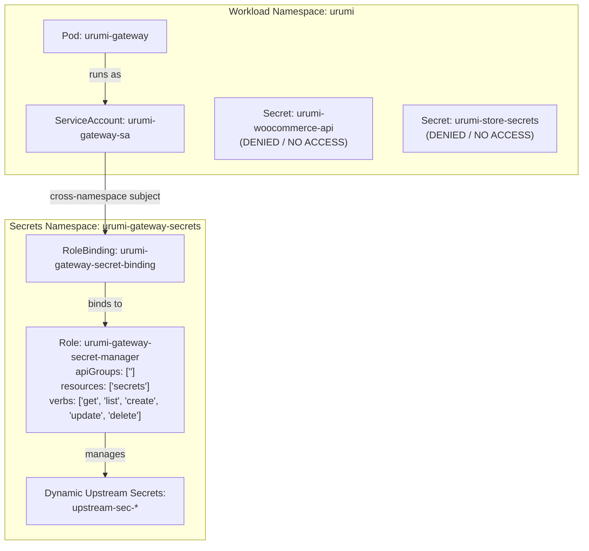

# Urumi Phase 4 — Gate G8 Implementation Plan
## Docker, Helm, Kubernetes Integration, Persistent Storage, RBAC and Network Security

**Gate:** G8  
**Target Cluster:** Local `k3d-urumi` (context: `k3d-urumi`)  
**Workload Namespace:** `urumi`  
**Secrets Namespace:** `urumi-gateway-secrets`  
**Primary Helm Chart:** `infra/helm/urumi-platform`  
**Status:** Implementation Plan — Submitted for Operator & Technical Head Review  

---

## 1. Executive Summary & Gate G8 Objectives

The objective of Gate G8 is to containerize, package, and deploy the entire Urumi MCP platform through the repository's native Docker and Helm workflows, integrating the central Team MCP Gateway (`apps/gateway`) with:
1. **Persistent SQLite Storage:** Dedicated `urumi-gateway-pvc` (500Mi, `local-path`) mounted at `/data/gateway.db` with single-replica `Recreate` deployment strategy to eliminate concurrent writer race conditions.
2. **Kubernetes Secret Isolation & RBAC:** Dedicated ServiceAccount (`urumi-gateway-sa`) in `urumi` bound via namespaced `Role` and `RoleBinding` strictly to `urumi-gateway-secrets`. Least-privilege verbs (`get`, `list`, `create`, `update`, `delete` on `secrets`), zero access to `urumi` or system secrets, and enforced HTTPS TLS verification.
3. **Multi-Stage Unprivileged Docker Images:** Pinned Node.js 24 Alpine runtime (`node:24-alpine@sha256:ebfe2f90...`), non-root execution (`mcpuser` UID/GID `10001`), `readOnlyRootFilesystem: true`, capabilities dropped (`ALL`), `RuntimeDefault` seccomp, and empirically verified native `node:sqlite` driver.
4. **Upstream MCP Microservices:** Packaging and deploying `mcp-crm` and `mcp-tasks` alongside existing `urumi-woocommerce-mcp`, exposed strictly as private `ClusterIP` services on TCP port 3000.
5. **Defense-in-Depth NetworkPolicies:** Kernel-level packet filtering enforcing:
   - Ingress to gateway only from Traefik ingress controller on TCP 3000.
   - Gateway egress strictly to CoreDNS (53), upstream MCPs (3000), and Kubernetes API (443).
   - Gateway egress to WordPress (80) and MariaDB (3306) strictly denied.
   - MariaDB ingress permitted exclusively from WordPress (3306).
   - Upstream MCPs private and accessible only from the gateway.
   - Conditional `allowTestClient` enabled in `values-local.yaml`, strictly disabled in `values-prod.yaml`.
6. **Storefront & Protected Record Invariance:** WooCommerce products 10, 11, 12 and Order #14 remain completely untouched; WordPress and MariaDB PVC UIDs preserved.

---

## 2. G8.1 Preflight & Baseline Assessment

Prior to making any file modifications or issuing build/deploy commands, the operational baseline was audited and verified:

```
┌──────────────────────────────┬────────────────────────────────────────────────────────┐
│ Parameter                    │ Verified Preflight Value                               │
├──────────────────────────────┼────────────────────────────────────────────────────────┤
│ Git Branch                   │ main                                                   │
│ Git Commit HEAD              │ e66ae36f91e20adc7aae4932b832f4d8435f54ca               │
│ Working Tree Status          │ Clean (0 staged, 0 unstaged, 0 untracked)              │
│ Node.js Runtime              │ v24.20.0 (npm v11.19.0 via nvm / pinned engines)       │
│ Monorepo Test Baseline       │ 360 passed, 0 failed across 4 workspaces               │
│ Kubernetes Context           │ k3d-urumi                                              │
│ Cluster Control Plane        │ k3d-urumi-server-0 (v1.37.1+k3s1, Ready)               │
│ Helm Release                 │ urumi-store in namespace urumi (Revision 6)            │
│ MariaDB PVC                  │ urumi-mariadb-pvc (UID: 58d7357d-5671-476d-904a...)    │
│ WordPress PVC                │ urumi-wordpress-pvc (UID: 78d0d23b-59fe-4c82-be1e...)  │
│ Storefront HTTP Health       │ http://shop.127.0.0.1.nip.io:8080/ -> HTTP 200 OK      │
│ Seeded Product 10            │ Urumi Test Mug (URUMI-MUG-001, price: 299, publish)   │
│ Seeded Product 11            │ Wireless Mouse Demo (URUMI-MOUSE-001, 799, publish)    │
│ Seeded Product 12            │ Notebook Demo (URUMI-NOTE-001, price: 149, publish)    │
│ Protected Order #14          │ Status: processing, Total: 299.00 INR                  │
│ Existing Secret Metadata     │ urumi-woocommerce-api (consumer-key, consumer-secret)  │
└──────────────────────────────┴────────────────────────────────────────────────────────┘
```

> [!IMPORTANT]
> All preflight invariants are confirmed green. Zero drift or dangling fixtures detected in the active store catalog.

---

## 3. G8.2 Docker Images Architecture & Build Specifications

### 3.1 Pinned Base Image & Driver Verification
All applications use the project's standard pinned Node.js 24 Alpine image:
`node:24-alpine@sha256:ebfe2f90462722a7a4de65e91990e97fe0d401c70e0e762c5b53302f905ec1c1`

- **Native SQLite Driver (`node:sqlite`):** Evaluated in the pinned Alpine container via `DatabaseSync`:
  ```bash
  docker run --rm node:24-alpine@sha256:ebfe2f90... node -e \
    "const { DatabaseSync } = require('node:sqlite'); const db = new DatabaseSync(':memory:'); db.exec('CREATE TABLE t (id INT); INSERT INTO t VALUES (42);'); console.log(db.prepare('SELECT * FROM t').all());"
  # Output: [ [Object: null prototype] { id: 42 } ] (Verified working)
  ```
- **Zero Native Compilation:** Eliminates external C++ modules (`better-sqlite3`, `sqlite3`, `node-gyp`, `python3`, `make`, `g++`).

### 3.2 Dockerfile Implementations
1. **`apps/gateway/Dockerfile`:**
   - **Stage 1 (builder):** Copies workspace manifests (`package.json`, `package-lock.json`, `tsconfig.base.json`, `packages/shared/`, `apps/gateway/`), runs `npm ci`, compiles via `npm run build --workspace=apps/gateway`.
   - **Stage 2 (prod-deps):** Runs `npm ci --omit=dev`.
   - **Stage 3 (runner):**
     - User/group `mcpuser:mcpuser` (UID/GID `10001`).
     - Directory `/data` created with ownership `10001:10001` and permissions `0700`.
     - Environment defaults: `NODE_ENV=production`, `PORT=3000`, `HOST=0.0.0.0`, `DB_PATH=/data/gateway.db`.
     - Entrypoint: `CMD ["node", "dist/index.js"]` (direct execution without shell wrapper for clean SIGTERM propagation).
2. **`apps/mcp-tasks/Dockerfile`:**
   - Multi-stage build matching `woocommerce-mcp` pattern. Compiles TypeScript, runs as UID/GID `10001`, exposes port 3000.
3. **`apps/mcp-crm/Dockerfile`:**
   - Multi-stage build matching `woocommerce-mcp` pattern. Compiles TypeScript, runs as UID/GID `10001`, exposes port 3000.
4. **`apps/woocommerce-mcp/Dockerfile`:**
   - Existing approved Dockerfile preserved unchanged.

### 3.3 Container Hardening Standards
- `runAsNonRoot: true`, `runAsUser: 10001`, `runAsGroup: 10001`
- `allowPrivilegeEscalation: false`
- `capabilities: { drop: ["ALL"] }`
- `seccompProfile: { type: "RuntimeDefault" }`
- `readOnlyRootFilesystem: true` with writable mounts at `/data` (PVC) and `/tmp` (emptyDir)
- Zero credentials or secrets baked into image layers or build args.

---

## 4. G8.3 Helm Chart Configuration & Templating (`infra/helm/urumi-platform`)

### 4.1 Gateway Workload Controller (`templates/gateway-deployment.yaml`)
- **Single-Writer Strategy:**
  ```yaml
  replicas: 1
  strategy:
    type: Recreate
  ```
  Strictly prevents dual-writer split-brain on SQLite WAL file across pod updates.
- **Volume Mounts:**
  - Mounts `urumi-gateway-pvc` at `/data` (`subPath` omitted to allow directory permission management).
  - Mounts ephemeral `emptyDir` at `/tmp` for temporary Node.js runtime operations under `readOnlyRootFilesystem: true`.
- **Probes:**
  - `startupProbe`: `GET /health/live` (initialDelaySeconds: 2, periodSeconds: 3, timeoutSeconds: 2, failureThreshold: 10)
  - `readinessProbe`: `GET /health/ready` (initialDelaySeconds: 2, periodSeconds: 5, timeoutSeconds: 2, failureThreshold: 3)
  - `livenessProbe`: `GET /health/live` (initialDelaySeconds: 5, periodSeconds: 10, timeoutSeconds: 3, failureThreshold: 3)
- **Lifecycle & Termination:**
  - `terminationGracePeriodSeconds: 30` to allow the gateway drain hooks (`DRAIN_TIMEOUT_MS: 5000`) to drain active concurrency pools and close SQLite WAL safely.

### 4.2 Gateway Persistence (`templates/gateway-pvc.yaml`)
- Name: `urumi-gateway-pvc`
- AccessModes: `ReadWriteOnce`
- StorageClass: `local-path`
- Size: `500Mi` (local), `2Gi` (production)
- Lifecycle: Preserved independently from application upgrades.

### 4.3 Gateway Service & Ingress Routing
- **Gateway Service (`templates/gateway-service.yaml`):**
  - Name: `urumi-gateway`
  - Type: `ClusterIP`
  - Port: 3000 -> containerPort 3000 (`http`)
- **Ingress Routing (`templates/ingress.yaml`):**
  - Storefront Ingress: Host `shop.127.0.0.1.nip.io:8080` -> Service `urumi-wordpress:80`.
  - Gateway Ingress: Host `dashboard.127.0.0.1.nip.io:8080` -> Path `/mcp` (Prefix) -> Service `urumi-gateway:3000`.
  - **Administrative Route Privacy:** The `/admin/v1/*` routes are **explicitly excluded** from the Ingress resource, making them accessible only via cluster-internal network or port-forwarding.

### 4.4 Upstream Microservices Packaging
- **`templates/crm-deployment.yaml` & `templates/crm-service.yaml`:**
  - Deployment with 1 replica, non-root execution, port 3000, probes on `/health`.
  - Private `ClusterIP` Service `urumi-mcp-crm` on port 3000.
- **`templates/tasks-deployment.yaml` & `templates/tasks-service.yaml`:**
  - Deployment with 1 replica, non-root execution, port 3000, probes on `/health`.
  - Private `ClusterIP` Service `urumi-mcp-tasks` on port 3000.
- **`templates/mcp-deployment.yaml` & `templates/mcp-service.yaml`:**
  - Existing WooCommerce MCP templates preserved, ensuring uninterrupted integration with WordPress.

### 4.5 Helm Values Synchronization
- **`values.yaml`:** Updated with complete defaults for gateway, crm, tasks, persistence, and security contexts.
- **`values-local.yaml`:** Optimized for local k3d cluster with `allowTestClient: true` for verification.
- **`values-prod.yaml`:** Production-grade configuration with `allowTestClient: false`, TLS cert-manager annotations, and expanded resource limits.

---

## 5. G8.4 Kubernetes RBAC & Secret Isolation (`templates/gateway-rbac.yaml`)



### 5.1 Manifest Specifications
1. **Namespace (`templates/secrets-namespace.yaml`):**
   ```yaml
   apiVersion: v1
   kind: Namespace
   metadata:
     name: urumi-gateway-secrets
     labels:
       app.kubernetes.io/name: urumi-platform
       app.kubernetes.io/instance: {{ .Release.Name }}
   ```
2. **ServiceAccount (`templates/gateway-serviceaccount.yaml`):**
   ```yaml
   apiVersion: v1
   kind: ServiceAccount
   metadata:
     name: urumi-gateway-sa
     namespace: urumi
     labels:
       app.kubernetes.io/component: gateway
   ```
3. **Role & RoleBinding (`templates/gateway-rbac.yaml`):**
   ```yaml
   apiVersion: rbac.authorization.k8s.io/v1
   kind: Role
   metadata:
     name: urumi-gateway-secret-manager
     namespace: urumi-gateway-secrets
   rules:
     - apiGroups: [""]
       resources: ["secrets"]
       verbs: ["get", "list", "create", "update", "delete"]
   ---
   apiVersion: rbac.authorization.k8s.io/v1
   kind: RoleBinding
   metadata:
     name: urumi-gateway-secret-binding
     namespace: urumi-gateway-secrets
   subjects:
     - kind: ServiceAccount
       name: urumi-gateway-sa
       namespace: urumi
   roleRef:
     kind: Role
     name: urumi-gateway-secret-manager
     apiGroup: rbac.authorization.k8s.io
   ```

### 5.2 Least-Privilege Verification & Namespace Boundary
- The `list` verb is strictly required for the `reconcileOrphanedSecrets()` background worker to audit and sweep orphaned Secrets matching `app.kubernetes.io/managed-by: urumi-gateway`.
- `watch` is omitted to eliminate long-lived streaming watch resource utilization.
- `urumi-gateway-sa` has **zero permissions** in the `urumi` namespace. An API request attempting to read `urumi-woocommerce-api` or `urumi-store-secrets` returns HTTP 403 Forbidden.

---

## 6. G8.5 Defense-in-Depth NetworkPolicy (`templates/networkpolicy.yaml`)

```
                        ┌───────────────────────────────┐
                        │   Traefik Ingress Controller  │
                        │        (kube-system)          │
                        └───────────────┬───────────────┘
                                        │
                         TCP 3000 (/mcp)│
                                        ▼
                        ┌───────────────────────────────┐
                        │         urumi-gateway         │
                        └───────┬───────┬───────┬───────┘
                                │       │       │
              ┌─────────────────┘       │       └─────────────────┐
     TCP 3000 │                TCP 3000 │                TCP 3000 │
              ▼                         ▼                         ▼
   ┌─────────────────────┐   ┌─────────────────────┐   ┌─────────────────────┐
   │urumi-woocommerce-mcp│   │    urumi-mcp-crm    │   │   urumi-mcp-tasks   │
   └──────────┬──────────┘   └─────────────────────┘   └─────────────────────┘
       TCP 80 │                   (Egress: DNS Only)        (Egress: DNS Only)
              ▼
   ┌─────────────────────┐
   │   urumi-wordpress   │
   └──────────┬──────────┘
     TCP 3306 │
              ▼
   ┌─────────────────────┐
   │    urumi-mariadb    │
   └─────────────────────┘
```

### 6.1 Policy Rules Matrix
| Policy Name | Target Pod Selector | Allowed Ingress | Allowed Egress |
|---|---|---|---|
| `urumi-gateway-netpol` | `app.kubernetes.io/component: gateway` | Traefik (TCP 3000), test-client (conditional) | CoreDNS (UDP/TCP 53), Upstreams (TCP 3000), K8s API (TCP 443) |
| `urumi-woocommerce-mcp-netpol` | `app.kubernetes.io/component: mcp-woocommerce` | Gateway (TCP 3000), test-client (conditional) | WordPress (TCP 80), CoreDNS (UDP/TCP 53) |
| `urumi-mcp-crm-netpol` | `app.kubernetes.io/component: mcp-crm` | Gateway (TCP 3000), test-client (conditional) | CoreDNS (UDP/TCP 53) |
| `urumi-mcp-tasks-netpol` | `app.kubernetes.io/component: mcp-tasks` | Gateway (TCP 3000), test-client (conditional) | CoreDNS (UDP/TCP 53) |
| `urumi-wordpress-netpol` | `app.kubernetes.io/component: wordpress` | Traefik (TCP 80), WooCommerce MCP (TCP 80), test-client (conditional) | MariaDB (TCP 3306), CoreDNS (UDP/TCP 53) |
| `urumi-mariadb-netpol` | `app.kubernetes.io/component: mariadb` | WordPress (TCP 3306) strictly | (Default deny egress) |

### 6.2 Strict Isolation Invariants
- Gateway -> WordPress (TCP 80): **DENIED** (enforced by gateway egress policy and wordpress ingress policy).
- Gateway -> MariaDB (TCP 3306): **DENIED** (enforced by gateway egress policy and mariadb ingress policy).
- CRM / Tasks -> WordPress / MariaDB / External: **DENIED**.
- Production profile: `allowTestClient: false` completely strips test-client selectors from all rendered NetworkPolicies.

---

## 7. G8.6 & G8.7 Verification & Testing Matrix

### 7.1 Automated Offline Verification (Pre-Deployment)
1. **Helm Lint:**
   ```bash
   helm lint infra/helm/urumi-platform
   ```
2. **Template Rendering Verification:**
   ```bash
   helm template urumi-store infra/helm/urumi-platform -n urumi -f infra/helm/urumi-platform/values-local.yaml > /tmp/urumi-local-rendered.yaml
   helm template urumi-store infra/helm/urumi-platform -n urumi -f infra/helm/urumi-platform/values-prod.yaml > /tmp/urumi-prod-rendered.yaml
   ```
   - Assert `values-local.yaml`: 1 gateway replica, `Recreate` strategy, `/data` PVC mount, `allowTestClient: true`.
   - Assert `values-prod.yaml`: 1 gateway replica, `Recreate` strategy, zero test-client selectors in NetworkPolicies, TLS ingress configured.
3. **Docker Multi-Stage Build & Container Smoke Test:**
   ```bash
   docker build -t urumi-gateway:1.0.0 -t urumi-gateway:latest -f apps/gateway/Dockerfile .
   docker build -t mcp-crm:1.0.0 -t mcp-crm:latest -f apps/mcp-crm/Dockerfile .
   docker build -t mcp-tasks:1.0.0 -t mcp-tasks:latest -f apps/mcp-tasks/Dockerfile .
   ```
   - Verify `node:sqlite` within `urumi-gateway:1.0.0`:
     ```bash
     docker run --rm urumi-gateway:1.0.0 node -e "const { DatabaseSync } = require('node:sqlite'); console.log('node:sqlite supported in runner image');"
     ```
   - Verify unprivileged user:
     ```bash
     docker run --rm urumi-gateway:1.0.0 id
     # Expected: uid=10001(mcpuser) gid=10001(mcpuser)
     ```
4. **Import Images to k3d Cluster:**
   ```bash
   k3d image import urumi-gateway:1.0.0 mcp-crm:1.0.0 mcp-tasks:1.0.0 -c urumi
   ```

### 7.2 Non-Mutating Target Cluster Review
Run `kubectl diff` to preview changes against the running cluster without mutating resources:
```bash
helm diff upgrade urumi-store infra/helm/urumi-platform -n urumi -f infra/helm/urumi-platform/values-local.yaml || true
```

### 7.3 Authorized Deployment & Live Integration Verification
Upon receiving explicit user authorization to deploy:
1. **Apply Helm Upgrade:**
   ```bash
   helm upgrade --install urumi-store infra/helm/urumi-platform -n urumi -f infra/helm/urumi-platform/values-local.yaml
   ```
2. **Workload Liveness & Readiness:**
   - Verify gateway pod reaches `1/1 Running`.
   - Verify crm, tasks, woocommerce-mcp, wordpress, and mariadb pods reach `1/1 Running`.
3. **SQLite Persistence Across Pod Replacement:**
   - Seed an API key or configuration via `bootstrap`.
   - Delete the gateway pod (`kubectl delete pod -n urumi -l app.kubernetes.io/component=gateway`).
   - Confirm replacement pod mounts `/data/gateway.db` and retains seeded data.
4. **RBAC & Secret Isolation Evidence:**
   - Execute test pod under `urumi-gateway-sa` attempting to read secret in `urumi`: confirm HTTP 403 Forbidden.
   - Execute test pod under `urumi-gateway-sa` creating secret in `urumi-gateway-secrets`: confirm HTTP 201 Created.
5. **NetworkPolicy Positive & Negative Connectivity:**
   - Gateway -> `urumi-woocommerce-mcp:3000`: **PASS** (HTTP 200).
   - Gateway -> `urumi-mcp-crm:3000`: **PASS** (HTTP 200).
   - Gateway -> `urumi-mcp-tasks:3000`: **PASS** (HTTP 200).
   - Gateway -> `urumi-wordpress:80`: **DENIED** (packet timeout).
   - Gateway -> `urumi-mariadb:3306`: **DENIED** (packet timeout).
   - Downstream client -> Gateway `/mcp`: **PASS** (returns 10 tools across 3 upstreams).
6. **Storefront & Protected Records Audit:**
   - Execute WP-CLI audit verifying Products 10, 11, 12 and Order #14 are 100% identical to baseline.
   - Verify PVC UIDs for MariaDB and WordPress are unchanged.

---

## 8. Rollback & Recovery Procedures

If any failure occurs during deployment or verification:
1. **Immediate Helm Rollback:**
   ```bash
   helm rollback urumi-store 6 -n urumi
   ```
   Rolls back release to stable Revision 6 without touching PVCs.
2. **PVC Preservation Guarantee:**
   - Never run `helm uninstall`.
   - Never delete PersistentVolumeClaims.
   - All PVCs (`urumi-mariadb-pvc`, `urumi-wordpress-pvc`, `urumi-gateway-pvc`) retain their Bound state and underlying host storage.
3. **Storefront Verification:**
   - Re-verify `http://shop.127.0.0.1.nip.io:8080/` reaches 200 OK.

---

## 9. Stop Conditions & Technical Head Review Gate

Execution will immediately halt and request Technical Head guidance if:
1. The final Linux image cannot load or execute native `node:sqlite`.
2. More than one gateway replica is configured or concurrent writers could exist on `/data/gateway.db`.
3. Kubernetes Secret permissions cannot be confined strictly to `urumi-gateway-secrets`.
4. NetworkPolicy enforcement cannot be demonstrated on the local K3s cluster.
5. Any protected store record (products 10, 11, 12, Order #14) is mutated or PVC UIDs change.
6. Any plaintext secret, API key, or credential leaks into manifests, logs, or command output.

**G8 completion is not G9 authorization.** Upon completion of G8 verification, execution stops and submits all evidence for review.

**Required final statement:** "Technical Head review requested; G9 not started."
