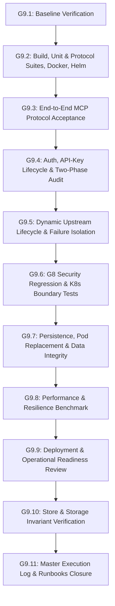

# Implementation Plan: Urumi Phase 4 — Gate G9 End-to-End Acceptance, Security Regression, Performance Benchmarking and Phase Closure

## Goal Description
Produce rigorous, reproducible evidence that the complete Urumi Platform Gateway and MCP ecosystem (gateway, WooCommerce MCP, CRM mock, Tasks mock, WordPress, MariaDB, Traefik ingress, and Kubernetes infrastructure) meets all functional, security, reliability, persistence, and operational acceptance criteria in the local `k3d-urumi` cluster. Deliver focused defect remediations (if discovered), regression tests, benchmark telemetry, updated operator runbooks, and the final Phase 4 Gate G9 closure recommendation for Technical Head review.

---

## User Review Required

> [!IMPORTANT]
> **Strict Non-Destructive Invariants on Live Storefront:**
> 1. Products `10`, `11`, `12` and Order `#14` are baseline invariants. Zero write operations, mutations, or deletions will be performed against these records.
> 2. WordPress (`pvc-78d0d23b-59fe-4c82-be1e-687d9c40fd6f`), MariaDB (`pvc-58d7357d-5671-476d-904a-cda0a12cf269`), and Gateway (`pvc-801dc6cb-076b-479a-8475-e77c905797f9`) PersistentVolumeClaims must never be deleted, recreated, or uninstalled.
> 3. No production VPS rollout, force-push, or history rewriting will be performed.

> [!NOTE]
> **Performance SLO Classification:**
> As established in ADR-015, performance thresholds (p50 < 100ms, p95 < 1000ms, p99 < 2000ms, 0% internal error rate under 10 concurrent virtual clients) are evaluated as proposed targets. Measured benchmark telemetry will be reported directly alongside the proposed targets.

---

## Open Questions

None blocking. The baseline is confirmed: node `k3d-urumi-server-0` (v1.37.1+k3s1), all 6 pods 1/1 Running, PVCs Bound, storefront healthy on HTTP 200, and HEAD commit `8dab79b` contains the verified G8 security remediation.

---

## Proposed Execution Strategy Grouped by Gate Sections



---

### Component 1: G9.1 — Baseline Capture and Inventory
Capture and record the complete pre-test baseline using non-destructive, read-only methods:
- **Git Context:** Branch `main`, HEAD commit `8dab79b`, working tree clean.
- **Cluster & Release:** Node `k3d-urumi-server-0` (`v1.37.1+k3s1`), Helm release `urumi-store` revision 8 (chart `urumi-platform-0.1.0`), namespace `urumi` and `urumi-gateway-secrets`.
- **Workloads (All 6 Pods 1/1 Running):**
  - `urumi-gateway`: `urumi-gateway:1.0.0` (digest `76f23b10e402`)
  - `urumi-mariadb-0`: `mariadb:11.4.5@sha256:49117dcc...`
  - `urumi-mcp-crm`: `mcp-crm:1.0.0` (digest `a86f8f442a3a`)
  - `urumi-mcp-tasks`: `mcp-tasks:1.0.0` (digest `18c55a577cac`)
  - `urumi-woocommerce-mcp`: `urumi-woocommerce-mcp:1.0.0` (digest `d831a5b6b4c3`)
  - `urumi-wordpress`: `wordpress:7.1.3-php8.3-apache@sha256:8ecd8d8e...`
- **Volume & Storage Invariants:**
  - `urumi-gateway-pvc`: Bound `pvc-801dc6cb-076b-479a-8475-e77c905797f9`
  - `urumi-mariadb-pvc`: Bound `pvc-58d7357d-5671-476d-904a-cda0a12cf269`
  - `urumi-wordpress-pvc`: Bound `pvc-78d0d23b-59fe-4c82-be1e-687d9c40fd6f`
  - Deployment strategy: `Recreate`, replicas: `1`, `DB_PATH: /data/gateway.db`.
- **Protected Store Invariants:**
  - Product 10: "Urumi Test Mug" (`URUMI-MUG-001`, Price 299, Status `publish`)
  - Product 11: "Wireless Mouse Demo" (`URUMI-MOUSE-001`, Price 799, Status `publish`)
  - Product 12: "Notebook Demo" (`URUMI-NOTE-001`, Price 149, Status `publish`)
  - Order #14: ID 14 (Status `wc-processing`, Total 299.00 INR)
  - Storefront: HTTP 200 OK on `shop.127.0.0.1.nip.io:8080/`.

---

### Component 2: G9.2 — Full Build and Regression Suites
Execute all monorepo test suites, image builds, and Helm linting under verified Node.js 24 environment:
- **Environment:** `export PATH="/home/rathore/.nvm/versions/node/v24.20.0/bin:$PATH"` (Node `v24.20.0`, npm `11.19.0`).
- **Commands:**
  1. `npm run build` (Clean compilation across all workspaces).
  2. `npm run lint` (0 lint/typecheck errors across all workspaces).
  3. `npm --workspace=gateway run test:unit` (208 unit tests across 27 suites).
  4. `npm --workspace=gateway run test:protocol` (10 protocol tests across 6 suites).
  5. `npm test` across monorepo (360 total tests passed, 0 failed).
  6. Image builds:
     - `docker build -f apps/gateway/Dockerfile -t urumi-gateway:1.0.0 .`
     - `docker build -f apps/mcp-crm/Dockerfile -t mcp-crm:1.0.0 .`
     - `docker build -f apps/mcp-tasks/Dockerfile -t mcp-tasks:1.0.0 .`
     - `docker build -f apps/woocommerce-mcp/Dockerfile -t urumi-woocommerce-mcp:1.0.0 .`
  7. Helm lint & template rendering:
     - `helm lint infra/helm/urumi-platform -f infra/helm/urumi-platform/values-local.yaml`
     - `helm lint infra/helm/urumi-platform -f infra/helm/urumi-platform/values-prod.yaml`
     - `helm template test-local infra/helm/urumi-platform -f infra/helm/urumi-platform/values-local.yaml`
     - `helm template test-prod infra/helm/urumi-platform -f infra/helm/urumi-platform/values-prod.yaml`

---

### Component 3: G9.3 — End-to-End MCP Protocol Acceptance
Test the real deployed gateway over `/mcp` using the official MCP protocol revision `2024-11-05`:
- **Protocol Endpoint:** `http://127.0.0.1:8080/mcp` with `Host: dashboard.127.0.0.1.nip.io`.
- **Test Scenarios:**
  1. `initialize`: verify `protocolVersion: "2024-11-05"`, `serverInfo: { name: "urumi-gateway", version: "1.0.0" }`, and `capabilities: { tools: { listChanged: true } }`.
  2. `tools/list`: verify 10 aggregated tools (`crm__get_contact`, `crm__search_contacts`, `tasks__create_task`, `tasks__list_tasks`, `tasks__update_task_status`, `woocommerce__create_product`, `woocommerce__get_order`, `woocommerce__list_orders`, `woocommerce__list_products`, `woocommerce__update_order_status`). All tools report `_meta.reachable: true`.
  3. Schema verification: Each tool validates input parameters with JSON Schema draft-07 and rejects additional properties where specified.
  4. Representative read-only calls:
     - `crm__search_contacts` with `{ limit: 2 }` -> returns deterministic synthetic contacts (`CRM-CONT-001`, `CRM-CONT-002`).
     - `tasks__list_tasks` with `{ limit: 2 }` -> returns synthetic tasks (`TASK-001`, `TASK-002`).
     - `woocommerce__get_order` with `{ order_id: 14 }` -> returns Order #14 without customer PII.
     - `woocommerce__list_products` with `{ per_page: 5 }` -> returns Products 10, 11, 12.
  5. Protocol Error Semantics:
     - Unknown tool call (`nonexistent__tool`) -> returns JSON-RPC `-32602` error.
     - Invalid arguments (`crm__get_contact` with malformed ID) -> returns `isError: true` with validation message.
     - Disabled tool invocation -> returns controlled error when upstream is disabled.
  6. Concurrency & Connection Handling:
     - Verify concurrent requests do not corrupt session state.
     - Verify client abort / disconnect cleans up downstream and upstream resources without lingering concurrency locks.

---

### Component 4: G9.4 — Authentication, Authorization, API Keys & Audit
Verify authentication and audit boundaries using dedicated test keys:
- **Authentication Matrix:**
  - Request with missing `Authorization` header -> HTTP 401 Unauthorized.
  - Request with invalid Bearer token -> HTTP 401 Unauthorized.
  - Request with revoked API key -> HTTP 401 Unauthorized immediately.
  - Request with expired API key -> HTTP 401 Unauthorized.
- **Role-Based Access Control:**
  - Admin API routes (`/admin/v1/*`) with `member` token -> HTTP 403 Forbidden (`Forbidden: Administrative privileges required`).
  - Admin API routes with `admin` token -> HTTP 200 / 201 OK.
- **Ingress Perimeter:**
  - `GET /admin/v1/upstreams` via public Ingress -> **HTTP 404 Not Found** (Traefik does not route private admin paths).
  - Internal upstream services (`http://urumi-mcp-crm:3000/`) via public Ingress -> **HTTP 404 Not Found**.
- **Audit Logging Lifecycle:**
  - Phase 1 audit failure: verify dispatch halts immediately (fail-closed invariant).
  - Phase 2 audit degradation: verify dual signaling contract (`result._meta.urumi_audit_status: "finalization-degraded"` and header `X-Urumi-Audit-Status`).
  - Zero secrets in audit records: inspect `audit_logs` table to confirm only hashes and non-sensitive metadata are persisted.

---

### Component 5: G9.5 — Dynamic Upstream Lifecycle
Verify the full dynamic lifecycle of registered upstreams using an isolated test upstream:
- **Scenarios:**
  1. Register valid upstream `test-dynamic-upstream` with dedicated test secret in `urumi-gateway-secrets`.
  2. Verify tool discovery: new tools appear in downstream `tools/list` under `test_dynamic_upstream__*`.
  3. Execute tool call on newly registered upstream.
  4. Update non-credential configuration (timeout, display name) -> runtime converges cleanly.
  5. Rotate credentials via `POST /admin/v1/upstreams/:id/rotate-credential` -> Kubernetes Secret updated with incremented `resourceVersion`.
  6. Controlled rotation rollback simulation -> verify compensation restores previous secret data, or transitions to `cleanup_required` if compensation fails.
  7. Disable upstream via `POST /admin/v1/upstreams/:id/disable` -> tools excluded from downstream catalog, calls rejected.
  8. Delete upstream via `DELETE /admin/v1/upstreams/:id` -> SQLite record removed, Kubernetes Secret deleted, catalog updated.
  9. Fault isolation: simulate upstream failure (e.g. unreachable endpoint) -> verify gateway remains healthy, sibling upstreams continue serving, and failed upstream tool reports `reachable: false`.
  10. Orphan secret reconciliation: verify orphan sweep only inspects secrets with label `app.kubernetes.io/managed-by=urumi-gateway` in `urumi-gateway-secrets` and preserves non-gateway secrets.

---

### Component 6: G9.6 — G8 Security Regression & Kubernetes Boundary Tests
Empirically verify all G8 security remediations against the live cluster:
- **Kubernetes API Client Hardening:**
  - Rejected destinations: plain HTTP (`http://10.43.0.1:443`), unapproved HTTPS (`https://evil.external.com:443`), IP loopback in production (`https://127.0.0.1:6443`), cloud metadata endpoints (`https://169.254.169.254`).
  - Approved destination: in-cluster `https://kubernetes.default.svc:443` and `https://10.43.0.1:443`.
  - Production TLS verification: `insecureSkipTlsVerify: true` strictly throws `KubernetesApiError` in production mode.
  - Fail-closed CA validation: cluster CA certificate must validate server identity.
- **NetworkPolicy Enforcement:**
  - Positive probes from gateway pod:
    - `http://urumi-mcp-crm:3000/health`: HTTP 200
    - `http://urumi-mcp-tasks:3000/health`: HTTP 200
    - `http://urumi-woocommerce-mcp:3000/health`: HTTP 200
    - `https://10.43.0.1:443/version`: HTTP 200
  - Negative probes from gateway pod (known listening ports):
    - `http://urumi-wordpress:80/`: **BLOCKED** (NetworkPolicy drops packets -> timeout/fetch failed)
    - `http://urumi-mariadb:3306/`: **BLOCKED** (NetworkPolicy drops packets -> timeout/fetch failed)
  - Upstream isolation:
    - CRM and Tasks cannot access MariaDB or WordPress.
    - WooCommerce MCP can access WordPress only.
    - MariaDB accepts traffic only from WordPress.
- **Kubernetes RBAC Boundary:**
  - `kubectl auth can-i [get, list, create, update, delete] secrets -n urumi-gateway-secrets --as=system:serviceaccount:urumi:urumi-gateway-sa` -> **YES**.
  - `kubectl auth can-i [get, list, create, update, delete] secrets -n urumi --as=system:serviceaccount:urumi:urumi-gateway-sa` -> **NO**.
  - `kubectl auth can-i [get, list, create, update, delete] secrets -n kube-system --as=system:serviceaccount:urumi:urumi-gateway-sa` -> **NO**.
  - Gateway SA cannot read pods, services, deployments, or PVCs in any namespace.
- **Storage Confidentiality:**
  - Inspect `/data` inside running gateway pod: mode `0700` (`drwx------`), owned by `10001:10001` (`mcpuser`).
  - Inspect `/data/gateway.db`, `/data/gateway.db-wal`, `/data/gateway.db-shm`: mode `0600` (`-rw-------`), owned by `10001:10001`.
  - Verify container securityContext: non-root (`10001:10001`), read-only rootfs (`readOnlyRootFilesystem: true`), dropped capabilities (`drop: ["ALL"]`), seccomp `RuntimeDefault`.

---

### Component 7: G9.7 — Persistence, Recovery & Data Integrity
Verify SQLite state persistence across pod replacements without PVC mutation:
1. Capture database counts and non-sensitive state before restart (`users`, `api_keys`, `upstreams`, `audit_logs`).
2. Insert a dedicated harmless test record via the gateway API (e.g. create a test API key or test upstream).
3. Confirm record is committed to SQLite.
4. Execute controlled pod deletion: `kubectl delete pod -n urumi -l app.kubernetes.io/component=gateway`.
5. Measure recovery duration and wait for replacement pod readiness (1/1 Running).
6. Verify persistent state after replacement:
   - Test record and bootstrap admin key are intact.
   - Upstream definitions and audit log history are preserved.
   - Downstream MCP handshake (`initialize`) and tool catalog discovery (`tools/list`) function immediately.
7. Run SQLite integrity check inside the pod: `PRAGMA integrity_check;` -> returns `ok`.
8. Safely remove only the dedicated test record.

---

### Component 8: G9.8 — Performance and Resilience Benchmark
Implement and run a reproducible benchmark harness against the local k3d gateway deployment:
- **Harness File:** `[NEW] apps/gateway/test/benchmarks/load-test.ts`
- **Methodology & Constraints:**
  - Local `k3d-urumi` cluster, 4 vCPUs allocated.
  - Gateway resource limits: requests `96Mi`, limits `256Mi`.
  - Percentiles computed via **NIST Nearest Rank Method** with boundary clamping.
  - Warm-up phase: 10 sequential tool calls across upstreams.
  - Concurrency sweeps: Concurrency levels 1, 5, 10, 20.
  - Workload: 100 consecutive tool invocations per concurrency tier targeting read-only tools (`crm__search_contacts`, `tasks__list_tasks`, `woocommerce__get_order`).
- **Telemetry Measured:**
  - MCP `initialize` latency and `tools/list` latency.
  - Tool call latency: p50, p95, p99, min, max.
  - Throughput (requests/sec).
  - Internal error rate (HTTP 500s / unhandled exceptions).
  - Memory consumption (RSS before and after benchmark via `kubectl top pod`).
  - Concurrency limit validation: verify requests exceeding global limit (20) receive HTTP 429 Too Many Requests.
  - Circuit breaker validation: simulate 3 consecutive upstream timeouts -> verify circuit transitions to Open with immediate fast-failure, followed by recovery after cooldown.

---

### Component 9: G9.9 — Deployment and Operational Readiness Review
Verify platform manifests and operational procedures:
- Confirm pinned image tags/digests.
- Confirm single replica, `Recreate` deployment strategy, and dedicated single-writer PVC (`urumi-gateway-pvc`).
- Document backup and restore drill procedure using SQLite `VACUUM INTO` without deleting or modifying live PVCs.
- Document troubleshooting runbook for:
  - Upstream connectivity failure (`UPSTREAM_CONNECTION_ERROR`).
  - Partial credential rotation failure (`cleanup_required` state).
  - Database lock contention / recovery.
  - Health/readiness probe failures.

---

### Component 10: G9.10 — Protected Store & Infrastructure Invariants Verification
Verify that after all testing is completed, all protected records and infrastructure remain unmutated:
- Product 10: "Urumi Test Mug" — **UNMUTATED**
- Product 11: "Wireless Mouse Demo" — **UNMUTATED**
- Product 12: "Notebook Demo" — **UNMUTATED**
- Order #14: ID 14 (Status `wc-processing`, Total 299.00) — **UNMUTATED**
- PVC UIDs:
  - `urumi-mariadb-pvc`: `58d7357d-5671-476d-904a-cda0a12cf269` — **PRESERVED**
  - `urumi-wordpress-pvc`: `78d0d23b-59fe-4c82-be1e-687d9c40fd6f` — **PRESERVED**
  - `urumi-gateway-pvc`: `801dc6cb-076b-479a-8475-e77c905797f9` — **PRESERVED**
- Kubernetes Secrets, NetworkPolicies, and Ingress resources remain untouched.

---

### Component 11: G9.11 — Documentation, Runbooks & Final Report
1. Author comprehensive operator runbook:
   - `[NEW] docs/phase-4/g9-e2e-acceptance-runbook.md`
2. Update Master Technical Roadmap & Execution Log:
   - `[MODIFY] docs/phase-4/phase-4-execution-log.md`
   - Record exact commands, exit codes, test counts, latency tables, and redacted audit summaries.
3. Complete final Gate G9 Checklist (marked `PASS`).
4. Submit final recommendation: `READY FOR TECHNICAL HEAD ACCEPTANCE`.

---

## Proposed File Changes

### Gateway & Benchmarks
#### [NEW] `apps/gateway/test/benchmarks/load-test.ts`
Implement reproducible benchmark harness using native `fetch`, NIST Nearest Rank percentile calculations, concurrency pools, and telemetry reporting.

### Documentation & Runbooks
#### [NEW] `docs/phase-4/g9-e2e-acceptance-runbook.md`
Comprehensive operator and verification guide covering troubleshooting, backup/recovery drill, and architecture operational readiness.

#### [MODIFY] `docs/phase-4/phase-4-execution-log.md`
Append Gate G9 implementation evidence, empirical test results, performance tables, and invariant checks.

---

## Verification Plan

### Automated Tests
1. **Full Monorepo Build, Lint, and Test Suite:**
   ```bash
   export PATH="/home/rathore/.nvm/versions/node/v24.20.0/bin:$PATH"
   npm run build
   npm run lint
   npm test
   ```
2. **Docker Multi-Stage Image Builds:**
   ```bash
   docker build -f apps/gateway/Dockerfile -t urumi-gateway:1.0.0 .
   docker build -f apps/mcp-crm/Dockerfile -t mcp-crm:1.0.0 .
   docker build -f apps/mcp-tasks/Dockerfile -t mcp-tasks:1.0.0 .
   docker build -f apps/woocommerce-mcp/Dockerfile -t urumi-woocommerce-mcp:1.0.0 .
   ```
3. **Helm Lint and Template Validation:**
   ```bash
   helm lint infra/helm/urumi-platform -f infra/helm/urumi-platform/values-local.yaml
   helm lint infra/helm/urumi-platform -f infra/helm/urumi-platform/values-prod.yaml
   helm template test-local infra/helm/urumi-platform -f infra/helm/urumi-platform/values-local.yaml > /dev/null
   helm template test-prod infra/helm/urumi-platform -f infra/helm/urumi-platform/values-prod.yaml > /dev/null
   ```
4. **End-to-End MCP Protocol Acceptance:**
   Run wire test script against `http://127.0.0.1:8080/mcp` exercising `initialize`, `tools/list`, representative `tools/call`, unknown tool, invalid arguments, and client cancellation.
5. **Security Regression & NetworkPolicy Probes:**
   Execute in-cluster positive and negative network probes to verify WordPress/MariaDB drops and K8s API allowlist enforcement.
6. **Performance & Concurrency Benchmark:**
   ```bash
   export PATH="/home/rathore/.nvm/versions/node/v24.20.0/bin:$PATH"
   npx tsx apps/gateway/test/benchmarks/load-test.ts
   ```

### Manual Verification
1. Inspect live store products (10, 11, 12) and Order #14 via WP-CLI:
   ```bash
   kubectl exec -n urumi deployment/urumi-wordpress -- wp post list --post_type=product,shop_order --allow-root --fields=ID,post_title,post_status,post_type
   ```
2. Verify PVC UIDs:
   ```bash
   kubectl get pvc -n urumi -o custom-columns=NAME:.metadata.name,UID:.metadata.uid,VOLUME:.spec.volumeName
   ```
3. Verify RBAC matrix via `kubectl auth can-i`.
4. Verify `/data` directory permissions (`0700`) and SQLite database file permissions (`0600`) inside the gateway container.
