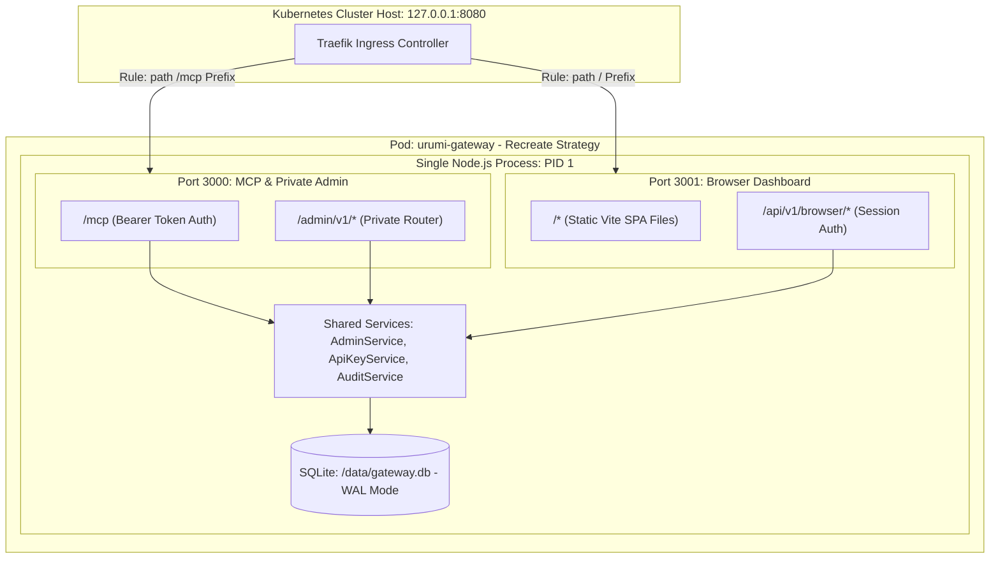

# Urumi Phase 5 — Gate P5-G1: Contract and Threat-Model Freeze Package
## Team MCP Gateway Browser Dashboard & Secure Administration

> [!IMPORTANT]
> **Authority, Governance & Gate Disposition:**
> - **Gate Disposition:** `DRAFT FOR TECHNICAL HEAD APPROVAL` — Gate P5-G1 Design Freeze Package.
> - **Operational Status:** **Implementation HOLD remains strictly active.**
> - **Mutation Authority:** ZERO code edits, ZERO package installations, ZERO image builds, ZERO database migrations, ZERO cluster mutations, and ZERO deployments are authorized during G1.
> - **Next Step:** Await Technical Head review, formal recording of decisions, and issuance of the separate written Gate P5-G2 Implementation Release.

---

## 1. Executive Summary & Gate Status

Gate P5-G1 defines the complete technical, security, architectural, and persistence contracts required to implement the Phase 5 React/Vite Team Dashboard on top of the Phase 4 Team MCP Gateway. 

Every design decision in this package is strictly reconciled against the source code inspected in `apps/gateway` and the empirical runtime baselines established in Gate P5-G0:
1. **Core Gateway Reuse:** Phase 5 introduces a lightweight browser façade and identity layer. It strictly reuses existing Phase 4 services (`AdminService`, `CatalogService`, `UpstreamManager`, `ToolRouter`, `ApiKeyService`, `AuditService`, `SecretManager`) without reimplementing upstream discovery, tool execution, secret management, or audit writing.
2. **Dual-Listener Perimeter:** Physical separation of the external browser surface from internal administrative controls via two in-process listeners: Port 3000 (`/mcp` and internal `/admin/v1/*`) and Port 3001 (static SPA assets and `/api/v1/browser/*`). External requests to `/admin/v1/*` match the catch-all Ingress rule and receive `HTTP 404 Not Found` from the browser listener.
3. **Identity & Session Decoupling:** Browser human authentication (username, Scrypt password verifier, opaque session tokens, `HttpOnly` cookies) is physically and logically decoupled from MCP client bearer API keys (`urumi_live_...`).
4. **Member Lifecycle & Deactivation:** Full member lifecycle specified in MVP: single-use 72-hour invitation tokens, Admin deactivation endpoint, immediate session purging, active-user checks in API-key verification, and safeguards preventing last-admin removal.
5. **Zero-Breakage Persistence:** Forward-only Migration 003 with a mandatory disposable database copy pre-flight protocol, atomic `VACUUM INTO` WAL-consistent backups, and strict row-preservation assertions.
6. **Project Invariants:** Strict preservation of WooCommerce Product IDs 10, 11, 12, Order #14, PVC UIDs, and kernel-level NetworkPolicy blocking direct gateway access to WordPress and MariaDB.

---

## 2. Source-to-Design Reconciliation

This section reconciles existing repository symbols and files against proposed Phase 5 capabilities, categorizing every fact into its verified evidence tier.

| Component / Subsystem | Exact Inspected File Path | Existing Source Symbols / Capabilities | Classification | Proposed Phase 5 Design Action |
|---|---|---|---|---|
| **Downstream MCP Protocol** | `apps/gateway/src/server.ts:174-318` | `createGatewayMcpServer`, `StreamableHTTPServerTransport`, `createAuthMiddleware` | `source-inspected` & `runtime-verified` | **Reuse Unchanged.** Remains on Port 3000; requires bearer API key. Cookies ignored. |
| **Dynamic Tool Router** | `apps/gateway/src/upstream/tool-router.ts:80-240` | `ToolRouter.dispatch()`, schema validation, timeout, concurrency pool (20/4) | `source-inspected` & `runtime-verified` | **Reuse Unchanged.** Dispatches downstream calls to upstreams. Not exposed to browser. |
| **Upstream Aggregation & Catalog** | `apps/gateway/src/upstream/upstream-manager.ts:1-250`<br>`apps/gateway/src/upstream/catalog-service.ts:1-120` | `UpstreamManager`, `CatalogService.getSnapshot()`, single-flight discovery | `source-inspected` & `runtime-verified` | **Reuse via Read Façade.** Browser endpoint `/api/v1/browser/upstreams/:id/tools` queries live catalog snapshot. |
| **Administrative Lifecycle API** | `apps/gateway/src/http/admin.ts:113-230`<br>`apps/gateway/src/admin/admin-service.ts:1-350` | `AdminService.createUpstream()`, `updateUpstream()`, `deleteUpstream()`, `disableUpstream()`, `enableUpstream()`, `retryCleanup()` | `source-inspected` & `runtime-verified` | **Reuse via Browser Router.** Browser endpoints on Port 3001 wrap `AdminService` with session auth. Standardize on `PATCH /upstreams/:id`. |
| **Kubernetes Secret Manager** | `apps/gateway/src/k8s/secret-manager.ts:1-180`<br>`apps/gateway/src/k8s/secret-client.ts:1-120` | `SecretManager.createOrUpdateSecret()`, `deleteSecret()`, allowlist checks | `source-inspected` & `runtime-verified` | **Reuse Unchanged.** Governed by `urumi-gateway-secrets` RBAC. Raw secrets never serialized to browser. |
| **API-Key & User Primitives** | `apps/gateway/src/auth/api-key-service.ts:1-147`<br>`apps/gateway/src/db/api-key-repo.ts:1-150` | `ApiKeyService.generateApiKey()`, `verifyKey()`, `revokeKey()`, `insertUser()` | `source-inspected` & `runtime-verified` | **Reuse Primitives; Add Ownership.** Wrap in browser endpoints. Enforce member session ownership server-side. |
| **Audit Logging Service** | `apps/gateway/src/audit/audit-service.ts:1-255`<br>`apps/gateway/src/db/audit-repo.ts:1-140` | `AuditService.startAudit()`, `finalizeAudit()`, `AuditRepository.listAudits()` | `source-inspected` & `runtime-verified` | **Reuse Repository Query.** Add `/api/v1/browser/audit` read service with bounded pagination and sanitized errors. |
| **SQLite Connection & Migration** | `apps/gateway/src/db/connection.ts:1-301`<br>`apps/gateway/src/db/migrations.ts:1-75`<br>`apps/gateway/src/db/schema.ts:1-88` | `DatabaseManager`, `runMigrations`, `MIGRATIONS` array, WAL mode, single replica | `source-inspected` & `runtime-verified` | **Extend Schema (Migration 003).** Add `is_active`, `user_credentials`, `browser_sessions`, `user_invitations`. |
| **Process Entrypoint & Listeners** | `apps/gateway/src/index.ts:1-132`<br>`apps/gateway/src/server.ts:155-331` | Express `app.listen(config.PORT)`, single process lifecycle | `source-inspected` | **Add Second Listener.** Express server for Port 3001 listening on `config.BROWSER_PORT` (3001). |
| **Frontend SPA Scaffolding** | `apps/dashboard/` | Currently absent from checkout | `source-inspected` | **Scaffold in G2.** Vite + React + TypeScript + Vanilla CSS design system. |
| **Container Multi-Stage Build** | `apps/gateway/Dockerfile:1-76` | Builds `gateway` only; runs as non-root `10001:10001` with `readOnlyRootFilesystem` | `source-inspected` | **Update in G2.** Multi-stage build compiles Vite SPA and copies static bundle to `/app/dist-dashboard`. |
| **Helm Service & Ingress Routing** | `infra/helm/urumi-platform/templates/ingress.yaml`<br>`infra/helm/urumi-platform/templates/gateway-service.yaml` | Port 3000 mapped; `/mcp` routed to 3000; external `/admin/v1` returns 404 | `source-inspected` & `runtime-verified` | **Update in G2.** Add Port 3001 to Service. Ingress maps `/mcp` $\rightarrow$ 3000, `/` $\rightarrow$ 3001. Update NetworkPolicy. |

---

## 3. Final Browser API Contract & Role/Ownership Matrix

All browser endpoints are mounted exclusively on **Port 3001** under the prefix `/api/v1/browser`. They are completely isolated from Port 3000.

### 3.1 Role & Ownership Matrix

| Endpoint Group | Specific Path | Anonymous | Member Role | Admin Role | Ownership Enforcement Mechanism |
|---|---|:---:|:---:|:---:|---|
| **Session** | `POST /session` | Allowed | N/A | N/A | Rate-limited by IP and username. |
| **Session** | `GET /session` | Denied (401) | Allowed | Allowed | Returns session user profile only. |
| **Session** | `DELETE /session` | Denied (401) | Allowed | Allowed | Revokes requesting session only. |
| **Members** | `GET /members` | Denied (401) | Denied (403) | Allowed | Admin-only team visibility. |
| **Members** | `POST /members/:id/deactivate` | Denied (401) | Denied (403) | Allowed | Admin-only; cannot deactivate self or last admin. |
| **Members** | `POST /members/:id/reactivate` | Denied (401) | Denied (403) | Allowed | Admin-only. |
| **Members** | `PATCH /members/:id/role` | Denied (401) | Denied (403) | Allowed | Admin-only; cannot demote last active admin. |
| **Invitations** | `POST /invitations` | Denied (401) | Denied (403) | Allowed | Admin-only; token displayed once. |
| **Invitations** | `POST /invitations/redeem` | Allowed | N/A | N/A | Requires valid, unexpired, unredeemed token. |
| **API Keys** | `GET /keys` | Denied (401) | **Own Keys** | **All Keys** | **Server-side filter:** For Member, `user_id` query parameter is ignored; forced to `req.user.id`. |
| **API Keys** | `POST /keys` | Denied (401) | **Self Only** | **Any User** | **Server-side bound:** For Member, target `userId` is strictly `req.user.id`. Admin may specify `userId`. |
| **API Keys** | `POST /keys/:id/revoke` | Denied (401) | **Owner Only**| Allowed | **Server-side check:** Member can only revoke if `key.user_id === req.user.id`. Admin can revoke any key. |
| **Upstreams** | `GET /upstreams` | Denied (401) | Allowed | Allowed | Read-only inventory (credentials omitted). |
| **Upstreams** | `GET /upstreams/:id` | Denied (401) | Allowed | Allowed | Detail view (credentials omitted). |
| **Upstreams** | `GET /upstreams/:id/tools` | Denied (401) | Allowed | Allowed | Discovered tools from catalog snapshot. |
| **Upstreams** | `POST /upstreams` | Denied (401) | Denied (403) | Allowed | Admin-only; full validation and saga. |
| **Upstreams** | `PATCH /upstreams/:id` | Denied (401) | Denied (403) | Allowed | Admin-only; configuration / credential update. |
| **Upstreams** | `POST /upstreams/:id/enable` | Denied (401) | Denied (403) | Allowed | Admin-only. |
| **Upstreams** | `POST /upstreams/:id/disable` | Denied (401) | Denied (403) | Allowed | Admin-only. |
| **Upstreams** | `DELETE /upstreams/:id` | Denied (401) | Denied (403) | Allowed | Admin-only; secret deletion and catalog purge. |
| **Upstreams** | `POST /upstreams/:id/retry-cleanup` | Denied (401) | Denied (403) | Allowed | Admin-only. |
| **Audit** | `GET /audit` | Denied (401) | Denied (403) | Allowed | Admin-only; bounded pagination and sanitized errors. |

---

### 3.2 Granular Endpoint Specifications

#### 1. Authentication & Session Management

##### `POST /api/v1/browser/session`
* **Authentication:** Anonymous (Strict Rate Limit: 5 failed attempts per 5 minutes per IP/username).
* **Payload Bound:** 4096 bytes maximum.
* **Request Schema:**
  ```json
  {
    "username": "admin",
    "password": "SuperSecretPassword123!"
  }
  ```
* **Validation:** `username` (string, 3–32 chars, `^[a-zA-Z0-9_-]+$`), `password` (string, 8–128 chars).
* **Response (200 OK):**
  ```json
  {
    "user": {
      "id": "b590e714-c575-4bab-862c-f74cb9a47b01",
      "username": "admin",
      "role": "admin"
    },
    "csrfToken": "4f8a...64_hex_chars"
  }
  ```
* **Headers Set:** `Set-Cookie: urumi_session=<token_hex>; Path=/; HttpOnly; SameSite=Lax; Max-Age=86400; Secure`
* **Failure Semantics:** Generic `HTTP 401: {"error": "Invalid username or password", "code": "INVALID_CREDENTIALS"}` on bad credentials or inactive user. `HTTP 429: {"error": "Too many failed attempts. Try again later.", "code": "RATE_LIMITED"}` on rate limit trip.

##### `GET /api/v1/browser/session`
* **Authentication:** Authenticated (Session Cookie required).
* **Response (200 OK):**
  ```json
  {
    "user": {
      "id": "b590e714-c575-4bab-862c-f74cb9a47b01",
      "username": "admin",
      "role": "admin"
    },
    "csrfToken": "4f8a...64_hex_chars"
  }
  ```
* **Failure Semantics:** `HTTP 401: {"error": "Unauthorized: Session expired or invalid", "code": "SESSION_INVALID"}`.

##### `DELETE /api/v1/browser/session`
* **Authentication:** Authenticated (Session Cookie + `X-Urumi-CSRF` header + Origin check).
* **Action:** Deletes session record from `browser_sessions` SQLite table.
* **Response (200 OK):** `{"success": true}`
* **Headers Set:** `Set-Cookie: urumi_session=; Path=/; HttpOnly; SameSite=Lax; Max-Age=0; Secure`

---

#### 2. Team Member & Invitation Lifecycle

##### `GET /api/v1/browser/members`
* **Authentication:** Authenticated, Admin role required.
* **Response (200 OK):**
  ```json
  {
    "members": [
      {
        "id": "b590e714-c575-4bab-862c-f74cb9a47b01",
        "username": "admin",
        "role": "admin",
        "isActive": true,
        "createdAt": 1792308540,
        "activeKeyCount": 1
      }
    ]
  }
  ```
* **Failure Semantics:** `HTTP 403: {"error": "Forbidden: Administrative privileges required", "code": "FORBIDDEN"}`.

##### `POST /api/v1/browser/invitations`
* **Authentication:** Authenticated, Admin role + CSRF + Origin.
* **Request Schema:**
  ```json
  {
    "role": "member"
  }
  ```
* **Validation:** `role` enum (`'admin' | 'member'`).
* **Action:** Generates 32-byte secure random token; stores SHA-256 verifier in `user_invitations` with `expires_at = now + 72 hours`.
* **Response (201 Created):**
  ```json
  {
    "invitation": {
      "id": "inv_8f9a2b...",
      "role": "member",
      "expiresAt": 1792567740,
      "token": "urumi_inv_32byteshex...",
      "inviteUrl": "/invite/urumi_inv_32byteshex..."
    }
  }
  ```
* **Note:** `token` is returned exactly once in this response and never persisted in plaintext.

##### `POST /api/v1/browser/invitations/redeem`
* **Authentication:** Anonymous.
* **Request Schema:**
  ```json
  {
    "token": "urumi_inv_32byteshex...",
    "username": "bob",
    "password": "ValidPassword987!"
  }
  ```
* **Validation:** `token` (non-empty string), `username` (3–32 chars, alphanumeric), `password` (8–128 chars).
* **Action (Atomic SQLite Transaction):**
  1. Computes SHA-256 hash of token; looks up `user_invitations`.
  2. Verifies `expires_at > now` and `redeemed_at IS NULL`.
  3. Verifies `username` is not already taken in `users`.
  4. Hashes password using Scrypt ($N=16384, r=8, p=1$).
  5. Inserts new row into `users` (`role` taken from invitation, `is_active = 1`).
  6. Inserts row into `user_credentials`.
  7. Marks invitation as redeemed (`redeemed_at = now`, `redeemed_by_user_id = user.id`).
  8. Issues initial session cookie.
* **Response (201 Created):** Minimal user profile + session cookie.
* **Failure Semantics:** `HTTP 400: {"error": "Invitation token is invalid or expired", "code": "INVITATION_INVALID"}` or `HTTP 409: {"error": "Username already exists", "code": "USERNAME_EXISTS"}`.

##### `POST /api/v1/browser/members/:id/deactivate`
* **Authentication:** Authenticated, Admin role + CSRF + Origin.
* **Action (Atomic SQLite Transaction):**
  1. Checks target user exists and `target.id !== req.user.id` (cannot deactivate self).
  2. If target is admin: checks `SELECT count(*) FROM users WHERE role = 'admin' AND is_active = 1` $\ge 2$ (cannot deactivate last active admin).
  3. Updates `users.is_active = 0`.
  4. Deletes all records in `browser_sessions` for `user_id = target.id`.
  5. Updates all records in `api_keys` setting `revoked_at = now` where `user_id = target.id AND revoked_at IS NULL`.
* **Response (200 OK):** `{"success": true, "userId": "...", "status": "deactivated"}`.

##### `POST /api/v1/browser/members/:id/reactivate`
* **Authentication:** Authenticated, Admin role + CSRF + Origin.
* **Action:** Updates `users.is_active = 1`. Does **not** restore previously revoked API keys.
* **Response (200 OK):** `{"success": true, "userId": "...", "status": "active"}`.

##### `PATCH /api/v1/browser/members/:id/role`
* **Authentication:** Authenticated, Admin role + CSRF + Origin.
* **Request Schema:** `{"role": "member"}`
* **Action:** Validates target user is not the last remaining admin. Updates `users.role`. Purges all active sessions in `browser_sessions` for that user, requiring re-login.
* **Response (200 OK):** `{"success": true, "userId": "...", "newRole": "member"}`.

---

#### 3. API-Key Management & Self-Service

##### `GET /api/v1/browser/keys`
* **Authentication:** Authenticated.
* **Authorization / Ownership Rule:**
  - If `req.user.role === 'admin'`: Returns all API keys across all users.
  - If `req.user.role === 'member'`: Query parameter `userId` is **strictly ignored**; query is hard-bound to `WHERE user_id = req.user.id`.
* **Response (200 OK):**
  ```json
  {
    "keys": [
      {
        "id": "d5e9b7a3-2c7c-490b-aceb-c1979a4e4785",
        "userId": "b590e714-c575-4bab-862c-f74cb9a47b01",
        "username": "admin",
        "name": "System Administrator",
        "keyPrefix": "urumi_live_13f4e",
        "expiresAt": null,
        "revokedAt": null,
        "createdAt": 1792308540,
        "lastUsedAt": 1792401126
      }
    ]
  }
  ```
* **Security Invariant:** `key_hash` is **never** included in this DTO.

##### `POST /api/v1/browser/keys`
* **Authentication:** Authenticated + CSRF + Origin.
* **Request Schema:**
  ```json
  {
    "name": "CLI Workstation Key",
    "userId": "optional_admin_target_uuid",
    "expiresInSeconds": 2592000
  }
  ```
* **Authorization / Ownership Rule:**
  - If Member: target user is forced to `req.user.id`. Any submitted `userId` is overridden.
  - If Admin: can issue key for `req.user.id` or specify another existing active member via `userId`.
* **Action:** Calls `ApiKeyService.generateApiKey()`.
* **Response (201 Created):**
  ```json
  {
    "apiKey": {
      "id": "k_uuid...",
      "name": "CLI Workstation Key",
      "keyPrefix": "urumi_live_abc12",
      "expiresAt": 1794900540,
      "createdAt": 1792308540
    },
    "rawKey": "urumi_live_abc1234567890abcdef..."
  }
  ```
* **Security Invariant:** `rawKey` is returned **strictly once** upon issuance. Frontend displays it in transient memory modal and purges it on dismiss.

##### `POST /api/v1/browser/keys/:id/revoke`
* **Authentication:** Authenticated + CSRF + Origin.
* **Authorization / Ownership Rule:**
  - Server queries key by `:id`. If not found, returns `HTTP 404`.
  - If Member: verifies `key.user_id === req.user.id`. If mismatched, returns `HTTP 403 Forbidden` (or 404 to prevent enumeration).
  - If Admin: can revoke any valid key.
* **Action:** Calls `ApiKeyService.revokeKey(keyId)`.
* **Response (200 OK):** `{"success": true, "keyId": "...", "revokedAt": 1792308999}`.
* **Effect:** Next downstream request to `/mcp` with this key fails immediately with `HTTP 401`.

---

#### 4. Upstream & Tool Management (Façade over Phase 4 Services)

##### `GET /api/v1/browser/upstreams`
* **Authentication:** Authenticated (Admin or Member).
* **Action:** Calls `AdminService.listUpstreams()`.
* **Response (200 OK):**
  ```json
  {
    "upstreams": [
      {
        "id": "ups_uuid...",
        "slug": "woocommerce",
        "displayName": "WooCommerce MCP",
        "endpointUrl": "http://urumi-woocommerce-mcp.urumi.svc.cluster.local:3000/mcp",
        "timeoutMs": 10000,
        "isEnabled": true,
        "status": "active",
        "health": {
          "state": "available",
          "toolCount": 5,
          "lastCheck": 1792308540,
          "lastError": null
        }
      }
    ]
  }
  ```
* **Security Invariant:** `secretRefName` and `secretRefKey` are omitted or sanitized; raw credentials are never present.

##### `GET /api/v1/browser/upstreams/:id/tools`
* **Authentication:** Authenticated (Admin or Member).
* **Action:** Queries live catalog snapshot from `CatalogService.getSnapshot()`; filters tools by `upstreamSlug === upstream.slug`.
* **Response (200 OK):**
  ```json
  {
    "upstreamSlug": "woocommerce",
    "toolCount": 5,
    "tools": [
      {
        "name": "list_products",
        "publicName": "woocommerce__list_products",
        "description": "List products from the store catalog...",
        "inputSchema": { "type": "object", "properties": { ... } }
      }
    ]
  }
  ```

##### `POST /api/v1/browser/upstreams` (Admin Only + CSRF)
* Calls `AdminService.createUpstream(parseResult.data, req.user)`. Reuses Phase 4 SSRF validation, saga, and Kubernetes Secret creation.

##### `PATCH /api/v1/browser/upstreams/:id` (Admin Only + CSRF)
* Standardized route reconciling GAP-C01. Calls `AdminService.updateUpstream(id, parseResult.data, req.user)`. Reuses configuration updates and credential rotation.

##### `POST /api/v1/browser/upstreams/:id/enable` & `.../disable` (Admin Only + CSRF)
* Calls `AdminService.enableUpstream()` / `disableUpstream()`.

##### `DELETE /api/v1/browser/upstreams/:id` (Admin Only + CSRF)
* Calls `AdminService.deleteUpstream()`. Purges Kubernetes Secret and catalog entries.

##### `POST /api/v1/browser/upstreams/:id/retry-cleanup` (Admin Only + CSRF)
* Calls `AdminService.retryCleanup()`.

---

#### 5. Audit Query API

##### `GET /api/v1/browser/audit`
* **Authentication:** Authenticated, Admin role required. Member access returns `HTTP 403 Forbidden`.
* **Query Parameters:**
  - `limit`: Integer, min 1, max 100, default 25.
  - `offset`: Integer, min 0, default 0.
  - `status`: Optional enum (`pending`, `success`, `failed`, `timeout`, `client_disconnected`, `unconfirmed_outcome`).
  - `userId`: Optional UUID string.
* **Action:** Calls `AuditRepository.listAudits()`, joining username from `users` table.
* **Response (200 OK):**
  ```json
  {
    "pagination": {
      "limit": 25,
      "offset": 0,
      "returned": 1
    },
    "logs": [
      {
        "id": "aud_uuid...",
        "userId": "b590e714...",
        "username": "admin",
        "upstreamSlug": "woocommerce",
        "toolName": "woocommerce__list_products",
        "status": "success",
        "durationMs": 42,
        "errorCode": null,
        "errorMessage": null,
        "createdAt": 1792308540
      }
    ]
  }
  ```
* **Security & Privacy Invariants:**
  - Raw tool arguments and raw return values are **never stored** and **never returned**.
  - `arguments_hash` is an internal redaction verification field and omitted from the client table DTO.
  - Error messages are sanitized to generic classifications; raw upstream exceptions/stack traces are stripped.

---

## 4. Authentication, Session, CSRF, and Password-KDF Specification

```mermaid
flowchart TD
    subgraph Browser_Client [Browser Client]
        LoginForm[Login Form: username + password]
        CookieStorage[Cookie: urumi_session]
        HeaderStorage[Header: X-Urumi-CSRF]
    end

    subgraph Port_3001_Listener [Port 3001: Browser Gateway Listener]
        RateLimiter[Sliding Window Rate Limiter: Max 5/5min]
        QueueLimiter[KDF Concurrency Limiter: Max 5 Simultaneous]
        ScryptEngine[Node.js crypto.scrypt N=16384, r=8, p=1]
        SessionEngine[Session Manager: SHA-256 Token Hash]
        CSRFValidator[CSRF & Origin Header Validator]
    end

    subgraph SQLite_Storage [/data/gateway.db]
        CredsTable[(user_credentials: scrypt$v1$...)]
        SessionsTable[(browser_sessions: token_hash, expires_at)]
    end

    LoginForm --> RateLimiter
    RateLimiter -->|Pass| QueueLimiter
    QueueLimiter --> ScryptEngine
    ScryptEngine -->|Compare with| CredsTable
    ScryptEngine -->|Success| SessionEngine
    SessionEngine -->|Store Token Hash| SessionsTable
    SessionEngine -->|Set-Cookie & Return CSRF| CookieStorage
    SessionEngine -->|Return Token| HeaderStorage

    CookieStorage --> CSRFValidator
    HeaderStorage --> CSRFValidator
    CSRFValidator -->|Validated| SessionEngine
```

### 4.1 Password KDF Parameters & Versioning
- **Algorithm:** Node.js built-in `crypto.scrypt` (Zero external native dependencies; eliminates C++ compiler/ABI vulnerabilities).
- **Format Tag:** `scrypt$v1$N=16384,r=8,p=1$<salt_hex>$<derived_key_hex>`
- **Cost Parameters:**
  - $N = 16384$ ($2^{14}$ CPU/memory cost parameter)
  - $r = 8$ (Block size)
  - $p = 1$ (Parallelization parameter)
  - `maxmem = 33554432` bytes (32 MiB RAM cap per hash)
  - Salt: 32 bytes cryptographically secure random entropy (`crypto.randomBytes(32)`)
  - Key Length: 64 bytes derived key (`crypto.scrypt(password, salt, 64, options)`)
- **Verification Logic:**
  - Parse stored string to extract version, parameters, salt, and expected key.
  - Execute `crypto.scrypt` on candidate password with extracted salt and parameters.
  - Execute `crypto.timingSafeEqual(candidateBuf, storedBuf)` to eliminate timing side-channels.
- **Concurrency & Resource Bounds:**
  - An async semaphore queue restricts in-process Scrypt operations to **maximum 5 simultaneous operations**.
  - Requests exceeding capacity wait up to 5000ms. If queue is saturated, fails closed with `HTTP 503: {"error": "Authentication server busy", "code": "AUTH_CONCURRENCY_EXCEEDED"}`.

### 4.2 Rate Limiting & User Enumeration Prevention
- **Sliding Window:** In-memory rate limiter tracking `ip_address` and `username`.
- **Threshold:** Maximum 5 failed attempts per 5 minutes (300 seconds).
- **Trigger Response:** `HTTP 429 Too Many Requests: {"error": "Too many failed login attempts. Please try again later.", "code": "LOGIN_RATE_LIMITED"}` with `Retry-After: 300`.
- **Timing-Safe Generic Errors:**
  - If username does not exist: system runs a dummy `crypto.scrypt` calculation with a static salt to ensure identical execution timing as a valid user check.
  - Response on failure is always identical: `HTTP 401 Unauthorized: {"error": "Invalid username or password", "code": "INVALID_CREDENTIALS"}`. Zero user enumeration.

### 4.3 Session Token & Cookie Controls
- **Session Token:** 32 bytes random entropy (64 hex characters).
- **Stored Verifier:** Only SHA-256 digest (`crypto.createHash('sha256').update(token).digest('hex')`) is persisted in `browser_sessions.token_hash`. Plaintext token never exists in SQLite.
- **Cookie Attributes:**
  - `Name: urumi_session`
  - `HttpOnly: true` (Prevents XSS token exfiltration)
  - `SameSite: Lax` (Blocks cross-site request embedding while supporting top-level navigation)
  - `Path: /`
  - `Secure: true` (Strictly enforced when `NODE_ENV=production` or `X-Forwarded-Proto=https`)
- **Lifetime:**
  - **Idle Timeout:** 60 minutes. If `last_activity_at + 3600 < now`, session is rejected.
  - **Absolute Cap:** 24 hours. If `created_at + 86400 < now`, session is rejected regardless of activity.
  - **Throttled Activity Touch:** `last_activity_at` update in SQLite is throttled to execute at most once every 60 seconds per session to prevent write contention in WAL mode.

### 4.4 CSRF & Strict Origin Defense
- **Token Mechanism:** Cryptographically secure 32-byte CSRF secret generated upon session creation.
- **Issuance:** Exposed to frontend in `GET /session` and `POST /session` responses.
- **Enforcement:** Every unsafe HTTP method (`POST`, `PATCH`, `DELETE`, `PUT`) on Port 3001 must provide the header:
  `X-Urumi-CSRF: <csrf_token_hex>`
- **Origin / Referer Validation:**
  - Mutating calls inspect `Origin` (falling back to `Referer`).
  - Target must strictly match the Host header or configured `dashboard.127.0.0.1.nip.io`.
  - Disallowed origin or missing CSRF header returns `HTTP 403 Forbidden: {"error": "CSRF validation failed", "code": "CSRF_FORBIDDEN"}`.

### 4.5 Credential Non-Interchangeability
- `POST /mcp` strictly requires `Authorization: Bearer urumi_live_...`. Any session cookie presented on `/mcp` is ignored.
- `/api/v1/browser/*` strictly requires `Cookie: urumi_session=...`. Any `Authorization: Bearer` header presented is ignored.
- An MCP API key submitted as a browser password fails Scrypt verification and returns `HTTP 401`.

---

## 5. Member Lifecycle, Invitation & First-Admin Policy

### 5.1 Invitation Lifecycle & Expiry
1. **Creation:** Admin invokes `POST /api/v1/browser/invitations`. Generates 32 bytes random entropy; stores SHA-256 hash in `user_invitations.token_hash` with `expires_at = now + 72 hours`.
2. **Delivery:** Displayed once in dashboard UI for operator out-of-band delivery (clipboard copy; zero third-party email/SaaS dependency).
3. **Redemption:** User navigates to `/invite/:token`, providing `username` and `password`.
4. **Replay & Concurrency Prevention:** Redemption executes in an atomic SQLite transaction (`BEGIN IMMEDIATE`). It checks `redeemed_at IS NULL`. If multiple concurrent redemptions occur, the first commits and the second fails with `INVITATION_ALREADY_REDEEMED`.
5. **Expiry:** Tokens older than 72 hours are rejected with `INVITATION_EXPIRED`.

### 5.2 First-Admin Bootstrap & Operator Recovery
* **CLI Tool:** `apps/gateway/src/cli/bootstrap-admin.ts` (runnable via `npm run bootstrap:admin` or `kubectl exec`).
* **Invariants:**
  1. Checks `SELECT count(*) FROM users WHERE role = 'admin' AND is_active = 1`.
  2. If an active Admin exists: halts safely with exit code 0 (`Administrator account already initialized; skipping bootstrap`). Never resets existing credentials or rotates keys.
  3. If no active Admin exists (initial deployment or recovery):
     - Generates a single-use Admin enrollment token (32 bytes entropy, valid for 1 hour).
     - Persists token verifier in `user_invitations` with `role = 'admin'`.
     - Prints one-time enrollment URL to stdout:
       `https://dashboard.127.0.0.1.nip.io/invite/urumi_inv_admin_<token>`
     - Operator navigates to URL to set initial Admin username and password. Zero hardcoded passwords in scripts, environment variables, or Helm values.

### 5.3 Safeguard Against Accidental Admin Lockout
Before any Admin deactivation (`POST .../members/:id/deactivate`) or demotion (`PATCH .../members/:id/role` to `member`), the server executes:
```sql
SELECT count(*) as active_admins FROM users WHERE role = 'admin' AND is_active = 1;
```
If `active_admins <= 1`, the request is rejected with `HTTP 400 Bad Request: {"error": "Cannot demote or deactivate the last remaining active administrator.", "code": "LAST_ADMIN_PROTECTED"}`.

### 5.4 Lifecycle Consequences on Sessions and API Keys

```mermaid
stateDiagram-v2
    direction TB
    state Member_Active {
        Active_Session: Active Browser Session
        Active_Key: Active MCP API Keys
    }

    state Member_Deactivated {
        Revoked_Session: Browser Sessions PURGED
        Revoked_Key: MCP Keys REVOKED
    }

    state Member_Role_Changed {
        Purged_Session: Browser Sessions PURGED
        Preserved_Key: MCP Keys LIVE (New Role Applied)
    }

    Member_Active --> Member_Deactivated: Admin deactivates
    note on link
      1. users.is_active = 0
      2. DELETE FROM browser_sessions
      3. UPDATE api_keys SET revoked_at = now
    end note

    Member_Deactivated --> Member_Active: Admin reactivates
    note on link
      1. users.is_active = 1
      2. Keys remain REVOKED (new keys required)
    end note

    Member_Active --> Member_Role_Changed: Admin updates role
    note on link
      1. users.role = newRole
      2. DELETE FROM browser_sessions (force re-login)
      3. api_keys join reflects new role
    end note
```

---

## 6. Forward Migration, Backup, Restore & Failure-Handling Design

### 6.1 Migration 003 DDL Specification
File: `apps/gateway/src/db/schema.ts` $\rightarrow$ `migration003`:

```typescript
export const migration003: Migration = {
  version: 3,
  name: '003_browser_identity_and_sessions',
  sql: `
    -- 1. Add active status tracking to existing users table
    ALTER TABLE users ADD COLUMN is_active INTEGER NOT NULL DEFAULT 1 CHECK(is_active IN (0, 1));

    -- 2. User Credentials table storing Scrypt password verifiers
    CREATE TABLE IF NOT EXISTS user_credentials (
      user_id TEXT PRIMARY KEY REFERENCES users(id) ON DELETE CASCADE,
      password_hash TEXT NOT NULL,
      algorithm TEXT NOT NULL DEFAULT 'scrypt_v1',
      created_at INTEGER NOT NULL,
      updated_at INTEGER NOT NULL
    );

    -- 3. Browser Sessions table storing SHA-256 hashed session tokens
    CREATE TABLE IF NOT EXISTS browser_sessions (
      id TEXT PRIMARY KEY,
      user_id TEXT NOT NULL REFERENCES users(id) ON DELETE CASCADE,
      token_hash TEXT UNIQUE NOT NULL,
      csrf_secret TEXT NOT NULL,
      ip_address TEXT,
      user_agent TEXT,
      expires_at INTEGER NOT NULL,
      created_at INTEGER NOT NULL,
      last_activity_at INTEGER NOT NULL
    );

    CREATE INDEX IF NOT EXISTS idx_sessions_token_hash ON browser_sessions(token_hash);
    CREATE INDEX IF NOT EXISTS idx_sessions_user ON browser_sessions(user_id);
    CREATE INDEX IF NOT EXISTS idx_sessions_expires ON browser_sessions(expires_at);

    -- 4. Single-use invitation tokens
    CREATE TABLE IF NOT EXISTS user_invitations (
      id TEXT PRIMARY KEY,
      token_hash TEXT UNIQUE NOT NULL,
      role TEXT NOT NULL CHECK(role IN ('admin', 'member')),
      invited_by TEXT REFERENCES users(id),
      expires_at INTEGER NOT NULL,
      redeemed_at INTEGER,
      redeemed_by_user_id TEXT REFERENCES users(id),
      created_at INTEGER NOT NULL
    );

    CREATE INDEX IF NOT EXISTS idx_invitations_token_hash ON user_invitations(token_hash);
  `,
};
```

### 6.2 Atomic WAL-Consistent Backup Method: `VACUUM INTO`
Standard file copy (`cp`) of an active SQLite database in WAL mode risks file corruption due to concurrent uncheckpointed WAL frames.
* **Safe Solution:** Use SQLite's native `VACUUM INTO` command, verified live on Node.js 24 LTS `node:sqlite`.
* **Execution:**
  ```typescript
  export function createDatabaseBackup(db: DatabaseSync, backupDir = '/data/backups'): string {
    if (!fs.existsSync(backupDir)) {
      fs.mkdirSync(backupDir, { recursive: true, mode: 0o700 });
    }
    const timestamp = Math.floor(Date.now() / 1000);
    const backupPath = path.join(backupDir, `gateway-pre-m003-${timestamp}.db`);
    // SQLite atomic backup command (consolidates WAL into clean standalone DB)
    db.exec(`VACUUM INTO '${backupPath}';`);
    fs.chmodSync(backupPath, 0o600);
    return backupPath;
  }
  ```

### 6.3 Disposable Copy Pre-Flight Protocol (Mandatory in G4)
Before Migration 003 is executed on the live cluster volume `/data/gateway.db`:
1. **Extract Test Copy:** Copy `/data/gateway.db` to `/tmp/disposable-migration-test.db`.
2. **Execute Migration 003:** Run `runMigrations(disposableDb, [migration001, migration002, migration003])`.
3. **Verify Integrity & Preservation:**
   - Execute `PRAGMA integrity_check;` $\rightarrow$ must return `ok`.
   - Assert pre-count vs post-count:
     - `SELECT count(*) FROM users;` (Matches baseline)
     - `SELECT count(*) FROM api_keys;` (Matches baseline)
     - `SELECT count(*) FROM upstreams;` (Matches baseline)
     - `SELECT count(*) FROM audit_logs;` (Matches baseline)
4. **Disaster Recovery / Rollback Plan:**
   - If live migration throws `MigrationError`, `runMigrations` automatically executes `ROLLBACK;` and the gateway process terminates immediately (`process.exit(1)`).
   - If pod cannot start, operator restores the timestamped pre-migration backup:
     ```bash
     cp /data/backups/gateway-pre-m003-<ts>.db /data/gateway.db
     ```
   - **Strict Prohibition:** Zero live database resets (`rm /data/gateway.db`), zero PVC deletions, zero seed overwrite shortcuts.

---

## 7. Listener, Ingress, NetworkPolicy & Persistence Design

### 7.1 Single Gateway Process Dual-Listener Topology



### 7.2 Ingress Routing Precedence & Proof of 404
In `infra/helm/urumi-platform/templates/ingress.yaml`:
```yaml
spec:
  rules:
    - host: {{ .Values.gateway.domain | quote }}
      http:
        paths:
          - path: /mcp
            pathType: Prefix
            backend:
              service:
                name: urumi-gateway
                port:
                  number: 3000
          - path: /
            pathType: Prefix
            backend:
              service:
                name: urumi-gateway
                port:
                  number: 3001
```

* **Behavior Analysis:**
  1. MCP Client calls `POST /mcp`: Traefik evaluates prefix rules. The longer prefix `/mcp` matches $\rightarrow$ forwarded to `urumi-gateway:3000`. Handled by MCP Streamable HTTP transport.
  2. Browser User calls `GET /` or `GET /api/v1/browser/upstreams`: Matches catch-all `/` $\rightarrow$ forwarded to `urumi-gateway:3001`. Handled by static SPA or browser router.
  3. External Attacker calls `GET /admin/v1/upstreams`: Matches catch-all `/` $\rightarrow$ forwarded to `urumi-gateway:3001`.
  4. **The Security Guarantee:** The Express application listening on Port 3001 **does not mount or proxy `/admin/v1/*`**. Port 3001 Express router reaches its 404 handler and returns `HTTP 404 Not Found: {"error": "Not Found", "code": "NOT_FOUND"}`. Port 3000 (which mounts `/admin/v1`) is physically unmapped from the `/` ingress route.

### 7.3 NetworkPolicy Updates
In `infra/helm/urumi-platform/templates/gateway-netpol.yaml`, update `ingress` rules to authorize Port 3001 from Traefik:
```yaml
  ingress:
  - from:
    - namespaceSelector:
        matchLabels:
          kubernetes.io/metadata.name: kube-system
      podSelector:
        matchLabels:
          app.kubernetes.io/name: traefik
    ports:
    - port: 3000
      protocol: TCP
    - port: 3001
      protocol: TCP
```
* **Preserved Invariant:** Gateway egress to `urumi-wordpress` (port 80) and `urumi-mariadb` (port 3306) remains strictly absent.

---

## 8. Threat Model & Acceptance Matrix

| Threat ID | Threat / Attack Scenario | Threat Vector & Impact | Technical Mitigation Architecture | Concrete Acceptance Test / Evidence Requirement |
|---|---|---|---|---|
| **THREAT-01** | **External Access to Private Admin Router** | Attacker calls `/admin/v1/upstreams` via public ingress to mutate upstream upstreams. | Dual-listener perimeter: Ingress routes `/` to Port 3001. Port 3001 does not mount `/admin/v1/*`. | Direct HTTP probe to `http://gateway.local/admin/v1/upstreams` returns `HTTP 404 Not Found`. |
| **THREAT-02** | **Session Hijacking / XSS Exfiltration** | Malicious script attempts to read browser session tokens. | `HttpOnly` cookie attribute; strict SameSite=Lax; opaque token stored as SHA-256 hash in SQLite. | Browser `document.cookie` cannot read session token; XSS cannot exfiltrate plaintext secret. |
| **THREAT-03** | **Cross-Site Request Forgery (CSRF)** | Malicious website triggers state-changing actions via user's ambient session cookie. | Header `X-Urumi-CSRF` required on all mutating calls (`POST/PATCH/DELETE`); strict `Origin` header validation. | HTTP request without `X-Urumi-CSRF` or with mismatched `Origin` returns `HTTP 403 Forbidden`. |
| **THREAT-04** | **Credential Stuffing & Brute Force** | Automated dictionary attacks against `/api/v1/browser/session`. | Sliding-window rate limiter (5 failed / 5 min); Scrypt concurrency queue limit (5 simultaneous). | Rapid invalid requests trigger `HTTP 429 Too Many Requests` with `Retry-After: 300`. |
| **THREAT-05** | **User Enumeration** | Attacker queries login to map existing member usernames. | Timing-safe generic error responses; dummy Scrypt computation executed when user does not exist. | Invalid username and invalid password return identical 401 response and timing profiles. |
| **THREAT-06** | **Insecure Direct Object Reference (IDOR)** | Member A attempts to list or revoke Member B's API keys by tampering with request params. | Server ignores client-supplied `userId`; derives target user strictly from session subject (`req.user.id`). | Member A calling `POST /keys/:idB/revoke` returns `HTTP 403/404`; Key B remains active. |
| **THREAT-07** | **Privilege Escalation** | Member attempts administrative operations (create upstream, invite admin). | Server-side role check (`req.user.role === 'admin'`) enforced on every administrative handler. | Direct HTTP mutating requests from Member session return `HTTP 403 Forbidden`. |
| **THREAT-08** | **Invitation Replay & Concurrency Race** | Attacker redeems invitation token twice or races concurrent redemptions. | Single-use invitation redeemed inside atomic SQLite transaction checking `redeemed_at IS NULL`. | Second redemption attempt returns `HTTP 400: INVITATION_ALREADY_REDEEMED`. |
| **THREAT-09** | **Secret & API-Key Leakage** | API keys or upstream secrets leaked in responses, DOM, localStorage, logs, or errors. | Safe DTO projections; raw key returned once in transient memory; secret scanning regex on responses/logs. | Automated scan across HTTP responses, DOM, localStorage, and logs yields 0 canary matches. |
| **THREAT-10** | **SSRF via Upstream Registration** | Attacker registers upstream pointing to AWS metadata, loopback, or internal cluster services. | Existing `validateEndpointUrl()` SSRF allowlist validator reused unchanged on browser create/update. | Submitting `http://169.254.169.254` or `http://localhost:80` returns `HTTP 400: SSRF_PROHIBITED`. |
| **THREAT-11** | **Unbounded Audit Log Denial of Service** | Attacker requests million-row audit query causing memory exhaustion. | Maximum limit capped at 100; offset pagination; arguments hash redaction. | Requesting `limit=10000` is clamped to 100 or rejected with 400. |
| **THREAT-12** | **SQLite WAL Migration Data Corruption** | Migration failure or mid-flight crash corrupts database during pod rollout. | `BEGIN IMMEDIATE` transactions in `runMigrations`; pre-migration `VACUUM INTO` backup; integrity assertions. | Sandboxed migration pre-flight verified; `PRAGMA integrity_check` = `ok` before and after rollout. |
| **THREAT-13** | **Accidental Last-Admin Demotion** | Operator demotes or deactivates the only remaining active Admin, locking out the system. | Pre-check enforces `SELECT count(*) WHERE role='admin' AND is_active=1` $\ge 2$. | Demoting/deactivating last admin returns `HTTP 400: LAST_ADMIN_PROTECTED`. |
| **THREAT-14** | **MCP Protocol & Downstream Regression** | Browser dashboard changes break existing MCP clients connecting to `/mcp`. | Port 3000 Streamable HTTP handler remains isolated and protocol-compatible. | Existing MCP test suite (10 catalog tools, handshake, cancellation) passes 100%. |

---

## 9. Test Manifest & Execution Commands

### 9.1 Existing Test Suites (Verified in G0)
* `apps/gateway`: `npm run test:unit` (208 tests) & `npm run test:protocol` (10 tests)
* `apps/woocommerce-mcp`: `npm run test:unit` (46 tests) & `npm run test:protocol` (35 tests)
* `apps/mcp-crm`: `npm run test` (26 tests)
* `apps/mcp-tasks`: `npm run test` (35 tests)
* **Total Existing Verified Tests:** **360 tests, 100% passing.**

### 9.2 Proposed New Test Suites (To Be Implemented in G2–G6)

| Target Test File | Subsystem / Focus | Gate | Planned Tests |
|---|---|:---:|---|
| `apps/gateway/test/unit/scrypt-kdf.test.ts` | Scrypt parameter hashing, timing resistance, invalid hash handling, concurrency queue bounds | G2 | 8 |
| `apps/gateway/test/unit/browser-session.test.ts` | Session issuance, SHA-256 token hashing, idle/absolute expiry, cookie attributes | G2 | 10 |
| `apps/gateway/test/unit/csrf-origin.test.ts` | CSRF header validation, Origin/Referer matching, missing header handling | G2 | 8 |
| `apps/gateway/test/protocol/browser-auth-perimeter.test.ts` | Negative auth: Cookie on `/mcp` $\rightarrow$ 401; Bearer on `/browser` $\rightarrow$ 401; Port 3001 404 for `/admin/v1` | G2 | 6 |
| `apps/gateway/test/unit/browser-upstreams-facade.test.ts` | Upstreams list/detail DTO safe projection, tools list from catalog snapshot, error mapping | G3 | 8 |
| `apps/gateway/test/unit/invitation-lifecycle.test.ts` | Invite generation, 72h expiry, single-use redemption, concurrent redemption race | G4 | 8 |
| `apps/gateway/test/unit/member-lifecycle.test.ts` | Deactivation session purge, key revocation, reactivation, last-admin protection | G4 | 10 |
| `apps/gateway/test/protocol/api-key-idor.test.ts` | Direct HTTP IDOR tests: Member A vs Member B key listing/revocation, Admin cross-user | G4 | 8 |
| `apps/gateway/test/unit/audit-read.test.ts` | Bounded pagination, status/user filtering, error sanitization, member 403 rejection | G5 | 8 |
| `apps/gateway/test/integration/disposable-migration.test.ts` | Migration 003 against disposable copy, `VACUUM INTO` backup, row preservation checks | G4/G6 | 6 |
| **Total Proposed New Tests** | **Comprehensive Phase 5 Test Suite** | **G2–G6** | **80 new tests** |

---

## 10. Decision Register (DEC-01 – DEC-14)

| ID | Decision Subject | Current Status | Specification in this G1 Freeze | Approval Required |
|---|---|---|---|---|
| **DEC-01** | **Formal Phase 4 G9 Acceptance** | `RECOMMENDED FOR ACCEPTANCE` | Reconciled against 6 empirical artifacts in G0: repo commit `ab85feb`, Helm rev 9, pod health, image digests, PVC UIDs, and 10-tool MCP catalog. Recorded exceptions: route is `PATCH`, column is `arguments_hash`. | **Technical Head Signature** |
| **DEC-02** | **ADR-012 Approval (SQLite WAL)** | `RECOMMENDED FOR APPROVAL` | Formally approve ADR-012 as `Accepted`. Single replica, `Recreate` strategy, single SQLite owner, POSIX 0700/0600 modes, and `urumi-gateway-pvc` reaffirmed. | **Technical Head Signature** |
| **DEC-03** | **Browser Identity Separation** | `FROZEN IN G1` | Distinct browser account and session mechanism. MCP bearer keys never authenticate browser sessions. | Accepted Default |
| **DEC-04** | **Password KDF Specification** | `FROZEN IN G1` | Node built-in `crypto.scrypt` with $N=16384, r=8, p=1$, 32-byte salt, 64-byte key. Max 5 concurrent hashes. | Accepted Default |
| **DEC-05** | **Session Security & CSRF** | `FROZEN IN G1` | 32-byte entropy, SHA-256 verifier, `HttpOnly`, `SameSite=Lax`, `Secure`, 60m idle / 24h absolute, `X-Urumi-CSRF`, sliding-window rate limit (5 / 5 min). | Accepted Default |
| **DEC-06** | **First-Admin Bootstrap / Recovery**| `FROZEN IN G1` | CLI tool `bootstrap-admin.ts` outputs single-use enrollment token if no active admin exists; idempotent exit code 0 if admin exists. Zero hardcoded secrets. | Accepted Default |
| **DEC-07** | **Member Lifecycle & Deactivation** | `FROZEN IN G1` | Full lifecycle in MVP: Single-use 72h invitations, Admin deactivation/reactivation, role changes. Deactivation purges sessions and revokes MCP keys. Last-admin protected. | Accepted Default |
| **DEC-08** | **Member Key Self-Service** | `FROZEN IN G1` | Member target `userId` hard-bound to session. Admin can issue/revoke for any user. Raw key shown once. | Accepted Default |
| **DEC-09** | **Member Audit View** | `FROZEN IN G1` | Global audit query is Admin-only; Member access returns `HTTP 403 Forbidden`. Own-audit deferred to Phase 6. | Accepted Default |
| **DEC-10** | **Dual-Listener Ingress Boundary** | `FROZEN IN G1` | Port 3000 (`/mcp` + private admin), Port 3001 (SPA + browser API). Ingress maps `/mcp` $\rightarrow$ 3000, `/` $\rightarrow$ 3001. External `/admin/v1` receives 404 from Port 3001. | Accepted Default |
| **DEC-11** | **Route Mismatch Reconciliation** | `FROZEN IN G1` | Reconciled G9 report typo. Standardized on `PATCH /api/v1/browser/upstreams/:id`. | Accepted Default |
| **DEC-12** | **Audit Query & Retention** | `FROZEN IN G1` | Bounded pagination (max 100, default 25), offset, `status` & `userId` filters. Sanitized errors. Log pruning disabled by default during Phase 5. | Accepted Default |
| **DEC-13** | **Performance Interpretation** | `FROZEN IN G1` | G9 load tests accepted as informational baseline. No unapproved sub-second p95 SLO. Circuit breakers maintained. | Accepted Default |
| **DEC-14** | **Scope / Schedule Tradeoff** | `FROZEN IN G1` | Security controls, CSRF, IDOR prevention, and data integrity strictly outrank visual UI polish. Security controls will never be waived. | Accepted Default |

---

## 11. Risks, Trade-offs & Explicit Stop Conditions

### 11.1 Technical Trade-offs Evaluated
1. **Scrypt in Main Thread vs. Worker Threads:**
   - *Decision:* Execute `crypto.scrypt` via asynchronous Node.js libuv threadpool bounded by an in-memory semaphore queue (max 5 concurrent).
   - *Trade-off:* Avoids complexity of managing Worker threads while preventing event loop starvation.
2. **In-Memory Rate Limiting vs. Redis:**
   - *Decision:* In-memory sliding window rate limiter per Gateway instance.
   - *Trade-off:* Gateway runs as `replicas: 1` per ADR-012; an in-memory rate limiter is 100% accurate, zero-latency, and requires zero external database infrastructure.
3. **Double-Submit Header CSRF vs. Synchronizer Token Session Table:**
   - *Decision:* Session-bound CSRF secret stored in `browser_sessions` and validated via `X-Urumi-CSRF` header.
   - *Trade-off:* Stronger than stateless double-submit cookies; strictly prevents cross-origin submission even under sub-domain compromise.

### 11.2 Explicit Stop Conditions
Execution must immediately halt and notify the Technical Head if:
- Any proposed test or route allows external access to Port 3000 `/admin/v1/*`.
- Any session cookie is accepted by `POST /mcp` or any API key is accepted by browser session routes.
- An IDOR vulnerability allows Member A to list or revoke Member B's API keys.
- Migration 003 pre-flight on the disposable database copy fails or alters baseline row counts.
- Any raw secret, password verifier, invitation token, or API key hash is exposed in HTTP responses, logs, DOM, or localStorage.
- The last remaining active Admin can be deactivated or demoted.

---

## 12. Gate P5-G2 Implementation Work Order (Draft for Release)

Upon formal Technical Head approval of Gate P5-G1, Gate P5-G2 will be released according to this granular task plan:

### Task Breakdown for P5-G2
* **Task 2.1: Scaffolding `apps/dashboard` Workspace**
  - Initialize `apps/dashboard` using Vite, React 19, TypeScript, and Vanilla CSS design tokens.
  - Configure root `package.json` workspace reference and scripts (`build`, `dev`, `lint`).
* **Task 2.2: Multi-Stage Container Image Integration**
  - Update `apps/gateway/Dockerfile` with a multi-stage build that compiles `apps/dashboard` and copies static assets to `/app/dist-dashboard`.
  - Maintain unprivileged non-root execution (`10001:10001`) and `readOnlyRootFilesystem`.
* **Task 2.3: Port 3001 Listener & Session Middleware Implementation**
  - Implement `createBrowserApp()` in `apps/gateway/src/server.ts` listening on Port 3001.
  - Implement `ScryptPasswordService` with $N=16384, r=8, p=1$ and concurrency limiter (max 5).
  - Implement `SessionService` and `createSessionAuthMiddleware`.
* **Task 2.4: Session Routes & CSRF Protection**
  - Implement `POST /api/v1/browser/session` (Login with sliding window rate limiting).
  - Implement `GET /api/v1/browser/session` (Session handshake & CSRF token issuance).
  - Implement `DELETE /api/v1/browser/session` (Logout and cookie clearing).
  - Implement CSRF header validator (`X-Urumi-CSRF`) and strict Origin checks.
* **Task 2.5: Helm Manifest Updates**
  - Update `infra/helm/urumi-platform/templates/gateway-service.yaml` to expose Port 3001 (`browser`).
  - Update `infra/helm/urumi-platform/templates/ingress.yaml` to route `/` to Port 3001.
  - Update `infra/helm/urumi-platform/templates/gateway-netpol.yaml` to allow Port 3001 ingress from Traefik.
* **Task 2.6: Automated Verification & Negative Security Tests**
  - Implement and run `scrypt-kdf.test.ts`, `browser-session.test.ts`, and `browser-auth-perimeter.test.ts`.
  - Verify external `/admin/v1` returns 404 and `/mcp` protocol tests continue to pass 100%.

### Prohibited Actions in G2
- No upstream mutation UI or forms (deferred to G3).
- No member management or API-key creation endpoints (deferred to G4).
- No live database migrations on `/data/gateway.db` (deferred to G4).
- No mutation of WooCommerce product IDs 10, 11, 12 or Order #14.

---
*Stop condition reached: Gate P5-G1 Design Freeze Package complete. Zero application code or cluster state modified. Awaiting Technical Head review and formal G1 approval.*
