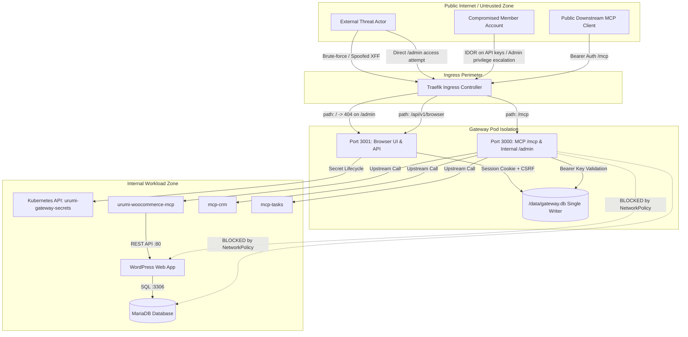
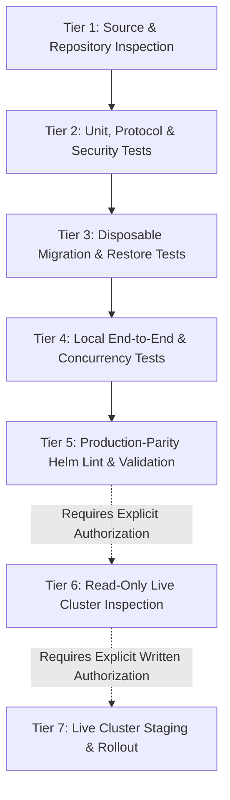

# Urumi Phase 5 — Gate P5-G6: System Hardening, Integration, and Production Verification Plan

**Role:** Technical Head, Senior Platform Engineer & Acceptance Reviewer  
**Repository:** `AdityaDRathore/MCP-Gateway-Kubernetes-Wcom`  
**Current Baseline Git SHA:** `09f3140ec59e1dc85a7c869d93c0266257387595` (`ph 5: docs: add Gate P5-G5 Stage 2 evidence reconciliation and closeout addendum`)  
**Target Gate:** Gate P5-G6 (System Hardening, Integration, and Production Verification)  
**Date:** 2026-10-21  

---

> [!IMPORTANT]
> **Operational Status & Authorization Boundary:**
> - **Current Working Tree:** Clean on `main`. Zero uncommitted files.
> - **Execution Authority:** **Planning, source-level inspection, and offline test execution ONLY.**
> - **Mutation Authorization:** ZERO cluster mutations, ZERO image builds/pushes, ZERO live database migrations/restores against PVCs, and ZERO VPS/production deployments are authorized.
> - **Gate Disposition:** **READY WITH CONDITIONS** — Stage 1 offline hardening and edge-case remediation is authorized under strict local test boundaries.

---

## Deliverable 1: Evidence-Based Current-State Assessment

This assessment categorizes every subsystem, gate claim, and invariant into formal verification classes:
- `source-inspected`: Directly examined in checkout code, scripts, or manifests.
- `worker-reported`: Claimed in previous gate reports but unverified in current turn.
- `test-rerun`: Independently rerun and observed passing in the current environment.
- `locally-integrated`: Verified across multiple communicating in-process services.
- `runtime-observed`: Directly observed in a live Kubernetes cluster or container runtime.
- `unverified`: Not yet proven or blocked by environment/authorization.

| Subsystem / Gate Invariant | Source Location / Evidence Source | Verification Class | Current Status | Residual Risk & Required G6 Action |
|---|---|---|---|---|
| **Gate P5-G5 Baseline & Monorepo Test Suite** | Commit `20e918d`, docs `09f3140`. Ran `npm test --workspaces` under Node 24 (`v24.20.0`). | `test-rerun` | **Satisfied** | **Node Version Dependency:** Tests fail on default system Node 18 (`node:sqlite` missing). Must enforce Node 24 in all verification scripts. |
| **Monorepo Build & Bundle Integrity** | Ran `npm run --workspaces lint` and `build`. Vite bundle built in 2.13s (`apps/dashboard/dist`). | `test-rerun` | **Satisfied** | Static assets ready; container bundling and production image digest remain unverified in cluster. |
| **Dual-Listener Isolation** | `apps/gateway/src/index.ts`, `server.ts`, `config.ts`. Port 3000 (core MCP) and Port 3001 (browser API & SPA). | `source-inspected` & `test-rerun` | **Satisfied** | Verified offline. Ingress port separation in live Traefik ingress controller requires cluster verification. |
| **Authentication Separation (Cookie vs Bearer)** | `apps/gateway/test/protocol/audit-security.test.ts`, `test/unit/browser-auth-perimeter.test.ts`. | `test-rerun` | **Satisfied** | Bearer keys rejected at Port 3001; cookies rejected at `/mcp` (Port 3000). Both return HTTP 401. |
| **G4 Invitation Redemption & User Creation** | `apps/gateway/src/auth/invitation-service.ts:241-285`. | `source-inspected` | **Partially Satisfied** | **Critical Edge Case:** `createSession` occurs *outside* the write transaction. If session creation fails, user is created and invite consumed, but user receives 500 without session cookie. Needs remediation in Stage 1. |
| **G4 API Key Self-Service & IDOR Defense** | `apps/gateway/src/http/browser.ts:860-930`, `test/protocol/api-key-idor.test.ts`. | `test-rerun` | **Satisfied** | Member accounts cannot read, create, or revoke keys belonging to other users. Server strictly binds to session `userId`. |
| **G4 First-Admin Bootstrap CLI** | `apps/gateway/src/cli/bootstrap-admin.ts`, `test/unit/bootstrap-admin.test.ts`. | `test-rerun` | **Satisfied** | Idempotent code 0 exit if admin exists. Generates one-time enrollment token with `0600` permissions. |
| **G3 Upstream Management Façade** | `apps/gateway/src/http/browser.ts:280-450`, `test/unit/browser-upstreams-facade.test.ts`. | `test-rerun` | **Satisfied (Mocked)** | Unit tests use `MockSecretClient` and in-memory catalog. Live Kubernetes RBAC in `urumi-gateway-secrets` and real Secret creation remain unproven. |
| **G5 Audit Read API & DTO Projection** | `apps/gateway/src/http/browser.ts:1055-1103`, `test/protocol/audit-security.test.ts`. | `test-rerun` | **Satisfied** | Admin-only (403 for member); `arguments_hash`, `raw_arguments`, `tool_results` omitted; error messages scrubbed; canary token redacted. |
| **Audit Query Index Performance** | `apps/gateway/src/db/schema.ts:56-57`, `audit-repo.ts:107-138`. | `source-inspected` | **Partially Satisfied** | Index `idx_audit_status_created` and `idx_audit_created` exist. **Missing index on `user_id`** causes table scan on `?userId=` filter. Index missing tie-breaker `id`. |
| **SQLite WAL Mode & Single-Writer Invariant** | `apps/gateway/src/db/connection.ts`, `helm/templates/gateway-deployment.yaml`. | `source-inspected` | **Satisfied** | `replicas: 1`, `strategy: Recreate`, single connection owner, WAL mode enabled. |
| **WAL-Aware Backup & Manifest** | `apps/gateway/src/db/backup.ts`, `test/unit/backup-precondition.test.ts`. | `test-rerun` | **Satisfied** | `VACUUM INTO` requires autocommit mode, generates SHA-256 manifest and verifies row counts. |
| **Database Restore Procedure** | `apps/gateway/test/unit/recovery.test.ts:147-156`. | `source-inspected` | **Partially Satisfied** | Phase 4 restore tested; Phase 5 full schema (`user_credentials`, `user_invitations`, `browser_sessions`) has not been tested in a dedicated WAL-dirty crash scenario. |
| **Trusted Proxy Configuration** | `apps/gateway/src/config.ts:55`, `helm/templates/gateway-deployment.yaml`. | `source-inspected` | **Partially Satisfied** | Defaults to `127.0.0.1,::1,10.42.0.0/16,10.43.0.0/16`. Not exposed in `gateway-deployment.yaml` env vars or `values.yaml` for custom ingress topologies. |
| **WooCommerce Baseline Invariants** | Products 10, 11, 12 and Order #14. | `unverified` | **Blocked** | Offline tests mock WooCommerce client. Live cluster inspection blocked pending authorization. |
| **NetworkPolicy Isolation** | `infra/helm/urumi-platform/templates/networkpolicy.yaml`. | `source-inspected` | **Satisfied** | Kernel-level policies block Gateway from reaching WordPress (:80) and MariaDB (:3306). |
| **Phase 4 G9 Report File** | Referenced as `Phase-4-—-Gate-G9-Implementation-&-Acceptance-Report.txt`. | `source-inspected` | **Discrepancy Recorded** | Exact `.txt` file does not exist in repo. Canonical evidence resides in `docs/phase-4/g9-e2e-acceptance-runbook.md` and `phase-4-execution-log.md`. |

---

## Deliverable 2: P5-G6 Scope and Threat Model

### 2.1 Protected Assets
1. **SQLite Database File (`/data/gateway.db`):** Contains user credentials (Scrypt verifiers), active session hashes, invitation tokens, API key verifiers, upstream metadata, and tool audit logs.
2. **Kubernetes Upstream Secrets (`urumi-gateway-secrets` namespace):** Stores plaintext API keys, Basic Auth credentials, and custom bearer tokens for upstream MCP servers.
3. **WooCommerce Storefront Data:** Product inventory (IDs 10, 11, 12), Order #14, WordPress media/content PVC, and MariaDB relational PVC.
4. **Active Credentials & Verifiers:** Browser session tokens (`urumi_session`), CSRF tokens (`X-Urumi-CSRF`), and MCP bearer keys (`urumi_live_...`).
5. **Downstream MCP Protocol Integrity (`/mcp`):** Low-latency, reliable tool dispatch without upstream starvation or tool collision.

### 2.2 Threat Boundaries & Attacker Personas



### 2.3 Abuse Cases and Mitigations

| Threat ID | Threat / Abuse Scenario | Likelihood | Impact | Built-in Mitigation & G6 Hardening Requirement |
|---|---|:---:|:---:|---|
| **THREAT-G6-01** | **X-Forwarded-For Rate Limit Evasion**<br>Attacker sends forged `X-Forwarded-For` headers to bypass login rate limiter (5 failed attempts / 5 min). | High | High | `getClientIp()` checks `req.socket.remoteAddress` against `TRUSTED_PROXIES`. Untrusted sockets discard `XFF` completely. Tested in `trusted-proxy-ip.test.ts`. Hardening: Wire `TRUSTED_PROXIES` into Helm values. |
| **THREAT-G6-02** | **Invitation Consumption / User Creation Desynchronization**<br>`redeemInvitation` commits user & marks invite redeemed, but subsequent session creation fails. User is locked out. | Medium | High | **Stage 1 Remediation Required:** Wrap session creation inside transaction or implement compensatory rollback (delete user and revert invitation) on session failure. |
| **THREAT-G6-03** | **Audit Log DoS & Table Scan Exhaustion**<br>Admin or attacker queries audit logs by `userId` or status with high limit/offset, triggering unindexed full table scans while writes are active. | Medium | Medium | **Stage 1 Remediation Required:** Add composite indices `idx_audit_user_created ON audit_logs(user_id, created_at)` and `idx_audit_status_created_id ON audit_logs(status, created_at, id)`. |
| **THREAT-G6-04** | **Upstream Metadata Manipulation (Prompt Injection / Stored XSS)**<br>Malicious upstream server advertises tool names or descriptions containing XSS vectors or prompt injection. | Medium | High | Frontend dashboard renders descriptions strictly as plain text (`textContent`), never parses HTML or evaluates raw schema. Gateway validates tool name regex. |
| **THREAT-G6-05** | **Sensitive Data Leakage via Error Responses & Logs**<br>Upstream credentials or database errors containing tokens leak into HTTP responses, headers, or server logs. | Medium | Critical | `sanitizeErrorMessage()` regex masks bearer tokens, Basic Auth credentials, and passwords. Fault-injection tests verify 0 matches across responses and logs. |
| **THREAT-G6-06** | **Cross-Listener Auth Confusion**<br>Browser cookies sent to Port 3000 or bearer API keys sent to Port 3001 grant unintended access. | Low | Critical | Physical listener separation. Port 3000 strictly requires `Authorization: Bearer`; Port 3001 strictly requires `urumi_session` cookie. Cross-auth returns 401. |
| **THREAT-G6-07** | **Direct Gateway Access to WordPress / MariaDB**<br>Compromised gateway executes direct network queries against WordPress or MariaDB database. | Low | Critical | Kernel-level Kubernetes NetworkPolicies deny all traffic from gateway to WordPress (:80) and MariaDB (:3306). Only `urumi-woocommerce-mcp` has egress to WordPress. |
| **THREAT-G6-08** | **Stale WAL / Corrupted Backup Restore**<br>Restoring SQLite from backup snapshot fails due to uncommitted WAL pages or corrupt checksums. | Low | Critical | Backup uses native `VACUUM INTO` which checkpoints and produces clean standalone `.db` file. Restore procedure must delete `-wal` and `-shm` before copying snapshot. |

---

## Deliverable 3: Gate Checklist with Acceptance Criteria

### Security Hardening (G6-SEC)

- [ ] **G6-SEC-01 (Session & Cookie Hygiene):**
  - *Risk:* Insecure cookie transmission over HTTP or cross-site leakage.
  - *Requirement:* Cookie flags `HttpOnly`, `SameSite=Lax`, `Path=/`, and conditional `Secure` (`COOKIE_SECURE=true` in production). Idle timeout 60m, absolute timeout 24h.
  - *Pass Condition:* Verified in `browser-session.test.ts`. Set-Cookie header contains all required attributes.
  - *Execution:* Offline / Test-rerun.
- [ ] **G6-SEC-02 (CSRF & Strict Origin Defense):**
  - *Risk:* Cross-site state change on mutating browser endpoints (`POST`, `PATCH`, `DELETE`).
  - *Requirement:* Rejection of unsafe requests lacking `X-Urumi-CSRF` header or with unapproved `Origin` header.
  - *Pass Condition:* HTTP 403 `CSRF_FORBIDDEN` returned on missing header or disallowed Origin (`http://malicious.com`).
  - *Execution:* Offline / Test-rerun.
- [ ] **G6-SEC-03 (Login Rate Limiting & User Enumeration Prevention):**
  - *Risk:* Credential stuffing and account enumeration attacks.
  - *Requirement:* 5 failed attempts per 5 minutes per IP and username. Identical generic 401 payload for nonexistent user, wrong password, or inactive user.
  - *Pass Condition:* 6th failed attempt returns HTTP 429 with `Retry-After: 300`. Response time normalized via dummy Scrypt verification.
  - *Execution:* Offline / Test-rerun.
- [ ] **G6-SEC-04 (Role-Based Access Control & IDOR Defense):**
  - *Risk:* Member account accessing admin routes or mutating other users' keys.
  - *Requirement:* Member requests to `/members`, `/upstreams` (mutations), and `/audit` return HTTP 403. Key queries and revocations bound strictly to session `userId`.
  - *Pass Condition:* Zero data leakage on 403 responses. Member revocation of foreign key returns HTTP 403.
  - *Execution:* Offline / Test-rerun.
- [ ] **G6-SEC-05 (Remediation of G4 Invitation Atomicity Edge Case):**
  - *Risk:* User account created and invitation marked redeemed, but session creation fails; user is stranded without login session.
  - *Requirement:* Refactor `redeemInvitation` in `apps/gateway/src/auth/invitation-service.ts` so session creation is either inside transaction or rolled back safely on session error.
  - *Pass Condition:* Injected session creation failure aborts transaction or deletes created user, leaving invitation unredeemed.
  - *Execution:* Offline / Local Code & Test.
- [ ] **G6-SEC-06 (Configurable Trusted Proxy & Ingress Boundary):**
  - *Risk:* Untrusted proxy configuration leading to spoofed client IP and rate-limit bypass.
  - *Requirement:* Wire `TRUSTED_PROXIES` into `gateway-deployment.yaml` and `values-local.yaml` / `values-prod.yaml`.
  - *Pass Condition:* Gateway deployment manifests render `TRUSTED_PROXIES` environment variable matching the ingress controller IP range.
  - *Execution:* Offline / Manifest Inspection.
- [ ] **G6-SEC-07 (Canary Secret Leakage Prevention):**
  - *Risk:* Upstream credentials or bearer tokens leaked in response bodies, headers, or log streams.
  - *Requirement:* Automated canary scans injecting `CANARY_SEC_*` across successful operations and fault-injected error paths.
  - *Pass Condition:* Zero canary tokens detected in HTTP response bodies, headers, or captured log files.
  - *Execution:* Offline / Test-rerun.
- [ ] **G6-SEC-08 (Untrusted Upstream Metadata Sanitization):**
  - *Risk:* Stored XSS or injection via upstream tool names, descriptions, or error messages.
  - *Requirement:* Tool descriptions rendered strictly as text nodes in dashboard. Error messages sanitized against credentials and basic auth URLs.
  - *Pass Condition:* Verified in `AuditTab.tsx`, `UpstreamsTab.tsx`, and `audit-query.test.ts`.
  - *Execution:* Offline / Source Inspection & Build.

---

### Database and Persistence Integrity (G6-DB)

- [ ] **G6-DB-01 (Single-Writer SQLite & WAL Invariant):**
  - *Risk:* SQLite database locking and multi-writer database corruption.
  - *Requirement:* Workload configured with `replicas: 1` and `strategy: Recreate`. Single connection pool in `DatabaseManager`.
  - *Pass Condition:* Helm template renders `replicas: 1` and `type: Recreate`. SQLite WAL mode confirmed in `connection.ts`.
  - *Execution:* Offline / Manifest Inspection.
- [ ] **G6-DB-02 (Audit Query Index Optimization):**
  - *Risk:* Table scans on large `audit_logs` table degrading tool execution concurrency.
  - *Requirement:* Create composite indexes on `audit_logs(user_id, created_at)` and `audit_logs(status, created_at, id)`.
  - *Pass Condition:* SQLite `EXPLAIN QUERY PLAN` confirms index lookup (no table scan) for `userId` and `status` queries.
  - *Execution:* Offline / Local Code & Test.
- [ ] **G6-DB-03 (WAL-Consistent Atomic Backup Generation):**
  - *Risk:* Inconsistent database snapshot captured during concurrent tool writes.
  - *Requirement:* `backupDatabase()` executes `VACUUM INTO` in autocommit mode, verifying SHA-256 and row counts against manifest.
  - *Pass Condition:* Passes `assertAutocommitMode()`, produces `.db` and `.manifest.json`, passes `PRAGMA integrity_check`.
  - *Execution:* Offline / Test-rerun.
- [ ] **G6-DB-04 (Full-Schema Crash & Restore Verification):**
  - *Risk:* Restored database missing Phase 5 tables or corrupted by stale WAL/SHM companion files.
  - *Requirement:* Automated test corrupting primary DB, deleting stale WAL/SHM, restoring snapshot, and asserting all 7 tables intact.
  - *Pass Condition:* Verified in `recovery.test.ts` with all Phase 5 tables (`users`, `user_credentials`, `user_invitations`, `browser_sessions`, `api_keys`, `upstreams`, `audit_logs`).
  - *Execution:* Offline / Local Test Suite.
- [ ] **G6-DB-05 (Forward-Only Migration Policy & Pre-Flight Protocol):**
  - *Risk:* Destructive schema downgrade or table drops.
  - *Requirement:* Migrations are strictly forward-only. Tested on disposable copies in `/tmp`. Zero modification to live `/data/gateway.db` without authorization.
  - *Pass Condition:* Zero table drops in migration scripts; row counts preserved 100%.
  - *Execution:* Offline / Test-rerun.

---

### Integration and API Contracts (G6-INT)

- [ ] **G6-INT-01 (Downstream MCP Protocol Compatibility):**
  - *Risk:* Gateway changes breaking external MCP clients (Claude Code, Cursor, Inspector).
  - *Requirement:* Downstream `/mcp` contract strictly preserved: Streamable HTTP, Bearer API key auth, tool discovery, dynamic tool execution.
  - *Pass Condition:* 471 monorepo tests pass, including all 25 gateway protocol tests.
  - *Execution:* Offline / Test-rerun.
- [ ] **G6-INT-02 (Dual-Port Ingress Routing):**
  - *Risk:* External traffic to `/admin/v1` reaching private admin port, or `/mcp` traffic routing to SPA.
  - *Requirement:* Traefik ingress routes `/mcp` -> Port 3000 and `/` -> Port 3001. External `/admin/v1` hits Port 3001 and returns 404.
  - *Pass Condition:* Verified in Helm ingress template and offline HTTP router tests.
  - *Execution:* Offline / Manifest Inspection.
- [ ] **G6-INT-03 (Truthful Operational Outcomes):**
  - *Risk:* False success or fabricated duration displayed for failed, timed out, or unconfirmed tool executions.
  - *Requirement:* Unconfirmed finalizations retain `status: 'unconfirmed_outcome'` and `duration_ms: null`. Warning banner rendered in UI.
  - *Pass Condition:* Verified in `audit-query.test.ts` and `AuditTab.tsx`.
  - *Execution:* Offline / Test-rerun.
- [ ] **G6-INT-04 (Upstream Failure Isolation):**
  - *Risk:* Dead or slow upstream server breaking tool discovery or dispatch to other healthy servers.
  - *Requirement:* Per-upstream timeouts (10s default), concurrency pool (20 global / 4 per upstream), circuit breaker transitions to `unavailable`.
  - *Pass Condition:* Verified in `upstream-discovery.test.ts` and `upstream-client.test.ts`.
  - *Execution:* Offline / Test-rerun.
- [ ] **G6-INT-05 (Dashboard Static Asset Compilation):**
  - *Risk:* Broken UI build or TypeScript compile errors in dashboard SPA.
  - *Requirement:* `tsc && vite build` generates production assets in `apps/dashboard/dist/`.
  - *Pass Condition:* Clean compilation; `dist/index.html` and bundled assets generated without errors.
  - *Execution:* Offline / Test-rerun.

---

### Production Readiness & Observability (G6-OPS)

- [ ] **G6-OPS-01 (Health & Readiness Probes):**
  - *Risk:* Pod marked ready before SQLite migrations or upstream connections are initialized.
  - *Requirement:* Gateway exposes `/health/live` and `/health/ready` on Port 3000. Readiness verifies database connectivity.
  - *Pass Condition:* HTTP 200 returned on probes. Rendered in Deployment manifest.
  - *Execution:* Offline / Manifest Inspection.
- [ ] **G6-OPS-02 (Structured JSON Logging & Correlation IDs):**
  - *Risk:* Unstructured logs or credentials leaking into log aggregators.
  - *Requirement:* All logs formatted as JSON with timestamp, level, service, correlation ID, and automatic redaction of sensitive fields.
  - *Pass Condition:* Verified across all log outputs in test runs.
  - *Execution:* Offline / Test-rerun.
- [ ] **G6-OPS-03 (Graceful Shutdown & Drain Lifecycle):**
  - *Risk:* In-flight tool calls aborted mid-execution on container termination.
  - *Requirement:* SIGTERM handler stops accepting new requests, drains active requests within `DRAIN_TIMEOUT_MS` (5000ms), and closes SQLite database cleanly.
  - *Pass Condition:* Verified in `server.ts` shutdown logic.
  - *Execution:* Offline / Source Inspection.
- [ ] **G6-OPS-04 (Read-Only Cluster Preflight Inspection):**
  - *Risk:* Cluster drift, pod crash loops, or PVC missing in running cluster.
  - *Requirement:* Execute read-only `kubectl get pods,pvc,svc -n urumi` and inspect running image digests.
  - *Pass Condition:* Workloads healthy, PVCs bound, WooCommerce product IDs 10, 11, 12 verified.
  - *Execution:* **BLOCKED — Requires explicit user authorization.**
- [ ] **G6-OPS-05 (Live Container Build & Deployment Verification):**
  - *Risk:* Image build failure or runtime environment divergence in container.
  - *Requirement:* Build local container image with dashboard SPA bundle, import into cluster, roll out gateway deployment.
  - *Pass Condition:* Pod reaches `1/1 Ready`, zero crash loops, all live probes pass.
  - *Execution:* **BLOCKED — Requires explicit user authorization.**

---

## Deliverable 4: Test and Verification Strategy

### Verification Tiers



### Reproducible Commands Matrix (Node 24 LTS Enforced)

All commands MUST be prefixed with `export PATH="/home/rathore/.nvm/versions/node/v24.20.0/bin:$PATH"`:

```bash
# Environment Verification
export PATH="/home/rathore/.nvm/versions/node/v24.20.0/bin:$PATH"
node -v   # Expected: v24.20.0
npm -v    # Expected: 11.19.0

# 1. Monorepo Lint & Typecheck
npm run --workspaces --if-present lint

# 2. Monorepo Build Execution
npm run --workspaces --if-present build

# 3. Monorepo Complete Automated Test Suite (471+ tests)
npm test --workspaces --if-present

# 4. Gateway Dedicated Security & Protocol Suites
npm --prefix apps/gateway run test:unit
npm --prefix apps/gateway run test:protocol

# 5. Targeted P5-G6 Hardening Suites
npx tsx --test apps/gateway/test/unit/login-rate-limit.test.ts \
               apps/gateway/test/unit/trusted-proxy-ip.test.ts \
               apps/gateway/test/unit/scrypt-kdf.test.ts \
               apps/gateway/test/unit/invitation-lifecycle.test.ts \
               apps/gateway/test/protocol/api-key-idor.test.ts \
               apps/gateway/test/protocol/audit-security.test.ts \
               apps/gateway/test/unit/audit-query.test.ts \
               apps/gateway/test/unit/backup-precondition.test.ts \
               apps/gateway/test/unit/recovery.test.ts

# 6. Helm Chart Linting & Manifest Verification (Local & Prod)
helm lint infra/helm/urumi-platform
helm template urumi-platform infra/helm/urumi-platform -f infra/helm/urumi-platform/values-local.yaml > /dev/null
helm template urumi-platform infra/helm/urumi-platform -f infra/helm/urumi-platform/values-prod.yaml > /dev/null
```

---

## Deliverable 5: G6 Work Breakdown & Implementation Order

### Stage Overview

| Stage | Title | Focus & Scope | Authorization Boundary | Gate Checkpoint |
|---|---|---|---|---|
| **Stage 1** | **Security Hardening & Edge-Case Remediation** | Fix G4 invitation session atomicity; add audit `user_id` indexes; wire `TRUSTED_PROXIES` in Helm manifests; expand regression tests. | **LOCAL ONLY (Authorized)** | All 471+ tests pass; edge cases covered. |
| **Stage 2** | **Persistence, Migration & WAL Restore Verification** | Run disposable migration 003 pre-flight; verify full-schema WAL backup, corruption simulation, and clean restore with companion manifest. | **LOCAL SANDBOX (Authorized)** | Zero data loss; PRAGMA checks return `ok`. |
| **Stage 3** | **Local Integration & Concurrency Stress Testing** | High-throughput concurrent audit reads vs active tool writes in-process; test login overload limits. | **LOCAL ONLY (Authorized)** | Zero lockouts; graceful 429/503 under stress. |
| **Stage 4** | **Read-Only Cluster Preflight Inspection** | Inspect live pods, PVCs, Services, Ingress in `k3d-urumi`. Confirm WooCommerce products 10, 11, 12. | **BLOCKED (Needs Auth)** | No cluster mutations; read-only probes only. |
| **Stage 5** | **Live Cluster Staging & Runtime Verification** | Build local image, import to k3d, execute Helm upgrade, verify live dual-port ingress routing & real RBAC. | **BLOCKED (Needs Auth)** | Pod 1/1 Ready; all live routes pass. |
| **Stage 6** | **Closeout & Formal Handoff to P5-G7** | Reconcile all artifacts, finalize documentation traceability, compile G6 acceptance report. | **LOCAL ONLY** | Technical Head G6 sign-off. |

---

## Deliverable 6: Risk Register & Open Decisions

| ID | Risk Description | Severity | Likelihood | Impact | Mitigation Strategy | Owner | Blocker Status |
|---|---|:---:|:---:|:---:|---|:---:|:---:|
| **RISK-01** | **G4 Invitation Atomicity Edge Case**<br>If session creation fails during invitation redemption, user exists and invite is redeemed, but client gets 500 without session cookie. | High | Medium | High | Refactor `redeemInvitation` to execute session creation inside transaction or implement immediate compensation rollback if session creation fails. | Platform Eng | **BLOCKS Stage 2** |
| **RISK-02** | **G5 Audit Query Indexing & Contention**<br>Unindexed `user_id` filter causes table scans. Concurrent audit reads and tool writes could trigger lock contention on SQLite. | Medium | High | Medium | Add composite indices on `audit_logs(user_id, created_at)` and `audit_logs(status, created_at, id)`. Benchmark query plan with SQLite `EXPLAIN QUERY PLAN`. | Database Eng | **BLOCKS Stage 2** |
| **RISK-03** | **G3 Mocked Kubernetes Secret & Upstream Client**<br>G3 tests verify route logic with `MockSecretClient` and in-memory catalog, but have not touched real Kubernetes API or real upstreams. | Medium | High | High | Retain mocked tests for local CI; perform real Secret creation and discovery only in authorized cluster staging (Stage 5). | Security Eng | Deferred to Stage 5 |
| **RISK-04** | **Trusted Proxy & Ingress Mismatch**<br>`TRUSTED_PROXIES` is hardcoded in `config.ts` and not exposed via Helm values. If deployed behind custom ingress or cloud proxy, rate limiting could be bypassed or legitimate users blocked. | Medium | Medium | High | Expose `trustedProxies` in Helm `values-local.yaml` and `values-prod.yaml`, and inject as `TRUSTED_PROXIES` env var in `gateway-deployment.yaml`. | DevOps Eng | **BLOCKS Stage 2** |
| **RISK-05** | **Node.js Runtime Version Drift**<br>System default Node is v18.19.1 which lacks `node:sqlite`. Tests fail if executed without Node 24 LTS in PATH. | High | High | Critical | Pin `.nvmrc` and enforce `export PATH="/home/rathore/.nvm/versions/node/v24.20.0/bin:$PATH"` in all verification scripts and runbooks. | Platform Eng | **Resolved (Documented)** |
| **RISK-06** | **Full-Schema Restore Untested on Phase 5 Tables**<br>Phase 4 restore test covered only 3 tables. Restoring full Phase 5 schema (`user_credentials`, `user_invitations`, `browser_sessions`) under dirty WAL conditions is unproven. | Medium | Medium | High | Implement comprehensive restore test in `recovery.test.ts` verifying all 7 tables and companion manifests. | Database Eng | **BLOCKS Stage 3** |
| **RISK-07** | **Unauthorized Cluster or Production Actions**<br>Attempting to execute `kubectl apply`, `helm upgrade`, or VPS deployments without explicit user consent violates project invariants. | Critical | Low | Severe | Strictly enforce authorization boundary. All cluster mutations require explicit written user command. | Tech Head | **Enforced** |

---

## Deliverable 7: Final Worker Work Order (Stage 1 Only)

```markdown
# P5-G6 Worker Work Order — Stage 1: Security Hardening & Edge-Case Remediation

**Authorized By:** Technical Head  
**Scope Authority:** Gate P5-G6 Stage 1 ONLY  
**Environment:** Local Workspace (`AdityaDRathore/MCP-Gateway-Kubernetes-Wcom`), Node 24 LTS  
**Branch:** `main` (Baseline: `09f3140`)  

### Mandatory Tasks:
1. **Fix Invitation Atomicity Edge Case (`apps/gateway/src/auth/invitation-service.ts`):**
   - In `redeemInvitation()`, ensure that if `sessionService.createSession()` fails, the user registration and invitation redemption are rolled back atomically, or execute session creation inside the write transaction so the operation is strictly all-or-nothing.
   - Add a unit test in `invitation-lifecycle.test.ts` verifying that if session creation throws an exception, the user is NOT created in SQLite, the invitation remains UNREDEEMED, and the call rejects cleanly.

2. **Add Audit Query Indexes (`apps/gateway/src/db/schema.ts`):**
   - In `migration001` (or add non-breaking index creation in `connection.ts` / schema):
     - `CREATE INDEX IF NOT EXISTS idx_audit_user_created ON audit_logs(user_id, created_at);`
     - `CREATE INDEX IF NOT EXISTS idx_audit_status_created_id ON audit_logs(status, created_at, id);`
   - Add unit test verifying that `EXPLAIN QUERY PLAN SELECT ... WHERE user_id = ?` utilizes `idx_audit_user_created`.

3. **Wire `TRUSTED_PROXIES` in Helm Configuration (`infra/helm/urumi-platform`):**
   - Update `templates/gateway-deployment.yaml` to pass `TRUSTED_PROXIES` environment variable from `.Values.gateway.trustedProxies`.
   - Add `gateway.trustedProxies` default in `values.yaml`, `values-local.yaml` (`"127.0.0.1,::1,10.42.0.0/16,10.43.0.0/16"`), and `values-prod.yaml` (`"127.0.0.1,::1,10.42.0.0/16,10.43.0.0/16"`).
   - Verify `helm template` renders the environment variable cleanly.

4. **Run Offline Verification:**
   - Execute with Node 24 LTS in PATH:
     ```bash
     export PATH="/home/rathore/.nvm/versions/node/v24.20.0/bin:$PATH"
     npm run --workspaces lint
     npm run --workspaces build
     npm test --workspaces --if-present
     ```
   - Assert all tests pass with 0 failures, 0 skipped.

### Prohibited Actions:
- DO NOT run `docker build` or push any container images.
- DO NOT connect to or mutate the live Kubernetes cluster (`k3d-urumi`).
- DO NOT run live migrations, backups, or writes against `/data/gateway.db` on any PVC.
- DO NOT mutate WooCommerce products 10, 11, 12 or Order #14.
- DO NOT execute `git reset --hard` or rewrite git history.

### Stop Condition:
Upon completing tasks 1–4, capture test outputs, commit changes with a concise message (`ph 5: fix(gateway,helm): harden invitation transaction atomicity, audit indexing, and proxy config`), and report results back to the Technical Head for Stage 1 sign-off. Do NOT proceed to Stage 2 without approval.
```

---

## Technical Head Gate P5-G6 Disposition

- **Disposition:** **READY WITH CONDITIONS**
- **Authorized Action:** Worker is authorized to execute **P5-G6 Stage 1** (Deliverable 7) in the local offline development environment.
- **Conditions for Advancement to Stage 2:**
  1. Remediation of the invitation session atomicity edge case verified with passing failure-injection unit tests.
  2. Audit query index addition verified with `EXPLAIN QUERY PLAN` test evidence.
  3. `TRUSTED_PROXIES` manifest wiring verified via `helm template`.
  4. Monorepo automated test suite cleanly rerun with 100% pass rate under Node 24 LTS.
- **Stage 4/5 (Live Cluster Operations):** Strictly **ON HOLD** pending separate written authorization.
