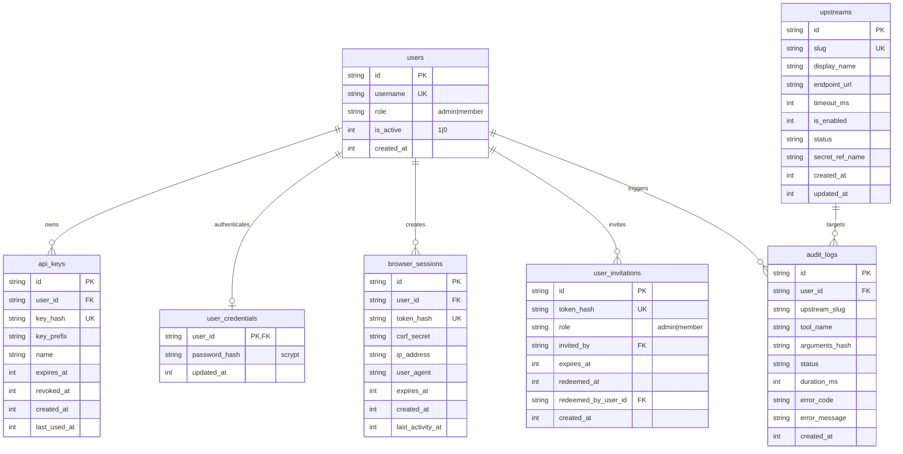

# Phase 5 Gate P5-G6: Stage 2 Persistent Storage & Recovery Test Plan

**Document Version:** 1.0.0  
**Target Environment:** Local Offline Development Sandbox (`/tmp/urumi-stage2-storage-*`)  
**Authorization State:** **DRAFT FOR TECHNICAL HEAD REVIEW (EXECUTION GATED)**  
**Target Scope:** Phase 5 Full-Schema WAL Backup, Disaster Restore, Integrity Verification, and Failure-Injection Suite

---

## 1. Executive Summary & Authorization Boundaries

### 1.1 Objective
Stage 2 validates SQLite persistence, WAL-aware backup generation, crash recovery, and disaster restore across the complete Phase 5 schema (all 7 application tables). It provides concrete proof that:
1. Online backups generated via native SQLite `VACUUM INTO` produce completely self-contained, crash-consistent snapshots with cryptographically bound manifests.
2. Cold disaster restore successfully recovers from primary database corruption and cleans stale WAL/SHM companion files with zero data loss.
3. Negative and failure cases (checksum mismatches, missing manifests, active transaction locks, poisoned companion files) fail closed safely.

### 1.2 Strict Safety & Anti-PVC Boundaries
| Resource / Action | Authorization Boundary | Safety Guarantee |
| :--- | :--- | :--- |
| **Live PVC (`/data/gateway.db`)** | **STRICTLY PROHIBITED** | Runtime path assertion fails closed if target path matches or starts with `/data/` |
| **Live Kubernetes Cluster** | **STRICTLY PROHIBITED** | Zero `kubectl` or `k3d` commands executed; no pod rollouts |
| **Docker Images** | **STRICTLY PROHIBITED** | Zero `docker build` or `docker push` commands |
| **Test Database Location** | **LOCAL SANDBOX ONLY** | Isolated temporary directory under `os.tmpdir()` (`/tmp/urumi-stage2-storage-*`) |
| **Cleanup Guarantee** | **MANDATORY** | All temporary directories wiped in `finally` / `afterEach` test hooks |

---

## 2. Phase 5 Full-Schema Coverage Matrix

The restore test must populate, snapshot, corrupt, restore, and verify all 7 tables in the Phase 5 schema:



### Table Verification Contracts:
1. **`users`:** Verifies admin and member rows, active state flags (`is_active = 1`), and unique constraints.
2. **`user_credentials`:** Verifies scrypt password hashes (`scrypt$N=16384,r=8,p=1$...`) and password verification functionality post-restore.
3. **`browser_sessions`:** Verifies active session records, SHA-256 token hashes, CSRF secrets, and session lookup post-restore.
4. **`user_invitations`:** Verifies pending unredeemed invitations and redeemed invitations with referential links to `users`.
5. **`api_keys`:** Verifies active and revoked key hashes and API key authentication verification post-restore.
6. **`upstreams`:** Verifies active upstreams (`woocommerce`, `crm`, `tasks`) and custom configured endpoint metadata.
7. **`audit_logs`:** Verifies audit records across multiple statuses (`success`, `failed`, `unconfirmed_outcome`) and timestamp ordering.

---

## 3. SQLite WAL-Aware Backup Architecture

### 3.1 Online Atomic Snapshotting (`VACUUM INTO`)
* **Transaction State Assertion:** `assertAutocommitMode(db)` verifies `db.isTransaction === false`. If a transaction is active, backup fails closed before touching the disk.
* **Checkpoint & Compaction:** `VACUUM INTO` creates an atomic, standalone SQLite database file where all committed WAL transactions are integrated. The resulting file has zero external dependencies on active `-wal` or `-shm` companion files.
* **POSIX Security:**
  * Backup directory is locked to `0700` (`drwx------`).
  * Backup snapshot `.db` file and `.manifest.json` are locked to `0600` (`-rw-------`).
* **Retention Pruning:** Retains the `retainCount` (default: 7) most recent backups and removes older `.db` and `.manifest.json` pairs.

### 3.2 Backup Manifest Specification (`BackupManifest`)
Each snapshot generates a cryptographically bound `.manifest.json`:
```json
{
  "backupId": "UUIDv4",
  "backupFileName": "gateway-YYYY-MM-DDTHH-mm-ss-sssZ-xxxxxxxx.db",
  "manifestFileName": "gateway-YYYY-MM-DDTHH-mm-ss-sssZ-xxxxxxxx.manifest.json",
  "timestamp": "ISO-8601 UTC string",
  "createdAtUnix": 1729510000,
  "sha256": "64-character lowercase hex SHA-256 checksum of the .db file",
  "sizeBytes": 147456,
  "schemaVersion": 3,
  "integrityCheck": "ok",
  "foreignKeyCheck": "ok",
  "rowCounts": {
    "users": 3,
    "user_credentials": 2,
    "browser_sessions": 2,
    "user_invitations": 2,
    "api_keys": 3,
    "upstreams": 3,
    "audit_logs": 10
  }
}
```

---

## 4. Standardized Recovery & Restore Procedure

The recovery drill tests the formal operator disaster restore procedure:

```mermaid
sequenceDiagram
    autonumber
    participant Op as Disaster Recovery Drill
    participant Man as Backup Manifest Validator
    participant FS as Local Filesystem (/tmp)
    participant DB as Restored Database Connection

    Op->>Man: 1. Read .manifest.json and compute SHA-256 of .db snapshot
    alt Checksum Mismatch or Missing Manifest
        Man-->>Op: ABORT: Manifest invalid or file corrupted (fail closed)
    else Checksum Matches Exactly
        Man-->>Op: OK: Backup file verified authentic
    end

    Op->>FS: 2. Close active DB connection; remove corrupted primary .db, .db-wal, and .db-shm
    Note over FS: Stale WAL/SHM companion files explicitly deleted to prevent poisoning

    Op->>FS: 3. Copy verified snapshot to primary dbPath with 0600 permissions
    
    Op->>DB: 4. Open restored DB connection with DatabaseManager
    DB->>Op: 5. Execute PRAGMA integrity_check -> 'ok'
    DB->>Op: 6. Execute PRAGMA foreign_key_check -> []
    DB->>Op: 7. Execute getTableRowCounts() -> Match manifest.rowCounts exactly across all 7 tables
    DB->>Op: 8. Execute functional auth & query drill (password verify, key verify, session verify)
```

### Key Restore Safety Invariants:
1. **Mandatory Companion File Cleanup:** In SQLite WAL mode, restoring a `.db` file while leaving existing `.db-wal` or `.db-shm` files on disk causes catastrophic database corruption or silent data reversion. The restore procedure **must** delete `-wal` and `-shm` companion files before placing the backup file.
2. **Offline Placement:** The primary database must be closed or the container scaled to 0 before replacing the file.
3. **Verification Before Opening:** The backup file's SHA-256 must match `manifest.sha256` prior to copy.
4. **Post-Restore Integrity Gate:** `PRAGMA integrity_check` and `PRAGMA foreign_key_check` must pass with zero errors before traffic is served.

---

## 5. Negative Test Scenarios & Failure-Injection Matrix

Stage 2 execution will implement and verify the following 5 failure cases:

| Test ID | Failure Injection Description | Expected Safe Behavior | Verification Check |
| :--- | :--- | :--- | :--- |
| **FAIL-01** | **Snapshot Byte Corruption:**<br>Modify random bytes in `.db` snapshot before restore. | Restore validator detects SHA-256 mismatch and aborts without overwriting database. | Throws `RestoreError('SHA-256 mismatch')`; primary file untouched. |
| **FAIL-02** | **Missing or Malformed Manifest:**<br>Manifest file deleted or corrupted with invalid JSON. | Restore validator fails closed; refuses to restore unverified snapshot. | Throws `RestoreError('Missing or invalid manifest')`. |
| **FAIL-03** | **Active Transaction During Backup:**<br>Attempt `backupDatabase` while explicit transaction is open. | Precondition check `assertAutocommitMode` fails immediately without executing `VACUUM INTO`. | Throws `BackupError('VACUUM INTO requires autocommit mode')`. |
| **FAIL-04** | **Stale WAL/SHM Companion Poisoning:**<br>Primary database crashed, leaving stale/poisoned `-wal` and `-shm` files on disk. | Restore procedure cleans stale `-wal` and `-shm`; restored DB opens cleanly with zero corruption. | `PRAGMA integrity_check === 'ok'`, all 7 table records intact. |
| **FAIL-05** | **Live PVC Path Rejection:**<br>Attempting to call restore targeting `/data/gateway.db` or `/data/*`. | Strict path assertion immediately aborts before any filesystem operation. | Throws `Error('Target path cannot reside within protected path /data')`. |

---

## 6. Detailed Test Suite Structure

A dedicated test file [`apps/gateway/test/unit/persistent-storage.test.ts`](file:///home/rathore/Documents/Urumi%20Assignment/apps/gateway/test/unit/persistent-storage.test.ts) will be created (or integrated into [`recovery.test.ts`](file:///home/rathore/Documents/Urumi%20Assignment/apps/gateway/test/unit/recovery.test.ts)), structured as follows:

```typescript
describe('Stage 2: Persistent Storage, WAL Backup & Disaster Recovery Verification', () => {
  // Test 1: Full-Schema Baseline Seed & Online Backup
  // Test 2: Cold Disaster Restore with Stale WAL/SHM Cleanup
  // Test 3: Post-Restore Functional Verification across all 7 tables
  // Test 4: FAIL-01 - Corrupted Snapshot Rejection
  // Test 5: FAIL-02 - Missing / Invalid Manifest Rejection
  // Test 6: FAIL-03 - Active Transaction Rejection (Autocommit Enforcement)
  // Test 7: FAIL-04 - Stale WAL/SHM Poisoning Resilience
  // Test 8: FAIL-05 - Runtime Protected Path (/data/) Guard
});
```

---

## 7. Execution Readiness & Authorization Request

### Pre-Execution Checklist
- [x] Full Phase 5 schema defined and indexed (Commit `cde5142`).
- [x] All 7 tables mapped to row-count collector `getTableRowCounts`.
- [x] Offline test environment isolated (`/tmp/urumi-stage2-storage-*`).
- [x] Zero cluster / zero live PVC mutations guaranteed.
- [ ] Technical Head review and formal approval.

**Submission Statement:**  
The worker is standing by. No code changes, no database writes, and no test executions for Stage 2 will proceed until the Technical Head has reviewed this plan and issued formal authorization.
