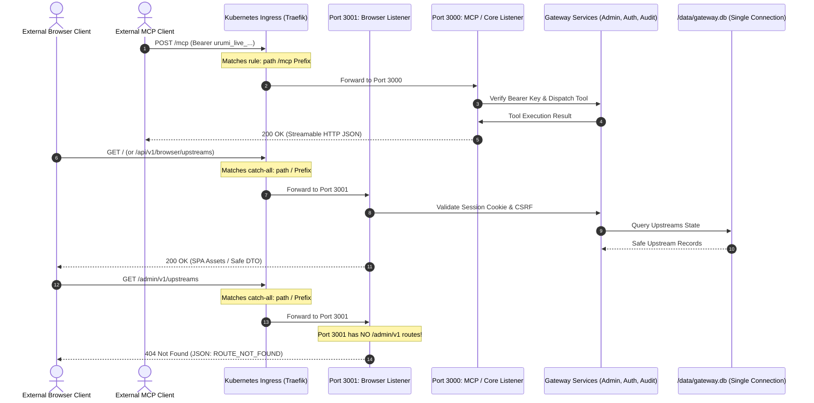
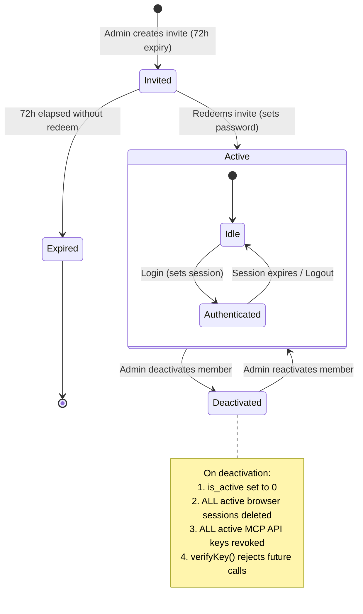
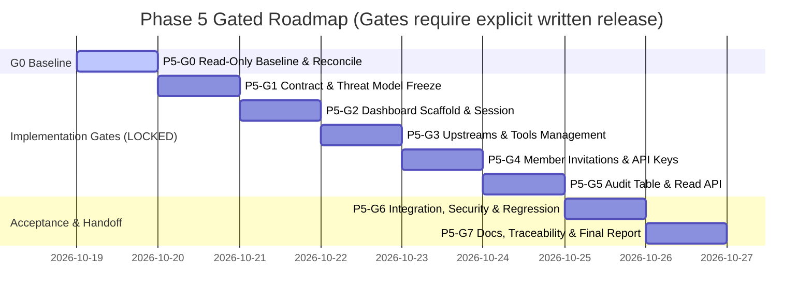

# Urumi Phase 5 — Technical Implementation Plan (Revised)
## Team MCP Gateway Browser Dashboard & Secure Administration

> [!IMPORTANT]
> **Authority, Governance & Gate Disposition:**
> - **Technical Head Disposition:** `APPROVE WITH CONDITIONS` — Planning and read-only baseline gate only.
> - **Operational Status:** **Implementation HOLD is strictly active.**
> - **Current Gate Status:** **Gate P5-G0 is AWAITING AUTHORIZATION.**
> - **Mutation Authority:** ZERO code edits, ZERO package installations, ZERO image builds, ZERO schema migrations, ZERO cluster mutations, and ZERO deployments are authorized.
> - **Next Step:** Await explicit written G0 release from the Technical Head before executing read-only cluster/environment inspection.

---

## 1. Plan Revision Change Log (Response to Technical Head Directives)

| Directive | Resolution in this Revised Plan | Reference Section |
|---|---|---|
| **1. Correct G0 Status** | Corrected Gantt chart and gate status table: G0 is explicitly marked `AWAITING AUTHORIZATION` (not `done`). Defined a strict four-tier evidence classification framework (`source-inspected`, `worker-reported`, `runtime-verified`, `formally-accepted`). Marked cluster state as `UNVERIFIED` until G0 execution. | Section 2, Section 7 |
| **2. Correct DEC-01** | Removed auto-acceptance language based on continuous git history. Formally specified that DEC-01 requires a multi-artifact reconciliation of repository HEAD, deployed image digest, Helm revision/values, running workloads, live route behavior, and G9 report claims. Formal acceptance is solely issued by the Technical Head. | Section 4 (DEC-01) |
| **3. Complete Member Lifecycle** | Fully designed member deactivation and role change semantics: SQLite schema additions (`is_active`), dedicated endpoints (`POST .../deactivate`, `POST .../reactivate`, `PATCH .../role`), immediate browser session revocation, active-user checks in API-key verification, and negative test contracts. | Section 5.3, Section 5.4 |
| **4. Migration Safety Prerequisite** | Formally codified that Migration 003 must be validated against a disposable copy of the database/schema before any live execution. Documented atomic transactions (`BEGIN IMMEDIATE`), pre-migration backup protocols, and row count/data integrity assertions. Live migration is barred without explicit gate release. | Section 5.2 |
| **5. Strengthen Authentication Acceptance** | Fully specified testable Scrypt parameters (`N=16384, r=8, p=1, maxmem=32MiB`, 32-byte salt, 64-byte key), KDF concurrency limiter (max 5 simultaneous operations), payload bounds (4 KiB), brute-force throttling (5 failed attempts / 5 min), generic 401 responses, session expiry (60m idle / 24h absolute), cookie flags, CSRF tokens (`X-Urumi-CSRF`), strict Origin checks, and direct two-way negative HTTP tests. | Section 5.5, Section 8.2 |
| **6. Clarify Ingress Behavior** | Corrected route analysis: external requests to `/admin/v1/*` match the catch-all `path: /` on the Ingress and are forwarded to Port 3001. Port 3001 Express router returns `HTTP 404` because `/admin/v1/*` is **not mounted or proxied** on the browser listener. Validated that `/mcp` matches the `/mcp` rule and routes exclusively to Port 3000. | Section 5.1 |
| **7. Separate Authorization Boundaries** | Decoupled browser session revocation from MCP API-key revocation. Defined exact ripple effects for member deactivation and role changes on both sessions and keys. | Section 5.4 |
| **8. Qualify Schedule** | Stated unequivocally that dates (19–26 Oct 2026) are planning targets and capacity limits, not automatic gate releases. Security controls, persistence checks, and Technical Head reviews will never be bypassed or truncated to hit schedule dates. | Section 7.1 |
| **9. Preserve All Project Invariants** | Re-asserted zero direct gateway/dashboard connectivity to WordPress or MariaDB; WooCommerce operations strictly via `urumi-woocommerce-mcp`; preservation of products 10, 11, 12, Order #14, and PVC UIDs; single SQLite writer; and no VPS deployment without authorization. | Section 3 |
| **10. Return Revised Plan Only** | Delivered this updated technical plan artifact only, with implementation HOLD active and no code or cluster mutations. | Full Artifact |

---

## 2. Governance, Evidence Classification & Current Verification Baseline

### 2.1 Four-Tier Evidence Taxonomy
To prevent worker claims from being misconstrued as verified facts, all evidence in Phase 5 is categorized into four strict tiers:
1. `source-inspected`: Direct static examination of code, configuration files, and git history in the local checkout.
2. `worker-reported`: Claims, benchmark metrics, or test passes recorded in worker reports (e.g. Phase 4 G9 report) that have not yet been independently rerun.
3. `runtime-verified`: Direct, empirical runtime proof captured from live execution (e.g., active cluster probes, curl responses, container logs, test command exit codes).
4. `formally-accepted`: Explicit sign-off recorded in writing by the Technical Head.

### 2.2 Baseline Verification Status
| Parameter | Classification | Status / Observed Value | Evidence Source & Notes |
|---|---|---|---|
| **Git Working Tree** | `source-inspected` | Clean (`## main...origin/main`) | Local `git status --short --branch` |
| **Current HEAD SHA** | `source-inspected` | `ab85febb8dfa0ef1ed4a36a311d56ea0e37bf2de` | Local `git rev-parse HEAD` |
| **Commit Lineage** | `source-inspected` | Direct continuation of G9 baseline `210d589f` | `git log 210d589..HEAD` (3 commits: docs & planning package) |
| **Node.js Environment** | `source-inspected` | `v24.20.0` available via NVM | Path: `/home/rathore/.nvm/versions/node/v24.20.0/bin/node` |
| **npm Environment** | `source-inspected` | `11.19.0` (supports Node >= 20.17.0) | Path: `/home/rathore/.nvm/versions/node/v24.20.0/bin/npm` |
| **Frontend Workspace** | `source-inspected` | Absent (to be scaffolded in G2) | Directory listing of `apps/` |
| **Phase 4 Capabilities** | `source-inspected` | Reusable services verified in source | `apps/gateway/src/` (Admin, Auth, Audit, Catalog, Router) |
| **Running Image Digest** | `UNVERIFIED` | Pending G0 live cluster authorization | Must be captured via `kubectl get pod -n urumi -o jsonpath` |
| **Helm Release Revision** | `UNVERIFIED` | Pending G0 live cluster authorization | Must be captured via `helm history -n urumi urumi-store` |
| **Live Workload Health** | `UNVERIFIED` | Pending G0 live cluster authorization | Must be captured via `kubectl get pods,deploy -n urumi` |
| **Live Ingress Routing** | `UNVERIFIED` | Pending G0 live cluster authorization | Must be verified via read-only HTTP probes to Ingress |
| **Storefront State** | `UNVERIFIED` | Pending G0 live cluster authorization | Must verify products 10, 11, 12 and Order #14 via MCP |
| **PVC UIDs** | `UNVERIFIED` | Pending G0 live cluster authorization | Must be captured via `kubectl get pvc -n urumi -o jsonpath` |

---

## 3. Non-Negotiable Project & System Invariants

1. **Dual-Port Network Isolation:**
   - Gateway runs two separate listeners within a single process: Port 3000 (core MCP `/mcp` and internal `/admin/v1/*`) and Port 3001 (static SPA and `/api/v1/browser/*`).
   - Browser listener on Port 3001 **never mounts or proxies** `/admin/v1/*`.
2. **Persistence & Storage Ownership:**
   - Gateway is the sole owner and process connected to `/data/gateway.db`.
   - Workload controller strictly configured with `replicas: 1` and `strategy: { type: Recreate }`.
   - PVCs `urumi-gateway-pvc`, `urumi-mariadb-pvc`, and `urumi-wordpress-pvc` must never be deleted, replaced, or have their StorageClass altered.
3. **Store & Business Invariant:**
   - WooCommerce Product IDs 10, 11, 12 and Order #14 are immutable baseline entities. No testing, mutation, or deletion of these entities is permitted.
   - All gateway/dashboard interaction with WooCommerce must flow through `urumi-woocommerce-mcp`.
   - Direct network connections from Gateway or Dashboard to WordPress (port 80) or MariaDB (port 3306) are strictly blocked by NetworkPolicy.
4. **Credential & Secret Boundary:**
   - Upstream secrets reside exclusively in the `urumi-gateway-secrets` namespace, managed via existing namespaced RBAC.
   - Plaintext credentials, password verifiers, session tokens, invitation secrets, and API-key verifiers must never be returned in API responses, serialized in logs, rendered in DOM/storage, or leaked in error bodies.
5. **Protocol Compatibility:**
   - Downstream MCP endpoint `/mcp` remains protocol-compatible with MCP Streamable HTTP specifications and requires bearer API-key authentication.
   - Browser cookies must never authenticate `/mcp`; MCP API keys must never authenticate browser sessions.
6. **Execution Discipline:**
   - Zero production or VPS deployment without explicit written release.
   - No destructive shortcuts (`helm uninstall`, namespace deletion, `git reset --hard`, database resets).

---

## 4. Blocking Decision Register (DEC-01 – DEC-14)

```mermaid
flowchart TD
    DEC01[DEC-01: Multi-Artifact G9 Reconcile] --> G0[Gate G0: Baseline & Reconcile]
    DEC02[DEC-02: ADR-012 Acceptance] --> G1[Gate G1: Contract Freeze]
    DEC03[DEC-03: Browser Session Model] --> G1
    DEC04[DEC-04: Password Scrypt KDF] --> G1
    DEC05[DEC-05: Session & CSRF Security] --> G1
    DEC06[DEC-06: First Admin Bootstrap] --> G1
    DEC07[DEC-07: Member Lifecycle & Deactivation] --> G1
    DEC08[DEC-08: Key Self-Service & Ownership] --> G1
    DEC09[DEC-09: Member Audit View Scoping] --> G1
    DEC10[DEC-10: Dual-Listener Perimeter] --> G1
    DEC11[DEC-11: Route Reconcile PATCH] --> G1
    DEC12[DEC-12: Audit Query & Retention] --> G1
    DEC13[DEC-13: Performance Baseline] --> G1
    DEC14[DEC-14: Security Over Polish] --> G1
    G1 --> G2[Gate G2: Implementation Release]
```



| ID | Decision Item | Recommended Technical Specification | Governance & Blocking Status |
|---|---|---|---|
| **DEC-01** | **Formal Phase 4 G9 Acceptance** | Require comprehensive reconciliation of: (1) repo HEAD SHA, (2) active container image digest, (3) Helm revision/values, (4) live pod status, (5) live route verification, and (6) G9 report claims. Technical Head decides acceptance; git continuity alone is insufficient. | **Blocks:** Phase 5 Implementation Release (G2). |
| **DEC-02** | **ADR-012 SQLite/WAL Approval** | Formally approve ADR-012 with strict adherence to: single replica, `Recreate` deployment strategy, single SQLite connection owner, WAL mode, and dedicated `urumi-gateway-pvc`. | **Blocks:** G1 approval and database migration design. |
| **DEC-03** | **Browser Identity & Session Model** | Introduce distinct browser human identity. Browser credentials and server-side sessions are completely isolated from MCP bearer API keys. | **Blocks:** G1 authentication contract. |
| **DEC-04** | **Password KDF Selection** | Standardize on Node built-in `crypto.scrypt` with versioned format: `scrypt$v1$N=16384,r=8,p=1$<salt_hex>$<derived_hex>`. 32-byte salt, 64-byte key. Concurrency bounded to max 5 simultaneous hashes via queue. | **Blocks:** G1 authentication contract. |
| **DEC-05** | **Session Security Controls** | 32-byte random session token; store SHA-256 verifier hash; `HttpOnly`, `SameSite=Lax`, `Secure` (TLS/prod); 60m idle timeout, 24h absolute cap; double-submit `X-Urumi-CSRF` header; strict Origin checks; login throttling (5 failed attempts / 5 min). | **Blocks:** G1 session contract. |
| **DEC-06** | **First Admin Bootstrap / Recovery** | Extend CLI (`tsx src/cli/bootstrap-admin.ts`) to generate a single-use enrollment token or set credentials if none exist. Idempotent: halts safely (code 0) without mutating existing keys or passwords if an admin exists. | **Blocks:** G1 bootstrap contract. |
| **DEC-07** | **Member Lifecycle & Deactivation** | Full lifecycle in MVP: Single-use 72h invitation tokens (out-of-band delivery); Admin deactivation (`POST .../deactivate`); role changes (`PATCH .../role`). Deactivation immediately revokes all browser sessions and MCP keys. Role changes invalidate sessions to force re-auth. | **Blocks:** G1 role matrix & migration. |
| **DEC-08** | **Member Key Self-Service** | Members generate, list, and revoke own keys. Target `userId` derived strictly from validated session. Admin can issue/revoke for any user. Raw key shown once at creation; key lists return metadata only (never `key_hash`). | **Blocks:** G1 key management contract. |
| **DEC-09** | **Member Audit View** | Global audit query is strictly Admin-only. Member global access returns `403 Forbidden`. Defer Member "own audit" view to Phase 6 to minimize security surface. | **Blocks:** G1 audit contract. |
| **DEC-10** | **Dual-Listener Ingress Boundary** | Port 3000 serves `/mcp` and internal `/admin/v1/*`. Port 3001 serves SPA and `/api/v1/browser/*`. Ingress maps `/mcp` $\rightarrow$ 3000 and `/` $\rightarrow$ 3001. External `/admin/v1/*` matches `/` and receives 404 from Port 3001 (unmounted). | **Blocks:** G1 listener & Helm design. |
| **DEC-11** | **Credential-Rotation Route Contract** | Reconcile G9 report typo (`PUT .../credential`) to inspected source: `PATCH /api/v1/browser/upstreams/:id`, calling `AdminService.updateUpstream()`. | **Blocks:** G1 upstream API contract. |
| **DEC-12** | **Audit Query & Retention Contract** | Bounded limit (max 100, default 25), offset pagination. Filters: `status`, `userId`. Return canonical `created_at` and `duration_ms`. Sanitized error messages. Automated log pruning disabled by default during Phase 5. | **Blocks:** G1 audit read contract. |
| **DEC-13** | **Performance Interpretation** | Treat G9 benchmark (concurrency 5–20, p95 1.65–3.20s, 1 failure at c=10) as informational baseline. Maintain global concurrency limit (20) and per-upstream queue (4). No unapproved sub-second SLOs. | **Blocks:** G1 non-functional requirements. |
| **DEC-14** | **Scope / Schedule Tradeoff** | Security controls, role authorization, CSRF, IDOR prevention, and data integrity strictly outrank visual UI polish. Deadline pressure will never justify waiving security checks or tests. | **Blocks:** All implementation gates. |

---

## 5. Architectural & Detailed Technical Specifications

### 5.1 Dual-Listener Process & Ingress Routing Flow



**Ingress Route Matching Truth:**
- Traefik ingress evaluates path prefixes. The rule `path: /mcp` matches downstream MCP client calls and directs them to `urumi-gateway:3000`.
- The rule `path: /` matches all other traffic on the gateway domain and directs it to `urumi-gateway:3001`.
- When an external client sends a request to `/admin/v1/upstreams`, it **does match** the Ingress catch-all rule `path: /` and is routed to Port 3001.
- Because Port 3001 is configured with a strict Express router that **only** mounts static assets and `/api/v1/browser/*`, the request reaches the Port 3001 404 handler and returns `HTTP 404 Not Found`. Port 3000 (which mounts `/admin/v1`) is physically isolated from the external `/` Ingress route.

---

### 5.2 Persistence, Migration 003 & Disposable Pre-Flight Protocol

#### Migration 003 SQL DDL (Forward-Only)
```sql
-- Migration 003: Browser Identity, Member Lifecycle, and Session Management
-- Non-negotiable: Preserves existing users, api_keys, upstreams, and audit_logs rows.

-- 1. Add active status tracking to existing users table
ALTER TABLE users ADD COLUMN is_active INTEGER NOT NULL DEFAULT 1 CHECK(is_active IN (0, 1));

-- 2. User Credentials table storing Scrypt password verifiers
CREATE TABLE IF NOT EXISTS user_credentials (
  user_id TEXT PRIMARY KEY REFERENCES users(id) ON DELETE CASCADE,
  password_hash TEXT NOT NULL,
  algorithm TEXT NOT NULL DEFAULT 'scrypt_v1',
  created_at INTEGER NOT NULL,
  updated_at INTEGER NOT NULL
);

-- 3. Browser Sessions table storing SHA-256 hashed session tokens
CREATE TABLE IF NOT EXISTS browser_sessions (
  id TEXT PRIMARY KEY,
  user_id TEXT NOT NULL REFERENCES users(id) ON DELETE CASCADE,
  token_hash TEXT UNIQUE NOT NULL,
  ip_address TEXT,
  user_agent TEXT,
  expires_at INTEGER NOT NULL,
  created_at INTEGER NOT NULL,
  last_activity_at INTEGER NOT NULL
);

CREATE INDEX IF NOT EXISTS idx_sessions_token_hash ON browser_sessions(token_hash);
CREATE INDEX IF NOT EXISTS idx_sessions_user ON browser_sessions(user_id);
CREATE INDEX IF NOT EXISTS idx_sessions_expires ON browser_sessions(expires_at);

-- 4. Single-use invitation tokens
CREATE TABLE IF NOT EXISTS user_invitations (
  id TEXT PRIMARY KEY,
  token_hash TEXT UNIQUE NOT NULL,
  role TEXT NOT NULL CHECK(role IN ('admin', 'member')),
  invited_by TEXT REFERENCES users(id),
  expires_at INTEGER NOT NULL,
  redeemed_at INTEGER,
  redeemed_by_user_id TEXT REFERENCES users(id),
  created_at INTEGER NOT NULL
);

CREATE INDEX IF NOT EXISTS idx_invitations_token_hash ON user_invitations(token_hash);
```

#### Disposable Migration Pre-Flight Protocol (Mandatory in G4)
1. **Disposable Copy:** Create an isolated sandbox copy of the baseline database file:
   ```bash
   cp /data/gateway.db /tmp/gateway-migration-test.db
   ```
2. **Execute Migration on Sandbox:** Run Migration 003 runner against `/tmp/gateway-migration-test.db`.
3. **Verify Zero Data Loss & Integrity:**
   - Execute `PRAGMA integrity_check;` $\rightarrow$ must return `ok`.
   - Assert `SELECT count(*) FROM users;` matches pre-migration count.
   - Assert `SELECT count(*) FROM api_keys;` matches pre-migration count.
   - Assert `SELECT count(*) FROM upstreams;` matches pre-migration count.
   - Assert `SELECT count(*) FROM audit_logs;` matches pre-migration count.
4. **Pre-Migration Live Backup:** Before running migration on live `/data/gateway.db`:
   ```bash
   cp /data/gateway.db /data/backups/gateway-pre-m003-$(date +%s).db
   ```
5. **Fail-Closed Execution:** Wrap migration execution in `db.exec("BEGIN IMMEDIATE")` with automatic rollback on error. If migration fails, server halts startup immediately (`process.exit(1)`).

---

### 5.3 Member Lifecycle & Deactivation Specification



#### Member Management Endpoints (`/api/v1/browser/members/*`)
1. **`GET /api/v1/browser/members` (Admin Only)**
   - Returns list of members with safe metadata: `{ id, username, role, is_active, created_at, key_count }`.
2. **`POST /api/v1/browser/members/:id/deactivate` (Admin Only + CSRF)**
   - Target user must exist and cannot be the current requesting Admin (`Cannot deactivate own account`).
   - Transactional execution:
     1. `UPDATE users SET is_active = 0 WHERE id = ?;`
     2. `DELETE FROM browser_sessions WHERE user_id = ?;` (immediate session invalidation).
     3. `UPDATE api_keys SET revoked_at = ? WHERE user_id = ? AND revoked_at IS NULL;` (immediate key revocation).
   - Returns `{ success: true, userId: id, status: 'deactivated' }`.
3. **`POST /api/v1/browser/members/:id/reactivate` (Admin Only + CSRF)**
   - Updates `is_active = 1`. Does **not** un-revoke previously revoked API keys (new keys must be issued).
4. **`PATCH /api/v1/browser/members/:id/role` (Admin Only + CSRF)**
   - Validates role change (`admin` $\leftrightarrow$ `member`).
   - Invariant: Cannot demote the last remaining active Admin.
   - On role change: `DELETE FROM browser_sessions WHERE user_id = ?;` (forces re-login so updated permissions are reflected in new session).

---

### 5.4 Authorization Boundaries: Browser Sessions vs. MCP API Keys

| Lifecycle Event | Browser Session Impact | MCP Bearer API Key Impact | Server-Side Enforcement Point |
|---|---|---|---|
| **Member Deactivation** | All sessions purged immediately from `browser_sessions`. Next request gets 401. | All active keys revoked in `api_keys` (`revoked_at = now`). `verifyKey` checks `user.is_active` and fails closed. | `sessionAuthMiddleware` and `ApiKeyService.verifyKey` |
| **Member Role Change** | All sessions purged immediately to prevent privilege persistence. | Live role reflected on next tool call via `users` join in `ApiKeyRepository.findApiKeyByHash`. | Next request re-authentication |
| **Session Logout** | Current session token deleted from `browser_sessions`; cookie cleared. | **Zero impact** on user's MCP API keys (keys remain valid for automated clients). | `DELETE /api/v1/browser/session` |
| **API Key Revocation** | **Zero impact** on user's active browser dashboard session. | Key marked `revoked_at = now`. Next `/mcp` call returns 401 immediately. | `POST /api/v1/browser/keys/:id/revoke` |
| **Session Expiry (Idle/Max)**| Session rejected; cookie cleared on next visit. | **Zero impact** on MCP API keys (keys follow separate `expires_at` column). | `sessionAuthMiddleware` |

---

### 5.5 Browser Authentication, Scrypt KDF & Security Controls

1. **Scrypt KDF Parameters (Strict & Versioned):**
   - Cost parameters: $N = 16384$ ($2^{14}$), $r = 8$, $p = 1$, `maxmem = 33554432` (32 MiB).
   - Salt: 32 bytes cryptographically secure random entropy (`crypto.randomBytes(32)`).
   - Derived key: 64 bytes (`crypto.scrypt(password, salt, 64, options)`).
   - Serialization: `scrypt$v1$N=16384,r=8,p=1$<salt_hex>$<derived_hex>`.
   - Verification: Compute candidate hash using salt and cost parameters from stored record; compare using `crypto.timingSafeEqual` over raw byte buffers.
2. **KDF Concurrency Limiter:**
   - Maximum 5 concurrent Scrypt operations running in-process via an async semaphore queue.
   - If queue exceeds capacity or times out (5000ms), fail closed with `HTTP 503 Service Unavailable: { error: "Authentication service busy", code: "AUTH_CONCURRENCY_LIMIT" }`. Protects event loop and node memory.
3. **Input Validation Bounds:**
   - Username: 3 to 32 characters, regex `^[a-zA-Z0-9_-]+$`.
   - Password: 8 to 128 characters, UTF-8.
   - Max login payload size: 4096 bytes (4 KiB) limit enforced before body parsing.
4. **Brute-Force & Credential Stuffing Throttling:**
   - In-memory sliding window rate limiter tracking `(ip_address)` and `(username)`.
   - Limit: 5 failed attempts within 300 seconds (5 minutes).
   - Excess attempts rejected with `HTTP 429 Too Many Requests: { error: "Too many failed login attempts. Please try again later.", code: "LOGIN_RATE_LIMITED" }` with `Retry-After: 300`.
5. **Generic Failure Responses:**
   - Invalid username OR invalid password returns identical payload: `HTTP 401 Unauthorized: { error: "Invalid username or password", code: "INVALID_CREDENTIALS" }`. Zero user enumeration.
6. **Session Token & Cookie Invariants:**
   - Session token: 32 bytes cryptographically secure entropy (64 hex characters).
   - Stored token: SHA-256 digest hex string only (`token_hash`).
   - Cookie attributes: `Name: urumi_session`, `HttpOnly`, `SameSite=Lax`, `Path=/`, `Secure` (enforced when `NODE_ENV=production` or `X-Forwarded-Proto=https`).
   - Lifetime: 60 minutes idle timeout; 24 hours absolute maximum lifetime.
7. **CSRF & Origin Protections:**
   - Header requirement: All unsafe browser methods (`POST`, `PATCH`, `DELETE`, `PUT`) must present `X-Urumi-CSRF`.
   - Origin verification: Requests must contain `Origin` or `Referer` matching the configured Gateway host. Disallowed/missing origin on mutating calls returns `HTTP 403 Forbidden: { error: "Cross-Site Request Forgery validation failed", code: "CSRF_FORBIDDEN" }`.

---

## 6. Complete Browser API Contract (`/api/v1/browser/*`)

Mounted exclusively on Port 3001.

| Method | Path | Allowed Role | CSRF Req. | Description & Error Semantics |
|---|---|---|---|---|
| `POST` | `/session` | Anonymous | No (Rate Ltd) | Authenticate username/password; issue session cookie. 401 on bad credentials, 429 on rate limit. |
| `GET` | `/session` | Authenticated | No | Return authenticated profile `{ id, username, role, csrfToken }`. 401 if unauthenticated/expired. |
| `DELETE` | `/session` | Authenticated | Yes | Revoke server session; clear `urumi_session` cookie (`Max-Age=0`). |
| `GET` | `/members` | Admin | No | List team members with metadata and key counts. 403 for Member. |
| `POST` | `/invitations` | Admin | Yes | Generate single-use invitation token. Returns `{ token, inviteUrl, expiresAt }` once. 403 for Member. |
| `POST` | `/invitations/redeem` | Anonymous | No | Redeem invitation token, create username and password. 400 if expired or replayed. |
| `POST` | `/members/:id/deactivate` | Admin | Yes | Deactivate member; purge all sessions; revoke all MCP keys. 400 on self-deactivation, 403 for Member. |
| `POST` | `/members/:id/reactivate` | Admin | Yes | Reactivate member account. 403 for Member. |
| `PATCH` | `/members/:id/role` | Admin | Yes | Update role (`admin` $\leftrightarrow$ `member`). Purges sessions to force re-auth. 400 on last admin demotion. |
| `GET` | `/keys` | Admin, Member | No | List API keys. Member receives **own keys only**; Admin receives all. Returns metadata only (no `key_hash`). |
| `POST` | `/keys` | Admin, Member | Yes | Generate API key. Member target forced to session `userId`; Admin may specify `userId`. Returns `rawKey` **once**. |
| `POST` | `/keys/:id/revoke` | Admin, Member (Owner) | Yes | Revoke API key. Server checks ownership (`key.user_id === session.user_id`); returns 403/404 if unauthorized. |
| `GET` | `/upstreams` | Admin, Member | No | List registered upstreams with health status and tool counts. No credentials returned. |
| `GET` | `/upstreams/:id` | Admin, Member | No | Get upstream detail by ID or slug. |
| `GET` | `/upstreams/:id/tools` | Admin, Member | No | Return discovered tools for upstream from catalog snapshot. 404 if upstream not found. |
| `POST` | `/upstreams` | Admin | Yes | Create upstream via `AdminService.createUpstream()`. 403 for Member. |
| `PATCH` | `/upstreams/:id` | Admin | Yes | Update config / rotate credentials via `AdminService.updateUpstream()`. 403 for Member. |
| `POST` | `/upstreams/:id/enable` | Admin | Yes | Enable upstream. 403 for Member. |
| `POST` | `/upstreams/:id/disable` | Admin | Yes | Disable upstream. 403 for Member. |
| `DELETE` | `/upstreams/:id` | Admin | Yes | Delete upstream and its Kubernetes Secret. 403 for Member. |
| `POST` | `/upstreams/:id/retry-cleanup` | Admin | Yes | Retry cleanup for an upstream in `cleanup_required`. 403 for Member. |
| `GET` | `/audit` | Admin | No | Bounded paginated audit query (limit max 100, default 25, offset). Filters: `status`, `userId`. 403 for Member. |

---

## 7. Gated Execution Roadmap & Schedule Controls

### 7.1 Schedule & Capacity Constraints
- **Target Timeline:** 19 October – 26 October 2026.
- **Qualification Rule:** Dates represent a capacity-controlled engineering plan, **NOT an automatic advancement schedule**.
- **No Compromise Policy:** Acceptance tests, security validations, database integrity checks, and Technical Head gate sign-offs will **never be waived, truncated, or compressed** to meet a date.
- **Stop Condition:** If any gate fails acceptance criteria or encounters an unresolved blocker, execution halts immediately and reports `BLOCKED` to the Technical Head.

### 7.2 Gate Status & Execution Roadmap



| Gate | Title | Current Status | Authorization Required | Stop Condition |
|---|---|---|---|---|
| **P5-G0** | **Read-Only Baseline & Reconcile** | **AWAITING AUTHORIZATION** | Technical Head G0 Release Checklist | Stop if cluster/source unaligned or drift detected. |
| **P5-G1** | **Contract & Threat Model Freeze** | LOCKED | Explicit Technical Head G1 Release | Stop if API schemas, KDF, or role matrix disputed. |
| **P5-G2** | **Dashboard Foundation & Sessions** | LOCKED | Explicit Technical Head G2 Release | Stop on auth bypass, cookie leak, or build failure. |
| **P5-G3** | **Upstream & Tool Management** | LOCKED | Explicit Technical Head G3 Release | Stop on canary secret leak or SSRF bypass. |
| **P5-G4** | **Member Invitations & Keys** | LOCKED | Explicit Technical Head G4 Release | Stop on IDOR vulnerability or failed sandbox migration. |
| **P5-G5** | **Audit Read API & Table** | LOCKED | Explicit Technical Head G5 Release | Stop on unbounded query or Member audit access leak. |
| **P5-G6** | **Integration, Security & Regression** | LOCKED | Explicit Technical Head G6 Release | Stop on any test failure, store drift, or MCP regression. |
| **P5-G7** | **Documentation & Handoff** | LOCKED | Explicit Technical Head G7 Release | Stop if acceptance report lacks empirical evidence. |

---

## 8. Verification Strategy & Acceptance Test Matrix

### 8.1 Automated Test Suites (Commands & Scripts)
```bash
# Ensure Node.js 24 LTS environment
export PATH="/home/rathore/.nvm/versions/node/v24.20.0/bin:$PATH"

# 1. Monorepo static verification
npm run --workspaces --if-present lint
npm run --workspaces --if-present build

# 2. Gateway core test suites
npm run --workspace=apps/gateway test:unit
npm run --workspace=apps/gateway test:protocol

# 3. Upstream MCP server unit suites
npm run --workspace=apps/mcp-crm test
npm run --workspace=apps/mcp-tasks test
npm run --workspace=apps/woocommerce-mcp test

# 4. Phase 5 Security, KDF & Browser Session Suites (to be implemented in G2-G5)
tsx --test apps/gateway/test/unit/scrypt-kdf.test.ts
tsx --test apps/gateway/test/unit/browser-session.test.ts
tsx --test apps/gateway/test/unit/invitation-lifecycle.test.ts
tsx --test apps/gateway/test/unit/member-management.test.ts
tsx --test apps/gateway/test/protocol/browser-api-security.test.ts
```

### 8.2 Mandatory Security Acceptance Tests (Direct HTTP Proof)

| Test ID | Test Target & Scenario | Concrete HTTP Probe / Command | Required Acceptance Result |
|---|---|---|---|
| **AUTH-NEG-01** | Unauthenticated Browser API Access | `curl -s -i http://localhost:3001/api/v1/browser/upstreams` | `HTTP/1.1 401 Unauthorized` |
| **AUTH-NEG-02** | Invalid Login Attempt (Generic Response) | `curl -s -i -X POST http://localhost:3001/api/v1/browser/session -H "Content-Type: application/json" -d '{"username":"admin","password":"wrongpassword"}'` | `HTTP/1.1 401 Unauthorized` with generic message; zero hint whether username existed. |
| **AUTH-NEG-03** | Login Rate Limiting | Send 6 rapid invalid login requests from single IP | Requests 1–5 get 401; request 6 gets `HTTP/1.1 429 Too Many Requests` with `Retry-After: 300`. |
| **AUTH-NEG-04** | Cookie / MCP Endpoint Separation | `curl -s -i -X POST http://localhost:3000/mcp -H "Cookie: urumi_session=<valid>" -H "Content-Type: application/json" -d '{}'` | `HTTP/1.1 401 Unauthorized` (Bearer token strictly required; cookies ignored). |
| **AUTH-NEG-05** | API Key / Browser API Separation | `curl -s -i http://localhost:3001/api/v1/browser/upstreams -H "Authorization: Bearer urumi_live_..."` | `HTTP/1.1 401 Unauthorized` (Session cookie strictly required; bearer keys ignored). |
| **CSRF-NEG-01** | Missing CSRF on Mutating Call | Authenticated as Admin; call `POST http://localhost:3001/api/v1/browser/upstreams` without `X-Urumi-CSRF` header | `HTTP/1.1 403 Forbidden: CSRF_FORBIDDEN` |
| **CSRF-NEG-02** | Disallowed Origin on Mutation | Call `POST http://localhost:3001/api/v1/browser/upstreams` with `Origin: http://malicious-site.com` | `HTTP/1.1 403 Forbidden: CSRF_FORBIDDEN` |
| **IDOR-NEG-01** | Member Revoking Another User's API Key | Authenticate as Member A; call `POST http://localhost:3001/api/v1/browser/keys/:keyIdB/revoke` | `HTTP/1.1 403 Forbidden` (or 404); Key B remains active and unchanged in SQLite. |
| **IDOR-NEG-02** | Member Querying Another User's Keys | Authenticate as Member A; call `GET http://localhost:3001/api/v1/browser/keys?userId=admin` | Server derives target from session; returns Member A's keys only (ignores `userId` override). |
| **ROLE-NEG-01** | Member Attempting Upstream Mutation | Authenticate as Member; call `POST http://localhost:3001/api/v1/browser/upstreams` | `HTTP/1.1 403 Forbidden`; no change in SQLite or Kubernetes Secrets. |
| **ROLE-NEG-02** | Member Attempting Member Management | Authenticate as Member; call `GET http://localhost:3001/api/v1/browser/members` | `HTTP/1.1 403 Forbidden` |
| **ROLE-NEG-03** | Member Attempting Global Audit Read | Authenticate as Member; call `GET http://localhost:3001/api/v1/browser/audit` | `HTTP/1.1 403 Forbidden` |
| **PERIM-NEG-01**| External Route to Private Admin | `curl -s -i http://gateway.local/admin/v1/upstreams` (routed to Port 3001 via Ingress) | `HTTP/1.1 404 Not Found` (Port 3001 does not mount `/admin/v1`). |
| **SECR-SCAN-01**| Zero Secret Leakage across Surface | Execute full upstream lifecycle with canary secret string `CANARY_SEC_XYZ123` | Regex scan across all HTTP responses, gateway logs, DOM, localStorage, and audit rows yields **0 matches**. |

---

## 9. Baseline Data Preservation & Invariant Verification

Before any mutating tests in later gates, and immediately after completion:
1. **WooCommerce Storefront Invariants:**
   - Query product details via `urumi-woocommerce-mcp` for Product IDs 10, 11, 12.
   - Query order details via `urumi-woocommerce-mcp` for Order #14.
   - Confirm names, prices, stock quantities, and order status are 100% identical before and after testing.
2. **SQLite Database Integrity:**
   - Execute `sqlite3 /data/gateway.db "PRAGMA integrity_check;"` inside pod $\rightarrow$ must return `ok`.
3. **PVC Identity Invariant:**
   - Verify `kubectl get pvc -n urumi -o jsonpath='{range .items[*]}{.metadata.name}{"="}{.metadata.uid}{"\n"}{end}'` remains identical across all gate rollouts.

---

## 10. Technical Head Release Checklist (Gate P5-G0)

To transition this plan from `AWAITING AUTHORIZATION` into active Gate P5-G0 execution, the Technical Head must review and sign off the following release checklist:

```markdown
### Technical Head Gate P5-G0 Release Authorization
- [ ] G9 report reconciled against source/commit baseline; formal acceptance exception list recorded (DEC-01).
- [ ] ADR-012 formally accepted; single-writer SQLite and PVC invariants reaffirmed (DEC-02).
- [ ] Decisions DEC-03 through DEC-14 approved as specified in revised implementation plan.
- [ ] Dual-listener ingress architecture (Port 3000 /mcp, Port 3001 SPA & browser API) approved (DEC-10).
- [ ] Full member lifecycle, deactivation semantics, and session invalidation approved (DEC-07).
- [ ] Disposable database migration pre-flight requirement approved.
- [ ] P5-G0 read-only cluster and environment inspection explicitly released.
- [ ] Confirmation that implementation HOLD remains active for G1–G7 code/cluster mutations.

Authorized by: Technical Head  
Date: ________________________  
Status: RELEASED FOR P5-G0 READ-ONLY BASELINE
```
