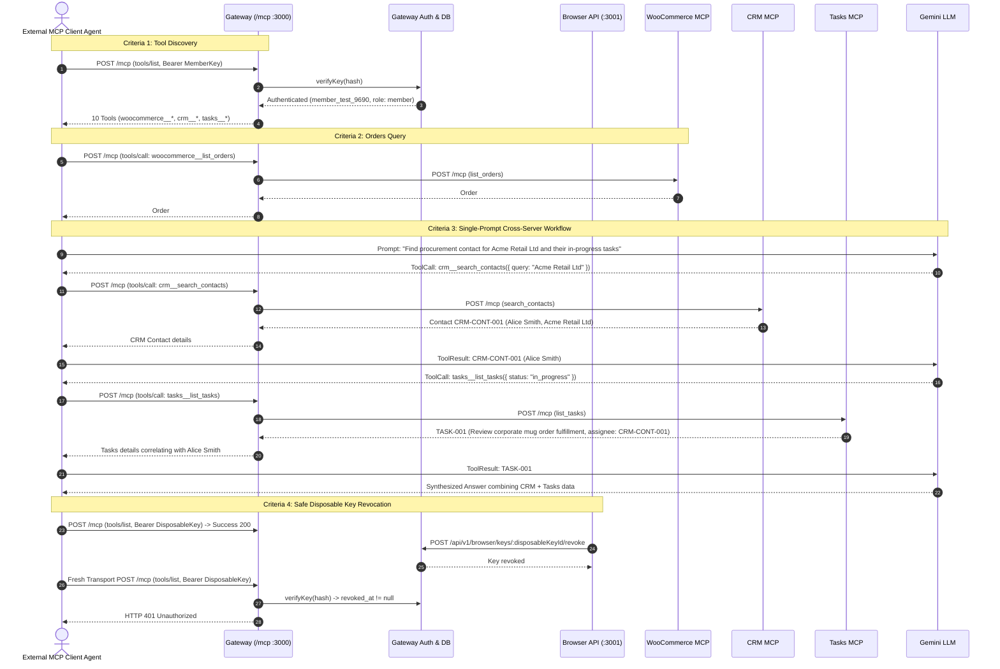

# Phase 6 Gate P6-G4 Implementation Plan: External MCP Client Acceptance & Cross-Server Verification (Revised)

## Goal Description
Phase 6 Gate P6-G4 is an acceptance and evidence gate to prove that an external MCP client can connect to the existing Urumi Gateway using exclusively the gateway URL and a member-specific API key. The gate validates tool discovery across multiple enabled upstream servers (WooCommerce, CRM, Tasks), executes a read-only orders query, performs a single-prompt model-driven cross-server tool execution (CRM + Tasks), and demonstrates that revoking the API key immediately causes subsequent requests to be rejected with HTTP 401.

This gate requires zero protocol changes, zero database schema migrations, and strictly preserves protected WooCommerce records (Product IDs 10, 11, 12 and Order #14).

---

## Technical Head Revisions Incorporated

### 1. Fixture and Catalog Assumptions Verified
- **Gateway Catalog Contract**: The gateway dynamically advertises `_meta: { reachable: true }` for all discovered tools across enabled upstreams.
- **WooCommerce Fixture**: Order #14 is confirmed present with `id: 14`, `status: "processing"`, `total: "299.00"`, `currency: "INR"`, line item `Urumi Test Mug` (`product_id: 10`, `sku: "URUMI-MUG-001"`). Customer PII fields (billing/shipping address, customer email, customer phone) are strictly redacted.
- **CRM Fixtures**: `CRM-CONT-001` (Alice Smith, Procurement Director, Acme Retail Ltd).
- **Tasks Fixtures**: `TASK-001` ("Review corporate mug order fulfillment", priority: "high", status: "in_progress", assignee: `CRM-CONT-001`).
- **Data Protection**: Zero live records are modified. All operations are strictly read-only.

### 2. Explicit Opt-In Live Acceptance
- The live acceptance test suite is isolated in `apps/gateway/test/integration/p6-g4-external-mcp-acceptance.test.ts`.
- The suite requires explicit environment activation: `RUN_P6_G4_ACCEPTANCE=true`. If the flag is absent, the test skips cleanly, preventing unintended network calls or key mutations during ordinary `npm test` runs.
- Credentials and configuration are read from environment variables or secure local files (`.secrets/gemini.env`). Raw API keys, bearer tokens, passwords, and PII are never logged or committed.

### 3. Safe Disposable Key Revocation Protocol
- Key generation targets the dedicated test member `member_test_9690` (role: `member`, ID: `d6902021-d08e-45e1-9939-10cc4f1a3d3f`).
- The suite asserts that the returned key record belongs to `member_test_9690` before proceeding.
- Pre-revocation verification: Executes an authenticated request (`tools/list` or read tool) to prove the key is active and functional (HTTP 200).
- Controlled Revocation: Invokes `POST /api/v1/browser/keys/:keyId/revoke` targeting strictly that disposable key.
- Post-revocation verification: Creates a completely fresh `StreamableHTTPClientTransport` to prevent stale connection reuse. Asserts that the gateway rejects the request with HTTP 401 Unauthorized.
- Error handling ensures that no unrelated keys or accounts can be touched.

### 4. Single-Prompt Model-Driven Cross-Server Workflow
- The external client accepts a single user prompt:
  > *"Who is the procurement contact for Acme Retail Ltd in our CRM, and what pending or in-progress tasks are assigned to them?"*
- An external client agent loop uses Gemini (`gemini-flash-lite-latest` via `GeminiProviderAdapter` grounded in `.secrets/gemini.env`) with tools dynamically discovered from the gateway's `tools/list`.
- **Autonomous Multi-Turn Execution**:
  1. **Turn 1**: Model inspects discovered tools and emits a namespaced tool call to `crm__search_contacts` with `{ query: "Acme Retail Ltd" }`.
  2. **External Dispatch 1**: Client calls gateway `/mcp`; gateway routes to `crm` upstream; returns contact `CRM-CONT-001` (`Alice Smith`).
  3. **Turn 2**: Model receives contact ID `CRM-CONT-001` and autonomously emits a namespaced tool call to `tasks__list_tasks` with `{ status: "in_progress" }`.
  4. **External Dispatch 2**: Client calls gateway `/mcp`; gateway routes to `tasks` upstream; returns `TASK-001` (`Review corporate mug order fulfillment`, assignee: `CRM-CONT-001`).
  5. **Turn 3**: Model synthesizes both results into a single comprehensive answer.
- Full trace of prompt, tool calls, raw gateway responses, and final response is captured as acceptance evidence.

---

## Baseline & System State

1. **Git Baseline**:
   - Current branch: `main`
   - HEAD commit SHA: `3a276679541575ca268f61448b376cbe3d36b7b2` (`feat: implement bounded agent loop, tool confirmation, and dashboard chat tab integration gate-3`)
   - Working tree: Clean (`git status -s` is empty).
   - Gate P6-G3 deliverable committed: `docs/phase-6/p6-g3-agent-loop-and-dashboard-chat-report.md`.

2. **Cluster & Services State**:
   - Gateway Ingress: `http://dashboard.127.0.0.1.nip.io:8080/mcp` (Port 3000 backend) and `/` (Port 3001 backend).
   - All 3 Upstream MCP Pods Running & Healthy:
     - `urumi-woocommerce-mcp` (5 tools)
     - `urumi-mcp-crm` (2 tools)
     - `urumi-mcp-tasks` (3 tools)
   - Gateway catalog: 10 tools discovered across all 3 enabled upstreams.

---

## Architecture Diagram



---

## Proposed Changes & Test Implementation

### 1. Dedicated Automated Acceptance Test Suite
#### [NEW] `apps/gateway/test/integration/p6-g4-external-mcp-acceptance.test.ts`
Implement an end-to-end integration acceptance test executing against `http://dashboard.127.0.0.1.nip.io:8080/mcp`:
- **Opt-In Guard**: Checks `process.env.RUN_P6_G4_ACCEPTANCE === 'true'`.
- **Test 1 (Connection & Discovery)**:
  - Connects using only the Gateway URL and member API key.
  - Calls `client.listTools()`.
  - Verifies all 10 tools from all 3 enabled upstreams are listed with `_meta.reachable: true`.
- **Test 2 (Orders Query Acceptance)**:
  - Invokes `woocommerce__list_orders` with `{ per_page: 5 }`.
  - Verifies presence of Order #14, currency INR, status processing, and line item `URUMI-MUG-001`.
  - Verifies PII fields (billing address, email, phone) are absent/redacted.
- **Test 3 (Single-Prompt Cross-Server Workflow)**:
  - Submits single prompt: *"Who is the procurement contact for Acme Retail Ltd in our CRM, and what pending or in-progress tasks are assigned to them?"*
  - Uses `GeminiProviderAdapter` with dynamic tools list.
  - Records multi-turn dispatch: Turn 1 executes `crm__search_contacts`, Turn 2 executes `tasks__list_tasks`, Turn 3 produces combined answer.
- **Test 4 (Safe Disposable Key Revocation)**:
  - Generates dedicated disposable test key for member `member_test_9690`.
  - Asserts initial request succeeds with HTTP 200.
  - Calls `POST /api/v1/browser/keys/:id/revoke`.
  - Creates fresh `StreamableHTTPClientTransport`.
  - Confirms gateway responds with HTTP 401.

### 2. Phase 6 Gate P6-G4 Report
#### [NEW] `docs/phase-6/p6-g4-external-mcp-acceptance-report.md`
Create the formal completion report required by Section 8:
- Criterion-by-criterion PASS / FAIL / BLOCKED matrix.
- Baseline SHA (`3a27667`), final commit SHA, working-tree status.
- Gateway endpoint, client specifications, and secret redaction audit.
- Tool discovery evidence across enabled upstreams.
- Orders-query result summary.
- Single-prompt cross-server workflow evidence (prompt, tool calls, results, final synthesis).
- Before/after key-revocation evidence.
- Exact commands and tests run with observed results.
- Recommendation for P6-G5.

---

## Verification Plan

### Automated Tests
1. Run the external MCP client acceptance suite against the live cluster:
   ```bash
   RUN_P6_G4_ACCEPTANCE=true npx tsx apps/gateway/test/integration/p6-g4-external-mcp-acceptance.test.ts
   ```
2. Run standard gateway test suites to ensure zero regressions:
   ```bash
   npm run test:unit --workspace=apps/gateway
   npm run test:protocol --workspace=apps/gateway
   ```

### Manual Verification
1. Inspect gateway audit logs to verify all external tool calls were recorded with valid `user_id` and status `success`.
2. Verify that protected WooCommerce records (Product IDs 10, 11, 12 and Order #14) remain unchanged in MariaDB/WordPress.
3. Verify that all raw secrets and tokens are redacted from reports and test outputs.
