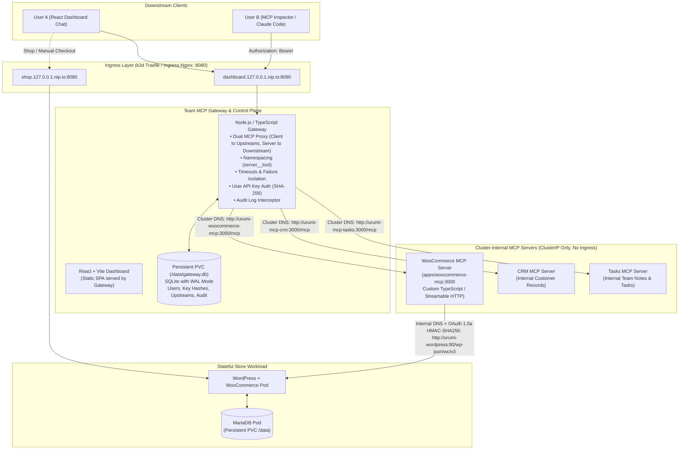

# Urumi Platform Architecture & System Design

---

## 1. System Overview & The 4 Layers

The platform provides unified, authenticated, and audited AI tool access to stateful Kubernetes applications.



---

## 2. Key Architecture Decisions

### D1 — Application Stack & Monorepo Structure
- **Language**: TypeScript across all services for end-to-end type safety and shared interfaces.
- **Runtime**: Pinned **Node.js 24 LTS (`v24.20.0`)** via `.nvmrc` and root `package.json` `engines`.
  > [!NOTE]
  > Node.js 20 reached official End-of-Life (EOL) in April 2026. Node.js 24 is the active Long Term Support (LTS) line in October 2026. The MCP SDK (`@modelcontextprotocol/sdk@1.32.1`) and TypeScript toolchain build and pass all automated tests cleanly on Node 24.
- **Package Manager**: npm workspaces (`apps/dashboard`, `apps/gateway`, `apps/woocommerce-mcp`, `apps/mcp-crm`, `apps/mcp-tasks`, `packages/shared`).
- **Monorepo Layout**:
  ```
  urumi-platform/
  ├── apps/
  │   ├── dashboard/          # React + Vite admin dashboard & chat UI
  │   ├── gateway/            # Express + TypeScript gateway proxy & control plane
  │   ├── woocommerce-mcp/    # Custom WooCommerce Streamable HTTP MCP server (Phase 3 Verified)
  │   ├── mcp-crm/            # Deterministic CRM upstream MCP server (Phase 4 Planned)
  │   └── mcp-tasks/          # Deterministic Tasks upstream MCP server (Phase 4 Planned)
  ├── packages/
  │   └── shared/             # Shared TypeScript types (audit logs, tool schemas)
  ├── infra/
  │   └── helm/
  │       └── urumi-platform/ # Unified Helm chart with values-local and values-prod
  ├── docs/                   # ADRs, requirements traceability, runbooks, and phase reports
  ├── spikes/                 # Protocol validation spikes (spikes/mcp-echo)
  └── package.json            # npm workspaces root
  ```

### D2 — Data Persistence & Storage Failure Model
- **WooCommerce Store**: MariaDB 11.x with standard Kubernetes PersistentVolumeClaim (`storageClassName: local-path`).
- **Gateway Persistence**: **SQLite with Write-Ahead Logging (WAL) mounted on a PersistentVolumeClaim (`/data/gateway.db`)**.
  - **Trade-off Analysis vs PostgreSQL**:
    - *PostgreSQL*: Consumes an additional ~120–180 MiB of idle RAM and requires another stateful deployment in the cluster.
    - *SQLite with WAL*: Operates in-process with <15 MiB RAM overhead, provides ACID transactional integrity, and handles hundreds of writes/sec (well above gateway needs).
  - **Realistic Failure Model**:
    - *Pod Crashes & Restarts*: Fully protected. The PersistentVolume preserves database files across container crashes, node evictions, and deployment rollouts.
    - *Concurrent Read/Write*: WAL mode allows concurrent readers and single writer without lock contention.
    - *Host / Disk Failure*: Standard local-path PVCs do not protect against physical host disk destruction. For enterprise disaster recovery, database snapshotting or continuous WAL replication (e.g. Litestream to object storage) is required.

### D3 — Service Boundaries & Network Isolation
- **Public Surface**: Only the Storefront (`shop.127.0.0.1.nip.io:8080`) and the Dashboard/Gateway endpoint (`dashboard.127.0.0.1.nip.io:8080`) are exposed via Kubernetes Ingress.
- **Private Surface**:
  - `urumi-woocommerce-mcp`, `urumi-mcp-crm`, and `urumi-mcp-tasks` are strictly `ClusterIP` services. They have **no Ingress rules**.
  - MariaDB is `ClusterIP` only, reachable only by WordPress.
- **Network Isolation Policy**:
  - *ClusterIP Limitation*: Standard Kubernetes ClusterIP services prevent external ingress, but by default all pods within a cluster can communicate with any ClusterIP service.
  - *NetworkPolicy Architecture*: Explicit Kubernetes `NetworkPolicy` objects are enforced by K3s `kube-router`:
    - `urumi-woocommerce-mcp` ingress is restricted solely to pods labeled `app.kubernetes.io/component: gateway` (with conditional `test-client` in local development).
    - `urumi-mariadb` ingress is restricted solely to pods labeled `app.kubernetes.io/component: wordpress`.
    - Unauthorized pods attempting direct access are blocked at the packet filter level (connection refused).

### D4 — Secrets Management & Cryptographic Boundaries
- **Kubernetes Secrets Trust Model**:
  - Sensitive credentials (database passwords, WooCommerce consumer secrets, upstream bearer tokens) are stored in Kubernetes Secrets.
  - *Default etcd Behavior*: In standard Kubernetes/K3s installations, Secret objects are base64-encoded, not encrypted at rest unless etcd encryption provider (`EncryptionConfiguration` with KMS/AES-CBC) is configured.
  - *Access Restriction via RBAC*: Gateway pod is assigned a dedicated `ServiceAccount` bound by a namespaced `Role` allowing read access only to its specific secret namespace (`urumi-gateway-secrets`), preventing access to WordPress or cluster secrets.
- **Gateway User API Key Security**:
  - The gateway database **never stores plaintext user API keys**.
  - Keys are generated with 32 cryptographically secure random bytes (`urumi_key_<hex>`), displayed once, and stored hashed with **SHA-256 and system salt**.
  - Authentication checks perform constant-time hash comparisons to prevent timing attacks.

### D5 — Local Kubernetes Engine & Port Mapping
- **Provider**: **`k3d`** (K3s in Docker).
  - Matches the production-like VPS target (K3s) with identical behavior.
  - Built-in Traefik ingress controller and lightweight footprint.
- **Port Strategy**:
  - Host port 80 is occupied by the host's native `nginx/1.24.0`; host port 3001 is occupied by Wekan.
  - Therefore, `k3d` maps its HTTP load balancer to **port 8080** and HTTPS to **port 8443**:
    ```bash
    k3d cluster create urumi --port "8080:80@loadbalancer" --port "8443:443@loadbalancer"
    ```
  - This avoids modifying or disrupting any running host services.

### D6 — Local Domain Resolution (`nip.io`)
- Rather than requiring manual `/etc/hosts` modifications on the host machine, all local domains use wildcard DNS via `nip.io`:
  - Store: `http://shop.127.0.0.1.nip.io:8080`
  - Dashboard & Gateway: `http://dashboard.127.0.0.1.nip.io:8080`
  - Gateway MCP Endpoint: `http://dashboard.127.0.0.1.nip.io:8080/mcp`
- Works universally across all modern browsers, curl, and MCP Inspector out of the box.

---

## 3. Workload Phasing & Verified Resource Metrics

| Workload | Phase | Probes Active | Resource Requests | Resource Limits | Empirical Usage (G7 Live) | Persistent Storage |
| :--- | :--- | :--- | :--- | :--- | :--- | :--- |
| **MariaDB** | Phase 2 | `healthcheck.sh` (startup, readiness, liveness) | 100m CPU / 128Mi RAM | 500m CPU / 384Mi RAM | **43m CPU / 180Mi RAM** | 1 GiB PVC (`/var/lib/mysql`) |
| **WordPress** | Phase 2 | `httpGet: /wp-login.php` (startup + readiness), `tcpSocket: 80` (liveness) | 100m CPU / 256Mi RAM | 500m CPU / 512Mi RAM | **16m CPU / 193Mi RAM** | 1 GiB PVC (`/var/www/html`) |
| **WooCommerce MCP** | Phase 3 | `httpGet: /health` (startup, readiness, liveness) | 50m CPU / 64Mi RAM | 150m CPU / 128Mi RAM | **1m CPU / 39Mi RAM** | Stateless |
| **CRM / Tasks MCP** | Phase 4 | `httpGet: /health` (readiness + liveness) | 50m CPU / 64Mi RAM | 200m CPU / 128Mi RAM | — | Stateless (in-memory seed) |
| **Gateway & Dashboard** | Phase 4 & 5 | `httpGet: /health` (readiness + liveness) | 50m CPU / 96Mi RAM | 300m CPU / 256Mi RAM | — | 500 MiB PVC (`/data/gateway.db`) |

For detailed architectural decision records, see:
- [**ADR-001**](decisions/ADR-001-stack-and-deployment.md): Application Stack, Node.js 24 LTS, and Local Kubernetes Strategy
- [**ADR-002**](decisions/ADR-002-mcp-compatibility.md): MCP SDK `@modelcontextprotocol/sdk@1.32.1`, Streamable HTTP Transport, and Wire Revision `2024-11-05`
- [**ADR-003**](decisions/ADR-003-secrets-and-access.md): Secrets Management, RBAC Boundaries, and Truthful LLM Cost Analysis
- [**ADR-004**](decisions/ADR-004-stateful-storage-and-workload-controllers.md): Stateful Storage Architecture and Workload Controller Selection
- [**ADR-005**](decisions/ADR-005-local-rest-api-security-boundary.md): Local Development REST API Authentication and Security Boundary
- [**ADR-006**](decisions/ADR-006-image-digest-locking-and-resource-tuning.md): Kubernetes Version Parity, Immutable Image Digest Locking, and Cgroup Memory Budgeting
- [**ADR-007**](decisions/ADR-007-in-cluster-rest-api-authentication.md): In-Cluster REST API Authentication via RFC 5849 OAuth 1.0a HMAC-SHA256

