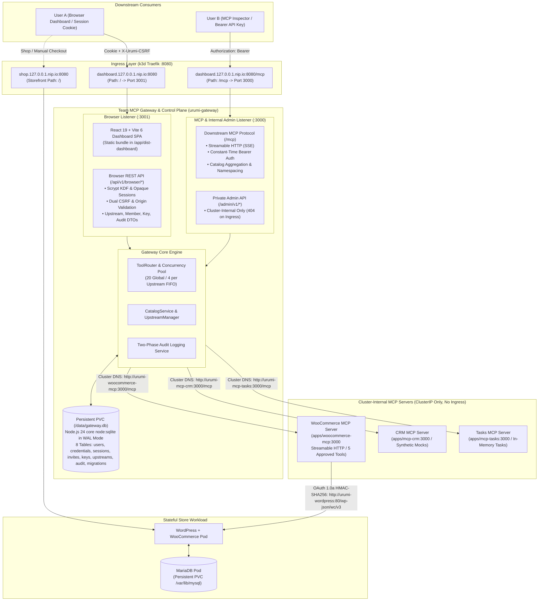

# Urumi Platform Architecture & System Design

---

## 1. System Overview & The 4 Layers

The platform provides unified, authenticated, and audited AI tool access to stateful Kubernetes applications.



---

## 2. Key Architecture Decisions

### D1 — Application Stack & Monorepo Structure
- **Language**: TypeScript across all services for end-to-end type safety and shared interfaces.
- **Runtime**: Pinned **Node.js 24 LTS (`v24.20.0`)** via `.nvmrc` and root `package.json` `engines`.
  > [!NOTE]
  > Node.js 20 reached official End-of-Life (EOL) in April 2026. Node.js 24 is the active Long Term Support (LTS) line in October 2026. The MCP SDK (`@modelcontextprotocol/sdk@1.32.1`) and TypeScript toolchain build and pass all automated tests cleanly on Node 24.
- **Package Manager**: npm workspaces (`apps/dashboard`, `apps/gateway`, `apps/woocommerce-mcp`, `apps/mcp-crm`, `apps/mcp-tasks`, `packages/shared`).
- **Monorepo Layout**:
  ```
  urumi-platform/
  ├── apps/
  │   ├── dashboard/          # React + Vite admin dashboard & chat UI
  │   ├── gateway/            # Express + TypeScript gateway proxy & control plane
  │   ├── woocommerce-mcp/    # Custom WooCommerce Stre  │   ├── mcp-crm/            # Deterministic CRM upstream MCP server (Phase 4 Verified)
  │   └── mcp-tasks/          # Deterministic Tasks upstream MCP server (Phase 4 Verified)
  ├── packages/
  │   └── shared/             # Shared TypeScript types (audit logs, tool schemas)
  ├── infra/
  │   └── helm/
  │       └── urumi-platform/ # Unified Helm chart with values-local and values-prod
  ├── docs/                   # ADRs, requirements traceability, runbooks, and phase reports
  ├── spikes/                 # Protocol validation spikes (spikes/mcp-echo)
  └── package.json            # npm workspaces root
  ```

### D2 — Data Persistence & 8-Table SQLite WAL Schema
- **WooCommerce Store**: MariaDB 11.x with standard Kubernetes PersistentVolumeClaim (`storageClassName: local-path`, 1Gi).
- **Gateway Persistence**: **Node.js 24 core `node:sqlite` in WAL mode mounted on PersistentVolumeClaim (`/data/gateway.db`, 500Mi)**.
  - **Single-Writer Safety**: Gateway deployment enforces `strategy: { type: Recreate }` and `replicas: 1` to eliminate multi-writer SQLite database lock contention.
  - **Schema Evolution (Migration 001–003)**:
    - `schema_migrations`: Versioned migration ledger (`version`, `name`, `applied_at`) with fail-closed startup validation.
    - `users`: Team accounts (`id`, `username`, `role` [admin/member], `is_active`, `created_at`).
    - `user_credentials`: Scrypt password verifiers (`user_id`, `password_hash`, `algorithm`, `created_at`, `updated_at`).
    - `browser_sessions`: Opaque session tokens (`id`, `user_id`, `token_hash`, `csrf_secret`, `ip_address`, `user_agent`, `expires_at`, `created_at`, `last_activity_at`).
    - `user_invitations`: Single-use onboarding tokens (`id`, `token_hash`, `role`, `invited_by`, `expires_at`, `redeemed_at`, `redeemed_by_user_id`, `created_at`).
    - `api_keys`: Scoped MCP keys (`id`, `user_id`, `key_hash`, `key_prefix`, `name`, `expires_at`, `revoked_at`, `created_at`, `last_used_at`).
    - `upstreams`: Dynamic MCP servers (`id`, `slug`, `display_name`, `endpoint_url`, `timeout_ms`, `is_enabled`, `status`, `secret_ref_name`, `secret_ref_key`, `cleanup_error`, `created_at`, `updated_at`).
    - `audit_logs`: Tool execution audit trail (`id`, `user_id`, `upstream_slug`, `tool_name`, `arguments_hash`, `status`, `duration_ms`, `error_code`, `error_message`, `created_at`).
  - **Disaster Recovery**: Non-locking online backup via SQLite `VACUUM INTO` validated in Phase 5 Stage 2 and Stage 5 (`backups/pre-stage5/gateway-pre-stage5.db`, SHA-256: `a9307df1231b0cf0446823214e52420c32c081ce7d7525aaa7e5df435377ff6f`).

### D3 — Service Boundaries & Network Isolation
- **Public Surface**:
  - Storefront: `http://shop.127.0.0.1.nip.io:8080/` (routed to `urumi-wordpress:80`).
  - Dashboard SPA & Browser API: `http://dashboard.127.0.0.1.nip.io:8080/` (routed to `urumi-gateway:3001`).
  - Downstream MCP Streamable HTTP: `http://dashboard.127.0.0.1.nip.io:8080/mcp` (routed to `urumi-gateway:3000`).
- **Private Surface**:
  - `urumi-woocommerce-mcp`, `urumi-mcp-crm`, and `urumi-mcp-tasks` are strictly `ClusterIP` services on port 3000 with **no Ingress rules**.
  - Private Admin REST API (`/admin/v1/*`) is mounted on Port 3000 and blocked from public Ingress (returns 404).
  - MariaDB is `ClusterIP` only on port 3306, reachable only by WordPress.
- **NetworkPolicy Architecture**: Enforced by K3s `kube-router`:
  - `urumi-gateway` egress allows outbound connections strictly to CRM, Tasks, and WooCommerce on port 3000, DNS on port 53, and the K8s API (`10.43.0.1:443` and `172.19.0.2:6443`). Egress to WordPress (port 80) and MariaDB (port 3306) strictly times out and is dropped (`TEST-8.8.1`, `TEST-8.8.2`).
  - `urumi-woocommerce-mcp` ingress is restricted solely to pods labeled `app.kubernetes.io/component: gateway`.
  - `urumi-mariadb` ingress is restricted solely to pods labeled `app.kubernetes.io/component: wordpress`.

### D4 — Secrets Management & Cryptographic Boundaries
- **Cross-Namespace Secrets Isolation**:
  - Upstream bearer tokens are stored in dedicated namespace `urumi-gateway-secrets`.
  - Gateway pod runs under dedicated `ServiceAccount` (`urumi-gateway-sa`) bound to Role `urumi-gateway-secret-manager` restricted to namespace `urumi-gateway-secrets`.
- **Gateway User API Key Security**:
  - Keys are generated with 32 cryptographically secure random bytes (`urumi_live_<hex>`), displayed once, and stored hashed with **SHA-256**.
  - Authentication checks perform constant-time hash comparisons (`crypto.timingSafeEqual`) to prevent timing attacks.
- **Two-Phase Audit Trail Redaction**:
  - Tool arguments are deterministically hashed via SHA-256 (`arguments_hash`), preventing customer PII or credentials from persisting in the audit table.

### D5 — Local Kubernetes Engine & Port Mapping
- **Provider**: **`k3d`** (K3s in Docker) pinned to `rancher/k3s:v1.37.1-k3s1`.
- **Port Strategy**: Maps HTTP load balancer to host port **8080** and HTTPS to **8443**.

### D6 — Local Domain Resolution (`nip.io`)
- All local domains use wildcard DNS via `127.0.0.1.nip.io`:
  - Store: `http://shop.127.0.0.1.nip.io:8080`
  - Gateway Dashboard: `http://dashboard.127.0.0.1.nip.io:8080/`
  - Gateway MCP Endpoint: `http://dashboard.127.0.0.1.nip.io:8080/mcp`

### D7 — Browser Human Identity, Scrypt Password KDF & Dual-Layer CSRF
- **Password KDF**: Node.js core `crypto.scrypt` with OWASP-compliant parameters (`N=16384, r=8, p=1, keyLen=64`), cryptographically random 32-byte salt, and timing-safe verification against dummy hashes on user-not-found to prevent user enumeration.
- **Session Token Security**: Opaque 256-bit entropy tokens stored SHA-256 hashed in `browser_sessions`. Cookies are `HttpOnly`, `SameSite=Lax`, path-scoped `/`, and `Secure` in TLS environments.
- **Dual-Layer CSRF Defense**: State-changing requests (`POST`, `PATCH`, `DELETE`) require both an `X-Urumi-CSRF` header and strict Origin matching against allowed hostnames (`http://dashboard.127.0.0.1.nip.io:8080`).

### D8 — Dual-Listener Architecture & Ingress Perimeter Isolation
- The single gateway container process binds two separate HTTP servers:
  - **Port 3000 (MCP / Admin Listener)**: Serves `/mcp` (Streamable HTTP) and `/admin/v1/*`.
  - **Port 3001 (Browser Listener)**: Serves static SPA assets from `/app/dist-dashboard` and `/api/v1/browser/*`.
- Traefik Ingress maps path `/mcp` to Service Port 3000, and path `/` to Service Port 3001. External requests to `/admin/v1/*` hit Port 3001 and return HTTP 404, guaranteeing that internal administrative routes cannot be accessed from outside the cluster.

---

## 3. Workload Phasing & Verified Resource Metrics

| Workload | Phase | Probes Active | Resource Requests | Resource Limits | Empirical Usage (Stage 5 Live) | Persistent Storage |
| :--- | :--- | :--- | :--- | :--- | :--- | :--- |
| **MariaDB** | Phase 2 | `healthcheck.sh` (startup, readiness, liveness) | 100m CPU / 128Mi RAM | 500m CPU / 384Mi RAM | **43m CPU / 180Mi RAM** | 1 GiB PVC (`/var/lib/mysql`) |
| **WordPress** | Phase 2 | `httpGet: /wp-login.php` (startup + readiness), `tcpSocket: 80` (liveness) | 100m CPU / 256Mi RAM | 500m CPU / 512Mi RAM | **16m CPU / 193Mi RAM** | 1 GiB PVC (`/var/www/html`) |
| **WooCommerce MCP** | Phase 3 | `httpGet: /health` (startup, readiness, liveness) | 50m CPU / 64Mi RAM | 150m CPU / 128Mi RAM | **1m CPU / 39Mi RAM** | Stateless |
| **CRM MCP** | Phase 4 | `httpGet: /health` (readiness + liveness) | 50m CPU / 64Mi RAM | 200m CPU / 128Mi RAM | **1m CPU / 38Mi RAM** | Stateless (in-memory seed) |
| **Tasks MCP** | Phase 4 | `httpGet: /health` (readiness + liveness) | 50m CPU / 64Mi RAM | 200m CPU / 128Mi RAM | **1m CPU / 38Mi RAM** | Stateless (in-memory seed) |
| **Gateway** | Phase 5 | `httpGet: /health/ready` (readiness + liveness) | 50m CPU / 96Mi RAM | 300m CPU / 256Mi RAM | **3m CPU / 62Mi RAM** | 500 MiB PVC (`/data/gateway.db`) |

---

## 4. Architecture Decision Records (ADRs)

- [**ADR-001**](decisions/ADR-001-stack-and-deployment.md): Application Stack, Node.js 24 LTS, and Local Kubernetes Strategy
- [**ADR-002**](decisions/ADR-002-mcp-compatibility.md): MCP SDK `@modelcontextprotocol/sdk@1.32.1`, Streamable HTTP Transport, and Wire Revision `2024-11-05`
- [**ADR-003**](decisions/ADR-003-secrets-and-access.md): Secrets Management, RBAC Boundaries, and Truthful LLM Cost Analysis
- [**ADR-004**](decisions/ADR-004-stateful-storage-and-workload-controllers.md): Stateful Storage Architecture and Workload Controller Selection
- [**ADR-005**](decisions/ADR-005-local-rest-api-security-boundary.md): Local Development REST API Authentication and Security Boundary
- [**ADR-006**](decisions/ADR-006-image-digest-locking-and-resource-tuning.md): Kubernetes Version Parity, Immutable Image Digest Locking, and Cgroup Memory Budgeting
- [**ADR-007**](decisions/ADR-007-in-cluster-rest-api-authentication.md): In-Cluster REST API Authentication via RFC 5849 OAuth 1.0a HMAC-SHA256
- [**ADR-008**](decisions/ADR-008-five-tool-contract-and-pii-redaction.md): Five-Tool Least-Privilege Contract, Bounded Input Validation, and Customer PII Redaction
- [**ADR-009**](decisions/ADR-009-kubernetes-network-isolation-and-conditional-policies.md): Cluster-Internal Workload Isolation, Non-Root Execution, and Conditional NetworkPolicies
- [**ADR-010**](decisions/ADR-010-container-image-identity-and-digest-pinning-boundary.md): Container Image Identity, Local CRI Resolution, and Production Immutability Separation
- [**ADR-011**](decisions/ADR-011-gateway-dual-mcp-proxy-and-transport-lifecycle.md): Gateway Dual MCP Proxy Architecture, Shared Client Multiplexing, and Cancellation Semantics
- [**ADR-012**](decisions/ADR-012-gateway-persistence-node-sqlite-and-wal.md): Gateway Storage Engine via Node.js Built-in `node:sqlite`, WAL Concurrency, Permissions, and Disaster Recovery (Accepted)
- [**ADR-013**](decisions/ADR-013-api-key-auth-constant-time-and-admin-bootstrap.md): API Key Format, Verifier Storage, Constant-Time Authentication, and One-Time Administrator Bootstrap
- [**ADR-014**](decisions/ADR-014-two-phase-audit-logging-and-retention.md): Two-Phase Audit Logging, Failure Safety Invariants, and Retention Policy
- [**ADR-015**](decisions/ADR-015-concurrency-limits-circuit-breaker-and-resilience.md): Concurrency Bounds, Circuit Breaker State Machine, and Performance Proposals
- [**ADR-016**](decisions/ADR-016-upstream-catalog-snapshot-and-health-tracking.md): Upstream Tool Namespacing, Dynamic Catalog Snapshotting, and Health Tracking
- [**ADR-017**](decisions/ADR-017-network-defense-ssrf-allowlist-and-secret-rbac.md): Network Defense Boundaries, SSRF URL Allowlisting, Ingress Scope, and Kubernetes Secret RBAC
- [**ADR-018**](decisions/ADR-018-upstream-mock-contracts-crm-and-tasks.md): Upstream Mock Services Architecture: Synthetic CRM and In-Memory Tasks Contracts
- [**ADR-019**](decisions/ADR-019-browser-identity-session-and-csrf.md): Browser Identity, Scrypt Password KDF, Opaque Session Tokens, and Dual-Layer CSRF Protection
- [**ADR-020**](decisions/ADR-020-dual-listener-and-ingress-perimeter.md): Dual-Listener Architecture and Public Ingress Perimeter Isolation


