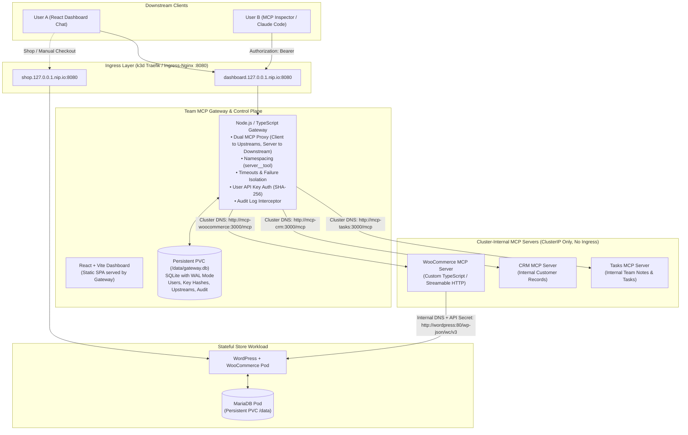

# Urumi Platform Architecture & System Design

---

## 1. System Overview & The 4 Layers

The platform provides unified, authenticated, and audited AI tool access to stateful Kubernetes applications.



---

## 2. Key Architecture Decisions

### D1 — Application Stack & Monorepo Structure
- **Language**: TypeScript across all services for end-to-end type safety and shared interfaces.
- **Runtime**: Pinned **Node.js 20 LTS (`v20.20.2`)** via `.nvmrc` and package engines.
- **Package Manager**: npm workspaces (`apps/dashboard`, `apps/gateway`, `apps/mcp-woocommerce`, `apps/mcp-crm`, `apps/mcp-tasks`, `packages/shared`).
- **Monorepo Layout**:
  ```
  urumi-gateway/
  ├── apps/
  │   ├── dashboard/          # React + Vite admin dashboard & chat UI
  │   ├── gateway/            # Express + TypeScript gateway proxy & control plane
  │   ├── mcp-woocommerce/    # Custom WooCommerce Streamable HTTP MCP server
  │   ├── mcp-crm/            # Deterministic CRM upstream MCP server
  │   └── mcp-tasks/          # Deterministic Tasks upstream MCP server
  ├── packages/
  │   └── shared/             # Shared TypeScript types (audit logs, tool schemas)
  ├── infra/
  │   └── helm/               # Unified Helm chart with values-local and values-prod
  ├── docs/                   # ADRs, audit, and design notes
  ├── spikes/                 # Protocol validation spikes
  └── package.json            # npm workspaces root
  ```

### D2 — Data Persistence & Memory Optimization
- **WooCommerce Store**: MariaDB 11.x with standard Kubernetes PersistentVolumeClaim (`storageClassName: local-path`).
- **Gateway Persistence**: **SQLite with Write-Ahead Logging (WAL) mounted on a PersistentVolumeClaim (`/data/gateway.db`)**.
  - **Trade-off Analysis vs PostgreSQL**:
    - *PostgreSQL*: Consumes an additional ~120–180 MiB of idle RAM and requires another stateful deployment in the cluster.
    - *SQLite with WAL*: Operates in-process with <15 MiB RAM overhead, provides ACID transactional integrity, handles hundreds of writes/sec (well above gateway needs), and guarantees 100% durability across pod restarts via the PVC mount.
    - *Verdict*: Given the host's 7.6 GiB total RAM (~1.4 GiB available), SQLite on PVC is the superior, resource-prudent design that prevents host out-of-memory crashes while fully satisfying data durability requirements.

### D3 — Service Boundaries & Network Isolation
- **Public Surface**: Only the Storefront (`shop.127.0.0.1.nip.io:8080`) and the Dashboard/Gateway endpoint (`dashboard.127.0.0.1.nip.io:8080`) are exposed via Kubernetes Ingress.
- **Private Surface**:
  - `mcp-woocommerce`, `mcp-crm`, and `mcp-tasks` are strictly `ClusterIP` services. They have **no Ingress rules** and are only reachable via Kubernetes internal DNS by the gateway backend.
  - MariaDB is `ClusterIP` only, reachable only by WordPress.
  - In Phase 7, NetworkPolicies enforce these boundaries at the network layer.

### D4 — Local Kubernetes Engine & Port Mapping
- **Provider**: **`k3d`** (K3s in Docker).
  - Matches the production-like VPS target (K3s) with identical behavior.
  - Built-in Traefik ingress controller and lightweight footprint.
- **Port Strategy**:
  - Host port 80 is occupied by the host's native `nginx/1.24.0`.
  - Therefore, `k3d` will map its HTTP load balancer to **port 8080** and HTTPS to **port 8443**:
    `k3d cluster create urumi --port "8080:80@loadbalancer" --port "8443:443@loadbalancer"`
  - This avoids modifying or disrupting the host's running services.

### D5 — Local Domain Resolution (`nip.io`)
- Rather than requiring manual `/etc/hosts` modifications on the host machine, all local domains use wildcard DNS via `nip.io`:
  - Store: `http://shop.127.0.0.1.nip.io:8080`
  - Dashboard & Gateway: `http://dashboard.127.0.0.1.nip.io:8080`
  - Gateway MCP Endpoint: `http://dashboard.127.0.0.1.nip.io:8080/mcp`
- Works universally across all modern browsers, curl, and MCP Inspector out of the box.

---

## 3. Workload Phasing & Resource Guardrails

To prevent premature complexity, Kubernetes resources are introduced strictly in the phase where each workload is deployed:

| Workload | Phase | Probes Planned | Resource Requests / Limits | Persistent Storage |
| :--- | :--- | :--- | :--- | :--- |
| **MariaDB** | Phase 2 | `tcpSocket: 3306` (liveness + readiness) | Request: 128Mi / 100m<br/>Limit: 384Mi / 500m | 1 GiB PVC (`/var/lib/mysql`) |
| **WordPress** | Phase 2 | `httpGet: /wp-login.php` (liveness + readiness) | Request: 192Mi / 100m<br/>Limit: 384Mi / 500m | 1 GiB PVC (`/var/www/html`) |
| **WooCommerce MCP** | Phase 3 | `httpGet: /health` (liveness + readiness) | Request: 64Mi / 50m<br/>Limit: 192Mi / 250m | Stateless |
| **CRM / Tasks MCP** | Phase 4 | `httpGet: /health` (liveness + readiness) | Request: 64Mi / 50m<br/>Limit: 128Mi / 200m | Stateless (in-memory seed) |
| **Gateway & Dashboard** | Phase 4 & 5 | `httpGet: /health` (liveness + readiness) | Request: 96Mi / 50m<br/>Limit: 256Mi / 300m | 500 MiB PVC (`/data/gateway.db`) |
| **Total Cluster Usage** | — | — | **Total Requests: ~544 MiB RAM**<br/>**Total Limits: ~1.3 GiB RAM** | Safe for 1.4 GiB available host RAM |
