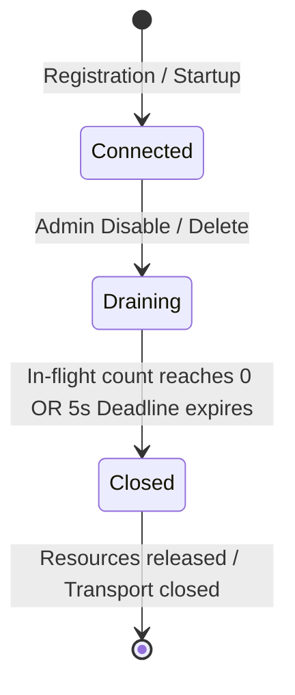

# ADR-011: Gateway Dual MCP Proxy Architecture, Shared Client Multiplexing, and Cancellation Semantics

**Status**: Proposed — Pending Technical Head Approval  
**Date**: 2026-10-15 (Revised: 2026-10-15)  
**Decision Makers**: Aditya Rathore (FDE Candidate), Antigravity AI  
**Related Documents**: [`ADR-002`](./ADR-002-mcp-compatibility.md), [`ADR-008`](./ADR-008-five-tool-contract-and-pii-redaction.md), [`ADR-014`](./ADR-014-two-phase-audit-logging-and-retention.md), [`ADR-015`](./ADR-015-concurrency-limits-circuit-breaker-and-resilience.md)  

---

## 1. Context & Problem Statement

Phase 4 requires building the central Team MCP Gateway (`apps/gateway`). The gateway acts as a **dual MCP proxy**:
1. **Downstream MCP Server**: Exposes an authenticated Model Context Protocol endpoint (`POST /mcp`) to external AI clients (Claude Code, MCP Inspector, internal Chat Agent).
2. **Upstream MCP Client Manager**: Connects to multiple upstream MCP servers running inside the Kubernetes cluster (`urumi-woocommerce-mcp`, `urumi-mcp-crm`, `urumi-mcp-tasks`).

Critical lifecycle and concurrency questions must be settled:
- How does cancellation operate on a shared upstream client without disrupting concurrent calls?
- How are downstream client disconnects handled?
- How does the gateway drain in-flight operations when an upstream is disabled or deleted?
- What are the exact timeout bounds and cancellation guarantees regarding remote side effects?

---

## 2. Decision & Technical Architecture

### 2.1 Pinned Protocol & SDK Version
- **Package**: `@modelcontextprotocol/sdk@1.32.1` across all Phase 4 applications (`apps/gateway`, `apps/mcp-crm`, `apps/mcp-tasks`).
- **Wire Protocol Version**: `2024-11-05` (RFC JSON-RPC 2.0).
- **Runtime**: Node.js 24 LTS (`v24.20.0`).

### 2.2 Downstream Transport: Stateless Streamable HTTP
- The gateway exposes `POST /mcp` utilizing `StreamableHTTPServerTransport`.
- **Stateless Per-Request Lifecycle**: Each incoming HTTP request instantiates an ephemeral `McpServer` and `StreamableHTTPServerTransport` instance bound to the request/response pair.
- The connection is cleanly torn down on `res.on('close')`.
- Downstream clients do not require sticky sessions or persistent SSE streams.

### 2.3 Shared Upstream Client Multiplexing & Granular Cancellation

The gateway maintains **one active `Client` instance per registered, enabled upstream server** utilizing `StreamableHTTPClientTransport`:

```
Downstream Client A ──(Call 1)──┐
                                ▼
Downstream Client B ──(Call 2)──► Gateway Router ──[Shared Client: urumi-woocommerce-mcp]──► Upstream Pod
                                ▲   (Message 1, Message 2, Message 3 multiplexed)
Downstream Client C ──(Call 3)──┘
```

#### Official Public API Pattern for Granular Cancellation:

The gateway application code exclusively uses the official, public `@modelcontextprotocol/sdk` API contract:

```typescript
// Official public API signature:
// client.request<T>(request: ClientRequest, resultSchema: ZodSchema<T>, options?: RequestOptions): Promise<T>
const abortController = new AbortController();

try {
  const result = await client.request(
    {
      method: 'tools/call',
      params: { name: upstreamToolName, arguments: sanitizedArguments },
    },
    CallToolResultSchema,
    { signal: abortController.signal } // Supported public API!
  );
  return result;
} catch (error) {
  if (abortController.signal.aborted) {
    // Handled gracefully as client disconnect or timeout
    throw new UpstreamCancellationError(`Call to ${upstreamToolName} was aborted`);
  }
  throw error;
}
```

#### How Supported SDK Cancellation Operates Under the Hood:
1. When `{ signal: abortController.signal }` is passed into `client.request(...)`, the MCP SDK binds an abort event listener to that specific request message ID.
2. When the signal fires `abort()`:
   - The SDK automatically formats and sends the JSON-RPC cancellation notification:
     ```json
     {
       "jsonrpc": "2.0",
       "method": "notifications/cancelled",
       "params": {
         "requestId": 14,
         "reason": "Request aborted by caller"
       }
     }
     ```
   - The SDK rejects the returned Promise with an `AbortError`.
   - The SDK unbinds only the listener associated with that request ID.
3. **Shared Transport Isolation Guarantee**: The underlying `StreamableHTTPClientTransport` session remains completely connected and unaffected. Concurrent sibling calls executing on the same client continue uninterrupted.
4. **No Internal State Manipulation**: The gateway application code **does NOT access or manipulate private SDK properties** (such as `_responseHandlers` or `_requestMessageId`). It relies strictly on the public `RequestOptions.signal` contract.
5. **Contract Regression Test (`TEST-GTW-SDK-ABORT-PUBLIC-API`)**:
   - Executes against the pinned `@modelcontextprotocol/sdk@1.32.1` package.
   - Launches two concurrent tool calls on a shared upstream client.
   - Aborts call A via `signal.abort()`.
   - Verifies: (a) Call A promise rejects with `AbortError`; (b) Upstream receives `notifications/cancelled` for call A; (c) Call B completes successfully; (d) The shared client successfully processes subsequent call C.

---

### 2.4 Downstream Client Disconnect Handling
- If a downstream client terminates its HTTP connection prematurely (`req.on('close')`):
  1. The gateway checks if the request was completed.
  2. If still in-flight, the gateway immediately triggers `abortController.abort('Client disconnected')`.
  3. The SDK client transmits `notifications/cancelled` to the target upstream for that specific request ID.
  4. The shared upstream client remains healthy and available for other callers.

---

### 2.5 SDK Cancellation vs Remote Side-Effect Guarantees (Crucial Distinction)
- **Protocol Cancellation**: Transmitting `notifications/cancelled` is a protocol-level notification to the upstream server indicating the caller is no longer awaiting the response.
- **Remote Side-Effect Reality**: **Sending a cancellation notification does NOT guarantee that an in-flight upstream database write was rolled back.**
  - If WooCommerce or MariaDB already committed an order status transition or created a product before processing the cancellation, the side-effect remains in the database.
- **Mandatory Invariant**:
  - The gateway **never automatically retries a cancelled or timed-out mutating operation**.
  - Callers receive an unambiguous error indicating the operation was cancelled/timed-out, with guidance to verify state before taking further action.

---

### 2.6 Upstream Lifecycle: DRAINING Semantics & Deadlines

When an administrator disables or deletes an upstream (`POST /admin/v1/upstreams/:id/disable` or `DELETE`):



1. **State Transition**: Upstream state immediately switches to `DRAINING`.
2. **Admission Rejection**: All new incoming tool calls targeting this upstream are immediately rejected with **HTTP 503 Service Unavailable** (`UpstreamDrainingError`).
3. **In-Flight Drain**: In-flight requests currently executing against the upstream are allowed to finish up to a bounded drain deadline (**5,000 ms**).
4. **Deadline Expiration**: If the 5,000 ms drain deadline expires while calls are still in-flight:
   - The gateway fires abort signals for all remaining in-flight calls on that upstream.
   - Associated client transports and sockets are forcefully closed.
   - Database status is finalized.

---

### 2.7 Consistent Timeout Bounds Across System

To prevent configuration mismatches and silent overrides:
- **Default Upstream Timeout**: **10,000 ms** (10.0 seconds).
- **Enforced Permissible Bounds**: All components (Zod schemas, Admin REST API, execution runtime, test assertions) strictly enforce:
  - **Minimum Timeout:** **500 ms**
  - **Maximum Timeout:** **30,000 ms**
- Any configuration payload specifying a timeout $<500\text{ ms}$ or $>30,000\text{ ms}$ is rejected with **HTTP 400 Bad Request** (`InvalidTimeoutBoundsError`).

---

### 2.8 Sanitized Error Mappings & Prohibited Upstream Credential Leakage

To prevent security exposures, sensitive credential leakage, and internal topology disclosure:
1. **Downstream Error Sanitization Invariant**:
   - Model-facing tool errors conform strictly to MCP specification `{ content: [{ type: "text", text: string }], isError: true }`.
   - Error messages returned to clients or logged to audit tables **must NEVER contain**:
     - Upstream authentication headers, Bearer tokens, or OAuth keys/secrets.
     - Kubernetes Secret names or internal volume mount paths.
     - Internal pod IP addresses (e.g. `10.42.x.x`), internal ports, or control plane hostnames.
     - Unhandled exception stack traces or raw Node.js runtime dumps.
2. **Standardized Error Mapping**:
   | Raw / Internal Condition | Sanitized Model-Facing Message | HTTP Status |
   |---|---|:---:|
   | Upstream connection refused (`ECONNREFUSED` / `EHOSTUNREACH`) | `"Upstream service '<slug>' is currently unreachable. The tool could not be executed."` | 503 |
   | Upstream execution timeout (> configured `timeout_ms`) | `"The operation timed out while waiting for upstream service '<slug>'. The mutation may have completed. Inspect state before attempting any retry."` | 504 |
   | Upstream authentication failure (HTTP 401 / 403) | `"Authentication failure communicating with upstream service '<slug>'. Please contact your gateway administrator."` | 502 |
   | Upstream internal failure (HTTP 500 / unhandled crash) | `"Upstream service '<slug>' encountered an internal failure while processing the tool call."` | 502 |
   | Circuit breaker open | `"Upstream service '<slug>' is temporarily paused due to consecutive infrastructure failures. Please retry in 15 seconds."` | 503 |
   | Rate limit / Concurrency cap exceeded | `"Gateway concurrency limit reached. Please retry shortly."` | 429 |
   | Request payload > 64 KiB | `"Request argument payload exceeds maximum permissible size of 64 KiB."` | 413 |
3. **Log Scrubbing**:
   - Container stderr logs pass through a regex redaction filter masking all patterns matching `Bearer\s+[A-Za-z0-9._-]+`, `consumer_secret=[^&\s]+`, or `password=[^&\s]+` before flushing to stdout/stderr.

---

## 3. Consequences & Verification
- **Positive**: Multiplexed client efficiency, zero cross-request cancellation contamination, safe draining on updates, consistent timeout enforcement, zero credential leakage.
- **Negative**: Callers must be aware that cancelled mutations require state verification.
- **Verification**: Verified via concurrent request tests where one request is aborted while adjacent requests complete successfully, drain deadline timeout tests, and credential sanitization tests.
