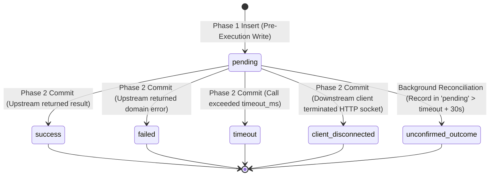

# ADR-014: Two-Phase Audit Logging, Failure Safety Invariants, and Retention Policy

**Status**: Proposed — Pending Technical Head Approval  
**Date**: 2026-10-15 (Revised: 2026-10-15)  
**Decision Makers**: Aditya Rathore (FDE Candidate), Antigravity AI  
**Related Documents**: [`ADR-003`](./ADR-003-secrets-and-access.md), [`ADR-008`](./ADR-008-five-tool-contract-and-pii-redaction.md), [`ADR-011`](./ADR-011-gateway-dual-mcp-proxy-and-transport-lifecycle.md), [`ADR-012`](./ADR-012-gateway-persistence-node-sqlite-and-wal.md)  

---

## 1. Context & Problem Statement

Requirement AUD-01 through AUD-03 demands that every tool call traversing the Team MCP Gateway produces an immutable, auditable log containing actor identity, upstream service, tool name, timestamp, duration, and status.

Critical distributed-systems failure scenarios require explicit handling:
1. **Audit Finalization Failure on Successful Mutation**: If an upstream mutation (e.g. WooCommerce product creation or order status update) succeeds, but writing the final audit outcome to SQLite fails (e.g. disk full), how must the gateway respond to the caller without creating double-mutation hazards?
2. **Audit Start Failure (Disk Full / Lock Timeout)**: If the pre-execution audit write fails, how does the system fail closed?
3. **Pending Record Reconciliation & Client Disconnects**: How are dangling records reconciled when clients disconnect prematurely or upstreams time out?
4. **Data Redaction & Integrity**: Ensuring customer PII and credentials are never persisted in logs or database tables.

---

## 2. Decision & Failure Semantics

### 2.1 Two-Phase Audit Lifecycle Pattern & Schema Alignment

Every tool call through the gateway executes under a strict two-phase audit lifecycle recorded in SQLite:

```sql
CREATE TABLE audit_logs (
  id TEXT PRIMARY KEY,
  user_id TEXT REFERENCES users(id),
  upstream_slug TEXT,
  tool_name TEXT NOT NULL,
  arguments_hash TEXT NOT NULL,
  status TEXT NOT NULL CHECK(status IN ('pending', 'success', 'failed', 'timeout', 'client_disconnected', 'unconfirmed_outcome')),
  duration_ms INTEGER,
  error_code TEXT,
  error_message TEXT,
  created_at INTEGER NOT NULL
);
```

#### Canonical 6-State Audit Lifecycle State Machine:



---

### 2.2 Strict Audit Failure Invariants

#### 1. Audit-Start Failure (Fail Closed)
- If writing the initial audit record fails (e.g. SQLite database locked, disk full, or write error):
  - **The gateway MUST NOT invoke the upstream server.**
  - The request aborts immediately with **HTTP 500 Internal Server Error** (`AuditStartError`).
  - *Rationale*: A tool execution that cannot be attributed must never be dispatched to live backends.

#### 2. Audit-Finalization Failure on Successful Mutation (Truthful Reporting Invariant)
- If an upstream tool call completes successfully (especially a mutating operation like `create_product` or `update_order_status`), but writing the Phase 2 audit update fails (e.g. `SQLITE_FULL`):
  - **CRITICAL INVARIANT: The gateway MUST NOT return an error indicating that the tool call failed.**
  - *Why*: If the gateway tells the caller or AI agent that the tool call failed, the agent will assume the side-effect did not occur and will attempt to retry the mutation, causing duplicate products, duplicate orders, or corrupted store states.
  - **Proven Response Contract (Dual MCP `_meta` + HTTP Header Signaling)**:
    - Standard MCP client libraries (e.g. Claude Code, Claude Desktop, Cursor) consume the JSON-RPC 2.0 response body (`CallToolResult`) and often abstract away HTTP response headers. Therefore, relying solely on an HTTP header would hide the degraded audit condition from the MCP layer.
    - To satisfy both the MCP protocol client abstraction and infrastructure observability, the gateway employs **dual signaling**:
      1. **MCP Protocol `_meta` Injection**: The JSON-RPC response body contains the successful tool output in `content`, keeps `isError: false`, and attaches an explicit `_meta` dictionary:
         ```json
         {
           "jsonrpc": "2.0",
           "id": 14,
           "result": {
             "content": [
               {
                 "type": "text",
                 "text": "{\"id\": 15, \"name\": \"Album\", \"status\": \"publish\"}"
               }
             ],
             "isError": false,
             "_meta": {
               "urumi_audit_status": "finalization-degraded",
               "urumi_audit_warning": "Upstream mutation succeeded, but local audit finalization write failed on gateway storage. Do not retry."
             }
           }
         }
         ```
         Under the Model Context Protocol specification (`2024-11-05`), `_meta` is the reserved, standard mechanism for execution metadata. The MCP SDK (`@modelcontextprotocol/sdk@1.32.1`) defines `CallToolResultSchema` with `_meta?: Record<string, unknown>`.
      2. **HTTP Transport Header**: The response HTTP headers include `X-Urumi-Audit-Status: finalization-degraded` for external proxies, API gateways, and curl/HTTP inspectors.
      3. **Infrastructure Alerting**: The gateway emits a high-priority structured log to container stderr:
         `{"level": "WARN", "event": "AUDIT_FINALIZATION_DEGRADED", "audit_id": "...", "upstream_slug": "...", "tool_name": "..."}`.
      4. **Persistent State**: The audit record remains in `status = 'pending'`, which is flagged for automated reconciliation.

#### 3. Client Disconnects & Upstream Timeouts
- **Client Disconnect**:
  - If the downstream HTTP client disconnects while the upstream tool call is in-flight:
  - The request `AbortController` triggers cancellation signal to upstream.
  - Phase 2 updates the audit row: `status = 'client_disconnected'`, `duration_ms = Date.now() - start_time`.
- **Upstream Timeout**:
  - If upstream does not respond within configured timeout (default 10s):
  - Phase 2 updates the audit row: `status = 'timeout'`, `error_code = 'UPSTREAM_TIMEOUT'`.
  - The client receives an explicit, unambiguous `UpstreamTimeoutError` (`isError: true`).
  - **No-Blind-Retry Rule**: Mutating write operations are strictly non-retryable. The response message explicitly instructs callers:
    `"The operation timed out while waiting for the upstream server. The mutation may have completed. Inspect state before attempting any retry."`

---

### 2.3 Pending Audit Record Reconciliation

To prevent orphaned `'pending'` records from lingering undetected:
1. **Dangling Record Criterion**: Any audit record in `status = 'pending'` whose `created_at` timestamp is older than `timeout_ms + 10,000ms` is classified as **Unconfirmed / Dangling**.
2. **Automated Background Reconciliation Job**:
   - Runs every 10 minutes or on administrative request (`POST /admin/v1/audit/reconcile`).
   - Identifies unfinalized pending records and sets:
     ```sql
     UPDATE audit_logs 
     SET status = 'unconfirmed_outcome', 
         error_code = 'FINALIZATION_TIMEOUT' 
     WHERE status = 'pending' AND created_at < (unixepoch() - 30);
     ```
   - Emits operational log: `"Reconciled N dangling audit records"`.

---

### 2.4 Disk-Full Failure Handling
- **Database Partition**: `/data` PVC.
- **Handling Strategy**:
  - SQLite returns error code `SQLITE_FULL`.
  - When `SQLITE_FULL` occurs during Phase 1 (start write): Gateway rejects request with HTTP 500, avoiding unlogged upstream calls.
  - When `SQLITE_FULL` occurs during Phase 2 (finalization write): Gateway logs to container stdout/stderr (which goes to containerd, not SQLite disk), sets `X-Urumi-Audit-Status: finalization-degraded`, and delivers tool output.
  - Prometheus/readiness metric `gateway_sqlite_disk_full_events_total` increments.

---

### 2.5 Sensitive Data Redaction & Retention Policy

- **Arguments Fingerprint**: The gateway computes an SHA-256 fingerprint:
  `arguments_hash = crypto.createHash('sha256').update(JSON.stringify(args)).digest('hex')`.
- **Zero Customer PII**: Per [`ADR-008`](./ADR-008-five-tool-contract-and-pii-redaction.md), order line items, totals, and statuses are captured; customer names, physical addresses, email addresses, and phone numbers are strictly stripped prior to audit persistence.
- **Retention Limit**: 30 days or maximum 100,000 records.
- **Bounded Batch Deletion**:
  ```sql
  DELETE FROM audit_logs 
  WHERE id IN (
    SELECT id FROM audit_logs 
    WHERE created_at < ? 
    LIMIT 500
  );
  ```

---

## 3. Consequences & Verification
- **Positive**: Zero unlogged calls, zero duplicate mutations caused by false failure responses, predictable disk-full behavior, complete PII omission.
- **Negative**: Administrators must monitor unconfirmed outcome metrics if SQLite disk is constrained.
- **Verification**: Verified via test suites simulating Phase 1 disk full failures, Phase 2 finalization failures, client aborts, and timeout attribution.
