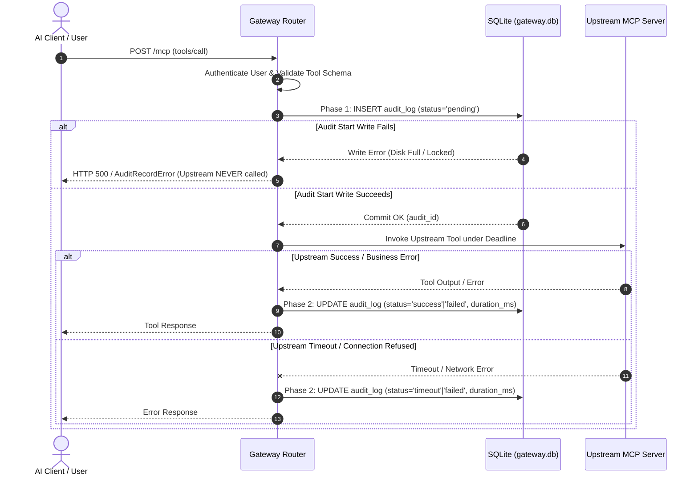

# ADR-014: Two-Phase Audit Logging, Failure Safety Invariants, and Retention Policy

**Status**: Accepted  
**Date**: 2026-10-15  
**Decision Makers**: Aditya Rathore (FDE Candidate), Antigravity AI  
**Related Documents**: [`ADR-003`](./ADR-003-secrets-and-access.md), [`ADR-008`](./ADR-008-five-tool-contract-and-pii-redaction.md), [`ADR-012`](./ADR-012-gateway-persistence-node-sqlite-and-wal.md)  

---

## 1. Context & Problem Statement

Requirement AUD-01 through AUD-03 demands that every tool call traversing the Team MCP Gateway produces an immutable, auditable log containing actor identity, upstream service, tool name, timestamp, duration, and status.

Traditional single-phase logging (logging only after a request completes) creates a critical operational blind spot: if the gateway process crashes, an upstream hangs indefinitely, or disk I/O stalls during execution, zero record of the tool invocation is ever captured.

Furthermore, naive logging often records raw JSON payloads containing credentials, API keys, or customer Personally Identifiable Information (PII), violating data protection baselines and ADR-008 invariants.

We must establish a two-phase audit logging sequence, strict failure handling invariants, and an automated data retention policy.

---

## 2. Decision

### 2.1 Two-Phase Audit Execution Pattern
Every tool call through the gateway executes under a strict two-phase audit lifecycle:



### 2.2 Strict Audit Failure Invariants
1. **Audit-Start Failure (Fail Closed)**:
   - If writing the initial audit record fails (e.g. SQLite database locked, disk capacity exhausted, or schema error), **the gateway MUST NOT invoke the upstream server**.
   - The operation terminates immediately, returning an error response to the client.
   - *Rationale*: A tool execution that cannot be attributed must never be dispatched to live backends (especially stateful systems like WooCommerce).
2. **Audit-Finalization Failure (Detectable Pending State)**:
   - If the upstream call completes but updating the final audit outcome fails, the gateway logs a sanitized critical alert and leaves the audit record in `status = 'pending'`.
   - Any audit record remaining in `'pending'` state longer than `timeout_ms + 5000ms` is unambiguously identifiable as an abnormally terminated execution.
   - An administrator endpoint allows querying and resolving lingering pending records.

### 2.3 Strict Redaction & Zero-PII Policy
- **No Plaintext Arguments**: Audit records do not store raw JSON arguments, which may contain sensitive query strings, phone numbers, or tokens.
- **Arguments Fingerprint**: The gateway computes an SHA-256 fingerprint:
  `arguments_hash = crypto.createHash('sha256').update(JSON.stringify(args)).digest('hex')`.
- **Result Summarization**: Responses are projected to high-level metadata (e.g. `{ record_count: 5, sku: "URUMI-MUG-001" }`); customer addresses, emails, and full raw dumps are strictly excluded per [`ADR-008`](./ADR-008-five-tool-contract-and-pii-redaction.md).
- **Zero Token Leakage**: Header authentication tokens and internal secrets are scrubbed before serialization.

### 2.4 Audit Log Retention and Maintenance
- **Retention Period**: Default **30 days** or **max 100,000 records**.
- **Bounded Batch Pruning**: Cleanup tasks prune expired records in small, bounded transactions to prevent database write-lock contention:
  ```sql
  DELETE FROM audit_logs 
  WHERE id IN (
    SELECT id FROM audit_logs 
    WHERE created_at < ? 
    LIMIT 500
  );
  ```
- Pruning runs periodically during off-peak intervals or upon administrative trigger.

---

## 3. Consequences & Verification
- **Positive**: Complete audit accountability, crash-evident pending tracking, zero unlogged upstream mutations, complete PII omission.
- **Negative**: Adds one small SQLite write (~0.2ms) before each tool dispatch.
- **Verification**: Verified via test suites simulating disk write failures during Phase 1, network timeouts during Phase 2, and verifying PII omission across audit tables.
