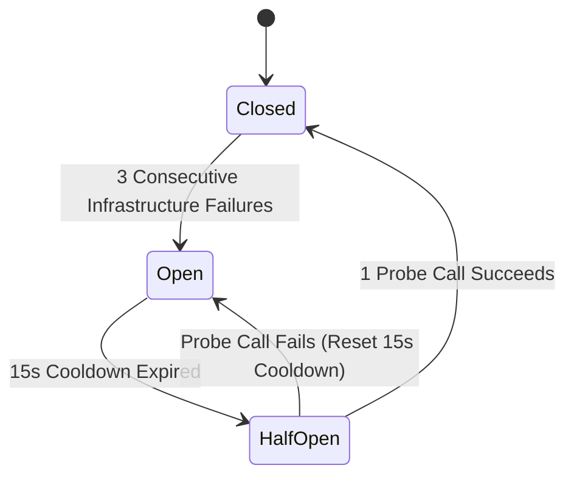

# ADR-015: Concurrency Bounds, Circuit Breaker State Machine, and Performance Proposals

**Status**: Proposed — Pending Technical Head Approval  
**Date**: 2026-10-15 (Revised: 2026-10-15)  
**Decision Makers**: Aditya Rathore (FDE Candidate), Antigravity AI  
**Related Documents**: [`ADR-008`](./ADR-008-five-tool-contract-and-pii-redaction.md), [`ADR-011`](./ADR-011-gateway-dual-mcp-proxy-and-transport-lifecycle.md)  

---

## 1. Context & Problem Statement

In a multi-upstream aggregation gateway, the failure or slowness of one upstream service (e.g. an overloaded mock CRM or delayed WooCommerce store) must never degrade healthy services or crash the central gateway process (Requirement GTW-05).

Furthermore, unconstrained incoming requests or oversized payload payloads can exhaust the gateway pod’s 256Mi memory cgroup, causing an OOMKill crash that disrupts all connected team members.

We must define strict concurrency bounds, payload limits, an infrastructure-aware circuit breaker, and proposed performance targets with reproducible measurement methodology.

---

## 2. Decision & Technical Architecture

### 2.1 Concurrency Limits & Overload Protection
- **Global Concurrency Cap**: Maximum **20 concurrent in-flight requests** across the entire gateway.
  - Inbound requests arriving when 20 requests are active immediately receive **HTTP 429 Too Many Requests** with `Retry-After: 1`.
- **Per-Upstream Concurrency Permit**: Maximum **4 concurrent in-flight requests** per upstream service.
  - Requests exceeding 4 concurrent calls wait in a FIFO queue for up to **1,000 ms**.
  - If a permit cannot be acquired within 1,000 ms, the gateway returns a clean model-facing error: `"Upstream service is currently busy. Please retry shortly."`

### 2.2 Payload & Result Size Bounds
- **Inbound Arguments Cap**: Maximum **64 KiB** serialized JSON payload.
  - Request arguments exceeding 64 KiB are rejected before audit start or upstream dispatch with **HTTP 413 Payload Too Large** (`PayloadTooLargeError`).
- **Outbound Response Cap**: Maximum **1 MiB** serialized output.
  - Upstream results exceeding 1 MiB are truncated or mapped to a safe error to prevent gateway memory exhaustion and downstream LLM token budget overflow.

---

### 2.3 Circuit Breaker Design & Error Classification

Each registered upstream maintains an in-memory circuit breaker:

#### Strict Error Classification Matrix:
| Error Category | Specific Error Types | Counts toward Circuit Trip? |
|---|---|:---:|
| **Infrastructure Error** | `ECONNREFUSED`, `EHOSTUNREACH`, `ETIMEDOUT`, upstream HTTP 502/503/504, connection reset | **YES** |
| **Timeout Failure** | Upstream execution exceeds configured 10s deadline | **YES** |
| **Business / Domain Error** | Upstream returns tool error (`isError: true`), 404 Not Found, 409 Duplicate SKU conflict | **NO** |
| **Input Validation Failure** | Client provides invalid Zod schema parameters (negative price, out-of-bounds pagination) | **NO** |
| **Authentication Error** | Invalid consumer key/secret (401), unauthorized access (403) | **NO** |

---

### 2.4 Performance Targets & Reproducible Measurement Methodology (PROPOSAL)

> [!NOTE]
> In accordance with Technical Head direction, the following performance criteria are classified as **PROPOSALS PENDING TECHNICAL HEAD APPROVAL**, to be benchmarked and formally accepted during Gate G9 end-to-end verification.

#### Proposed Performance Targets:
1. **Concurrency**: 10 concurrent virtual clients.
2. **Throughput**: 100 consecutive mock tool invocations without dropped requests.
3. **Latency Budgets**:
   - p50 latency: **< 100 ms** (fast mock calls)
   - p95 latency: **< 1,000 ms** (1.0 second)
   - p99 latency: **< 2,000 ms** (2.0 seconds)
   - Delayed calls: must complete within `configured_timeout + 1,000 ms`.
4. **Internal Error Rate**: **0.0%** (zero unexpected 500s or unhandled promise rejections).

#### Reproducible Benchmarking Specification:
- **Test Harness**: `apps/gateway/test/benchmarks/load-test.ts` using Node.js 24 native `fetch` or `autocannon`.
- **Target Environment**: Local `k3d-urumi` cluster, 4 vCPUs, single gateway pod with `requests: 96Mi, limits: 256Mi`.
- **Execution Protocol**:
  1. **Warm-Up Phase**: 10 sequential tool calls across all upstreams to warm up V8 JIT compilation and establish persistent client sockets.
  2. **Measurement Phase**: 100 total requests generated across 10 concurrent workers targeting fast mock tools (`crm__search_contacts`, `tasks__list_tasks`).
  3. **Metric Calculation**:
     - Latency: Monotonically measured from HTTP request start to response headers end (`performance.now()`).
     - Percentiles: Calculated via exact sorted array percentile rank: $P_{95} = \text{array}[\lfloor 0.95 \times N \rfloor]$.
     - Error Rate: $\text{Error Rate} = \frac{\text{Internal Errors (HTTP 500)}}{\text{Total Requests}} \times 100\%$.
  4. **Output Artifact**: Test prints table with p50, p95, p99, memory RSS before/after, and exit code 0 if all targets met.

---

## 3. Consequences & Verification
- **Positive**: Strict protection against noisy neighbors, predictable memory footprint (<100 MiB RSS), zero circuit false-positives on client errors.
- **Negative**: Concurrency cap will throttle clients exceeding 20 in-flight requests.
- **Verification**: Verified via synthetic load test script simulating 10 concurrent clients, delayed upstreams, and circuit transition verification tests.
