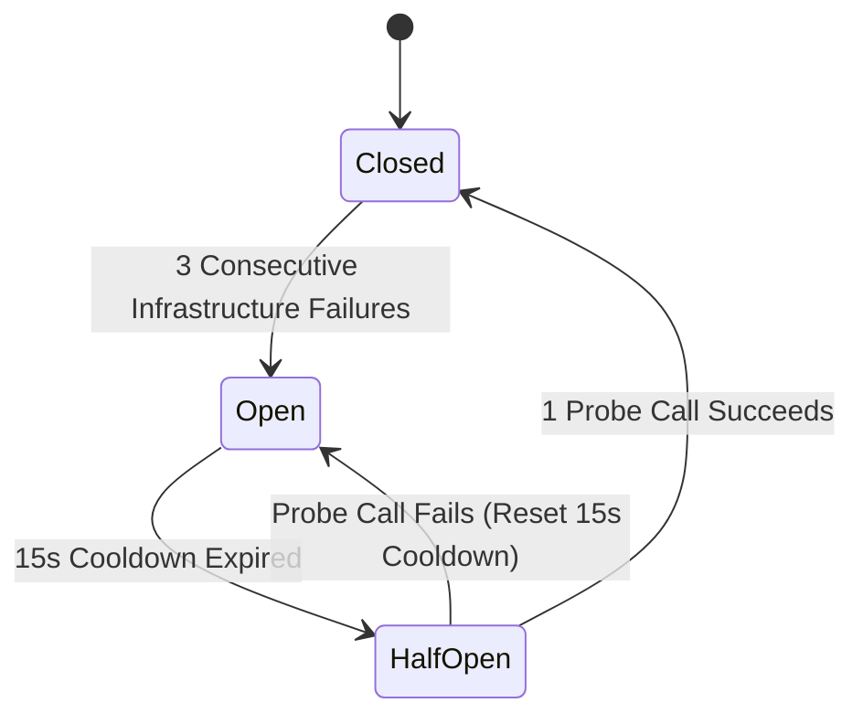

# ADR-015: Concurrency Bounds, Circuit Breaker State Machine, and Resilience Invariants

**Status**: Accepted  
**Date**: 2026-10-15  
**Decision Makers**: Aditya Rathore (FDE Candidate), Antigravity AI  
**Related Documents**: [`ADR-008`](./ADR-008-five-tool-contract-and-pii-redaction.md), [`ADR-011`](./ADR-011-gateway-dual-mcp-proxy-and-transport-lifecycle.md)  

---

## 1. Context & Problem Statement

In a multi-upstream aggregation gateway, the failure or slowness of one upstream service (e.g. an overloaded mock CRM or delayed WooCommerce store) must never degrade healthy services (e.g. Tasks service) or crash the central gateway process (Requirement GTW-05).

Furthermore, unconstrained incoming requests or oversized payload payloads can exhaust the gateway pod’s 256Mi memory cgroup, causing an OOMKill crash that disrupts all connected team members.

We must define strict concurrency bounds, payload limits, an infrastructure-aware circuit breaker, and graceful drain semantics during upstream lifecycle changes.

---

## 2. Decision

### 2.1 Concurrency Limits & Overload Protection
To protect the gateway process and maintain predictable latency within container memory budgets:
- **Global Concurrency Cap**: Maximum **20 concurrent in-flight requests** across the entire gateway.
  - Inbound requests arriving when 20 requests are active immediately receive **HTTP 429 Too Many Requests** with `Retry-After: 1`.
- **Per-Upstream Concurrency Permit**: Maximum **4 concurrent in-flight requests** per upstream service.
  - Requests exceeding 4 concurrent calls wait in a FIFO queue for up to **1,000 ms**.
  - If a permit cannot be acquired within 1,000 ms, the gateway returns a clean model-facing error: `"Upstream service is currently busy. Please retry shortly."`

### 2.2 Payload & Result Size Bounds
- **Inbound Arguments Cap**: Maximum **64 KiB** serialized JSON payload.
  - Request arguments exceeding 64 KiB are rejected before audit start or upstream dispatch with **HTTP 413 Payload Too Large** (`PayloadTooLargeError`).
- **Outbound Response Cap**: Maximum **1 MiB** serialized output.
  - Upstream results exceeding 1 MiB are truncated or mapped to a safe error to prevent gateway memory exhaustion and downstream LLM token budget overflow.

### 2.3 Circuit Breaker Design & Error Classification
Each registered upstream maintains an in-memory circuit breaker:

#### Strict Error Classification Matrix:
| Error Category | Examples | Counts toward Circuit Trip? |
|---|---|:---:|
| **Infrastructure Error** | `ECONNREFUSED`, `EHOSTUNREACH`, `ETIMEDOUT`, upstream HTTP 502/503/504, connection reset | **YES** |
| **Timeout Failure** | Upstream execution exceeds configured 10s deadline | **YES** |
| **Business / Domain Error** | Upstream returns tool error (`isError: true`), 404 Not Found, 409 Duplicate SKU conflict | **NO** |
| **Input Validation Failure** | Client provides invalid Zod schema parameters (negative price, out-of-bounds pagination) | **NO** |
| **Authentication Error** | Invalid consumer key/secret (401), unauthorized access (403) | **NO** |

*Rationale*: Legitimate client errors (such as querying a nonexistent order or providing an invalid parameter) reflect normal application behavior and must never trip an infrastructure circuit breaker.

### 2.4 Graceful Drain on Upstream Modification / Removal
When an administrator disables or deletes an upstream server (`POST /admin/v1/upstreams/:id/disable` or `DELETE`):
1. **State Transition**: Upstream state immediately switches to `DRAINING`.
2. **Admission Rejection**: All new incoming tool calls targeting this upstream are immediately rejected with **HTTP 503 Service Unavailable** (`UpstreamDisablingError`).
3. **In-Flight Drain**: In-flight requests currently executing against the upstream are allowed to finish up to a bounded drain deadline (**5,000 ms**).
4. **Resource Teardown**: Upon completion of in-flight requests or deadline expiration, the gateway aborts any remaining sockets, cancels timers, tears down the client transport, and updates the database status.

### 2.5 Performance Targets & Measurement Method
- **Target Concurrency**: 10 concurrent client workers.
- **Target Throughput**: 100 consecutive mock tool invocations without dropped requests.
- **Latency Budgets**:
  - p95 latency: **< 1.0 second** for fast/un-delayed upstream calls.
  - p99 latency: **< 2.0 seconds**.
  - Delayed calls: must complete within `configured_timeout + 1,000 ms`.
  - Internal error rate: **0.0%**.
- **Measurement Script**: Verified via automated reproducible benchmark test (`apps/gateway/test/benchmarks/load-test.ts`).

---

## 3. Consequences & Verification
- **Positive**: Complete fault isolation, no cascading failures across upstreams, predictable memory footprint (<100 MiB RSS), zero circuit false-positives on client errors.
- **Negative**: Callers must handle 429 when global capacity is reached.
- **Verification**: Verified via test suites simulating slow upstreams, killed pods, concurrent load spikes, and upstream disable drains.
