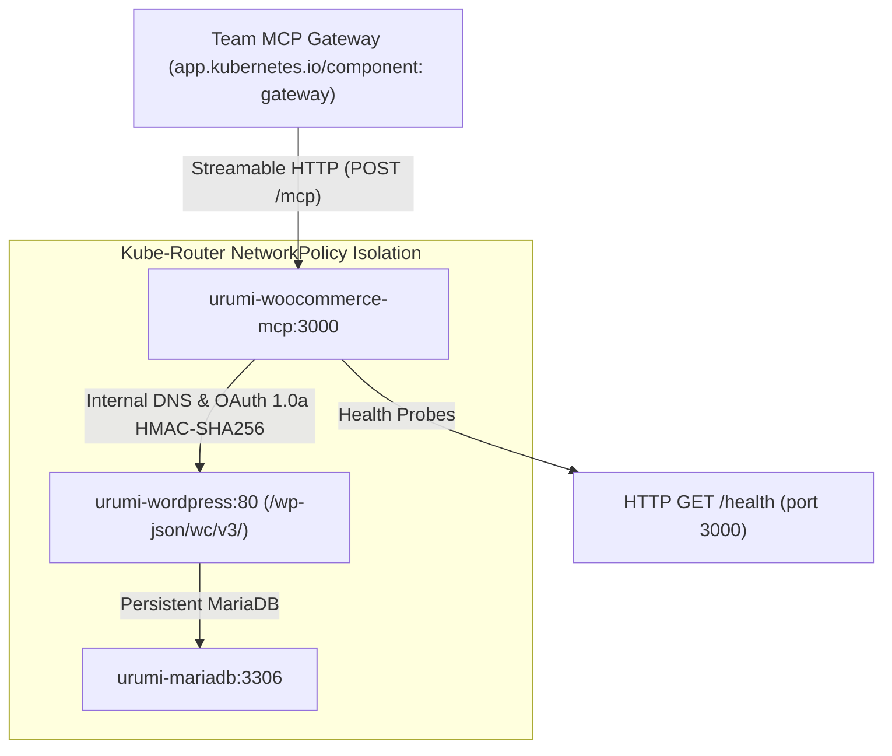

# Operational Runbook: Custom WooCommerce MCP Server on Kubernetes

**Document Type:** Production & Platform Operations Guide  
**Component:** `apps/woocommerce-mcp` & `infra/helm/urumi-platform`  
**Namespace:** `urumi`  
**Target Architecture:** Kubernetes (`k3d-urumi` / K3s)  
**Date:** 2026-10-13  
**Status:** Approved for Gate G8  

---

## 1. Overview & Service Architecture

The **WooCommerce MCP Server** (`apps/woocommerce-mcp`) is a cluster-internal, stateless Node.js 24 TypeScript service that exposes exactly five Model Context Protocol (MCP) tools via the official **Streamable HTTP transport** (`POST /mcp`).



### Key Operational Characteristics:
- **Service Name:** `urumi-woocommerce-mcp` (ClusterIP: `10.43.192.177:3000`)
- **Container Port:** `3000` (targetPort `http`)
- **External Exposure:** **Zero** (no Ingress, NodePort, or hostPort)
- **Security Context:** Non-root UID `10001` (`mcpuser`), all Linux capabilities dropped (`drop: ["ALL"]`), `seccompProfile: RuntimeDefault`
- **Resource Footprint:** 1m CPU cores, ~39 MiB memory under active load (Requests: 50m / 64Mi; Limits: 150m / 128Mi)

---

## 2. Startup & Dependency Verification

Before deploying or starting the MCP server, verify that core dependencies are healthy:

### 2.1 Cluster & Toolchain Preflight
```bash
# 1. Verify Kubernetes cluster connectivity and version parity
kubectl get nodes -o wide
# Expected: Node k3d-urumi-server-0 Ready (v1.37.1+k3s1)

# 2. Verify namespace urumi exists
kubectl get namespace urumi
```

### 2.2 Store Workload Health Check
```bash
# Verify WordPress and MariaDB pods and PVCs are 1/1 Ready
kubectl -n urumi get pods -l 'app.kubernetes.io/instance=urumi-store'
kubectl -n urumi get pvc -n urumi

# Verify internal WordPress Service responds
kubectl -n urumi run preflight-curl --rm -it --image=curlimages/curl --restart=Never \
  --labels="app.kubernetes.io/component=test-client" \
  -- curl -sI http://urumi-wordpress.urumi.svc.cluster.local:80/wp-json/
# Expected: HTTP/1.1 200 OK
```

### 2.3 Secret Verification
The MCP server requires the Kubernetes Secret `urumi-woocommerce-api`:
```bash
kubectl -n urumi get secret urumi-woocommerce-api -o jsonpath='{.data}'
# Expected keys: consumer-key, consumer-secret (base64 encoded)
```
> [!CAUTION]
> Never print the decoded secret contents in production logs or terminal history.

---

## 3. Deployment & Release Management

### 3.1 Helm Profiles
The unified Helm chart `infra/helm/urumi-platform` supports two profiles:
- **Local Development (`values-local.yaml`):** Uses locally imported image `urumi-woocommerce-mcp:1.0.0`, `imagePullPolicy: IfNotPresent`, and enables the `test-client` NetworkPolicy exception (`allowTestClient: true`).
- **Production-Like (`values-prod.yaml`):** Disables `test-client` NetworkPolicy exception (`allowTestClient: false`), restricting ingress exclusively to the Gateway.

### 3.2 Deployment Commands
```bash
# Validate chart syntax
helm lint infra/helm/urumi-platform

# Deploy or upgrade the local release
helm upgrade --install urumi-store infra/helm/urumi-platform \
  -n urumi \
  -f infra/helm/urumi-platform/values-local.yaml

# Monitor rollout progression
kubectl -n urumi rollout status deployment/urumi-woocommerce-mcp --timeout=120s
```

### 3.3 Verifying Active Deployment
```bash
kubectl -n urumi get deployment urumi-woocommerce-mcp -o wide
kubectl -n urumi get pods -l app.kubernetes.io/name=woocommerce-mcp
```

---

## 4. Health Checks & Probes Inspection

The MCP server implements a dedicated, non-leaking health probe at `GET /health`:

### 4.1 Probe Specifications
- **Startup Probe:** `httpGet: /health`, port 3000, `failureThreshold: 30`, `periodSeconds: 2` (60s startup budget).
- **Readiness Probe:** `httpGet: /health`, port 3000, `periodSeconds: 5`, `failureThreshold: 3`.
- **Liveness Probe:** `httpGet: /health`, port 3000, `periodSeconds: 10`, `failureThreshold: 3`.

### 4.2 Inspecting Probes & Live Resource Usage
```bash
# Inspect probe events
kubectl -n urumi describe deployment urumi-woocommerce-mcp | grep -A 10 "Liveness"

# Inspect active CPU and Memory consumption
kubectl -n urumi top pod -l app.kubernetes.io/name=woocommerce-mcp
# Expected: CPU: ~1m-5m, Memory: ~35Mi-45Mi
```

### 4.3 Manual In-Cluster Probe Verification
```bash
kubectl -n urumi run mcp-probe-test --rm -it --image=curlimages/curl --restart=Never \
  --labels="app.kubernetes.io/component=test-client" \
  -- curl -s http://urumi-woocommerce-mcp:3000/health
# Expected: {"status":"ok"}
```

---

## 5. Graceful Restart & Rolling Updates

The deployment uses a `RollingUpdate` strategy (`maxSurge: 1`, `maxUnavailable: 0`) and handles `SIGTERM` gracefully.

### 5.1 Initiating Rolling Restart
```bash
kubectl -n urumi rollout restart deployment/urumi-woocommerce-mcp
kubectl -n urumi rollout status deployment/urumi-woocommerce-mcp
```

### 5.2 Signal Handling Verification
When a pod receives `SIGTERM`:
1. The Express server stops accepting new connections.
2. In-flight requests are granted up to 10 seconds to finish.
3. The process exits cleanly with status code `0` within ~1.2 seconds.
4. Verify termination in logs:
   ```bash
   kubectl -n urumi logs -l app.kubernetes.io/name=woocommerce-mcp --tail=50
   ```

---

## 6. Rollback Procedures

If an upgraded image or configuration causes failures, roll back cleanly without impacting store data:

### 6.1 Helm Rollback
```bash
# 1. Check Helm release history
helm -n urumi history urumi-store

# 2. Roll back to previous revision (e.g. revision 6)
helm -n urumi rollback urumi-store 6

# 3. Confirm rollout status
kubectl -n urumi rollout status deployment/urumi-woocommerce-mcp
```

### 6.2 State Preservation Guarantee
- Helm rollbacks of `urumi-store` manage only Deployment, Service, and NetworkPolicy specs.
- The underlying `PersistentVolumeClaims` (`urumi-mariadb-pvc` and `urumi-wordpress-pvc`) remain untouched and bound.
- Database records, seeded products, and orders are never altered by MCP rollbacks.

---

## 7. Troubleshooting Runbook

### 7.1 Issue: Pod in `CrashLoopBackOff` or `Error`
- **Symptom:** Pod fails immediately upon startup.
- **Root Cause Analysis:**
  1. Check logs for missing environment variables:
     ```bash
     kubectl -n urumi logs deployment/urumi-woocommerce-mcp
     ```
  2. If error indicates missing `WOOCOMMERCE_CONSUMER_KEY` or `WOOCOMMERCE_CONSUMER_SECRET`, verify secret `urumi-woocommerce-api` exists and is formatted correctly.
  3. Verify port conflict: Ensure `PORT` environment variable matches `containerPort: 3000`.

### 7.2 Issue: `ErrImagePull` or `ImagePullBackOff`
- **Symptom:** Pod cannot pull image `urumi-woocommerce-mcp:1.0.0`.
- **Root Cause Analysis:**
  1. Image is not available in local k3d containerd cache:
     ```bash
     k3d image import urumi-woocommerce-mcp:1.0.0 -c urumi
     ```
  2. In `values-local.yaml`, ensure `imagePullPolicy: IfNotPresent` and `digest: ""`.

### 7.3 Issue: Tool Calls Return HTTP 401 (`Invalid signature`)
- **Symptom:** MCP server returns `isError: true` with message `Invalid signature - provided signature does not match`.
- **Root Cause Analysis:**
  1. Verify `WOOCOMMERCE_SITE_URL` matches WordPress `home_url()` (`http://shop.127.0.0.1.nip.io:8080`).
  2. The OAuth 1.0a signer must sign using `WOOCOMMERCE_SITE_URL` because WordPress core verifies signatures against its canonical site URL even when called via internal ClusterIP (`WOOCOMMERCE_BASE_URL`).

### 7.4 Issue: Connection Refused (`curl: (7)`)
- **Symptom:** Client cannot connect to `urumi-woocommerce-mcp:3000`.
- **Root Cause Analysis:**
  1. Check NetworkPolicy: Ingress is restricted by K3s `kube-router`.
  2. If calling from an ad-hoc pod, ensure pod has label `app.kubernetes.io/component: gateway` (or `test-client` when `allowTestClient: true`).
  3. If running under `values-prod.yaml`, `test-client` pods are intentionally blocked.

### 7.5 Issue: Write Timeouts on `create_product` or `update_order_status`
- **Symptom:** MCP tool returns `UpstreamTimeoutError: Request to WooCommerce API timed out after 10000ms`.
- **Operational Procedure:**
  1. The client intentionally **aborts without blind retries** to prevent double-creation or race conditions.
  2. Check WordPress pod health and CPU load (`kubectl -n urumi top pod`).
  3. Inspect MariaDB lock status.

---

## 8. Recovery Procedures

### 8.1 Recreating the WooCommerce Integration Secret
If the secret `urumi-woocommerce-api` is accidentally corrupted or deleted:
```bash
# 1. Regenerate keys via WP-CLI inside WordPress pod
kubectl -n urumi exec deployment/urumi-wordpress -- bash -c \
  "if [ ! -f /usr/local/bin/wp ]; then cp /var/www/html/wp-cli.phar /usr/local/bin/wp && chmod +x /usr/local/bin/wp; fi; \
   wp wc api_key create --user=1 --description='MCP Gateway In-Cluster API Key' --permissions=read_write --porcelain --allow-root"

# 2. Update Kubernetes secret imperatively
kubectl -n urumi create secret generic urumi-woocommerce-api \
  --from-literal=consumer-key="<KEY>" \
  --from-literal=consumer-secret="<SECRET>" \
  --dry-run=client -o yaml | kubectl apply -f -

# 3. Rollout restart the MCP deployment to reload keys
kubectl -n urumi rollout restart deployment/urumi-woocommerce-mcp
```

### 8.2 Restoring WP-CLI Binary in WordPress Pod
Because the official `wordpress:7.1.3-php8.3-apache` base image does not ship WP-CLI in `/usr/local/bin/`, the PHAR is preserved on the persistent volume at `/var/www/html/wp-cli.phar`:
```bash
kubectl -n urumi exec deployment/urumi-wordpress -- bash -c \
  "cp /var/www/html/wp-cli.phar /usr/local/bin/wp && chmod +x /usr/local/bin/wp"
```
