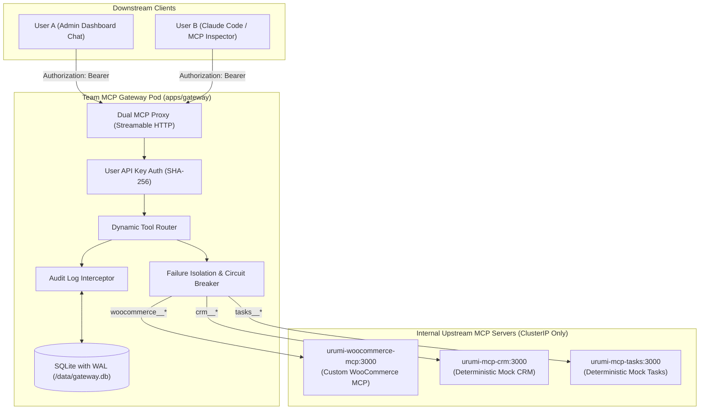

# Formal Phase 4 Readiness Review & Gateway Architecture Specification

**Document Type:** Phase Transition Readiness Review & Architecture Blueprint  
**Transition:** Phase 3 (Custom WooCommerce MCP Server) $\rightarrow$ Phase 4 (Team MCP Gateway Core)  
**Date:** 2026-10-13  
**Status:** **AWAITING FORMAL PHASE 4 AUTHORIZATION (IMPLEMENTATION ON HOLD)**  

---

## 1. Executive Summary & Gate Boundary

Phase 3 has successfully concluded with the formal acceptance of **Gate G7**. All five approved tools (`list_products`, `create_product`, `list_orders`, `get_order`, `update_order_status`) are deployed and verified as an isolated `ClusterIP` workload on Kubernetes.

This document serves as the formal **Gate G8 handoff artifact**, establishing the architectural blueprint, prerequisite checks, interface boundaries, and acceptance criteria for **Phase 4: Team MCP Gateway Core (Aggregation, Routing & Reliability)**.

> [!CAUTION]
> **Implementation Hold:** In accordance with the Technical Lead directive, this document does NOT authorize immediate Phase 4 code execution. Phase 4 development remains strictly frozen until the Product Manager and Technical Lead review this readiness assessment and issue formal sign-off.

---

## 2. Phase 4 Scope & Architecture Blueprint

The goal of Phase 4 is to build the central **Team MCP Gateway** (`apps/gateway`), an enterprise-grade Model Context Protocol aggregation proxy and control plane running in Kubernetes.

### 2.1 Core Gateway Architectural Components:
1. **Dual MCP Proxy Architecture**:
   - **Downstream Server:** Implements `StreamableHTTPServerTransport` exposing `POST /mcp` for downstream AI clients.
   - **Upstream Client Manager:** Maintains persistent `StreamableHTTPClientTransport` connections to internal upstreams.
2. **Deterministic Tool Namespacing**:
   - Upstream tools are dynamically prefixed: `{server}__{tool}` (e.g. `woocommerce__list_products`, `crm__get_customer`, `tasks__create_task`).
   - Prevents naming collisions across upstreams and enables O(1) routing.
3. **Failure Isolation & Circuit Breaking**:
   - If one upstream crashes or becomes unresponsive (e.g. CRM pod killed), the gateway continues serving requests for healthy upstreams (WooCommerce, Tasks).
   - Tool listing (`tools/list`) gracefully omits or flags unreachable upstreams without throwing 500 errors.
4. **Configurable Request Timeouts**:
   - Enforces strict per-upstream timeouts (default: 10s) using `AbortController` to prevent client connection starvation.
5. **Upstream Credential Isolation (ADR-003)**:
   - Downstream clients only provide their personal gateway API key.
   - Upstream credentials (e.g. WooCommerce OAuth keys, CRM tokens) are managed securely by the gateway and never exposed downstream.
6. **Persistent SQLite Database with WAL on PVC**:
   - Located at `/data/gateway.db` on a dedicated 500Mi `PersistentVolumeClaim`.
   - Stores users, hashed API keys (SHA-256), upstream configurations, and structured audit logs across pod replacements.

---

## 3. Prerequisite Verification Checklist

All technical and cluster prerequisites for Phase 4 have been verified:

| Prerequisite | Status | Evidence |
|---|:---:|---|
| **Phase 2 Stateful Store Workload** | **READY** | Pods `urumi-mariadb-0` and `urumi-wordpress` 1/1 Running; PVCs bound. Seeded products 10, 11, 12 and Order #14 intact. |
| **Phase 3 WooCommerce MCP Server** | **READY** | Pod `urumi-woocommerce-mcp` 1/1 Running; all 5 tools verified live; zero customer PII. |
| **Internal Cluster Networking** | **READY** | DNS `urumi-woocommerce-mcp.urumi.svc.cluster.local:3000` resolvable; NetworkPolicy configured with `app.kubernetes.io/component: gateway` ingress rules. |
| **Node.js LTS & MCP SDK** | **READY** | Node.js `24.20.0` pinned; `@modelcontextprotocol/sdk@1.32.1` verified on Streamable HTTP transport. |
| **Monorepo Structure** | **READY** | Root npm workspaces configured (`apps/gateway/` directory ready to scaffold). |
| **Resource Budget Headroom** | **READY** | Host has ~1.4 GiB free RAM. WooCommerce MCP uses only 39 MiB; Gateway budgeted for 96Mi req / 256Mi lim. |

---

## 4. Phase 4 Requirements Traceability (Category D)

The following 11 atomic requirements from [`docs/requirements-traceability.md`](file:///home/rathore/Documents/Urumi%20Assignment/docs/requirements-traceability.md) govern Phase 4:

| Req ID | Atomic Statement / Requirement | Target Component | Verification Test |
|---|---|---|---|
| **GTW-01** | Aggregates multiple upstream MCP servers into single downstream endpoint. | `apps/gateway/` | Client connects to `/mcp`; `tools/list` returns aggregated tool catalog. |
| **GTW-02** | Connects to at least 3 distinct upstream servers (WooCommerce, CRM, Tasks). | `apps/gateway/` | Catalog contains tools from WooCommerce, CRM, and Tasks servers. |
| **GTW-03** | Dynamic routing of tool calls to correct upstream server. | `apps/gateway/` | Calls route cleanly based on namespaced prefix. |
| **GTW-04** | Tool namespacing (`{server}__{tool}`) to prevent collisions. | `apps/gateway/` | All aggregated tools follow `{server}__{tool}` format. |
| **GTW-05** | Failure isolation: slow/dead upstream does not crash gateway. | `apps/gateway/` | Terminate Upstream 2; remaining servers function normally. |
| **GTW-06** | Configurable per-upstream request timeouts (10s default). | `apps/gateway/` | Simulated slow upstream returns timeout cleanly without hanging. |
| **GTW-07** | Upstream server management: add, remove, enable, disable without restart. | `apps/gateway/` | Dynamic toggle immediately updates downstream `tools/list`. |
| **GTW-08** | Upstream health tracking: unhealthy upstreams marked in metadata. | `apps/gateway/` | Unreachable upstreams reflect health status cleanly. |
| **GTW-09** | Upstream credential isolation: clients never see upstream secrets. | `apps/gateway/` | Downstream uses only User API key; gateway injects internal auth. |
| **GTW-10** | Dynamic upstream credentials stored in Kubernetes Secrets. | `apps/gateway/` | Gateway interacts with Kubernetes secrets securely. |
| **GTW-11** | Gateway persistence: SQLite with WAL mode on PVC (`/data/gateway.db`). | `apps/gateway/` | Pod restart retains users, upstreams, keys, and audit logs. |

---

## 5. Phase 4 Gate Structure & Implementation Milestones

When authorized, Phase 4 will proceed through the established engineering gate structure:

- **Gate G0 (Preflight):** Verify cluster baseline, namespace secrets, and working tree clean status.
- **Gate G1 (Mock Upstreams):** Implement deterministic internal mock servers `apps/mcp-crm` and `apps/mcp-tasks`.
- **Gate G2 (Gateway Skeleton):** Scaffold `apps/gateway`, Express + TypeScript, Streamable HTTP server, and health check.
- **Gate G3 (Upstream Aggregation & Proxy):** Build client connection pool, dynamic discovery, and `{server}__{tool}` namespacing.
- **Gate G4 (Routing, Timeouts & Failure Isolation):** Implement tool routing, 10s request aborts, and circuit breaker isolation.
- **Gate G5 (Persistence & Database Layer):** Configure SQLite with WAL mode on PVC (`/data/gateway.db`) for upstream configurations and audit records.
- **Gate G6 (Packaging & Helm Deployment):** Build non-root Dockerfile, integrate into `infra/helm/urumi-platform`, bind PVC, configure NetworkPolicies.
- **Gate G7 (End-to-End Acceptance):** Execute full DoD test scenarios (Steps 1–9) with multi-upstream failure injection and live store tools.

---

## 6. Formal Sign-Off Request

Phase 3 is complete, verified, and closed. All prerequisites, architectural patterns, and security constraints for Phase 4 are defined.

**Current Recommendation:**
- **Gate G8:** PASS — Closed.
- **Phase 4 Implementation:** **Awaiting formal Technical Lead & Product Manager authorization.**
