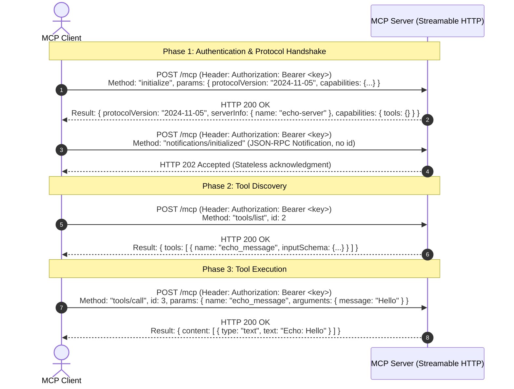

# Urumi Platform — Phase 1 Project Study Material
## A Comprehensive Self-Study Guide to MCP, Kubernetes, Helm, and Distributed Architecture

> **Author**: Aditya Rathore  
> **Phase**: Phase 1 (Foundation, Technical Validation & Scaffolding)  
> **Target Audience**: Self-study, technical interviews, team knowledge transfer  
> **Last Updated**: October 2026  

---

## Table of Contents
1. [Introduction: Why This Document Exists](#1-introduction-why-this-document-exists)
2. [The Core Problem: Why Are We Building This?](#2-the-core-problem-why-are-we-building-this)
3. [Deep Dive: Model Context Protocol (MCP)](#3-deep-dive-model-context-protocol-mcp)
   - [What is MCP and who created it?](#what-is-mcp-and-who-created-it)
   - [Core Architecture: Host, Client, and Server](#core-architecture-host-client-and-server)
   - [The Three MCP Primitives](#the-three-mcp-primitives)
   - [Transport Evolution: stdio vs HTTP+SSE vs Streamable HTTP](#transport-evolution-stdio-vs-httpsse-vs-streamable-http)
   - [The JSON-RPC 2.0 Wire Protocol & Handshake](#the-json-rpc-20-wire-protocol--handshake)
   - [Official TypeScript SDK Internals](#official-typescript-sdk-internals)
4. [The MCP Gateway Architecture: Why Not Direct Connections?](#4-the-mcp-gateway-architecture-why-not-direct-connections)
   - [The 5 Critical Gateway Responsibilities](#the-5-critical-gateway-responsibilities)
   - [Namespacing and Collision Prevention](#namespacing-and-collision-prevention)
   - [Failure Isolation and Timeouts](#failure-isolation-and-timeouts)
5. [Kubernetes & Container Orchestration Fundamentals](#5-kubernetes--container-orchestration-fundamentals)
   - [What is Kubernetes and why container orchestration?](#what-is-kubernetes-and-why-container-orchestration)
   - [Key Kubernetes Objects Explained Simply](#key-kubernetes-objects-explained-simply)
   - [Why k3d and K3s instead of Minikube or Kind?](#why-k3d-and-k3s-instead-of-minikube-or-kind)
   - [Port Conflicts & Wildcard DNS (`nip.io`)](#port-conflicts--wildcard-dns-nipio)
6. [Helm: The Kubernetes Package Manager](#6-helm-the-kubernetes-package-manager)
   - [Why Helm instead of raw YAML files?](#why-helm-instead-of-raw-yaml-files)
   - [Chart Structure & The Go Template Engine](#chart-structure--the-go-template-engine)
   - [Local vs Production Values Configuration](#local-vs-production-values-configuration)
7. [Monorepos, Workspaces, and Node.js Runtime Strategy](#7-monorepos-workspaces-and-nodejs-runtime-strategy)
   - [Why npm Workspaces?](#why-npm-workspaces)
   - [The Node.js 24 LTS Decision (Why Node 20 is EOL)](#the-nodejs-24-lts-decision-why-node-20-is-eol)
   - [Reproducible Builds: `npm install` vs `npm ci` and Lockfiles](#reproducible-builds-npm-install-vs-npm-ci-and-lockfiles)
8. [Database Architecture: SQLite with WAL on PVC vs PostgreSQL](#8-database-architecture-sqlite-with-wal-on-pvc-vs-postgresql)
   - [The Memory Dilemma on Host Hardware](#the-memory-dilemma-on-host-hardware)
   - [What is SQLite WAL (Write-Ahead Logging)?](#what-is-sqlite-wal-write-ahead-logging)
   - [The Realistic Storage Failure Model](#the-realistic-storage-failure-model)
9. [Security, Authentication, and Threat Boundaries](#9-security-authentication-and-threat-boundaries)
   - [Bearer Token Authentication in HTTP Headers](#bearer-token-authentication-in-http-headers)
   - [Cryptographic Key Hashing (SHA-256 + Salt)](#cryptographic-key-hashing-sha-256--salt)
   - [DNS Rebinding Protection & Host Validation](#dns-rebinding-protection--host-validation)
10. [Step-by-Step Walkthrough of What We Built in Phase 1](#10-step-by-step-walkthrough-of-what-we-built-in-phase-1)
    - [The MCP Echo Spike Server (`server.ts`)](#the-mcp-echo-spike-server-serverts)
    - [The MCP Spike Test Client (`test-client.ts`)](#the-mcp-spike-test-client-test-clientts)
    - [The Helm Scaffold](#the-helm-scaffold)
11. [Technical Glossary & Interview Cheat Sheet](#11-technical-glossary--interview-cheat-sheet)

---

## 1. Introduction: Why This Document Exists

When starting an advanced, production-grade cloud and AI project, it is easy to get lost in commands, configuration files, and frameworks without truly grasping the underlying mechanics.

This document serves as your **personal technical textbook and conceptual foundation**. It is designed to bridge the gap between "running commands" and "deep architectural comprehension." Every concept introduced in Phase 1—from Model Context Protocol wire semantics to Kubernetes PersistentVolume storage models—is explained from first principles, in plain English, with diagrams, analogies, and code snippets.

---

## 2. The Core Problem: Why Are We Building This?

### The AI Tooling Problem
Large Language Models (LLMs) like Claude, GPT-4, and Gemini possess vast reasoning capabilities, but they are fundamentally "brains in a jar." They have no direct access to real-time company databases, customer relationship management (CRM) systems, inventory, or e-commerce stores like WooCommerce.

Before late 2024, connecting an LLM to external systems was chaotic:
- OpenAI had their custom "Function Calling" schema.
- Anthropic had their proprietary "Tool Use" API.
- LangChain and LlamaIndex had internal custom abstraction layers.
- Every company wrote brittle, custom REST glue code to connect an AI to their database.

If you had **5 LLM clients** (Cursor, Claude Desktop, internal web chatbots, CLI tools) and **10 internal services** (database, GitHub, Slack, WooCommerce, CRM), you had to write and maintain **$5 \times 10 = 50$ distinct custom integrations**!

```
[Cursor] ---------\       /--------> [WooCommerce]
[Claude Code] -----\     /---------> [Postgres DB]
[Web Chatbot] ------X---X----------> [CRM System]
[Internal CLI] ----/     \---------> [Tasks Service]
                  (N x M Spaghetti Integrations)
```

### The Solution: A Standard Protocol & A Central Gateway
1. **Model Context Protocol (MCP)** standardizes the interface. Just like **HTTP** standardized how web browsers talk to web servers, and **SQL** standardized how applications query databases, **MCP standardizes how AI agents talk to data sources and tools**.
2. **Team MCP Gateway on Kubernetes**: Instead of letting individual developers and external clients connect directly to private databases or microservices, our platform provides a **single, secure, authenticated, and audited entry point** inside Kubernetes.

```
Downstream Clients                   Kubernetes Control Plane                     Upstream Workloads
[User A (Chat UI)]       \                                                  /---> [WooCommerce MCP] -> [Woo Store]
                          +===> [Team MCP Gateway] ========================+----> [CRM MCP Server]
[User B (MCP Inspector)] /      • Auth (Bearer Tokens)                      \---> [Tasks MCP Server]
                                • Namespacing (`server__tool`)
                                • Failure Isolation & Timeouts
                                • Persistent Audit Logging (SQLite on PVC)
```

---

## 3. Deep Dive: Model Context Protocol (MCP)

### What is MCP and who created it?
The **Model Context Protocol (MCP)** was open-sourced by **Anthropic** in late 2024 as an open, universal standard. It is not tied to Claude; it is model-agnostic and client-agnostic. Any AI model (Gemini, OpenAI, Claude, local Ollama) and any client (Cursor, VS Code, terminal CLI) can speak MCP.

### Core Architecture: Host, Client, and Server
MCP divides the world into three distinct roles:

| Role | Definition | Concrete Example in Our Project |
| :--- | :--- | :--- |
| **MCP Host** | The user-facing AI application that coordinates LLM reasoning and client connections. | Claude Desktop, Cursor IDE, or our React Dashboard Chat. |
| **MCP Client** | The software component inside the Host that initiates the connection, discovers tools, and handles JSON-RPC communication. | `@modelcontextprotocol/sdk/client` in our test client script, or our Gateway acting as a client to upstreams. |
| **MCP Server** | The backend service that exposes capabilities (tools, prompts, data resources) to the client. | Our `spikes/mcp-echo` server, our upcoming `mcp-woocommerce` server, or our Gateway acting as a server to downstream users. |

> [!NOTE]
> Notice that our **Team MCP Gateway** is unique: it acts as a **Server** to downstream users (User A, User B), but acts as a **Client** to internal upstream servers (WooCommerce, CRM, Tasks). This is called a **Dual MCP Proxy Architecture**.

### The Three MCP Primitives
An MCP Server can provide three types of capabilities:
1. **Tools (Actions)**: Executable functions that the model can invoke to take action or fetch computed data (e.g., `create_product`, `list_orders`, `echo_message`). **This is the core focus of our project.**
2. **Resources (Context/Data)**: Read-only data sources similar to file contents or database rows (e.g., `file:///logs/app.log`, `postgres://schema/orders`).
3. **Prompts (Templates)**: Pre-packaged prompt engineering templates with arguments (e.g., `summarize_customer_history(customer_id)`).

### Transport Evolution: stdio vs HTTP+SSE vs Streamable HTTP
How do the MCP Client and MCP Server physically send bytes to each other? MCP specifies **Transports**:

#### 1. `stdio` (Standard Input / Output)
The client spawns the server as a local child process (`node server.js` or `python server.py`) and writes JSON-RPC messages to the server's `stdin`, while reading responses from the server's `stdout`.
* *Pros*: Simple, zero network setup, highly secure for desktop apps.
* *Cons*: **Cannot work across a network or inside Kubernetes microservices.** The server must live on the same physical machine as the client.

#### 2. `HTTP with SSE` (Legacy HTTP + Server-Sent Events)
An early remote transport draft where the client sent HTTP POST requests for commands, and the server kept an open HTTP GET connection receiving a stream of Server-Sent Events (`text/event-stream`).
* *Why it was deprecated*: Maintaining long-lived SSE connections behind Kubernetes reverse proxies, load balancers, and Cloudflare caused connection timeouts, broken states, and complex session management. In `@modelcontextprotocol/sdk@1.32.1`, `SSEServerTransport` is officially marked `@deprecated`.

#### 3. `Streamable HTTP` (The Modern Standard)
The current, official remote transport specified by the MCP working group and supported in `@modelcontextprotocol/sdk@1.32.1`.
* *How it works*: Standard HTTP `POST` requests sending JSON-RPC 2.0 payloads. When the response is small, it returns a standard JSON payload. When streaming is needed, it utilizes chunked HTTP transfer encoding.
* *Stateless & Resilient*: Each request can be independently handled, authenticated with standard HTTP headers (`Authorization: Bearer <token>`), and easily routed across Kubernetes Ingress and Services.

### The JSON-RPC 2.0 Wire Protocol & Handshake
MCP uses the standard **JSON-RPC 2.0** format for all wire messages. Every message has:
- `jsonrpc: "2.0"`
- `id`: A unique number or string to correlate requests and responses.
- `method`: The protocol procedure being invoked.
- `params`: Arguments for the procedure.

Here is the exact wire sequence that occurs when an MCP client connects:



### Official TypeScript SDK Internals
In our spike, we use the official package `@modelcontextprotocol/sdk@1.32.1`. Key classes include:

- **`McpServer`**: The high-level abstraction used to register tools, schemas, and metadata.
  ```typescript
  const server = new McpServer({ name: 'echo-server', version: '1.0.0' });
  server.registerTool('echo_message', {
    description: 'Echoes back a message',
    inputSchema: { message: z.string() }
  }, async ({ message }) => {
    return { content: [{ type: 'text', text: `Echo: ${message}` }] };
  });
  ```
- **`StreamableHTTPServerTransport`**: The server-side network transport adapter that bridges Express HTTP requests (`req`, `res`) into the MCP JSON-RPC state machine.
- **`createMcpExpressApp`**: An official helper function that pre-configures an Express application with security guardrails, specifically **DNS Rebinding Protection**.

---

## 4. The MCP Gateway Architecture: Why Not Direct Connections?

Why can't User A (the Chat Agent) or User B (MCP Inspector) connect directly to WooCommerce, the CRM, and the Tasks service?

### The 5 Critical Gateway Responsibilities

1. **Tool Aggregation (Single Entry Point)**:
   Instead of configuring 3 different URLs and 3 different authentication schemes in your AI client, the gateway exposes **one unified endpoint**:
   `http://dashboard.127.0.0.1.nip.io:8080/mcp`.
   When the client asks for tools, the gateway queries all registered upstream servers, merges their tools into a single list, and presents them to the client.

2. **Collision Prevention via Namespacing**:
   What happens if Upstream 1 (WooCommerce) has a tool called `get_order`, and Upstream 2 (Internal ERP) also has a tool called `get_order`?
   The LLM would be confused and could call the wrong tool!
   The gateway namespaces all upstream tools using the format:
   `{upstream_server}__{tool_name}`
   For example: `woocommerce__get_order` and `erp__get_order`.

3. **Security & Credential Isolation**:
   This is a fundamental security invariant:
   * **Downstream users only possess personal gateway API keys** (`urumi_key_...`).
   * **Upstream credentials (e.g. WooCommerce Consumer Secret, CRM bearer tokens) NEVER leave the cluster.**
   * The gateway strips the client's token, looks up the upstream's credentials from a Kubernetes Secret, and makes the upstream call securely. Even if a team member inspects their network requests in MCP Inspector, they cannot steal WooCommerce admin credentials!

4. **Failure Isolation & Timeouts**:
   If Upstream 2 (e.g., the CRM pod) crashes or takes 45 seconds to respond:
   * Without a gateway: The entire tool-calling loop hangs, and the user gets a generic timeout error.
   * With our gateway: The gateway enforces a 10-second timeout per upstream. If the CRM is dead, it returns an error for that specific tool, marks the CRM as `Unreachable` in the dashboard, but allows WooCommerce and Tasks tools to keep functioning normally!

5. **Centralized Audit Logging**:
   In enterprise environments, AI actions must be traceable.
   Who created that $500 discount coupon in WooCommerce? Was it Alice using the chat UI, or Bob running an automated script via MCP Inspector?
   The gateway intercepts every tool execution and writes an immutable record to persistent storage:
   `User ID | Timestamp | Upstream | Tool Name | Parameters | Latency | Status`

---

## 5. Kubernetes & Container Orchestration Fundamentals

### What is Kubernetes and why container orchestration?
Docker allows you to package an application into a container image (`docker build`) and run it on a machine (`docker run`).
However, in production:
- What happens if the container crashes at 3:00 AM?
- What happens if your machine runs out of memory?
- How do two containers find each other when IP addresses change dynamically?
- How do you update an application with zero downtime?

**Kubernetes (K8s)** is an open-source container orchestration engine that automates the deployment, scaling, health checking, and networking of containerized applications.

### Key Kubernetes Objects Explained Simply

```
┌────────────────────────────────────────────────────────┐
│ Kubernetes Ingress (Traefik / Nginx)                   │
│ Maps external domains (shop.nip.io:8080) to Services   │
└──────────────────────────┬─────────────────────────────┘
                           │
                           ▼
┌────────────────────────────────────────────────────────┐
│ Kubernetes Service (ClusterIP)                         │
│ Stable internal DNS & virtual IP (http://wordpress:80)│
└──────────────────────────┬─────────────────────────────┘
                           │
                           ▼
┌────────────────────────────────────────────────────────┐
│ Kubernetes Deployment / Pod                            │
│ Runs container(s). Restarts automatically if crashed. │
└──────────────────────────┬─────────────────────────────┘
                           │ Mounts
                           ▼
┌────────────────────────────────────────────────────────┐
│ PersistentVolumeClaim (PVC)                            │
│ Preserves database & uploads on disk across restarts   │
└────────────────────────────────────────────────────────┘
```

- **Pod**: The smallest deployable unit in Kubernetes. Usually wraps a single running container (e.g., one WordPress container).
- **Deployment**: A controller that declares how many copies (replicas) of a Pod should run, manages rolling updates, and automatically replaces failed Pods.
- **Service**: A stable internal network abstraction. Pods are mortal—they can be killed and assigned new private IPs. A Service provides a permanent internal DNS name (e.g. `http://mariadb:3306`) that load-balances traffic to the underlying pods.
  - *ClusterIP*: Accessible **only from inside the cluster** (used for our databases and internal MCP servers).
  - *NodePort / LoadBalancer*: Exposes ports to the outside world.
- **Ingress**: A layer-7 reverse proxy (like Traefik or Ingress-Nginx) that routes external HTTP hostnames (e.g., `shop.127.0.0.1.nip.io`) to internal Kubernetes Services.
- **PersistentVolumeClaim (PVC)**: A request for durable disk storage. By default, containers are **ephemeral** (if a container dies, all files written inside it disappear). A PVC attaches a persistent directory on the host to the pod (e.g., `/var/lib/mysql` or `/data/gateway.db`).
- **ConfigMap**: Key-value pairs for non-sensitive configuration (domain names, environment names).
- **Secret**: Key-value pairs for sensitive data (passwords, tokens). Stored in Kubernetes and mounted as environment variables or volume files.
- **Liveness & Readiness Probes**:
  - *Readiness Probe*: "Is the application initialized and ready to accept traffic?" (If false, K8s stops sending requests to it).
  - *Liveness Probe*: "Is the application still alive, or is it deadlocked/frozen?" (If false, K8s kills the container and starts a fresh one).

### Why k3d and K3s instead of Minikube or Kind?
- **K3s**: A lightweight, certified Kubernetes distribution developed by Rancher. It strips out legacy cloud-provider drivers and uses less than 512 MiB of RAM. It is widely used in production on edge devices and VPS servers.
- **k3d**: Runs lightweight K3s clusters inside Docker containers on your local machine.
- *Why we chose k3d*:
  1. Our target production deployment is a VPS running K3s. By using `k3d` locally, our local development environment has **100% parity** with production K3s!
  2. It has Traefik Ingress pre-installed out of the box.
  3. It uses significantly less memory than Minikube or full Kubernetes.

### Port Conflicts & Wildcard DNS (`nip.io`)

#### The Host Port 80 Conflict
During our read-only environment audit, we discovered:
- The host machine was already running native `nginx/1.24.0` bound to port 80.
- Trying to bind a local Kubernetes cluster to host port 80 would fail with `bind: address already in use` or break the host's existing web services.
- **Our Resolution**: We map k3d's ingress load balancer to **port 8080** (HTTP) and **8443** (HTTPS):
  ```bash
  k3d cluster create urumi --port "8080:80@loadbalancer" --port "8443:443@loadbalancer"
  ```

#### Wildcard DNS via `nip.io`
Normally, to access custom domain names like `shop.local` on your machine, you must edit `/etc/hosts` with `sudo` permissions.
To avoid requiring root permissions, we use **`nip.io`**:
- `nip.io` is a free public wildcard DNS service.
- Any hostname formatted as `<subdomain>.<IP>.nip.io` automatically resolves to that IP address!
- Therefore:
  - `shop.127.0.0.1.nip.io` automatically resolves to `127.0.0.1`.
  - `dashboard.127.0.0.1.nip.io` automatically resolves to `127.0.0.1`.
- Any browser or curl command immediately routes traffic to our local machine's port 8080!

---

## 6. Helm: The Kubernetes Package Manager

### Why Helm instead of raw YAML files?
In plain Kubernetes, if you want to deploy WordPress, MariaDB, the Gateway, and 3 MCP servers, you might have to maintain 25 different YAML files:
`deployment.yaml`, `service.yaml`, `pvc.yaml`, `ingress.yaml`, `secret.yaml`, etc.

Now imagine deploying to two different environments:
- In **Local Development**: Ingress domain is `shop.127.0.0.1.nip.io:8080`, replicas is `1`, storage class is `local-path`.
- In **Production VPS**: Ingress domain is `store.urumi-demo.com`, port is `443`, TLS certificates are enabled.

Without Helm, you would have to duplicate all 25 YAML files or manually edit them with `sed`.
**Helm** solves this by templating your Kubernetes manifests:
$$\text{Templates} + \text{Values File} = \text{Rendered Kubernetes Manifests}$$

### Chart Structure & The Go Template Engine
A Helm chart is structured as:
```
urumi-platform/
├── Chart.yaml             # Chart name, version, description
├── values.yaml            # Default parameters for all variables
├── values-local.yaml      # Overrides for local k3d development
├── values-prod.yaml       # Overrides for production VPS
└── templates/
    ├── _helpers.tpl       # Named template definitions (labels, fullnames)
    └── configmap.yaml     # The resource manifest template
```

In `templates/configmap.yaml`, notice the syntax:
```yaml
apiVersion: v1
kind: ConfigMap
metadata:
  name: {{ include "urumi-platform.fullname" . }}-config
data:
  environment: {{ .Values.global.environment | quote }}
  store-domain: {{ .Values.store.domain | quote }}
```
The `{{ ... }}` syntax is Go template interpolation. Helm dynamically replaces `.Values.store.domain` with the value from your active values file!

### Local vs Production Values Configuration
In Phase 1, we established two profiles:
1. `values-local.yaml`:
   - `environment: "local"`
   - `store.domain: "shop.127.0.0.1.nip.io"`
   - `store.port: 8080`
   - `gateway.replicas: 1`
2. `values-prod.yaml`:
   - `environment: "production"`
   - `store.domain: "store.urumi-demo.com"`
   - `store.port: 443`
   - `gateway.replicas: 1` *(Strictly pinned to 1 replica to match the single-writer SQLite on PVC storage design!)*

---

## 7. Monorepos, Workspaces, and Node.js Runtime Strategy

### Why npm Workspaces?
Instead of creating 5 completely separate Git repositories for the dashboard, gateway, and MCP servers, we use a **Monorepo** managed by native **npm workspaces**.
- Single `package.json` at root defining `workspaces: ["apps/*", "packages/*"]`.
- Common TypeScript configurations shared via `tsconfig.base.json`.
- A shared package (`@urumi/shared`) where common types (audit log structures, tool response types) can be shared across the gateway and UI without publishing to npm registry.

### The Node.js 24 LTS Decision (Why Node 20 is EOL)
In software engineering, relying on runtime version labels without checking official release schedules leads to technical debt.
- **Node.js 20**: Reached official **End-of-Life (EOL) on April 30, 2026**. Using it in late 2026 means deploying an unmaintained engine without security patches.
- **Node.js 24**: Promoted to **Active Long Term Support (LTS)**.
- **Action Taken**: We pinned `v24.20.0` in `.nvmrc` and root `package.json` `engines`. We verified that all TypeScript tooling and the official `@modelcontextprotocol/sdk@1.32.1` build with zero deprecations or warnings on Node 24.

### Reproducible Builds: `npm install` vs `npm ci` and Lockfiles
- `npm install`: Inspects `package.json` and may update dependencies within allowed ranges (e.g. `^1.0.0`), potentially rewriting `package-lock.json`.
- `npm ci` (Clean Install): **Strictly installs the exact dependencies listed in `package-lock.json`**. If the lockfile doesn't match `package.json`, it fails immediately.
- **Key Takeaway**: We removed `package-lock.json` from `.gitignore` so the exact dependency tree is committed to Git. Anyone cloning the repository can run `npm ci` and get an identical build!

---

## 8. Database Architecture: SQLite with WAL on PVC vs PostgreSQL

### The Memory Dilemma on Host Hardware
During our environment audit, we measured the host resources:
- Physical RAM: 7.6 GiB total, but **only ~1.4 GiB available**, with **3.0 GiB swap active**.
- If we deployed:
  - MariaDB (Store DB): ~256 MiB
  - WordPress (Apache/PHP): ~256 MiB
  - PostgreSQL (for Gateway): ~150 MiB
  - Node.js Services & Traefik: ~300 MiB
  $\rightarrow$ The host would experience severe memory pressure and kernel OOM (Out Of Memory) killer events!

### What is SQLite WAL (Write-Ahead Logging)?
SQLite is an in-process, serverless database engine. It does not run as a background daemon; it reads and writes directly to a single file on disk (`/data/gateway.db`).

By default, SQLite uses a rollback journal (which locks the entire database during writes).
By enabling **Write-Ahead Logging (WAL)**:
`PRAGMA journal_mode=WAL;`
- Writers append changes to a separate `wal` log file.
- **Readers can read concurrently while a writer is writing!**
- It delivers hundreds of transactions per second with **<15 MiB RAM overhead**!

### The Realistic Storage Failure Model
Is SQLite on a Kubernetes PersistentVolumeClaim (PVC) "100% durable"?
In engineering, claims must be precise:

| Failure Scenario | What Happens? | Is Data Safe? |
| :--- | :--- | :---: |
| **Gateway Container Crash** | Pod restarts; new container mounts the same PVC (`/data/gateway.db`). | **YES** |
| **Deployment Rollout / Pod Reschedule** | Pod is terminated and rescheduled on the node; volume reattaches. | **YES** |
| **Node Reboot** | K3s restarts; local-path volume reattaches. | **YES** |
| **Physical Host Disk Corruption** | Physical disk sectors die or host filesystem is wiped. | **NO** (Requires external backups) |

> [!IMPORTANT]
> A PersistentVolume protects against container crashes and pod lifecycles, but enterprise disaster recovery against host disk failure requires offsite backups (e.g., Litestream streaming WAL logs to S3/GCS or regular file snapshots).

---

## 9. Security, Authentication, and Threat Boundaries

### Bearer Token Authentication in HTTP Headers
All client-to-gateway and client-to-spike communications use standard HTTP authorization headers:
`Authorization: Bearer <token>`
When a request arrives at `POST /mcp`, our Express authentication middleware inspects the header before any MCP processing occurs:
```typescript
const authMiddleware = (req: Request, res: Response, next: NextFunction): void => {
  const authHeader = req.headers.authorization;
  if (!authHeader || authHeader !== `Bearer ${EXPECTED_API_KEY}`) {
    res.status(401).json({
      error: 'Unauthorized',
      message: 'Missing or invalid Authorization header. Expected Bearer <api_key>.'
    });
    return;
  }
  next();
};
```

### Cryptographic Key Hashing (SHA-256 + Salt)
When User B or User A generates a Gateway API key:
- Plaintext key: `urumi_key_8f3a9b1c...` (shown **once** in the UI, never stored in the database).
- Database stores: $\text{SHA-256}(\text{key} + \text{salt})$.
- Why? If an attacker somehow extracts `/data/gateway.db`, they only get cryptographic hashes. They cannot reverse the hashes to impersonate users!

### DNS Rebinding Protection & Host Validation
What is **DNS Rebinding**?
An attacker tricks your web browser into executing malicious JavaScript on an attacker website (`evil.com`), while re-resolving the DNS of `evil.com` to `127.0.0.1`. The browser then sends requests to your local dev servers with the browser's credentials!

The official helper `createMcpExpressApp({ host: HOST, allowedHosts: ALLOWED_HOSTS })` inspects the HTTP `Host` header. If an incoming request has an unexpected host header (like `evil.com`), it immediately returns **HTTP 403 Forbidden** before parsing the body!

---

## 10. Step-by-Step Walkthrough of What We Built in Phase 1

### The MCP Echo Spike Server (`server.ts`)
Location: [`spikes/mcp-echo/src/server.ts`](file:///home/rathore/Documents/Urumi%20Assignment/spikes/mcp-echo/src/server.ts)

1. **Environment Configuration**:
   - `PORT`: defaults to `7777` (or `7788`).
   - `HOST`: defaults to `127.0.0.1` locally, supports `0.0.0.0` in container networking.
   - `MCP_SPIKE_API_KEY`: **Strictly required**. The server immediately exits with code 1 if this environment variable is missing (zero hardcoded fallbacks).
2. **Security**: Redacts the key in logs (`[REDACTED]`).
3. **Tool Definition**:
   Registers the `echo_message` tool using Zod schema:
   ```typescript
   server.registerTool('echo_message', {
     description: 'Echoes back the received message with a server timestamp',
     inputSchema: { message: z.string() }
   }, async ({ message }) => {
     return {
       content: [{
         type: 'text',
         text: `Echo from Streamable HTTP Server: ${message} (timestamp: ${new Date().toISOString()})`
       }]
     };
   });
   ```
4. **Stateless Request Handling**:
   For each incoming `POST /mcp` request, it creates a fresh `StreamableHTTPServerTransport({ sessionIdGenerator: undefined })`, connects the server, delegates request processing, and cleans up when the HTTP response closes.

### The MCP Spike Test Client (`test-client.ts`)
Location: [`spikes/mcp-echo/src/test-client.ts`](file:///home/rathore/Documents/Urumi%20Assignment/spikes/mcp-echo/src/test-client.ts)

Automates 4 distinct test gates:
- **Test 1A**: Sends a request with **no Authorization header** $\rightarrow$ Asserts rejection (HTTP 401).
- **Test 1B**: Sends a request with an **invalid/tampered token** $\rightarrow$ Asserts rejection (HTTP 401).
- **Test 2**: Connects using `StreamableHTTPClientTransport` with the valid bearer token $\rightarrow$ Asserts protocol handshake success.
- **Test 3**: Calls `client.listTools()` $\rightarrow$ Asserts discovery of `echo_message` and its Zod JSON schema.
- **Test 4**: Calls `client.callTool({ name: 'echo_message', arguments: { message: '...' } })` $\rightarrow$ Asserts valid echoed response with server timestamp.

### The Helm Scaffold
Location: [`infra/helm/urumi-platform/`](file:///home/rathore/Documents/Urumi%20Assignment/infra/helm/urumi-platform/)

- `Chart.yaml`: Declares chart version `1.0.0`.
- `templates/_helpers.tpl`: Generates standard Kubernetes labels (`app.kubernetes.io/name`, `app.kubernetes.io/instance`, `helm.sh/chart`).
- `templates/configmap.yaml`: Renders a validated ConfigMap confirming that variable mapping functions seamlessly.
- `values-local.yaml` & `values-prod.yaml`: Defines environment profiles, ingress domains, and resource budgets.

---

## 11. Technical Glossary & Interview Cheat Sheet

### 15 Essential Terms Explained
1. **Model Context Protocol (MCP)**: An open standard for communication between AI agents and external tools/data sources.
2. **Streamable HTTP**: The modern remote transport for MCP, utilizing standard HTTP POST requests with streaming capabilities.
3. **Dual MCP Proxy**: An architecture where a gateway acts as an MCP server to downstream clients and an MCP client to upstream servers.
4. **Tool Namespacing**: Prefixing tool names with the server name (e.g. `woocommerce__list_products`) to prevent collisions.
5. **Failure Isolation**: An architectural pattern ensuring a failure in one service does not cascade to other healthy services.
6. **Kubernetes Pod**: The smallest deployable computing unit in Kubernetes, hosting one or more containers.
7. **ClusterIP Service**: An internal-only Kubernetes network endpoint not reachable from outside the cluster.
8. **PersistentVolumeClaim (PVC)**: A declared request for persistent, non-ephemeral disk storage in Kubernetes.
9. **Ingress Controller**: A reverse proxy inside Kubernetes that maps HTTP hostnames to internal Services.
10. **`k3d`**: A lightweight wrapper that runs K3s Kubernetes clusters inside local Docker containers.
11. **`nip.io`**: A wildcard DNS service mapping any hostname like `<name>.127.0.0.1.nip.io` back to `127.0.0.1`.
12. **Helm**: The standard package manager and templating engine for Kubernetes manifests.
13. **SQLite WAL (Write-Ahead Logging)**: A database journaling mode enabling concurrent readers and writers with minimal RAM overhead.
14. **JSON-RPC 2.0**: A lightweight remote procedure call protocol encoding requests and responses in JSON format.
15. **Node.js LTS**: Long Term Support release of Node.js guaranteed to receive security patches and enterprise maintenance for multiple years.

---

### Top 5 Interview Questions On This Architecture

#### Q1: "Why did you build an MCP Gateway instead of letting clients connect directly to upstream MCP servers?"
> **Answer**:  
> *"Direct connections create an $N \times M$ integration problem and introduce serious security risks. First, our gateway acts as a security barrier: human users only hold personal gateway API keys, while sensitive upstream credentials (like WooCommerce API secrets) remain sealed inside the cluster. Second, the gateway prevents tool name collisions through `{server}__{tool}` namespacing. Third, it provides failure isolation—if one upstream times out, it doesn't crash the entire client session. Finally, it centralizes auditing: every tool invocation across all servers is logged with user attribution and latency."*

#### Q2: "Why choose Streamable HTTP over the older HTTP+SSE transport?"
> **Answer**:  
> *"In earlier MCP drafts, HTTP+SSE required persistent Server-Sent Event streams alongside separate POST endpoints. This caused state management and connection drop issues behind reverse proxies, load balancers, and ingress controllers. Streamable HTTP is the official modern standard: it uses standard HTTP POST requests with chunked transfer encoding when needed. It is stateless, naturally resilient to proxy reconnects, and works seamlessly with standard Kubernetes Ingress and HTTP Bearer token authentication."*

#### Q3: "Why did you select SQLite with WAL on a PVC instead of PostgreSQL for the Gateway?"
> **Answer**:  
> *"It was an engineering trade-off guided by our hardware profile and workload requirements. The host machine has ~1.4 GiB of available RAM and active swap usage. PostgreSQL requires an additional container and consumes ~150 MiB of idle RAM. In contrast, SQLite runs in-process with <15 MiB of RAM. With Write-Ahead Logging (WAL) enabled, SQLite easily handles hundreds of transactions per second with concurrent reads and writes, while a Kubernetes PersistentVolumeClaim preserves data across container crashes and rollout restarts."*

#### Q4: "Why did you migrate from Node.js 20 to Node.js 24 LTS?"
> **Answer**:  
> *"According to the official Node.js release schedule, the Node.js 20.x line reached official End-of-Life on April 30, 2026. Deploying on an EOL runtime introduces unpatched security vulnerabilities. As of October 2026, Node.js 24 is the active Long Term Support release. We pinned Node.js 24.20.0 via `.nvmrc` and package.json engines, and verified that our TypeScript toolchain, Express, and `@modelcontextprotocol/sdk@1.32.1` compile and execute cleanly on it."*

#### Q5: "How does the MCP client discover and execute tools over the wire?"
> **Answer**:  
> *"It follows a 3-phase JSON-RPC 2.0 handshake over Streamable HTTP: First, the client sends an `initialize` POST request with protocol version `2024-11-05`, followed by a `notifications/initialized` notification. Second, in the Discovery phase, the client calls `tools/list`, and the server returns an array of tools with their descriptions and Zod/JSON schemas. Third, when the model decides to invoke a tool, the client sends a `tools/call` request containing the tool name and validated arguments, and the server returns the structured content payload."*
