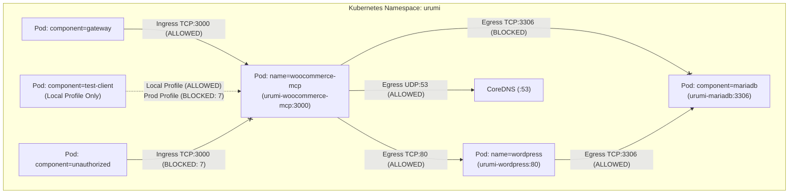

# Urumi Platform — Phase 3 Technical Context Material
## System Architecture, Technical Breakdown, Reproduction Guide & Operational State

> **Project**: Team MCP Gateway on Kubernetes with WooCommerce  
> **Phase**: Phase 3 (Custom WooCommerce MCP Server on Kubernetes)  
> **Repository**: [AdityaDRathore/MCP-Gateway-Kubernetes-Wcom](https://github.com/AdityaDRathore/MCP-Gateway-Kubernetes-Wcom)  
> **Target Runtime**: Kubernetes K3s `v1.37.1` on Ubuntu 24.04 LTS (`x86_64`)  
> **Release**: `urumi-store` (Namespace: `urumi`)  
> **Last Updated**: October 2026  

---

## 1. Executive Summary & Purpose

This document provides the **authoritative technical reference** for the complete state of the Urumi Platform following the successful completion and closure of **Phase 3: Custom WooCommerce MCP Server on Kubernetes** (Gates G0 through G8).

While its companion document [`Project Study Material.md`](Project%20Study%20Material.md) serves as an in-depth conceptual textbook explaining *why* technologies were chosen and *how* they function under the hood, this document is a **concrete, rigorous technical reference** containing:
- Complete monorepo file and directory inventory reflecting all Phase 3 additions.
- Exact Kubernetes workload specifications, container security contexts, resource metrics, and network boundaries.
- The step-by-step reproduction guide to build, deploy, test, and audit the MCP server from scratch.
- Full empirical verification data across unit, protocol, live integration, and in-cluster test suites.
- Explicit governance tracking of the Technical Lead qualifications regarding production image registry publication and digest pinning.
- The technical interface contract required for **Phase 4: Team MCP Gateway Core**.

---

## 2. Repository Layout & File Inventory

```
MCP-Gateway-Kubernetes-Wcom/
├── .dockerignore                                     # Excludes node_modules, .git, .secrets from Docker context
├── .env.example                                      # Master environment variable template for local development
├── .gitignore                                        # Ignores node_modules, build artifacts, and .secrets/
├── .nvmrc                                            # Pins Node.js version to 24 (v24.20.0)
├── package.json                                      # Monorepo root manifest with npm workspaces (apps/*, packages/*)
├── package-lock.json                                 # Pinned root dependency tree
├── tsconfig.base.json                                # Base TypeScript compiler configuration
├── README.md                                         # Public project README with Phase 3 architecture & setup guide
├── apps/
│   └── woocommerce-mcp/                              # Phase 3: Custom WooCommerce MCP Server
│       ├── Dockerfile                                # Multi-stage Dockerfile (Node 24 Alpine, non-root UID 10001)
│       ├── package.json                              # Locked dependencies (@modelcontextprotocol/sdk@1.32.1)
│       ├── tsconfig.json                             # Strict TypeScript configuration
│       ├── vitest.config.ts                          # Vitest configuration for unit, protocol, and integration tests
│       ├── src/
│       │   ├── index.ts                              # Application entrypoint & UNIX signal listeners (SIGTERM/SIGINT)
│       │   ├── server.ts                             # Express app, /health probe, and Streamable HTTP transport
│       │   ├── config.ts                             # Zod-validated environment configuration (fail-fast startup)
│       │   ├── logging/
│       │   │   └── logger.ts                         # Structured single-line JSON logging with secret/PII redaction
│       │   ├── woocommerce/
│       │   │   ├── client.ts                         # Authenticated WooCommerce REST client (10s AbortController)
│       │   │   ├── oauth.ts                          # RFC 5849 OAuth 1.0a HMAC-SHA256 signature generator
│       │   │   ├── errors.ts                         # Typed domain errors & safe status code mappers
│       │   │   ├── schemas.ts                        # Upstream WooCommerce response Zod schemas
│       │   │   └── mappers.ts                        # Output projections & PII scrubbing functions
│       │   ├── validation/
│       │   │   ├── products.ts                       # Zod input validation schemas for product tools
│       │   │   └── orders.ts                         # Zod input validation schemas for order tools
│       │   └── tools/
│       │       ├── index.ts                          # MCP tool registry registering exactly 5 tools
│       │       ├── products/
│       │       │   ├── list-products.ts              # Tool: list_products
│       │       │   └── create-product.ts             # Tool: create_product (with SKU conflict pre-check)
│       │       └── orders/
│       │           ├── list-orders.ts                # Tool: list_orders (with date bound validation)
│       │           ├── get-order.ts                  # Tool: get_order (strictly zero PII)
│       │           └── update-order-status.ts        # Tool: update_order_status (with no-op detection)
│       └── test/
│           ├── unit/                                 # 46 Vitest unit tests (validation, OAuth, projections)
│           ├── protocol/                             # 35 Vitest protocol tests (Streamable HTTP, handshake)
│           └── integration/                          # 39 Vitest live integration tests (real store calls)
├── infra/
│   └── helm/
│       └── urumi-platform/                           # Unified Kubernetes Helm chart
│           ├── Chart.yaml                            # Helm chart metadata (v1.0.0)
│           ├── values.yaml                           # Baseline defaults with MCP stanza and networkPolicy
│           ├── values-local.yaml                     # Local profile (nip.io:8080, allowTestClient: true)
│           ├── values-prod.yaml                      # Production profile (port 443, allowTestClient: false)
│           └── templates/
│               ├── mcp-deployment.yaml               # Deployment for urumi-woocommerce-mcp (probes, non-root)
│               ├── mcp-service.yaml                  # ClusterIP Service on port 3000 (targetPort http)
│               ├── networkpolicy.yaml                # NetPols for MCP, WordPress, and MariaDB (kube-router)
│               ├── wordpress-deployment.yaml         # Deployment for WordPress 7.1.3
│               ├── wordpress-service.yaml            # ClusterIP Service for WordPress on port 80
│               ├── wordpress-pvc.yaml                # 1Gi PVC on local-path for WordPress
│               ├── mariadb-statefulset.yaml          # StatefulSet for MariaDB 11.4.5
│               ├── mariadb-service.yaml              # ClusterIP Service for MariaDB on port 3306
│               ├── mariadb-pvc.yaml                  # 1Gi PVC on local-path for MariaDB
│               └── ingress.yaml                      # Traefik Ingress routing shop.127.0.0.1.nip.io:8080
├── docs/
│   ├── architecture.md                               # Updated 4-layer architecture & resource metrics
│   ├── requirements-traceability.md                  # Requirements matrix (WMC-01..08 marked Verified)
│   ├── decisions/
│   │   ├── ADR-001 through ADR-006                   # Phase 1 and 2 Architecture Decision Records
│   │   └── ADR-007-in-cluster-rest-api-authentication.md # Gate G1: In-Cluster OAuth 1.0a HMAC-SHA256
│   └── phase-3/
│       ├── Urumi_Phase_3_Master_Technical_Roadmap_and_Checklist.md # Master Phase 3 specification
│       ├── image-lock.md                             # Image tags, config IDs, and containerd resolution
│       ├── operational-runbook.md                    # Platform operations, restart, and troubleshooting
│       ├── verification-runbook.md                   # Reproducible audit and verification guide
│       ├── five-tool-contract.md                     # Complete interface specification for the 5 tools
│       ├── security-and-deployment-readiness-register.md # Auditable governance register
│       ├── phase-4-readiness-review.md               # Formal Phase 4 architecture blueprint
│       ├── gate-g6-completion-report.md              # Gate G6 completion report (remediated)
│       ├── gate-g7-completion-report.md              # Gate G7 end-to-end acceptance report
│       └── phase-3-execution-log.md                  # Comprehensive chronological engineering log
└── documentation/
    ├── phase 1/                                      # Phase 1 Study and Technical Context guides
    ├── phase 2/                                      # Phase 2 Study and Technical Context guides
    └── phase 3/                                      # This phase
        ├── Project Study Material.md                 # Conceptual deep-dive textbook for Phase 3
        └── Technical Context Material.md             # This document: Authoritative technical reference
```

---

## 3. Cluster Topology & Runtime Workload Specifications

### 3.1 Host & Cluster Baseline
- **Host OS:** Ubuntu 24.04 LTS (`x86_64`, Linux kernel `7.0.0-38-generic`)
- **Node.js:** `v24.20.0` (Pinned LTS) | **npm:** `11.19.0`
- **Kubernetes Engine:** `k3d v5.8.3` running `rancher/k3s:v1.37.1-k3s1` (0 minor version skew with client `kubectl v1.37.1`)
- **Host Port Bindings:**
  - `80/TCP`: Bound to host system `nginx/1.24.0` (Untouched).
  - `3001/TCP`: Bound to host system `Wekan` (Untouched).
  - `8080/TCP`: Bound to k3d Traefik loadbalancer (`shop.127.0.0.1.nip.io`).
  - `8443/TCP`: Bound to k3d Traefik loadbalancer for HTTPS.

### 3.2 Active Pods in Namespace `urumi`

```text
NAME                                         READY   STATUS    RESTARTS   AGE
pod/urumi-mariadb-0                          1/1     Running   0          24h
pod/urumi-woocommerce-mcp-69dc88fbcb-28cm9   1/1     Running   0          45m
pod/urumi-wordpress-d994966c6-pt8cc          1/1     Running   0          24h
```

### 3.3 Active Services in Namespace `urumi`

| Service Name | Type | ClusterIP | Internal Port | External Exposure |
|---|---|---|---|---|
| `urumi-mariadb` | ClusterIP | `10.43.48.147` | `3306/TCP` | **None** (Reachable only by WordPress) |
| `urumi-wordpress` | ClusterIP | `10.43.146.205` | `80/TCP` | Routed via Traefik Ingress (`shop.127.0.0.1.nip.io:8080`) |
| `urumi-woocommerce-mcp` | ClusterIP | `10.43.192.177` | `3000/TCP` | **None** (Zero Ingress, Zero NodePort) |

### 3.4 Persistent Volume Claims in Namespace `urumi`

| PVC Name | Status | Volume | Capacity | StorageClass | Mount Path |
|---|---|---|---|---|---|
| `urumi-mariadb-pvc` | Bound | `pvc-58d7357d...` | 1 GiB | `local-path` | `/var/lib/mysql` |
| `urumi-wordpress-pvc` | Bound | `pvc-78d0d23b...` | 1 GiB | `local-path` | `/var/www/html` |

---

## 4. Workload Specification: `urumi-woocommerce-mcp`

### 4.1 Container Build & Identity
- **Repository / Tag:** `urumi-woocommerce-mcp:1.0.0`
- **Image Config ID (Local CRI):** `sha256:d831a5b6b4c3b21c6d930eece6e484c4ccebcbbcdf9bf00ccea98c61eb9fee6a`
- **Distribution Manifest Digest:** `N/A` (Local CRI image build and k3d import; not published to an external OCI registry).
- **Virtual Image Size:** 187 MB (Alpine Linux 3.21 + Node.js 24 + production `node_modules`).
- **Runtime User:** `mcpuser:mcpuser` (UID `10001`, GID `10001`).

### 4.2 Security Context & Kernel Boundaries
Enforced in `templates/mcp-deployment.yaml`:
```yaml
securityContext:
  runAsNonRoot: true
  runAsUser: 10001
  runAsGroup: 10001
  allowPrivilegeEscalation: false
  capabilities:
    drop:
      - ALL
  seccompProfile:
    type: RuntimeDefault
```

### 4.3 Resource Allocation & Empirical Metrics
Measured under live load via `kubectl top pod -n urumi`:

| Metric | Configured Request | Configured Limit | Empirical Usage (Live) | Budget Margin |
|---|---|---|---|---|
| **CPU** | 50m | 150m | **1m** | <1% of limit |
| **Memory** | 64 MiB | 128 MiB | **39 MiB** | <31% of limit (~89 MiB headroom) |

### 4.4 Health Check Probes
- **Startup Probe:** `httpGet: /health`, port 3000, `failureThreshold: 30`, `periodSeconds: 2` (60s startup grace).
- **Readiness Probe:** `httpGet: /health`, port 3000, `periodSeconds: 5`, `failureThreshold: 3`.
- **Liveness Probe:** `httpGet: /health`, port 3000, `periodSeconds: 10`, `failureThreshold: 3`.

---

## 5. NetworkPolicy Packet Filtering Architecture

Packet filtering is enforced at the Linux kernel level by K3s `kube-router` iptables rules:



### Profile Differences:
- **`values-local.yaml` (`allowTestClient: true`):** Permits pods labeled `app.kubernetes.io/component: test-client` to access port 3000 for local test verification.
- **`values-prod.yaml` (`allowTestClient: false`):** Completely eliminates the `test-client` block from rendered manifests. Ingress is restricted exclusively to `app.kubernetes.io/component: gateway`.

---

## 6. In-Cluster Cryptographic Authentication (ADR-007)

### Mathematical Parameters:
- **Protocol:** RFC 5849 One-Legged OAuth 1.0a
- **Signature Method:** `HMAC-SHA256`
- **Key Formulation:** `Consumer Secret + '&'`
- **Normalized Query Parameters:** `oauth_consumer_key`, `oauth_nonce`, `oauth_signature_method`, `oauth_timestamp`, `oauth_version=1.0`, plus request query params.

### Dual-URL Separation:
Because WordPress core validates OAuth signatures against its canonical `home_url()`, the client separates physical network routing from signature calculation:
- **`WOOCOMMERCE_BASE_URL`:** `http://urumi-wordpress.urumi.svc.cluster.local:80` (Network destination).
- **`WOOCOMMERCE_SITE_URL`:** `http://shop.127.0.0.1.nip.io:8080` (Cryptographic signature base string).

### Secret Mounting:
Credentials are mounted via `secretKeyRef` targeting pre-existing secret `urumi-woocommerce-api`:
- `WOOCOMMERCE_CONSUMER_KEY` $\leftarrow$ `secretKeyRef: { name: urumi-woocommerce-api, key: consumer-key }`
- `WOOCOMMERCE_CONSUMER_SECRET` $\leftarrow$ `secretKeyRef: { name: urumi-woocommerce-api, key: consumer-secret }`

---

## 7. The Five-Tool Contract & Verification Data

```text
┌────────────────────────┬────────┬─────────────────────────┬──────────────────────────┐
│ Tool Name              │ Method │ Upstream Endpoint       │ Input Constraints        │
├────────────────────────┼────────┼─────────────────────────┼──────────────────────────┤
│ list_products          │ GET    │ /wp-json/wc/v3/products │ page>=1, per_page 1..50  │
│ create_product         │ POST   │ /wp-json/wc/v3/products │ SKU regex, decimal price │
│ list_orders            │ GET    │ /wp-json/wc/v3/orders   │ after < before validated │
│ get_order              │ GET    │ /wp-json/wc/v3/orders/:id│ order_id positive integer│
│ update_order_status    │ PUT    │ /wp-json/wc/v3/orders/:id│ status allow-list enum   │
└────────────────────────┴────────┴─────────────────────────┴──────────────────────────┘
```

### Output PII Stripping Verification:
`get_order` and `list_orders` return projected data models asserting:
- `billing.*`: **100% OMITTED**
- `shipping.*`: **100% OMITTED**
- `customer_id`, `customer_ip_address`, `customer_user_agent`, `customer_note`: **100% OMITTED**

---

## 8. Complete System Reproduction Guide

Follow these exact commands to reproduce and verify Phase 3 on any clean system:

### 8.1 Build & Import Container Image
```bash
# 1. Switch to pinned Node version
nvm use 24.20.0

# 2. Build multi-stage Docker image
docker build -t urumi-woocommerce-mcp:1.0.0 apps/woocommerce-mcp

# 3. Import image into local k3d containerd cache
k3d image import urumi-woocommerce-mcp:1.0.0 -c urumi
```

### 8.2 Deploy via Helm
```bash
# Deploy local development profile
helm upgrade --install urumi-store infra/helm/urumi-platform \
  -n urumi \
  -f infra/helm/urumi-platform/values-local.yaml

# Wait for rollout
kubectl -n urumi rollout status deployment/urumi-woocommerce-mcp --timeout=120s
```

### 8.3 Run Automated Regression Matrix (120 Tests)
```bash
# Run unit tests (46 passed)
npm run test:unit --workspace=apps/woocommerce-mcp

# Run protocol tests (35 passed)
npm run test:protocol --workspace=apps/woocommerce-mcp

# Run live store integration tests (39 passed)
npm run test:integration --workspace=apps/woocommerce-mcp
```

### 8.4 Execute In-Cluster Protocol Verification
```bash
kubectl -n urumi run mcp-verifier --rm -it \
  --image=node:24-alpine \
  --restart=Never \
  --labels="app.kubernetes.io/component=test-client" \
  -- sh -c '
    npm install -g @modelcontextprotocol/sdk@1.32.1 > /dev/null 2>&1
    node -e "
      const { Client } = require(\"@modelcontextprotocol/sdk/client/index.js\");
      const { StreamableHTTPClientTransport } = require(\"@modelcontextprotocol/sdk/client/streamableHttp.js\");
      async function main() {
        const transport = new StreamableHTTPClientTransport(new URL(\"http://urumi-woocommerce-mcp:3000/mcp\"));
        const client = new Client({ name: \"verifier\", version: \"1.0.0\" });
        await client.connect(transport);
        const tools = await client.listTools();
        console.log(\"DISCOVERED:\" + tools.tools.map(t => t.name).join(\",\"));
        const prods = await client.callTool({ name: \"list_products\", arguments: { per_page: 5 } });
        console.log(\"MUG_FOUND:\" + prods.content[0].text.includes(\"URUMI-MUG-001\"));
        await client.close();
      }
      main().catch(err => { console.error(err); process.exit(1); });
    "
  '
```

### 8.5 Verify State Preservation via WP-CLI
```bash
kubectl -n urumi exec deployment/urumi-wordpress -- bash -c \
  "if [ ! -f /usr/local/bin/wp ]; then cp /var/www/html/wp-cli.phar /usr/local/bin/wp && chmod +x /usr/local/bin/wp; fi; \
   wp wc product list --user=1 --fields=id,name,sku,price,status --allow-root && \
   wp wc shop_order list --user=1 --fields=id,status,total,currency --allow-root"
```
**Expected Output:**
- Product 10: `URUMI-MUG-001` (₹299, `publish`)
- Product 11: `URUMI-MOUSE-001` (₹799, `publish`)
- Product 12: `URUMI-NOTE-001` (₹149, `publish`)
- Order #14: Status `processing`, Total `₹299.00`, Currency `INR`
- Exactly 3 products, exactly 1 order, zero lingering test fixtures.

---

## 9. Security & Deployment-Readiness Register (Governance Tracking)

| Item ID | Title | Severity | Production Status | Owner | Closure Criteria |
|---|---|---|---|---|---|
| **SEC-REG-01** | Registry Digest Pinning | **HIGH** | **BLOCKING FOR PROD** | DevOps Lead | Push image to OCI registry, capture distribution manifest digest, pin `values-prod.yaml` to `@sha256:...`. |
| **SEC-REG-02** | In-Cluster Transport Encryption | **MEDIUM** | **QUALIFIED (Single-Node)** | Security Architect | Deploy in-cluster mTLS or internal HTTPS with `cert-manager`. |
| **SEC-REG-03** | WooCommerce API Key Scoping | **MEDIUM** | **MITIGATED (App Sandboxed)** | Backend Engineer | Author MU-plugin restricting integration consumer key to specific endpoints. |

---

## 10. Phase 4 Technical Interface Contract (Handoff to Gateway Core)

When Phase 4 is authorized, the central **Team MCP Gateway** (`apps/gateway/`) will connect to the WooCommerce MCP server using the following verified interface contract:

- **Cluster DNS Target:** `http://urumi-woocommerce-mcp.urumi.svc.cluster.local:3000/mcp`
- **Transport Protocol:** Streamable HTTP (`POST /mcp`)
- **Required NetworkPolicy Label:** `app.kubernetes.io/component: gateway`
- **Expected Namespaced Tools:**
  - `woocommerce__list_products`
  - `woocommerce__create_product`
  - `woocommerce__list_orders`
  - `woocommerce__get_order`
  - `woocommerce__update_order_status`
- **Per-Upstream Timeout Budget:** 10,000 ms (enforced by Gateway `AbortController`)
- **Failure Mode:** Circuit breaker isolation. If `urumi-woocommerce-mcp` is unreachable, Gateway returns empty/unreachable tool status without crashing other upstreams (CRM, Tasks).
